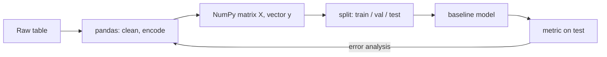

# Week 1 (Days 1-7): Python for ML: NumPy, pandas, plotting, and good data habits

**Month 1, Foundations.** Time budget: 7 days × 6 h = 42 h.

## Week goals
By the end of this week you can:
1. Explain in one sentence what "learning" means in ML: choose parameters that make a cost small on data.
2. Use NumPy arrays fluently: shapes, dtypes, indexing, views vs copies, broadcasting.
3. Write vectorised code, and explain *why* it is about 100-1000× faster than a Python loop (interpreter overhead, SIMD, BLAS), using the same mental model you use for C++/Rust.
4. Load, clean and summarise a table with pandas, and turn it into a model-ready matrix.
5. Make the three EDA plots you will use for six months: histogram, scatter, residual plot.
6. Split data into train/validation/test reproducibly, and recognise data leakage.

**Weekly project (Day 7):** an EDA report on a synthetic housing table plus three baselines, each scored by test MAE.



---

## Day 1: Setup, Python refresher, and what "learning" means
**Review today:** none (first day). Set up Anki and import `flashcards/month-01.csv` (tags `d1`).

### Block 1: Concept lesson (1h15)
**Intuition.** Picture a friend who sells flats in Chennai. She can usually guess a flat's price within a few lakh just from its size. She never wrote down a formula. Over the years she saw many (size, price) pairs and her brain fitted a rule. Machine learning does the same thing explicitly:
1. pick a family of rules, such as "price = w × size + b";
2. define what "a good rule" means: a **cost** that measures how wrong the rule is on known examples;
3. search for the parameters (w, b) that make the cost small.

That is the whole game. Every model in this course, a GPT included, follows these three steps. Only the family of rules gets richer, the costs get more careful, and the search gets cleverer.

**Small concrete example.** Here are seven flats. Size is in hundreds of sq ft and price is in lakh INR. The numbers are invented.

| size | 6 | 8 | 10 | 12 | 15 | 18 | 20 |
|---|---|---|---|---|---|---|---|
| price | 32 | 41 | 50 | 58 | 74 | 88 | 97 |

Price per size is about 5 for every flat, so "price ≈ 5 × size" is a decent first guess. Can we do better, and how would we even know?

**Plain-language maths.** A model is a function f(x) with knobs (parameters). For a line, f(x) = w·x + b. The *error* on one example is f(xᵢ) − yᵢ. We square it so that positive and negative errors don't cancel and big misses count more. Then we average over the m examples:

  MSE(w, b) = (1/m) Σᵢ (w·xᵢ + b − yᵢ)²

"Learning" means finding the w, b that minimise MSE. This week we search by brute force. In Week 3 we use calculus to search smartly. In Week 4 that becomes *gradient descent*, the engine of all deep learning.

**Supervised vs unsupervised vs RL, in one line each.** Supervised: you have inputs *and* correct answers (prices). Unsupervised: you only have inputs and look for structure (clusters). Reinforcement learning: you take actions and get rewards. Months 1-4 are mostly supervised. RL arrives in Month 5.

**Python you will use daily** (you know C++/Rust, so here are only the differences that matter):
- Everything is an object, and loops are slow (about 50-100 ns of interpreter work per iteration). This is the reason NumPy exists (Day 3).
- Idioms: list comprehensions, `zip`, `enumerate`, f-strings, `dataclass`, unpacking `a, b = pair`.
- Duck typing: there is no compile-time check on shapes or types. In ML the most common bug class is a *shape bug*. Print `.shape` constantly.

### Block 2: Worked example (45 min)
Compute MSE by hand for the guess w = 5, b = 0.

| x | y | 5x | error | error² |
|---|---|---|---|---|
| 6 | 32 | 30 | −2 | 4 |
| 8 | 41 | 40 | −1 | 1 |
| 10 | 50 | 50 | 0 | 0 |
| 12 | 58 | 60 | 2 | 4 |
| 15 | 74 | 75 | 1 | 1 |
| 18 | 88 | 90 | 2 | 4 |
| 20 | 97 | 100 | 3 | 9 |

The squared errors sum to 23, so MSE = 23/7 ≈ **3.286**. The lab prints exactly this, which is a good first sanity check that your code matches your hand calculation.

Now notice the pattern in the errors: small flats are *under*-predicted and big flats are *over*-predicted. That means the slope is a bit too steep and the intercept a bit too low. So try w = 4.6, b = 4.5. The lab reports MSE 0.604. Reading the *sign pattern* of the errors to decide which way to move the parameters is exactly what a gradient will do for us automatically on Day 18.

### Block 3: Coding lab (2h): `code/week-01/day01_python_refresher.py`
Setup (once):
```bash
cd ai-ml-course && python3 -m venv .venv && source .venv/bin/activate && pip install -r requirements.txt
python code/week-01/day01_python_refresher.py
```
The script defines a `Line` dataclass and an `mse` function, prints the hand guesses, and then **grid-searches** w ∈ [3.0, 6.9] and b ∈ [−5.0, 9.9] in steps of 0.1. Verified output on this box: grid best **MSE = 0.443 at w = 4.7, b = 3.1**, which predicts **68.9 lakh** for a 1,400 sq ft flat.

Lab tasks:
1. Make the grid 10× finer (step 0.01). How much does the best MSE improve, and how much longer does it take? (The work grows with the product of the two grid sizes. This is why grid search dies with more than 2-3 parameters.)
2. Replace MSE with mean *absolute* error. Does the best (w, b) move? Why might it?
3. Add an outlier: a flat of size 10 priced at 150. Re-run both costs and compare how much each best line moves. (Squared error is far more sensitive to outliers.)
4. Systems contrast: write the same grid search in Rust (two nested loops over i32 grid indices). Before you time it, predict the speed-up.

### Block 4: Practice problems (1h)
1. For w = 4, b = 10, compute the error on the flat of size 20 by hand. *Answer:* 4·20+10 = 90, so the error is 90 − 97 = −7.
2. Why square errors instead of summing them raw? *Answer:* raw errors cancel (+5 and −5 add to 0), and squaring also punishes big misses more.
3. If every price were multiplied by 2, what would happen to the best w and b? *Answer:* both double, and the MSE becomes 4×.
4. Classify each as supervised, unsupervised or RL: (a) grouping songs by similarity with no labels, (b) predicting tomorrow's app crashes from logs labelled crash/no-crash, (c) a robot learning to walk from a reward. *Answer:* U, S, RL.
5. Write a one-line comprehension that returns the prices of flats bigger than 12. *Hint:* `[y for x, y in zip(sizes, prices) if x > 12]`.
6. Grid search over 3 parameters with 100 values each takes how many cost evaluations? *Answer:* 10⁶. With 10 parameters it would be 10²⁰, which is hopeless. That motivates gradients.

### Block 5: Review (1h)
There are no earlier days to review yet, so spend 30 min writing your learning log and making 5 flashcards of your own. **Self-check:**
1. What are the three ingredients of "learning"? (model family, cost, search)
2. Write the MSE formula from memory.
3. What does an error pattern of "small houses under-predicted, big houses over-predicted" tell you?
4. Why does grid search not scale?
5. What is the most common class of bug in NumPy code? (shapes)

### Common mistakes / how to debug
- **Errors without a hand check.** Always verify one cost value by hand on tiny data, as we did with 3.286.
- **Wrong virtualenv.** `which python` should point to `.venv/bin/python`.
- **Integer division surprises** are gone in Python 3 (`/` is a float), but NumPy integer arrays still overflow silently (Day 2).

### What to do next
If the idea of a "cost surface" feels fuzzy, sketch the MSE as a function of w alone (fix b = 3.1) for w from 4 to 5.5. You will see a parabola, a bowl. Hold on to that picture: half of this course is about rolling down bowls.

---

## Day 2: NumPy arrays: shapes, dtypes, indexing, broadcasting
**Review today:** Day 1 (+1).

### Block 1: Concept lesson (1h15)
**Intuition.** A NumPy array is what you would write in C++: one contiguous buffer of a single dtype, plus a small header holding a **shape** and **strides** (bytes to jump per axis). That is all it is. Transposing, slicing and reshaping usually only change the header, so they create a *view* that shares the same memory. Arithmetic runs in compiled loops over the buffer.

**Concrete example.** `M = np.arange(12).reshape(3, 4)` is 12 int64 values. Its strides are `(32, 8)`: move 32 bytes to go down a row and 8 bytes to go across a column. `M.T` has strides `(8, 32)` and **shares memory** with M. The lab prints `True` for `np.shares_memory(M, M.T)`. If you have written image code with a row pitch, this is the same idea.

**Plain-language maths of broadcasting.** When two arrays meet in an operation, NumPy lines up their shapes *from the right*. Each pair of dimensions must be equal, or one of them must be 1, and a size-1 dimension is stretched (virtually, without copying) to match.
```
M            (3, 4)
row vector      (4,)  -> treated as (1, 4) -> stretched to (3, 4): added to every row
col vector   (3, 1)   -> stretched across the 4 columns
```
Standardising a feature matrix is the most common use. `(X - X.mean(axis=0)) / X.std(axis=0)` subtracts each column's mean. X has shape (n, d) and the mean has shape (d,), so broadcasting does it per column.

**Axis rule of thumb:** `axis=k` means "collapse dimension k". `X.mean(axis=0)` on (n, d) gives (d,), one mean per feature. Use `keepdims=True` when you want to broadcast the result back.

**dtypes.** float64 is the default and is safe for learning. float32 is what GPUs and phones use (machine epsilon ≈ 1.19e-7 vs 2.2e-16 for float64, as the lab prints). int8 is used for quantised models in Month 4. Integer arrays **wrap silently** like C: int8 100 + 120 = −36 in the lab, with only a warning.

### Block 2: Worked example (45 min)
Subtract each row's mean from M = [[0,1,2,3],[4,5,6,7],[8,9,10,11]].
- Row means: 1.5, 5.5 and 9.5. With keepdims the shape is (3, 1).
- Broadcasting (3,4) − (3,1) subtracts 1.5 from row 0, and so on.
- Every row becomes [−1.5, −0.5, 0.5, 1.5]. The lab prints exactly this.
Without keepdims, the means would have shape (3,). Lined up from the right against (3, 4), 3 ≠ 4, so you get an error. That is the lucky case. The unlucky case is a square matrix, where it silently subtracts *column*-wise. **Lesson: be explicit with keepdims or reshape.**

### Block 3: Coding lab (2h): `code/week-01/day02_numpy_basics.py`
Run it and read every printed line next to the code. Verified highlights: the standardised feature means are about 0 and the stds are 1. The `y - col` shape is `(3, 3)`, an *accidental broadcast*, which is the most dangerous bug in ML code (Day 23 shows it corrupting a gradient). The int8 overflow prints −36.

Tasks:
1. Build a (1000, 3) array of random features and compute the per-feature min and max, then min-max scale to [0, 1] in one expression.
2. Use boolean masking to set all negative values to 0 (this is ReLU, which you will meet on Day 62).
3. Using `np.shares_memory`, find out which of `M[1]`, `M[:, 1]`, `M[[0, 2]]` and `M.reshape(4, 3)` are views. (Fancy indexing copies.)
4. Make an RGB "image" `img = np.zeros((480, 640, 3), np.uint8)`, draw a red rectangle with slicing, and convert it to grayscale with a weighted sum over the last axis (`img @ [0.299, 0.587, 0.114]`). Watch the dtype.

### Block 4: Practice problems (1h)
1. Shapes: (5, 1) + (3,) = ? *Answer:* (5, 3).
2. (4, 3) + (4,) = ? *Answer:* error (3 vs 4 when aligned from the right).
3. How do you compute the mean of each *row* of X (n, d) as a column vector? *Answer:* `X.mean(axis=1, keepdims=True)`, shape (n, 1).
4. Strides of a C-ordered float32 array with shape (10, 20)? *Answer:* (80, 4).
5. Why is `a += 1` on a view dangerous? *Answer:* it modifies the original array.
6. Given `y` with shape (n,) and predictions `p` with shape (n, 1), what is the shape of `y - p`, and how do you fix it? *Answer:* (n, n). Fix with `p.ravel()` or `y[:, None]`.

### Block 5: Review (1h)
- **Spaced repetition, Day 1:** recompute the MSE for w = 5, b = 0 using NumPy in one line: `((5*x - y)**2).mean()`. You should get 3.286.
- **Self-check:**
  1. What two pieces of metadata turn a flat buffer into an N-d array?
  2. What is the broadcasting rule?
  3. What does `axis=0` do on (n, d)?
  4. Name one operation that returns a copy rather than a view.
  5. What is float32 epsilon roughly? (1e-7)

### Common mistakes / how to debug
- **Shape bugs:** add `assert X.shape == (n, d)` at function boundaries, just like preconditions in C++.
- **Silent broadcast between (n,) and (n,1):** always `ravel()` predictions.
- **Integer arrays in maths:** `np.array([1, 2, 3]) / 2` is fine, but `arr_int8 + arr_int8` overflows. Cast to float early.

### What to do next
Read the NumPy broadcasting page in the official docs (https://numpy.org/doc/stable/), then try predicting 10 shapes before you run them. Shape fluency pays off every day from here to transformers.

---

## Day 3: Vectorisation and the performance mindset
**Review today:** Day 2 (+1).

### Block 1: Concept lesson (1h15)
**Intuition.** In C++, a loop over a million floats costs about 1 ns per element and the compiler can use SIMD. In CPython, each iteration boxes Python objects, dispatches `*` dynamically, and touches reference counts, which costs tens of nanoseconds. **Vectorisation** means expressing the work as whole-array operations so the inner loop runs in compiled C/Fortran (and, for matrix products, in a tuned BLAS that uses SIMD, caches and multiple cores). You don't make Python faster. You make Python *do less*: it hands big chunks of work to native code.

**Concrete example (verified on this box, so run it yourself because your numbers will differ):**
- Dot product of two 1,000,000-element vectors: Python loop **24.4 ms**, `np.dot` **0.037 ms**, roughly **656×** faster, with the same answer.
- Pairwise squared distances, 400×300 points in 8-D: Python loops **97.4 ms**, broadcasting **6.0 ms**, the "matmul trick" **0.28 ms**.

**Plain-language maths of the matmul trick.** ‖p − q‖² = ‖p‖² + ‖q‖² − 2 p·q. The first two terms are cheap per-row norms. The third, for all pairs at once, is a single matrix product P Qᵀ. So an O(n·m·d) loop turns into one BLAS call, which is the fastest kind of code on any CPU or GPU. The same identity shows up later in k-means (Month 2) and in attention (Month 4: attention scores *are* Q Kᵀ).

**Memory layout matters (it's your C++ intuition again).** Arrays are row-major (C order) by default. `A.sum(axis=1)` on a C-ordered 3000×3000 array took 2.88 ms. Converting to Fortran order first and then summing took 62.5 ms, and most of that was the conversion copy. Contiguity, cache lines and avoiding copies all apply in NumPy just as they do in media pipelines.

**Is broadcasting always better?** Broadcasting `P[:, None, :] - Q[None, :, :]` materialises a 400×300×8 temporary (about 7.7 MB). For big inputs that temporary blows the cache or your RAM. The matmul formulation avoids it. **Vectorised ≠ free:** watch the size of temporaries.

### Block 2: Worked example (45 min)
Check the trick on p = (1, 2), q = (3, 5).
- Direct: (1−3)² + (2−5)² = 4 + 9 = **13**.
- Trick: ‖p‖² = 5, ‖q‖² = 34, p·q = 3 + 10 = 13, so 5 + 34 − 26 = **13**. ✓

Floating point: the trick subtracts large numbers, so for nearly identical points it can return tiny *negative* distances. The lab's maximum difference between the methods is 3.4e-15. When you need it, clip with `np.maximum(d, 0)` before `sqrt`.

### Block 3: Coding lab (2h): `code/week-01/day03_vectorisation_benchmark.py`
Run it three times and record the minimum times in your log. Tasks:
1. Vectorise this loop: `out[i] = x[i] if x[i] > 0 else 0.1*x[i]` (leaky ReLU). *Hint:* `np.where`.
2. Vectorise a moving average of window 5 with `np.convolve` (an audio-filter reflex) and compare it with a loop.
3. Use `time.perf_counter` to time `A @ B` for n = 256, 512, 1024, then compute GFLOP/s = 2n³ / t. (Day 9 compares this with Rust.)
4. Profile with `python -m cProfile -s cumtime day03_vectorisation_benchmark.py | head -20` to see where the time goes.

### Block 4: Practice problems (1h)
1. Why is `sum(a*b for a, b in zip(x, y))` slow even though Python's `sum` is implemented in C? *Answer:* the generator runs Python bytecode for every element, and that per-element interpreter overhead dominates.
2. How many bytes does a 1000×1000×3 float64 temporary use? *Answer:* 24 MB.
3. Rewrite `[[np.dot(a, b) for b in B] for a in A]` vectorised. *Answer:* `A @ B.T`.
4. When might a loop in NumPy be acceptable? *Answer:* over a small number of large chunks (for example epochs or batches), never over individual elements.
5. True or false: vectorised code is always more memory-efficient. *Answer:* false (temporaries).

### Block 5: Review (1h)
- **Day 2 (+1):** predict the shapes of (3,1)+(1,4), (2,3)*(3,), and `X.mean(1)` for X (5, 7).
- **Self-check:**
  1. What is the source of Python loop overhead?
  2. Write the identity behind the matmul distance trick.
  3. What is a risk of broadcasting with large arrays?
  4. Why might C-order vs F-order change speed?
  5. What is the formula for GFLOP/s of an n×n matmul? (2n³/t/1e9)

### Common mistakes / how to debug
- **Timing the first call** includes warm-up and allocation. Take the min over repetitions.
- **Comparing against the wrong baseline:** always check that the results match (`np.allclose`) before you celebrate a speed-up.
- **Negative squared distances** from the trick: clip them.

### What to do next
Whenever you write `for i in range(n)` over data, stop and ask: "Is this a reduction, a map, or a matmul?" Almost everything in ML is one of the three.

---

## Day 4: pandas for tabular ML data
**Review today:** Day 3 (+1), Day 1 (+3).

### Block 1: Concept lesson (1h15)
**Intuition.** Real data arrives as tables with named columns of mixed types (numbers, categories, dates) and holes in it. pandas is a labelled table on top of NumPy columns. The ML workflow is: **load → inspect → clean → engineer features → convert to a NumPy matrix X and vector y.** Models eat matrices, so pandas is the kitchen and NumPy is the plate.

**Concrete example.** Our synthetic table has 500 flats with `area_sqft`, `bedrooms`, `age_years` and `city` (Chennai, Bengaluru or Pune). Price comes from a known formula plus noise, which lets us later check whether a model recovers the truth. 25 ages are deliberately missing.

**Plain-language "maths" of cleaning:**
- **Missing values:** filling with the median is a robust guess that outliers can't drag around (unlike the mean).
- **Categorical → numbers:** "Pune" has no numeric value, and mapping Chennai=0, Bengaluru=1, Pune=2 invents an order that doesn't exist. **One-hot encoding** makes one 0/1 column per category, so the model learns a separate premium for each city.
- **Group-by** is split-apply-combine: split rows by key, compute a statistic, and combine the results into a table. It is the quickest way to check a hypothesis like "Bengaluru is pricier".
- **Leakage:** we create `price_per_sqft = price / area` for EDA. It is computed from the **target**, so it must never become a feature. The script drops it explicitly before building X.

### Block 2: Worked example (45 min)
From the verified run: the mean price by city is Bengaluru **77.2**, Chennai **62.6** and Pune **64.8** lakh, with 189, 207 and 104 flats. The generator added a +15 premium for Bengaluru and +5 for Pune. The observed Bengaluru − Chennai gap of 14.6 is close to 15, and noise plus random area differences explain the rest. The Pune − Chennai gap is 2.2, much less than 5. With only 104 Pune flats and noise std 6 per flat, plus other features varying, this is a reminder that **group means are noisy estimates, not truth**. Regression (Week 4) separates the effect of city from the effect of area.

Model-ready columns after one-hot (verified): `['area_sqft', 'bedrooms', 'age_years', 'city_Bengaluru', 'city_Chennai', 'city_Pune']`.

### Block 3: Coding lab (2h): `code/week-01/day04_pandas_basics.py`
It writes `code/week-01/out/housing_synth.csv`, which Day 7 uses. Tasks:
1. `df.info()`, `df.describe(include="all")`: which column has missing values?
2. Add a `size_band` column with `pd.cut(df.area_sqft, [0, 800, 1200, 1600, 5000])` and compute the mean price per band.
3. Try `drop_first=True` in `get_dummies`. Why would a linear model with an intercept want that? (Collinearity: the city columns sum to 1, which duplicates the intercept. See Day 10's conditioning.)
4. Load the same CSV with Python's `csv` module and compute the Chennai mean price by hand. Compare the code length.

### Block 4: Practice problems (1h)
1. Why is the median preferred over the mean for imputing skewed data? *Answer:* it is robust to outliers.
2. Which of these leak the target? (a) `rooms_per_floor`, (b) `price_rank`, (c) `days_on_market_before_sale` when predicting price at listing time. *Answer:* (b) definitely. (c) also, because it isn't known at prediction time.
3. How many columns does one-hot add for a category with k levels? *Answer:* k, or k−1 with drop_first.
4. `df.groupby("city")["price_lakh"].mean()` returns what type? *Answer:* a Series indexed by city.
5. What is the difference between `df.loc` and `df.iloc`? *Answer:* label-based vs position-based.

### Block 5: Review (1h)
- **Day 3 (+1):** rewrite the dot product timing from memory and get the speed-up order of magnitude.
- **Day 1 (+3):** what are the three ingredients of learning? Compute MSE for w=5, b=0 again without notes.
- **Self-check:**
  1. Why one-hot instead of integer codes?
  2. What is leakage? Give an example from today.
  3. What does split-apply-combine mean?
  4. How do you count missing values per column?
  5. Why convert to NumPy before modelling?

### Going deeper (optional, inside Block 4)
**Tidy data.** Hadley Wickham's "tidy data" idea fits ML perfectly: one row per observation, one column per variable, one table per kind of entity. Most of your pandas time is spent reshaping toward that form. `melt` turns wide data into long, and `pivot_table` turns long into wide. Before modelling, ask of every column: *would I know this value at prediction time?* If not, it is leakage (Day 6).

**Memory awareness.** `df.info(memory_usage="deep")` shows the real footprint. Converting a low-cardinality string column such as `city` to `category` dtype often cuts its memory by more than 10×, and it speeds up `groupby`. Downcasting float64 to float32 halves the memory, which is fine for features but think twice for targets and sums. These are the same habits you'd use for a media pipeline buffer: know your bytes.

**Mini exercise.** With `housing_synth.csv`, compute the median price per city, and the share of homes with missing values per column (`df.isna().mean()`). Write both into your learning log.

### Common mistakes / how to debug
- **SettingWithCopyWarning:** assign through `df.loc[rows, col] = …` or work on an explicit `.copy()`.
- **Silent dtype objects:** a numeric column read as strings (`object`/`str`) because of a stray "N/A". Use `pd.to_numeric(errors="coerce")`.
- **Imputing before splitting** leaks test-set statistics. From Day 6 onward, compute medians and means on the train split only.

### What to do next
Pick any CSV you care about (Android crash stats, your app's media metadata) and run today's checklist on it: shape, dtypes, missing values, a group-by, and one-hot encoding.

---

## Day 5: Plotting and exploratory data analysis (EDA)
**Review today:** Day 4 (+1), Day 2 (+3).

### Block 1: Concept lesson (1h15)
**Intuition.** Summary statistics can hide everything. Very different datasets can share the same mean, variance and correlation. Before modelling, *look*. Three plots answer most first questions:
1. **Histogram:** what values does a feature take? Is it skewed, does it have outliers, is it clipped?
2. **Scatter of feature vs target:** is the relationship roughly linear, curved, or missing?
3. **Residual plot** (after fitting a model): what is left over? If the residuals look like structureless noise around 0, the model has captured the pattern. If they show a shape (a U, a fan, clusters), the model is missing something.

**Concrete example (verified).** 300 flats with area ~ N(1200, 350) clipped at 350, and price = 0.05·area + noise (std 8). A straight-line fit gives slope **0.0506**, intercept **−0.88** and residual std **7.94**, close to the true 0.05, 0 and 8. The residual plot is a featureless band. ✓

Now a trap: y = x² + noise, fitted with a straight line. The residuals form a **U shape**. The lab measures this as corr(|x|, residual) = **0.956**, a very strong pattern. A U-shaped residual plot means the model is too simple (high bias), and the fix is a better feature (x²), not more data.

**Plain-language maths.** A residual is rᵢ = yᵢ − ŷᵢ. If the model is right and the noise is random, the residuals should have mean ≈ 0, no correlation with any feature, and roughly constant spread. Each way a residual plot can fail suggests a fix:
- curve → add non-linear features
- fan shape (spread grows with x) → model log(price) instead
- clusters → a missing categorical feature

### Block 2: Worked example (45 min)
Fit the line by hand to three points (1,1), (2,2), (3,5). The slope is cov(x,y)/var(x). The means are x̄ = 2 and ȳ = 8/3. cov = [(−1)(−5/3) + 0 + (1)(7/3)]/3 = 4/3 and var(x) = 2/3, so the slope is 2 and the intercept is 8/3 − 4 = −4/3. The predictions are 2/3, 8/3 and 14/3, so the residuals are **+1/3, −2/3, +1/3**. That is positive, negative, positive: a tiny U. Even three points hint at curvature. Check it with `np.polyfit([1,2,3],[1,2,5],1)`.

### Block 3: Coding lab (2h): `code/week-01/day05_matplotlib_eda.py`
Outputs: `out/day05_eda.png` (histogram, scatter with fit, residuals) and `out/day05_residual_pattern.png`. Tasks:
1. Add a log-scale histogram of price per sqft from Day 4's CSV.
2. Create a "fan" dataset: y = 0.05·area·(1 + 0.2·noise). Plot the residuals and see the fan. Then fit log(y) and re-plot.
3. Fix the U by adding x² as a feature: `np.polyfit(x, y, 2)`. Confirm the residual pattern disappears.
4. Make a 2×2 subplot figure: one histogram per numeric housing feature.

```
Residual-plot reading guide
  random band        ->  ok
  U / arch           ->  add non-linear feature
  fan / funnel       ->  transform target (log) or model variance
  separate clusters  ->  missing categorical feature
```

### Block 4: Practice problems (1h)
1. You see right-skewed prices with a long tail. Name two things to try. *Answer:* a log transform, and robust metrics (MAE).
2. The residuals vs *time* show a trend. What does that mean? *Answer:* drift or a missing time feature.
3. Why plot the residuals vs prediction ŷ and not only vs x? *Answer:* with many features, ŷ summarises them all.
4. A scatter shows no pattern at all between feature and target. Is the feature useless? *Hint:* not necessarily. It could matter in interaction with another feature.
5. What does `plt.tight_layout()` fix? *Answer:* overlapping labels.

### Block 5: Review (1h)
- **Day 4 (+1):** one-hot encode a list of 4 cities by hand.
- **Day 2 (+3):** standardise a column of [2, 4, 6] by hand. *Answer:* the std is 1.633, so the values are [−1.22, 0, 1.22].
- **Self-check:**
  1. What are the three EDA plots?
  2. What should a good residual plot look like?
  3. What does a U-shaped residual plot mean?
  4. What does a fan shape mean?
  5. Why do summary statistics alone mislead?

### Going deeper (optional, inside Block 4)
**A five-plot EDA checklist** that you can reuse on every new dataset:
1. a histogram of the target (skew? would a log transform help?)
2. a histogram per numeric feature (outliers, impossible values, units)
3. a scatter of each feature vs the target (linear? curved? clustered?)
4. a correlation heatmap (redundant features, a preview of conditioning on Day 10)
5. counts per category (rare levels you may need to merge)

**Log scales.** Prices, incomes and file sizes are usually right-skewed: a few huge values stretch the axis. `plt.yscale("log")`, or modelling log(price), often turns a curved relationship into a straight one. That's also why errors on log-targets read as *percentages*.

**Small multiples beat one busy plot.** `fig, axes = plt.subplots(2, 3)`, with one feature per panel and shared y-axes, lets the eye compare quickly. Always label axes with units. Six months from now, "x" and "y" will mean nothing to you.

### Common mistakes / how to debug
- **Plots not appearing on a headless box:** we use the Agg backend and save PNGs (`code/common.py`).
- **Over-plotting** with many points: use `alpha=0.2` or `hexbin`.
- **Forgetting axis labels and units.** In six weeks you will not remember what "x" meant.

### What to do next
Make "plot residuals" a reflex after *every* fit for the rest of the course. Andrew Ng-style error analysis (Day 28) is just a more organised version of staring at residuals.

---

## Day 6: Train/validation/test splits, reproducibility, and leakage
**Review today:** Day 5 (+1), Day 3 (+3).

### Block 1: Concept lesson (1h15)
**Intuition.** A model that is graded on the data it studied is like a student who has seen the exam paper: the score means nothing. We hold back data the model never sees during training:
- **Train set:** used to fit the parameters.
- **Validation (dev) set:** used to make *choices* such as features, learning rate, model type. It gets "used up" slowly as you peek at it.
- **Test set:** used once at the end for an honest estimate. If you tune on it, it has become another dev set.

Typical split: 60/20/20 for small data. With millions of examples, 98/1/1 is fine, because 1% is already plenty.

**Concrete example (verified).** We use 300 points with y = 3x + noise (std 1). The splits are 180/60/60 with `random_state=0`. The train MSE is 0.927, val 1.409 and test 0.917. All are near the noise variance of 1.0. The 1.409 on validation is just sampling noise from 60 points: a single number from a small set is uncertain.

**Reproducibility.** The same seed gives the same split, and the lab prints the identical first value 0.4724 twice. Seed 1 gives −1.553. Record seeds, library versions and data versions. ML results are only half-reproducible by default, so build the habit now.

**Leakage, the silent killer.** Here is the demo in the lab. We take 100 rows, **2000 pure-noise features**, and a pure-noise target. If we choose the 10 "best" features using all 100 rows, including the 20 we later test on, a linear model gets test **R² = 0.506**. It looks predictive, yet it is noise. If we choose features using only the 80 training rows, the test R² is **−0.10**: worse than predicting the mean, which is the truth. Any decision that uses test data (feature selection, scaling statistics, imputation medians, deduplication) leaks.

**Plain-language maths.** The test error estimates the **generalisation error**, the expected error on new data from the same distribution. It is a sample mean, so its uncertainty shrinks like 1/√n_test (you will see this on Day 20 with the CLT).

### Block 2: Worked example (45 min)
Why does selecting on all the data inflate R²? With 2000 noise features and 100 rows, some features correlate with y by chance. The typical |corr| from pure chance is about 1/√100 = 0.1, and the maximum over 2000 features is much bigger. When the selection uses the test rows, it picks features whose chance correlations *include* the test rows, so those correlations "work" on the test set too. Selection on train only picks chance correlations that are *independent* of the test rows, and they vanish there. Rule: **the test set must be invisible to every decision.**

### Block 3: Coding lab (2h): `code/week-01/day06_splits_reproducibility.py`
Tasks:
1. Repeat the clean experiment with 20 different seeds and plot a histogram of test R². What is the spread? (This is why one split can mislead. Cross-validation comes on Day 33.)
2. Add a time order: generate data where y drifts upward over the row index. Compare a random split with a "past → future" split. Which is honest for forecasting?
3. Make a deliberately leaky scaler: fit `(X - mean)/std` on all data and then split. On this data the effect is tiny. Explain why it can be big on small or skewed data.
4. Write a `split(df, seed)` helper that saves the row indices to disk so the split can be reproduced exactly.

### Block 4: Practice problems (1h)
1. You tuned 50 hyperparameter combinations on the test set. Is the reported test score optimistic or pessimistic? *Answer:* optimistic.
2. You have 1M images. Suggest a split. *Answer:* something like 98/1/1.
3. Patient data has several scans per patient. How should you split? *Answer:* by patient (group split), otherwise near-duplicates leak.
4. Is computing the mean for imputation before splitting a leak? *Answer:* yes, a small one.
5. Train MSE 0.1, val MSE 5.0. What is likely going on? *Answer:* overfitting (high variance), or a bug in the val pipeline.

### Block 5: Review (1h)
- **Day 5 (+1):** sketch the four residual patterns from memory.
- **Day 3 (+3):** explain to an imaginary colleague why `A @ B` beats loops, using the words *interpreter*, *SIMD* and *cache*.
- **Self-check:**
  1. What is each of train, val and test for?
  2. Give two forms of leakage.
  3. Why record seeds?
  4. How does test error uncertainty scale with n?
  5. When should you split by group or time?

### Common mistakes / how to debug
- **Too-good-to-be-true results:** suspect leakage first. Look for target-derived features, duplicates across splits, and future information.
- **Re-shuffling every run** without a seed makes debugging impossible.
- **Stratify classification splits** (`stratify=y`) so that rare classes appear in every split (used on Day 26).

### What to do next
Write a "split contract" at the top of every project: how you split, which seed, what the test set is for, and when you will look at it (once).

---

## Day 7: Week 1 project: EDA report and baselines, plus Quiz 1
**Review today:** Day 6 (+1), Day 4 (+3).

### Block 1: Concept lesson: baselines (1h15)
**Intuition.** Before building a clever model, ask: *what score does a dumb model get?* A baseline tells you whether your model is useful at all. It also catches bugs: if a fancy model loses to "predict the mean", something is broken. In production work, a baseline (sometimes human-level performance) is also how you decide whether the project is worth doing.

Three baselines for regression:
1. Predict the train mean for everyone.
2. Predict the per-group mean (per city).
3. A one-feature line on the strongest feature.

**Metric: mean absolute error (MAE)** = (1/m) Σ|yᵢ − ŷᵢ|. It is in the target's units (lakh), so it is easy to explain to a non-ML colleague: "on average we're off by X lakh".

### Block 2: Worked example (45 min)
Verified results on the 100-flat test split (400 train) of the synthetic table:

| Baseline | Test MAE (lakh) |
|---|---|
| Predict the mean | 16.96 |
| Mean per city | 15.88 |
| Line on area only | **8.77** |

Interpretation: city alone helps a little (−1.1 lakh), while area alone halves the error. This matches the correlations the script prints: area **0.851**, age **−0.283**, bedrooms **0.193**. Note that price_per_sqft shows 0.271, but it is a target-derived column, so its correlation is meaningless for modelling. The noise std in the generator is 6, so the best possible MAE is about 6·√(2/π) ≈ 4.8 lakh. The line on area is at 8.77, so there is room to improve with more features (Week 4 gets close to that floor).

### Block 3: Coding lab: project (2h): `code/week-01/day07_week_project.py`
Deliverable: `notes/week01_report.md` (about 1 page) containing:
1. A data description (rows, columns, missing values, how you imputed them).
2. Three plots: the price histogram, price vs area, and the boxplot by city (`out/day07_price_by_city.png`).
3. The baseline table above, reproduced by *your* run.
4. Two hypotheses for what will improve the model, and why.
Stretch: add a fourth baseline, "line on area + city one-hot", using `np.linalg.lstsq`. Check that it beats 8.77.

**Suggested timeline (2h).**
- 0:00-0:20: re-run the script and confirm your baseline table matches the worked example exactly. The data generator is seeded, so any difference is a bug in your copy.
- 0:20-0:50: make the three plots. Give every plot a title, labelled axes with units (lakh, sq ft), and a one-sentence takeaway written under it in the report.
- 0:50-1:20: write the data description. Cover where the data came from (synthetic, and say so), the row and column counts, the missing values and your imputation choice, and the columns you dropped and why (price_per_sqft is derived from the target).
- 1:20-1:45: baselines and the stretch baseline.
- 1:45-2:00: hypotheses and a proofread. Delete any sentence that is not backed by a number or a plot.

**Rubric (self-grade out of 20).**

| criterion | points |
|---|---|
| Baseline table reproduced from your own run, test split stated | 5 |
| Three plots, each with axes, units and a written takeaway | 4 |
| Data description covers missing values, imputation and dropped columns with reasons | 4 |
| Two hypotheses, each tied to evidence (a correlation or a plot) | 3 |
| Noise-floor reasoning: compare 8.77 with the ≈4.8 floor and say what it implies | 2 |
| Report fits on one page and makes no unsupported claims | 2 |

16+ means you are ready for Week 2. Below 12, redo the weakest section before moving on.

**What separates a strong report from a weak one.** A weak report says "area is important". A strong one says "area alone cuts test MAE from 16.96 to 8.77 lakh, and its correlation with price is 0.851, so the next model should keep area and add city and age". The second is checkable, and it tells the reader what to do next.

### Block 4: Practice: Quiz 1 (1h), closed book, answers at the end of this file

### Block 5: Review (1h)
- **Day 6 (+1):** re-explain the leakage demo numbers (0.506 vs −0.10).
- **Day 4 (+3):** why was `price_per_sqft` dropped?
- **Self-check:**
  1. Why build baselines?
  2. Define MAE.
  3. What is the noise floor of MAE for Gaussian noise with std σ? (σ√(2/π))
  4. Which feature correlated most with price?
  5. What would a model *losing* to the mean baseline suggest?

### Going deeper (optional)
**Writing a good EDA report.** Structure it as: question → data description (rows, columns, provenance) → data quality issues and how you fixed them → three key plots with one-sentence takeaways → baselines table → next steps. Keep each claim tied to a number or a plot that you produced. That habit makes later model reports trustworthy.

**Why the median baseline can beat the mean on MAE.** The median minimises the mean *absolute* error, while the mean minimises the mean *squared* error. So report both baselines, and judge each model with the metric that matches its baseline. This pairing returns on Day 21 (MLE under Gaussian vs Laplace noise).

### Common mistakes / how to debug
- Reporting only your model's score without a baseline.
- Comparing MAE from one split with MSE from another. Fix the metric and the split once.

### What to do next
Next week is linear algebra: the language in which "fit many features at once" becomes a single line of code.

---

## Weekly quiz: Week 1 (answers below)
1. Name the three ingredients of an ML learning procedure.
2. MSE for predictions [2, 4] against targets [1, 6]?
3. Shape of (7, 1) − (7,)?
4. Which is a view: `M.T`, `M[[0, 1]]`, `M[:, ::2]`?
5. Why is a Python loop dot product hundreds of times slower than `np.dot`?
6. State the identity used to compute all pairwise squared distances with one matmul.
7. Why one-hot encode `city` rather than using codes 0/1/2?
8. What does a U-shaped residual plot mean, and what is the fix?
9. What is the validation set for, and what is the test set for?
10. In the leakage demo, why did "select features on all rows" give positive test R² on pure noise?
11. What MAE did "predict the mean" get in the Day 7 run, and which baseline won?
12. int8: what is 100 + 120?

### Answers
1. Model family, cost function, search/optimisation.
2. ((1)² + (−2)²)/2 = 2.5.
3. (7, 7), an accidental broadcast.
4. `M.T` and `M[:, ::2]` (basic slicing). Fancy indexing `M[[0,1]]` copies.
5. Per-element interpreter overhead (boxing, dynamic dispatch) vs compiled, SIMD, BLAS loops.
6. ‖p−q‖² = ‖p‖² + ‖q‖² − 2p·q, so all pairs are norms plus −2PQᵀ.
7. Integer codes impose a fake order and spacing. One-hot gives each city its own coefficient.
8. The model is too simple (missing non-linearity). Add features such as x², or use a more flexible model.
9. Validation is for choices and tuning. Test is used once, for an honest final estimate.
10. The selection used chance correlations that included the test rows, so they "held up" on those same rows.
11. 16.96 lakh. The line on area won (8.77).
12. −36 (wrap-around), with an overflow warning.
