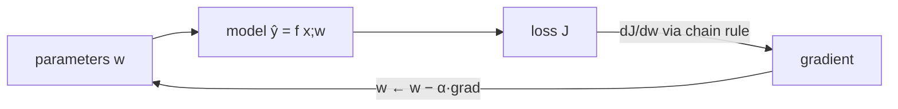

# Week 3 (Days 15-21): Calculus and probability for ML

**Month 1, Foundations.** Time budget: 42 h. Optional reading: *Mathematics for Machine Learning*, ch. 5 (vector calculus) and ch. 6 (probability) (https://mml-book.github.io/).

## Week goals
1. Read a derivative as "the slope: how much the output changes per unit nudge of the input", and compute it analytically and numerically.
2. Compute gradients of multivariable functions, including the vectorised MSE gradient Xᵀ(Xw − y)/m, and **gradient-check** them.
3. Apply the chain rule on a computational graph. Build a ~40-line reverse-mode autograd and train a line with it.
4. Run gradient descent and diagnose learning rates (too small, good, divergent) from the curvature.
5. Use probability, Bayes' rule, distributions, expectation and variance, and the CLT, checking each by simulation.
6. Derive maximum-likelihood estimates and show that least squares = MLE under Gaussian noise.

**Weekly project (Day 21):** MLE three ways (closed form, grid, gradient ascent), with a write-up that connects MLE to the cost functions of Week 4.



---

## Day 15: Derivatives and numerical differentiation
**Review today:** Day 14 (+1), Day 12 (+3), Day 8 (+7).

### Block 1: Concept lesson (1h15)
**Intuition.** You're standing on a hillside in fog. You can't see the valley, but you can feel the slope under your feet. The derivative is that slope. If the ground drops to your left, step left. ML training is exactly this: the "hill" is the cost J(w), and the derivative dJ/dw says which way and how steeply the cost changes when you nudge the parameter w.

**Concrete example.** One flat has x = 3 (hundred sq ft) and price y = 12. The model is ŷ = w·x and the cost is J(w) = (3w − 12)². Verified lab output:
- w = 2: J = 36 and dJ/dw = **−36**. The slope is negative, so increasing w lowers the cost: **move w up**.
- w = 4: J = 0 and dJ/dw = 0, the bottom.
- w = 5: J = 9 and dJ/dw = **+18**, so move w down.
Note that the magnitude is bigger the further you are from the optimum, so steps naturally shrink as you approach it.

**Plain-language maths.**
- Definition: f′(x) = lim_{h→0} [f(x + h) − f(x)]/h, the "rise over run" for an infinitesimal run.
- Rules you need: (xⁿ)′ = n xⁿ⁻¹, (eˣ)′ = eˣ, (ln x)′ = 1/x, sum rule, product rule, and the chain rule (Day 17).
- For J(w) = (wx − y)²: J′(w) = 2(wx − y)·x. Read it as "2 × error × input". This "error times input" shape appears in every gradient this month.

**Numerical differentiation** is your unit test for calculus. **Central difference** [f(x + h) − f(x − h)]/(2h) has error ~h², while forward difference has error ~h. Verified for f(x) = x³ − 2x at x = 1.5 (true f′ = 4.75):

| h | forward error | central error |
|---|---|---|
| 1e-1 | 4.6e-1 | 1.0e-2 |
| 1e-3 | 4.5e-3 | 1.0e-6 |
| 1e-5 | 4.5e-5 | **1.3e-10** |
| 1e-8 | 3.8e-8 | 2.9e-8 |
| 1e-12 | 4.2e-4 | 4.2e-4 |

Making h smaller only helps up to a point. Below about 1e-5 (central) the error *grows* again because of floating-point cancellation: f(x + h) and f(x − h) agree in almost all digits. This is the float64 epsilon from Day 2 at work. **Use h ≈ 1e-5 to 1e-6 with central differences in float64.**

### Block 2: Worked example (45 min)
Differentiate f(x) = x³ − 2x: f′(x) = 3x² − 2, so f′(1.5) = 3·2.25 − 2 = 4.75.
Central difference with h = 0.1: f(1.6) = 4.096 − 3.2 = 0.896 and f(1.4) = 2.744 − 2.8 = −0.056. So [0.896 − (−0.056)]/0.2 = 0.952/0.2 = **4.76**. The error is 0.01, matching the table ✓. (For a cubic the central-difference error is exactly h²·f‴/6 = 0.01·6/6 = 0.01.)

### Block 3: Coding lab (2h): `code/week-03/day15_derivatives.py`
Tasks:
1. Plot both error curves vs h on log-log axes. Read the slopes off the plot (1 for forward, 2 for central) and find the "valley" of best h.
2. Repeat in float32 (`np.float32`). Where is the best h now? (Larger, about 1e-2 to 1e-3, because float32 epsilon is ~1e-7.)
3. Differentiate the sigmoid σ(z) = 1/(1 + e^(−z)) numerically and check it against σ(z)(1 − σ(z)). You will need this on Day 26.
4. Write `numderiv(f, x, h=1e-5)` and keep it in a `utils.py`. You'll reuse it to gradient-check everything.

### Block 4: Practice problems (1h)
1. d/dx of 5x⁴ − x + 7? *Answer:* 20x³ − 1.
2. d/dx of e^(2x)? *Answer:* 2e^(2x) (chain rule preview).
3. J(w) = (2w − 6)². Find the minimiser and J′(1). *Answer:* w = 3, and J′(1) = 2(2 − 6)·2 = −16.
4. Why is central difference more accurate? *Hint:* the even-order error terms of the Taylor expansion cancel.
5. Which way should w move if dJ/dw = +0.3? *Answer:* down (decrease w).
6. d/dx of ln(1 + eˣ) (softplus)? *Answer:* eˣ/(1 + eˣ) = σ(x).

### Block 5: Review (1h)
- **Day 14 (+1):** what is the storage formula for rank k, and what errors did k = 2/8/32 give?
- **Day 12 (+3):** explain PCA as SVD in 3 sentences.
- **Day 8 (+7):** compute the cosine of (1, 2) and (2, 4) (1.0).
- **Self-check:**
  1. Give the derivative as a slope, in words.
  2. Derivative of (wx − y)² with respect to w?
  3. Why does a too-small h hurt?
  4. Which h works best for central differences in float64?
  5. Derivative of the sigmoid?

### Common mistakes / how to debug
- Differentiating with respect to the wrong variable. In ML we differentiate the **cost** with respect to the **parameters**, with the data held fixed.
- Using h = 1e-12 "for accuracy" gives garbage from rounding.

### What to do next
Every time you derive a gradient this course, check it numerically. It takes about 2 minutes and saves days.

---

## Day 16: Partial derivatives, gradients, gradient checking
**Review today:** Day 15 (+1), Day 13 (+3), Day 9 (+7).

### Block 1: Concept lesson (1h15)
**Intuition.** With two parameters, the cost is a landscape over a 2-D map. Each **partial derivative** is the slope if you walk only east (∂J/∂w₁) or only north (∂J/∂w₂). Stack them and you get the **gradient**, an arrow pointing *uphill*, in the steepest direction, with a length equal to the steepness. Gradient descent walks against that arrow.

**Concrete example (verified).** f(x, y) = x² + 3y² + xy at (1, −2):
- ∂f/∂x = 2x + y = 0
- ∂f/∂y = 6y + x = −11
- gradient = (0, −11). Numerically we get the same values, with relative error **7e-11**.
- One step against the gradient with size 0.1: f goes from **11 → 2.53**.

**Plain-language maths: the MSE gradient.** For m examples, X (m × n), weights w (n), and J(w) = (1/2m)‖Xw − y‖²:

  ∇J = (1/m) Xᵀ(Xw − y)

Reading it: compute the error vector e = Xw − y (one number per example). Then for each feature j, ∂J/∂wⱼ = average over examples of (error × feature j). Features that are big on examples with big positive errors get pushed down hardest. This is the "error × input" pattern from yesterday, vectorised with the transpose from Day 9. The lab checks it on random data with relative error **9.3e-11** ✓.

**Gradient checking recipe.**
1. Analytic gradient g.
2. Numerical gradient g̃ₖ = [J(w + h eₖ) − J(w − h eₖ)]/(2h) for each k.
3. Relative error ‖g − g̃‖/‖g + g̃‖.
The rule of thumb: < 1e-7 is great, ~1e-5 deserves a look, and > 1e-3 is almost certainly a bug.

### Block 2: Worked example (45 min)
Derive ∇J for two examples and one weight (no bias). J(w) = (1/4)[(wx₁ − y₁)² + (wx₂ − y₂)²], so dJ/dw = (1/2)[(wx₁ − y₁)x₁ + (wx₂ − y₂)x₂] = (1/m) Σ eᵢxᵢ ✓ with m = 2 (the ½ in the cost cancels the 2 from the power).
Numbers: x = (1, 2), y = (2, 3), w = 1. The errors are (−1, −1), so dJ/dw = ½[(−1)(1) + (−1)(2)] = **−1.5**. In matrix form: X = [[1], [2]] and Xᵀe = 1·(−1) + 2·(−1) = −3, divided by m = 2 gives −1.5 ✓.

### Block 3: Coding lab (2h): `code/week-03/day16_gradients.py`
Tasks:
1. Add a bias b. Derive ∂J/∂b = mean(e) and gradient-check it.
2. **Plant a bug:** use `X @ (X@w - y)` instead of `X.T @ …` (with a square X so that it doesn't crash). Watch the gradient check catch it.
3. Gradient-check f(w) = Σ log(1 + exp(wᵢ)) against the analytic σ(w).
4. Draw the contour plot of f(x, y) and the gradient arrows (`plt.quiver`) on a grid. Notice that the arrows are perpendicular to the contours.

### Block 4: Practice problems (1h)
1. ∇ of f(x, y) = x²y + y³? *Answer:* (2xy, x² + 3y²).
2. At a minimum, what is the gradient? *Answer:* the zero vector.
3. Is the gradient perpendicular or parallel to the contour lines? *Answer:* perpendicular.
4. What is the shape of ∇J for w of shape (n,)? *Answer:* (n,).
5. The relative error of a gradient check is 0.3. What next? *Answer:* look for a bug. Check transposes, the missing 1/m and the sign.

### Block 5: Review (1h)
- **Day 15 (+1):** differentiate (3w − 12)² and evaluate it at w = 2 (−36).
- **Day 13 (+3):** why must the residuals sum to 0 with an intercept?
- **Day 9 (+7):** explain (AB)ᵀ = BᵀAᵀ with shapes.
- **Self-check:**
  1. What is a gradient?
  2. Give the vectorised MSE gradient.
  3. What are the gradient-check thresholds?
  4. Gradient of the bias?
  5. Why does the gradient point uphill?

### Going deeper (optional, inside Block 4)
**Jacobians and Hessians.** For a vector-valued function f: ℝⁿ → ℝᵏ, the matrix of all partial derivatives is the **Jacobian** (k × n). Backprop multiplies vectors by Jacobians without ever building them explicitly. The matrix of *second* derivatives of a scalar cost is the **Hessian** (n × n). For the MSE cost it is XᵀX/m, which is exactly the matrix whose eigenvalues set the learning-rate limit on Day 18 and whose condition number explains Day 25's slow convergence. Compute XᵀX/m for the Day-16 random data and print its eigenvalues. You'll use this link three more times this month.

### Common mistakes / how to debug
- Forgetting 1/m makes the gradient m times too big, which leads to divergence on large datasets.
- Shape (n, 1) vs (n,) makes `X.T @ e` an (n, m) matrix through broadcasting. Assert shapes.
- Checking with h too small (see Day 15).

### What to do next
You now have the full "error × input" gradient for linear regression. Day 23 runs it in a loop.

---

## Day 17: The chain rule and a tiny autograd
**Review today:** Day 16 (+1), Day 14 (+3), Day 10 (+7).

### Block 1: Concept lesson (1h15)
**Intuition.** Picture a pipeline of gears. Gear A turns gear B 3× as fast, and gear B turns gear C 2× as fast, so A turns C 6× as fast. The chain rule says the rates *multiply* along a path. A neural network is a long pipeline of simple functions, so the derivative of the loss with respect to an early weight is the product of the local derivatives along the path. When paths branch and merge, their contributions *add*.

**Computational graph.** Write f(x, y) = (x·y + eˣ)² as nodes: a = x·y, c = eˣ, u = a + c, f = u².
```
 x ──┬──(*)── a ──┐
 y ──┘            (+)── u ──(²)── f
 x ────(exp)── c ─┘
```
**Reverse mode (backprop):** go forward computing the values, then go backward from f with df/df = 1. At each node, multiply the incoming gradient by the local derivative and send it to the parents, *accumulating* (+=) when a variable is used more than once (x is used twice here).

**Plain-language maths.** df/du = 2u, du/da = 1, du/dc = 1, da/dx = y, dc/dx = eˣ, da/dy = x.
So df/dx = 2u·(y + eˣ) and df/dy = 2u·x.
At x = 0.5, y = −1.2: u = −0.6 + 1.6487 = 1.0487, so df/dx = 2·1.0487·(−1.2 + 1.6487) = **0.94117** and df/dy = 2·1.0487·0.5 = **1.04872**. The lab's autograd prints exactly these ✓.

**Why reverse mode?** One backward pass gives the derivative of a scalar loss with respect to *all* parameters, at about the cost of 2-3 forward passes. Forward mode would need one pass per parameter. For a model with millions of parameters, reverse mode is the only option. PyTorch's autograd (Month 3) is this same idea, industrial-strength and over tensors.

### Block 2: Worked example (45 min)
Backprop by hand through J = (w·x + b − y)² with x = 2, y = 7, w = 1, b = 1.
Forward: p = wx = 2, q = p + b = 3, e = q − y = −4, J = 16.
Backward: dJ/de = 2e = −8, dJ/dq = −8, dJ/db = −8, dJ/dp = −8, dJ/dw = −8·x = **−16**.
Check against the formula 2(wx + b − y)x = 2·(−4)·2 = −16 ✓.

### Block 3: Coding lab (2h): `code/week-03/day17_chain_rule_autograd.py`
The `Value` class (written from scratch) supports +, *, −, ** and exp, with topological-sort backprop. It then trains w, b on the Day-1 flats. Verified: the loss goes from 4456.9 (after step 0) to **0.435** by step 500, with **w = 4.681, b = 3.336**. That matches Day 10's least squares (4.6814, 3.3363) ✓.
Notice the hack in the code: b's step is scaled 25× because x (size) is about 10× larger than 1, so the two parameters have very different curvature. Day 25 explains this and fixes it properly with feature scaling.
Tasks:
1. Add `tanh` and `log` operations with their backward rules, and gradient-check them numerically.
2. Remove the 25× hack and use one learning rate. How many steps does convergence take now, and what is the largest stable rate?
3. Draw the graph (print parents recursively) for f = (x·y + eˣ)².
4. Systems thought: this `Value` creates one Python object per scalar op. How many objects does one training step of the 7-point loss create? Why do real frameworks work on *tensors*?

### Block 4: Practice problems (1h)
1. d/dx of sin(x²)? *Answer:* 2x·cos(x²).
2. d/dx of σ(wx + b)? *Answer:* σ(1 − σ)·w.
3. If x feeds two nodes with local gradients 3 and 5 (with upstream gradient 1 for each), what is df/dx? *Answer:* 8 (contributions add).
4. Why must gradients be zeroed between steps in our code and in PyTorch? *Answer:* `backward` accumulates with +=.
5. Forward vs reverse mode for f: ℝ¹⁰⁰⁰⁰⁰⁰ → ℝ? *Answer:* reverse.

### Block 5: Review (1h)
- **Day 16 (+1):** gradient-check ∇(x² + y²) by hand at (1, 1).
- **Day 14 (+3):** why doesn't noise compress under the SVD?
- **Day 10 (+7):** solve the 2 × 2 system [[1, 1], [1, −1]]x = [3, 1]. *Answer:* (2, 1).
- **Self-check:**
  1. The chain rule in words.
  2. Why do gradients accumulate at shared nodes?
  3. Give the cost of reverse mode.
  4. What does topological order guarantee? (each node's gradient is complete before it is propagated)
  5. Which numbers did the autograd training reach?

### Common mistakes / how to debug
- Overwriting (`=`) instead of accumulating (`+=`) gradients breaks any variable used twice.
- Forgetting to zero gradients causes them to grow every step, so the loss explodes.
- Recursion depth limits on huge graphs (Python), which is one more reason to use tensors.

### What to do next
If backprop still feels magical, redo the worked example with x used twice (for example J = (wx + x − y)²). Then spend 30 min reading the PyTorch autograd docs page (https://pytorch.org/docs/stable/index.html).

---

## Day 18: Gradient descent and learning rates
**Review today:** Day 17 (+1), Day 15 (+3), Day 11 (+7).

### Block 1: Concept lesson (1h15)
**Intuition.** Roll a ball downhill in small steps: w ← w − α ∇J(w). The **learning rate α** is the step size. If it is too small, you crawl. If it is right, you arrive quickly. If it is too large, you overshoot the valley floor, land higher on the other side, and bounce out to infinity.

**Concrete example (verified).** f(x, y) = x² + 10y², an elongated bowl that is 10× steeper in y. Start at (−5, 2) and take 40 steps:
- α = 0.01: f = **4.97**, still crawling along the flat x-direction.
- α = 0.09: f = **3.9e-6**, converged. (It zig-zags in y, but the zig-zag is shrinking.)
- α = 0.105: f = **8.2e4**, diverged.
Plot: `code/week-03/out/day18_gd_paths.png`.

**Plain-language maths of the threshold.** In the y-direction, one step multiplies y by (1 − α·20), because ∂f/∂y = 20y. The process is stable only if |1 − 20α| < 1, which means α < 2/20 = **0.1**. In general the largest stable α is 2/λ_max, where λ_max is the largest curvature (the top eigenvalue of the Hessian, Day 11's eigenvalues again). Meanwhile progress in the flattest direction goes like (1 − α λ_min)ᵏ. So the **condition number** κ = λ_max/λ_min sets how many steps you need. An elongated bowl (big κ) is slow. Feature scaling (Day 25) makes the bowl round.

**Convex vs non-convex.** Linear and logistic regression costs are convex bowls: one minimum, and GD finds it. Neural nets aren't convex, yet GD still works remarkably well in practice. Month 3 covers why, and the tricks involved (momentum, Adam).

**How to choose α in practice:** try 0.001, 0.003, 0.01, 0.03, 0.1, 0.3, 1 (factors of about 3) and plot J vs iteration for each. Pick the largest that decreases J smoothly. Ng-style advice: *always plot the learning curve*. J must go down every iteration for full-batch GD. If it ever goes up, α is too big or there's a bug.

### Block 2: Worked example (45 min)
1-D: f(w) = w², f′ = 2w, start at w₀ = 1.
- α = 0.1: w ← 0.8w, giving 0.8, 0.64, 0.512, … (smooth).
- α = 0.9: w ← −0.8w, giving −0.8, 0.64, −0.512, … (oscillating, but converging).
- α = 1.1: w ← −1.2w, giving −1.2, 1.44, −1.728, … (diverging).
The threshold is 2/λ with λ = f″ = 2, so α < 1. With α = 0.5, w ← 0 in **one step**: α = 1/λ is the "Newton step" for a quadratic.

### Block 3: Coding lab (2h): `code/week-03/day18_gradient_descent.py`
Tasks:
1. Add a run with α = 0.099 and one with α = 0.1. Predict the behaviour before you run them.
2. Plot f vs iteration (log y) for the three rates.
3. Implement **momentum**: v ← βv + ∇f and w ← w − αv with β = 0.9. Compare the steps needed to reach f < 1e-6 on this bowl. (Month 3 revisits this.)
4. Rotate the bowl (f = (x + y)² + 10(x − y)²) and check that the threshold depends on the eigenvalues of the Hessian, not on the axes.

### Block 4: Practice problems (1h)
1. f = 3w². What is the largest stable α? *Answer:* f″ = 6, so α < 1/3.
2. The loss oscillates and grows. What do you do? *Answer:* lower α by about 3×.
3. The loss decreases very slowly and smoothly. What then? *Answer:* raise α, or scale the features.
4. Why does a high condition number slow GD? *Answer:* α is limited by the steepest direction, so the flattest direction moves slowly.
5. Does GD find the global minimum of a convex function? *Answer:* yes, with a suitable α.

### Block 5: Review (1h)
- **Day 17 (+1):** backprop through J = (2w − 3)² at w = 0. *Answer:* dJ/dw = 2(−3)(2) = −12.
- **Day 15 (+3):** how does the central-difference error scale with h?
- **Day 11 (+7):** what are the eigenvalues of diag(2, 20), and how do they relate to today's bowl? (Hessian of today's f.)
- **Self-check:**
  1. Write the GD update rule.
  2. Stability condition?
  3. What does the condition number do to speed?
  4. How do you choose α?
  5. A loss that goes up for full-batch GD means what?

### Common mistakes / how to debug
- Not plotting J per iteration and debugging blind.
- `nan` after a few steps means divergence. Lower α, and check feature scales.
- Stopping on a fixed iteration count without checking convergence. Use a tolerance on the change in J.

### What to do next
Next we switch from calculus to probability. It explains *why* MSE is a sensible cost, and gives us log-loss for classification.

---

## Day 19: Probability and Bayes' rule
**Review today:** Day 18 (+1), Day 16 (+3), Day 12 (+7).

### Block 1: Concept lesson (1h15)
**Intuition.** Probability is the bookkeeping of uncertainty. A model that outputs "spam with probability 0.9" is more useful than one that just says "spam", because you can choose how cautious to be (thresholds, Day 27). **Bayes' rule** updates a belief with evidence: P(cause | evidence) = P(evidence | cause)·P(cause)/P(evidence).

**Concrete example: the medical-test surprise (verified).** A disease affects 1% of people. A test catches 95% of sick people (sensitivity) and wrongly flags 5% of healthy people. If you test positive, how likely are you to be sick? Most people say about 95%. Bayes says:
P(sick | +) = 0.95·0.01 / (0.95·0.01 + 0.05·0.99) = 0.0095/0.059 = **0.161**.
A simulation of 1,000,000 people gives **0.1617** (from 59,169 positives) ✓. Most positives are false positives because healthy people vastly outnumber sick ones. This **base-rate** effect is why fraud and anomaly detectors produce so many false alarms, and why accuracy is a bad metric for rare classes (Day 27).

**Plain-language maths.**
- P(A) is between 0 and 1. P(not A) = 1 − P(A).
- Conditional: P(A | B) = P(A and B)/P(B), meaning "restrict to the world where B happened".
- Independence: P(A and B) = P(A)P(B). The lab estimates P(sum = 7) ≈ **0.1668** (exact 1/6) and P(sum = 7 | first die = 3) ≈ **0.1676**, also 1/6. So "sum is 7" is independent of the first die, a nice surprise.
- Law of total probability: P(+) = P(+ | sick)P(sick) + P(+ | healthy)P(healthy).
- Bayes: posterior ∝ likelihood × prior.

**ML link: naive Bayes.** If 40% of spam contains "free", 2% of ham does, and 30% of mail is spam, then P(spam | "free") = 0.4·0.3/(0.4·0.3 + 0.02·0.7) = **0.8955** (verified). With many words assumed independent, you multiply their likelihoods. That is the naive Bayes classifier (Day 37).

### Block 2: Worked example (45 min)
Re-do the medical test with a **second independent positive test**. The posterior after test 1 is 0.161, and it becomes the new prior.
P(sick | ++) = 0.95·0.161 / (0.95·0.161 + 0.05·0.839) = 0.153/(0.153 + 0.042) = **0.785**.
Two positives turn "unlikely" into "likely". Sequential Bayesian updating is the root of filtering methods (Kalman filters, if you've done sensor work on Android).

### Block 3: Coding lab (2h): `code/week-03/day19_probability_bayes.py`
Tasks:
1. Verify the two-test result (0.785) by simulation.
2. Make the prevalence a slider (a loop over 0.1%, 1%, 10%, 50%) and plot P(sick | +). When does a positive mean "probably sick"?
3. Estimate P(at least two people share a birthday) for 23 people by simulation (~0.507).
4. Build a 3-word naive Bayes spam scorer with made-up word probabilities, and check one email by hand.

### Block 4: Practice problems (1h)
1. P(A) = 0.3, P(B | A) = 0.5. What is P(A and B)? *Answer:* 0.15.
2. A fair coin is flipped 3 times. What is P(at least one head)? *Answer:* 1 − 1/8 = 7/8.
3. A detector has 99% sensitivity and a 1% false-positive rate, and fraud prevalence is 0.1%. What is P(fraud | alert)? *Answer:* 0.00099/(0.00099 + 0.00999) ≈ 0.09.
4. Are "disjoint" and "independent" the same? *Answer:* no. Disjoint events with non-zero probability are *dependent*.
5. What does "posterior ∝ likelihood × prior" mean? *Hint:* normalise afterwards so the probabilities sum to 1.

### Block 5: Review (1h)
- **Day 18 (+1):** the stable α for f = 5w² (< 0.2).
- **Day 16 (+3):** derive ∂J/∂b for MSE.
- **Day 12 (+7):** why centre data before PCA?
- **Self-check:**
  1. Bayes' rule formula?
  2. Explain the base-rate effect.
  3. Define independence.
  4. Law of total probability?
  5. P(sick | +) in the example?

### Going deeper (optional, inside Block 4)
**Odds form of Bayes.** Posterior odds = prior odds × likelihood ratio. For the test: prior odds 1:99, likelihood ratio 0.95/0.05 = 19, so the posterior odds are 19:99, giving probability 19/118 = 0.161. Each extra independent positive multiplies the odds by 19 again: 361:99 gives 0.785, which matches the worked example. This form is handy for mental arithmetic and is exactly what naive Bayes does in log space: add log likelihood ratios.

**Conditional vs joint tables.** Build a 2 × 2 table of counts (sick/healthy × positive/negative) for 10,000 people. Reading P(sick | +) off the counts makes the base-rate effect obvious: 95 true positives vs 495 false positives.

### Common mistakes / how to debug
- Confusing P(A | B) with P(B | A) (the "prosecutor's fallacy").
- Ignoring the prior or base rate.
- Simulations with too few samples. The error shrinks like 1/√N (tomorrow).

### What to do next
Whenever someone reports "95% accurate", ask: "what's the base rate, and what's P(true | flagged)?"

---

## Day 20: Distributions, expectation, variance, LLN and CLT
**Review today:** Day 19 (+1), Day 17 (+3), Day 13 (+7).

### Block 1: Concept lesson (1h15)
**Intuition.** A distribution describes how a random quantity tends to behave. The **expectation** is its long-run average (the centre of mass). The **variance** is the average squared distance from that centre (its spread), and the standard deviation is the square root of the variance, back in the original units. Two laws make statistics work:
- **Law of large numbers (LLN):** sample averages converge to the expectation.
- **Central limit theorem (CLT):** averages of many independent things are approximately **normal**, whatever the original distribution, and their spread shrinks like **σ/√n**.

**Concrete example (verified with 1M samples each):**

| Distribution | sample mean (theory) | sample var (theory) |
|---|---|---|
| Bernoulli(0.3) | 0.2990 (0.3) | 0.2096 (0.21) |
| Uniform(0, 1) | 0.5001 (0.5) | 0.0833 (1/12) |
| Exponential(rate 2) | 0.5003 (0.5) | 0.2507 (0.25) |
| Normal(3, 2²) | 3.0006 (3) | 4.0055 (4) |

CLT check, averaging n exponentials (σ = 1): the std of the mean is 0.990 for n = 1, **0.449** for n = 5 (theory 0.447) and **0.141** for n = 50 (theory 0.141). The histograms in `out/day20_clt.png` go from skewed to bell-shaped. For the normal distribution, P(|x| < 1) ≈ 0.682 and P(|x| < 2) ≈ 0.954: the famous 68-95 rule.

**Plain-language maths.**
- E[X] = Σ x·p(x) (discrete) or ∫ x p(x) dx (continuous). It is linear: E[aX + b] = aE[X] + b.
- Var[X] = E[(X − E[X])²] = E[X²] − E[X]². Var[aX + b] = a²Var[X].
- For independent X, Y: Var[X + Y] = Var X + Var Y. Hence Var(mean of n) = σ²/n, so the std is σ/√n.
- Bernoulli(p): mean p, variance p(1 − p). This is the model behind logistic regression's labels.
- Normal N(μ, σ²): density ∝ exp(−(x − μ)²/(2σ²)). Tomorrow this exponent turns into squared error.

**Why ML cares.** Your test-set accuracy is a sample mean, so its uncertainty is about √(p(1 − p)/n). With 100 test examples and 90% accuracy, the std is about 3%, so "90% vs 92%" means nothing. SGD's mini-batch gradients are also sample means, and their noise shrinks like 1/√batch (Month 3).

### Block 2: Worked example (45 min)
For a fair die, X ∈ {1, …, 6}: E[X] = 21/6 = 3.5. E[X²] = (1 + 4 + 9 + 16 + 25 + 36)/6 = 91/6 = 15.167, so Var = 15.167 − 12.25 = **2.917** and σ = 1.708.
The mean of 100 rolls has std 1.708/10 = 0.171. So about 95% of the time the average of 100 rolls lands in 3.5 ± 0.34.
Test-set example: a classifier gets 88 of 100 right. The std is √(0.88·0.12/100) = 0.0325, so a rough 95% interval is 88% ± 6.5%.

### Block 3: Coding lab (2h): `code/week-03/day20_distributions_clt.py`
Tasks:
1. Verify the die numbers by simulation.
2. Bootstrap: resample a test set of 100 correct/incorrect outcomes with replacement 10,000 times and compare the spread with the √(p(1 − p)/n) formula.
3. Plot the Normal density on top of the n = 50 histogram using the theoretical μ and σ/√n.
4. Find a distribution where the CLT fails or is very slow (Cauchy: `rng.standard_cauchy`). Watch sample means refuse to settle. (Heavy tails matter for outlier-robust losses.)

### Block 4: Practice problems (1h)
1. E[3X + 2] if E[X] = 4? *Answer:* 14.
2. Var[3X + 2] if Var X = 4? *Answer:* 36.
3. Bernoulli(0.1): mean and variance? *Answer:* 0.1 and 0.09.
4. How many test samples do you need to get the std of an accuracy near 90% below 1%? *Answer:* 0.09/n < 0.0001, so n > 900.
5. Why does averaging reduce noise? *Answer:* the variances add (n σ²), but you divide by n² when averaging.

### Block 5: Review (1h)
- **Day 19 (+1):** compute P(spam | word) for your own made-up numbers.
- **Day 17 (+3):** backprop through f = (x·y)² at x = 1, y = 2. *Answer:* df/dx = 2·2·2 = 8 and df/dy = 2·2·1 = 4.
- **Day 13 (+7):** project (3, 4) onto (1, 1).
- **Self-check:**
  1. Define E and Var.
  2. Var[X + Y] for independent variables?
  3. State the CLT in words.
  4. Std of the mean of n samples?
  5. What uncertainty does a 100-sample accuracy estimate have?

### Common mistakes / how to debug
- `np.var` defaults to ddof=0 (divide by n). Use ddof=1 for the unbiased sample variance. It matters for small n.
- Comparing models with one small test set. Report intervals or use cross-validation (Day 33).

### What to do next
Get into the habit of attaching an error bar to every metric you report from now on.

---

## Day 21: Week 3 project: maximum likelihood estimation, plus Quiz 3
**Review today:** Day 20 (+1), Day 18 (+3), Day 14 (+7).

### Block 1: Concept lesson (1h15)
**Intuition.** Given data and a family of distributions with a knob θ, which θ makes the observed data **most probable**? That is maximum likelihood. If you flip a coin 200 times and see 141 heads, the bias that best "explains" this is p = 141/200 = 0.705. Any other p would make seeing exactly this data less likely.

**Plain-language maths.**
- Likelihood L(θ) = Πᵢ p(xᵢ | θ), the product of the probabilities of each independent observation.
- Products of many small numbers underflow, so take logs: **log-likelihood** ℓ(θ) = Σᵢ log p(xᵢ | θ). The log is monotonic, so the maximiser is unchanged.
- **Coin:** ℓ(p) = k log p + (n − k) log(1 − p). Setting dℓ/dp = k/p − (n − k)/(1 − p) = 0 gives **p̂ = k/n**.
- **Gaussian:** ℓ(μ, σ²) = −(n/2)log(2πσ²) − Σ(xᵢ − μ)²/(2σ²). The maximiser has μ̂ = the sample mean and σ̂² = (1/n)Σ(xᵢ − μ̂)², the biased "divide by n" version.
- **Regression:** assume y = wx + b + ε with ε ~ N(0, σ²). Then ℓ(w, b) = const − (1/(2σ²)) Σ(yᵢ − wxᵢ − b)². Maximising the likelihood is the same as **minimising the sum of squared errors**. MSE is not arbitrary: it is the right cost when the noise is Gaussian. If the noise were Laplace-distributed, MLE would give mean *absolute* error instead.
- **Classification preview:** for y ∈ {0, 1} with P(y = 1) = p(x), the negative log-likelihood is −[y log p + (1 − y) log(1 − p)]. That is exactly the **log-loss** (cross-entropy) used for logistic regression on Day 26.

**Verified results (`code/week-03/day21_mle_project.py`):**
- coin: 141/200 heads, grid MLE **0.705** = closed form 0.705 ✓
- Gaussian: μ̂ = 5.079 and σ̂² = 3.846 (MLE), with the unbiased estimate 3.853 (true values 5 and 4)
- regression by gradient *ascent* on the log-likelihood: w = **2.4975**, b = **1.2503**, identical to `np.polyfit` ✓ (true values 2.5 and 1)

### Block 2: Worked example (45 min)
Derive the coin MLE fully. ℓ(p) = k ln p + (n − k) ln(1 − p). ℓ′(p) = k/p − (n − k)/(1 − p) = 0, so k(1 − p) = (n − k)p, so k = np, so p̂ = k/n. The second derivative −k/p² − (n − k)/(1 − p)² < 0, so it is a maximum ✓.
With n = 10 and k = 7: ℓ(0.7) = 7 ln 0.7 + 3 ln 0.3 = 7(−0.3567) + 3(−1.2040) = −2.497 − 3.612 = **−6.109**, and ℓ(0.5) = 10 ln 0.5 = **−6.931**. So 0.7 explains the data better, as expected.

### Block 3: Coding lab: project (2h)
Deliverables (`notes/week03_report.md`):
1. Run the script and reproduce the three results.
2. Plot ℓ(p) for the coin with n = 20 and n = 200 (same proportion). How does the peak's sharpness change? (More data gives more certainty, with width ~1/√n, linking to Day 20.)
3. Poisson MLE: simulate counts (`rng.poisson(3.2, 500)`), derive λ̂ = the mean by hand, and confirm it with a grid search.
4. Robust regression: add 5 big outliers to the regression data. Fit by MSE (Gaussian MLE) and by MAE (Laplace MLE, using subgradient descent: the gradient of |e| is sign(e)). Compare the slopes and explain the difference.

**Suggested timeline (2h).**
- 0:00-0:20: run the script and reproduce its three MLE results.
- 0:20-0:45: likelihood curves for n = 20 and n = 200. Plot both normalised to the same peak height so that the widths are comparable, and measure each width at half the maximum. Is the ratio close to √10 ≈ 3.16?
- 0:45-1:15: the Poisson derivation on paper. Write ℓ(λ) = Σ(xᵢ log λ − λ − log xᵢ!), set the derivative to zero, and get λ̂ = x̄. Then confirm it with a grid search and report both numbers.
- 1:15-1:50: robust regression with outliers. Fit both losses from the same start, plot the two lines over the data, and record both slopes and the true slope.
- 1:50-2:00: write-up.

**Rubric (self-grade out of 20).**

| criterion | points |
|---|---|
| Three script results reproduced | 3 |
| Likelihood-width comparison with a measured ratio, linked to 1/√n | 4 |
| Poisson MLE derived by hand and confirmed numerically | 5 |
| MSE vs MAE fits on contaminated data: slopes reported against the truth | 4 |
| Explanation of *why* MAE is robust (Laplace tails, bounded gradient of the absolute value) | 3 |
| Clear, short report | 1 |

**What separates a strong report from a weak one.** A weak report says "MAE is more robust". A strong one shows by how much each slope moved, connects the loss to a noise model (Gaussian gives squared error, Laplace gives absolute error), and notes the cost: absolute loss is not differentiable at 0, which is why subgradients are needed.

### Block 4: Practice: Quiz 3 (1h), answers below

### Block 5: Review (1h)
- **Day 20 (+1):** the CLT, and the std of the mean of 50 exponentials (0.141).
- **Day 18 (+3):** the α threshold for f = x² + 10y² (0.1).
- **Day 14 (+7):** the SVD storage formula.
- **Self-check:**
  1. Define the likelihood.
  2. Why use the log?
  3. Coin MLE?
  4. Why is MSE the Gaussian MLE?
  5. What does the Bernoulli MLE give as a loss?

### Common mistakes / how to debug
- Maximising the likelihood directly underflows to 0. Always use log-likelihoods.
- Sign confusion: maximise ℓ, or equivalently *minimise* −ℓ (what optimisers do).
- log(0) = −inf. Clip probabilities to [1e-12, 1 − 1e-12].

### What to do next
You now have every ingredient: models (vectors and matrices), gradients (calculus), and principled costs (MLE). Week 4 assembles them into linear and logistic regression.

---

## Weekly quiz: Week 3 (answers below)
1. Derivative of J(w) = (4w − 8)² at w = 1?
2. Why use central differences, and what h works well in float64?
3. Write the vectorised gradient of J = (1/2m)‖Xw − y‖².
4. Give the gradient-check relative-error thresholds.
5. Backprop: J = (wx + b − y)², with x = 1, y = 3, w = 1, b = 0. What are dJ/dw and dJ/db?
6. Why do gradients accumulate when a variable is used twice?
7. f = x² + 10y². What is the largest stable α, and why?
8. P(sick | +) for prevalence 1%, sensitivity 95% and FPR 5%?
9. Var of the mean of n i.i.d. samples with variance σ²?
10. 95/100 correct. Roughly what is the std of the accuracy estimate?
11. MLE of a coin's p from k heads in n flips?
12. Under what noise assumption is least squares the MLE? What loss do Bernoulli labels give?

### Answers
1. 2(4w − 8)·4 = 2(−4)(4) = −32.
2. The error is O(h²) instead of O(h). h ≈ 1e-5 to 1e-6.
3. ∇J = Xᵀ(Xw − y)/m.
4. < 1e-7 good, ~1e-5 suspicious, > 1e-3 a bug.
5. e = 1·1 + 0 − 3 = −2, so dJ/dw = 2e·x = −4 and dJ/db = 2e = −4.
6. The total derivative sums the contributions over all paths (the multivariable chain rule).
7. α < 2/λ_max = 2/20 = 0.1. Otherwise the y-direction factor |1 − 20α| exceeds 1.
8. ≈ 0.161.
9. σ²/n.
10. √(0.95·0.05/100) ≈ 0.022 (2.2%).
11. k/n.
12. Gaussian noise. Bernoulli labels give log-loss (binary cross-entropy).
