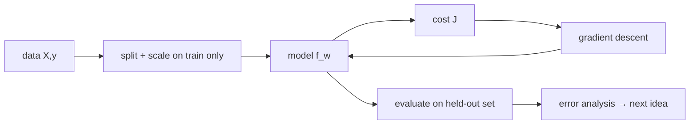

# Week 4 (Days 22-28): Classic supervised learning I: linear and logistic regression

**Month 1, Foundations.** Time budget: 42 h. Optional reading: the scikit-learn user guide sections on linear models and model evaluation (https://scikit-learn.org/stable/user_guide.html), and *An Introduction to Statistical Learning*, ch. 3-4 (https://www.statlearning.com/).

## Week goals
1. Frame supervised learning as model + cost + optimiser, and visualise the cost surface J(w, b).
2. Implement batch gradient descent for linear regression and read learning curves.
3. Vectorise to many features, and match the normal equation and scikit-learn to 4 decimals.
4. Explain *why* feature scaling speeds up GD (conditioning), and measure it.
5. Implement logistic regression with log-loss, and match scikit-learn.
6. Evaluate classifiers properly (confusion matrix, precision/recall/F1, thresholds, ROC-AUC) and diagnose bias vs variance.

**Weekly project (Day 28):** an end-to-end housing regression with **error analysis**, finding which homes the model gets wrong and fixing it with one feature.

All Week-4 scripts use `code/week-04/housing.py`, a deterministic synthetic generator. The true rule is price (lakh) = 0.05·area + 4·beds − 0.4·age − 0.8·dist_km + 20 + noise(σ = 6). Because we know the truth, we can check whether our learners recover it.

---

## Day 22: Linear regression and the cost function
**Review today:** Day 21 (+1), Day 19 (+3), Day 15 (+7), Day 1 (+21; quick 15-min skim of its self-check).

### Block 1: Concept lesson (1h15)
**Intuition.** Supervised learning = "learn a function from examples of input → correct output". For housing, the input x is area and the output y is price. The **model** (hypothesis) is a family of functions with knobs: f_{w,b}(x) = wx + b. The **cost** J(w, b) is one number scoring how badly a particular setting of the knobs fits the training data. Learning means finding the knobs with the lowest cost.

**Concrete example (verified, 200 synthetic homes, area in 1000s of sq ft):**
- w = 0, b = mean price (predict the average for everyone): J = **222.69**
- w = 30, b = 30: J = **95.83**
- best on a 120 × 120 grid: w = 52.10, b = 7.39, J = **57.80**
- closed form (`np.polyfit`): w = 51.71, b = 7.86

So each extra 1000 sq ft adds about 52 lakh. The true value is 0.05 lakh per sq ft = 50 per 1000 sq ft. The estimate is a bit higher because area here also stands in for omitted features.

**Plain-language maths.** J(w, b) = (1/2m) Σᵢ (f(xᵢ) − yᵢ)². In words: the average squared miss, halved. The ½ only makes the derivative tidier. Why squared? Day 21 showed squared error is the maximum-likelihood cost under Gaussian noise. It also punishes big misses heavily and is smooth for gradients. Plotted over (w, b), J is a **bowl** (convex quadratic) with one lowest point. The contour plot (`out/day22_cost_contour.png`) shows ellipses: the bowl is long and thin, because w multiplies a variable around 1.2 while b multiplies 1. That is a preview of the scaling problem on Day 25.

Notation used all course: m = number of examples, n = number of features, x⁽ⁱ⁾ = example i, ŷ = prediction.

### Block 2: Worked example (45 min)
Three homes: x = (1, 2, 3) (1000 sq ft) and y = (60, 110, 150).
- For w = 50, b = 0: predictions 50, 100, 150 and errors −10, −10, 0. J = (100 + 100 + 0)/(2·3) = **33.3**.
- For w = 45, b = 17: predictions 62, 107, 152 and errors 2, −3, 2. J = (4 + 9 + 4)/6 = **2.83**. That is better.
- The best fit via the Day-10 normal equation: x̄ = 2, ȳ = 106.67, w = Σ(x − x̄)(y − ȳ)/Σ(x − x̄)² = ((−1)(−46.67) + 0 + (1)(43.33))/2 = 90/2 = **45**, b = 106.67 − 90 = **16.67**.

### Block 3: Coding lab (2h): `code/week-04/day22_linreg_cost.py`
Tasks:
1. Plot J(w) for fixed b = 7.86 as a 1-D curve. It's a parabola. Mark the closed-form minimum.
2. Make a 3-D surface plot (`ax = fig.add_subplot(projection="3d")`).
3. Replace squared error with absolute error and redo the grid. Is the minimum in the same place? Is the surface still smooth?
4. Rescale x to raw sq ft (not 1000s) and look at how the contour ellipses change. Write down your prediction first.

### Block 4: Practice problems (1h)
1. What is J if every prediction is exactly right? *Answer:* 0.
2. Errors are (3, −1, −2). What is J? *Answer:* (9 + 1 + 4)/6 = 2.33.
3. Why is the "predict the mean" baseline useful? *Answer:* any real model must beat it. R² measures the improvement over it.
4. Are model parameters and hyperparameters the same thing? *Answer:* no. Parameters are learned (w, b). Hyperparameters are chosen (learning rate, degree).
5. Units of J in this problem? *Answer:* lakh².

### Block 5: Review (1h)
- **Day 21 (+1):** why is MSE the Gaussian MLE?
- **Day 19 (+3):** compute P(spam | word) with prior 0.5 and likelihoods 0.4 vs 0.1 (0.8).
- **Day 15 (+7):** what is the central-difference formula, and the best h?
- **Self-check:**
  1. Model vs cost vs optimiser?
  2. Formula for J(w, b)?
  3. Why does J form a bowl?
  4. What are m and n?
  5. What J did the predict-the-mean baseline have?

### Going deeper (optional, inside Block 4)
**Other regression losses.** MAE (absolute error) is more robust to outliers but has a kink at zero. Huber loss is quadratic for small errors and linear for large ones, a compromise that keeps smooth gradients near the optimum. scikit-learn offers `HuberRegressor`. Fit it next to `LinearRegression` on the Day-22 data after adding three extreme outliers, and compare the slopes. The choice of loss is a statement about your noise (Day 21).

**Prediction vs inference.** In ML we mostly care about predictive accuracy on new data. Statisticians often care about the coefficients themselves (is the effect of age real?). Both use the same fit, but they need different checks: held-out error vs confidence intervals.

### Common mistakes / how to debug
- Forgetting the ½ or the 1/m: harmless for the location of the minimum, but it changes gradient scales and learning rates.
- Plotting y vs x and expecting to *see* the cost. The cost lives in parameter space.

### What to do next
Tomorrow we find the bottom of the bowl by walking downhill instead of solving equations.

---

## Day 23: Gradient descent for linear regression
**Review today:** Day 22 (+1), Day 20 (+3), Day 16 (+7), Day 2 (+21; quick 15-min skim of its self-check).

### Block 1: Concept lesson (1h15)
**Intuition.** Combine Day 22's bowl with Day 18's ball-rolling. Repeat until convergence:
- w ← w − α · ∂J/∂w
- b ← b − α · ∂J/∂b
updating both **simultaneously** (compute both gradients from the old values, then update).

**Plain-language maths (from Day 16):**
- ∂J/∂w = (1/m) Σ (ŷᵢ − yᵢ)·xᵢ, the average of error × input.
- ∂J/∂b = (1/m) Σ (ŷᵢ − yᵢ), the average error.
This is **batch** gradient descent, because every step uses all m examples. Month 3 introduces mini-batch and stochastic variants.

**Concrete example (verified, same 200 homes, 3000 steps):**

| α | final w | final b | final J |
|---|---|---|---|
| 0.01 | 47.998 | 12.602 | 58.67 (not yet converged) |
| 0.1 | 51.714 | 7.861 | 57.79 |
| 0.5 | 51.714 | 7.861 | 57.79 |
| 0.9 | nan | nan | diverged |

The closed form is [51.714, 7.861], matched to 3 decimals ✓. The learning curve plot is `out/day23_learning_curve.png`.

**Reading learning curves** (J vs iteration):
- It falls smoothly and flattens: good. Stop when the improvement is below a tolerance.
- It falls very slowly in a straight line: α is too small, or the features are badly scaled.
- It zig-zags or rises: α is too large. Rising J in *batch* GD is always a problem.
- nan or inf: divergence. The lab wraps this in `np.errstate` so you see "diverged" instead of warnings.

**Why use GD when a closed form exists?** The normal equation costs about O(n³) for n features and only exists for this specific model. GD costs O(mn) per step and works for logistic regression, neural nets, everything. Learn it on the problem where you can check the answer.

### Block 2: Worked example (45 min)
One GD step by hand on x = (1, 2, 3), y = (60, 110, 150), starting from w = b = 0 with α = 0.1.
Errors (ŷ − y) = (−60, −110, −150).
- ∂J/∂w = (−60·1 − 110·2 − 150·3)/3 = (−60 − 220 − 450)/3 = −243.3
- ∂J/∂b = (−320)/3 = −106.7
New values: w = 24.33 and b = 10.67. New predictions are 35, 59.3 and 83.7, so J drops from (3600 + 12100 + 22500)/6 = 6367 to (625 + 2570 + 4400)/6 ≈ 1266. That is a big first step. Continue for a second step on paper if you want more practice.

### Block 3: Coding lab (2h): `code/week-04/day23_gd_linreg.py`
Tasks:
1. Add a convergence criterion `|J_prev − J| < 1e-9` and report the iteration count for α = 0.1 vs 0.5.
2. Find the divergence threshold for α by bisection between 0.5 and 0.9. Relate it to the Hessian eigenvalues: compute `np.linalg.eigvalsh(A.T@A/m)` with A = [x, 1], and check 2/λ_max.
3. Introduce a bug by updating w first and then computing b's gradient with the new w (non-simultaneous update). Does it still converge? (It usually does here, but it's a different algorithm. Keep the textbook version.)
4. Animate or plot the (w, b) path on the Day-22 contour plot.

### Block 4: Practice problems (1h)
1. Write the update for b in words. *Answer:* subtract α times the average error.
2. If all errors are positive (over-predicting), which way does b move? *Answer:* down.
3. J went 100 → 80 → 95 → 70 → 120. Diagnosis? *Answer:* α too big (oscillating, diverging).
4. What does each batch-GD step cost for m = 1e6 and n = 100? *Answer:* about 2mn = 2e8 FLOPs, one matvec plus a transposed matvec.
5. Why can't GD "get stuck" here? *Answer:* the cost is convex, so there is only one minimum.

### Block 5: Review (1h)
- **Day 22 (+1):** compute J for errors (2, 2).
- **Day 20 (+3):** what is the std of the mean of 100 samples with σ = 5? (0.5)
- **Day 16 (+7):** derive ∇J in matrix form.
- **Self-check:**
  1. Update rules?
  2. Simultaneous update: why?
  3. Learning-curve shapes and what they mean?
  4. Why does GD scale better than the normal equation?
  5. What happened at α = 0.9?

### Common mistakes / how to debug
- A sign error (w += …) makes the loss climb steadily. Check one gradient numerically.
- Mixing up the order of the error: (y − ŷ) vs (ŷ − y) flips the sign.
- Using an unconverged model (α = 0.01) and concluding "linear regression is bad here".

### What to do next
Tomorrow: many features at once, all in matrix form. Before then, sketch from memory the four learning-curve shapes (smooth, slow, oscillating, diverging) and label the likely cause of each. Your sketch should match the four α rows of today's table.

---

## Day 24: Multiple linear regression, vectorised
**Review today:** Day 23 (+1), Day 21 (+3), Day 17 (+7), Day 3 (+21; quick 15-min skim of its self-check).

### Block 1: Concept lesson (1h15)
**Intuition.** Real prices depend on area, bedrooms, age and location together. The model becomes ŷ = w₁x₁ + w₂x₂ + … + wₙxₙ + b = **w·x + b** (Day 8's dot product). Each weight answers: "holding the other features fixed, how much does price change per unit of this feature?"

**Plain-language maths (all vectorised):**
- predictions ŷ = Xw + b (X is m × n)
- errors e = ŷ − y
- gradients ∇_w J = Xᵀe/m and ∂J/∂b = mean(e)
- closed form: append a column of ones and solve least squares (Day 10)

The code is the same three lines as Day 23 with `*` replaced by `@`. No loops over features.

**Concrete example (verified, 1000 synthetic homes):**

| feature | GD | lstsq | sklearn | true |
|---|---|---|---|---|
| area_sqft | 0.0517 | 0.0517 | 0.0517 | 0.05 |
| bedrooms | 4.0486 | 4.0486 | 4.0486 | 4.00 |
| age_years | −0.3909 | −0.3909 | −0.3909 | −0.40 |
| dist_km | −0.7828 | −0.7828 | −0.7828 | −0.80 |
| intercept | 17.318 | 17.318 | 17.318 | 20.00 |

R² (train) = **0.9216**. Three methods agree to 4 decimals, and all are close to the truth. The leftover differences come from the random noise (σ = 6), not from bugs. GD ran on *scaled* features (Day 25 explains why), and the weights were converted back with w_orig = w/σ and b_orig = b − Σ w_orig·μ.

**Interpretation caution.** The weights' magnitudes depend on units: 0.05 per sq ft isn't "less important" than 4 per bedroom. Compare standardised coefficients, or better, use the permutation importance you'll meet in Month 2. Correlation between features also makes individual weights unstable (Day 10's conditioning).

**R²** = 1 − SS_res/SS_tot = the fraction of variance explained compared with predicting the mean. 0.92 means 92% of the variance is explained. The rest is mostly the irreducible noise.

### Block 2: Worked example (45 min)
Vectorised prediction for 2 homes and 2 features. X = [[1000, 2], [1500, 3]], w = [0.05, 4], b = 20:
Xw = [50 + 8, 75 + 12] = [58, 87], and adding b gives ŷ = [78, 107].
If y = [80, 100], then e = [−2, 7] and Xᵀe = [1000·(−2) + 1500·7, 2·(−2) + 3·7] = [8500, 17].
∇_w J = [4250, 8.5] (dividing by m = 2). The area gradient is 500× larger than the bedroom gradient, purely because of units. That is tomorrow's problem.

### Block 3: Coding lab (2h): `code/week-04/day24_multivar_linreg.py`
Tasks:
1. Run GD on *unscaled* X with α = 0.1. What happens? (Divergence. Explain it using the worked example.)
2. Compute R² by hand from SS_res and SS_tot and check it against `sk.score`.
3. Add a useless random feature. Does the train R² go up? Does its weight go to about 0? (It can only go up on train, which is why we need validation.)
4. Write `predict(X, w, b)` and `fit_gd(X, y, alpha, iters)` functions for reuse (they become `mlscratch.py` on Day 29).

### Block 4: Practice problems (1h)
1. Shapes: X (500 × 8), w? Xw? Xᵀe? *Answer:* (8,), (500,), (8,).
2. A weight of −0.39 for age means? *Answer:* about −0.39 lakh per extra year, holding the other features fixed.
3. Can R² be negative? *Answer:* yes, on test data, if the model is worse than predicting the mean.
4. Why does adding features never lower train R² for least squares? *Answer:* the old solution is still available (new weight = 0).
5. How do you convert scaled weights back? *Answer:* w_orig = w_scaled/σ, b_orig = b − Σ w_orig μ.

### Block 5: Review (1h)
- **Day 23 (+1):** do one GD step by hand for a 1-point dataset.
- **Day 21 (+3):** what is the coin MLE for 30 heads in 50 flips? (0.6)
- **Day 17 (+7):** why do gradients accumulate in backprop?
- **Self-check:**
  1. Vectorised model and gradient?
  2. What does a single weight mean?
  3. Define R².
  4. Why might coefficients be unstable?
  5. Did the GD, lstsq and sklearn results agree?

### Going deeper (optional, inside Block 4)
**Categorical features.** City or neighbourhood must be one-hot encoded before a linear model can use it. With an intercept, drop one level (the "reference") to avoid the collinearity seen on Day 10. Each remaining weight is then "premium vs the reference city". `pd.get_dummies(df, drop_first=True)` or `sklearn.preprocessing.OneHotEncoder(drop="first")` do this. With many rare levels, group them into "other", or wait for target encoding with cross-fitting in Month 2.

**Interactions.** A linear model can't express "bedrooms matter more in big homes" unless you add a product feature area × bedrooms. Feature engineering is how linear models get flexibility, and it's what Day 28's hinge does.

### Common mistakes / how to debug
- y of shape (m, 1) vs (m,) causes broadcasting havoc in `Xw − y` (it becomes m × m). Flatten y.
- Forgetting the intercept column in lstsq.
- Interpreting raw coefficients as importance.

### What to do next
Look back at the worked example's gradients (4250 vs 8.5). Tomorrow explains the fix.

---

## Day 25: Feature scaling and conditioning
**Review today:** Day 24 (+1), Day 22 (+3), Day 18 (+7), Day 4 (+21; quick 15-min skim of its self-check).

### Block 1: Concept lesson (1h15)
**Intuition.** If one feature ranges over hundreds (area, std ≈ 346) and another over single digits (bedrooms, std ≈ 1.1), the cost bowl is a long, narrow canyon. One learning rate must be small enough for the steep direction, so progress along the shallow direction crawls (Day 18's condition number). Scaling the features turns the canyon into a round bowl, and GD heads straight to the bottom.

**Concrete example (verified, same housing data, tolerance 1e-6 on the change in J, cap 200,000 iterations):**

| setup | α | iterations | final J |
|---|---|---|---|
| raw features | 1e-6 | 200,000 (hit the cap) | 39.70 |
| raw | 1e-7 | 76,539 (stopped by tolerance, far from optimum) | 52.89 |
| raw | 2.5e-7 | 55,245 | 50.86 |
| z-score | 0.1 | **83** | **19.22** |
| min-max [0, 1] | 0.5 | 472 | 19.22 |

The condition number of XᵀX is **9.63e4** raw vs **1.16** after z-scoring. The raw runs "converge" by the tolerance rule while still far from the optimum (J ≈ 19.2) because progress is so slow per step. This is a nasty trap: **a flat learning curve doesn't always mean you've reached the minimum.**

**Plain-language maths.**
- **Z-score (standardisation):** x′ = (x − μ)/σ, giving mean 0 and std 1. This is the default choice.
- **Min-max:** x′ = (x − min)/(max − min), giving the range [0, 1]. It is sensitive to outliers.
- Compute μ and σ (or min/max) on the **training set only**, and apply the same numbers to validation, test and production data. Fitting on all the data is leakage (Day 6).
- Trees (Month 2) don't need scaling. GD-based models, k-NN, SVMs, PCA and neural nets do.

### Block 2: Worked example (45 min)
Areas (800, 1200, 1600): μ = 1200 and σ = √((400² + 0 + 400²)/3) = 326.6, so the z-scores are (−1.22, 0, 1.22).
Min-max gives (0, 0.5, 1).
A new house of 2000 sq ft gets z = (2000 − 1200)/326.6 = 2.45 using the *training* μ and σ, not recomputed. Min-max gives 1.5, outside [0, 1], which is fine.

### Block 3: Coding lab (2h): `code/week-04/day25_feature_scaling.py`
Tasks:
1. Plot the learning curves (log J vs iteration) for raw and scaled data on the same axes.
2. Compute the eigenvalues of XᵀX/m for raw and scaled data and verify that the ratio equals the printed condition number.
3. Find the largest stable α for scaled features (it is about 2/λ_max) and test α slightly above it.
4. Write `StandardScalerNP` with `fit`/`transform` methods (it becomes part of `mlscratch.py`), and check it against `sklearn.preprocessing.StandardScaler`.

### Block 4: Practice problems (1h)
1. Feature values (2, 4, 6). Z-scores? *Answer:* μ = 4, σ = 1.633, giving (−1.22, 0, 1.22).
2. Why not fit the scaler on the test set? *Answer:* leakage, and it isn't available at prediction time.
3. Does scaling change the least-squares *predictions*? *Answer:* no (with an intercept). It only changes the weights and the speed of GD.
4. Which models don't care about scaling? *Answer:* tree-based models.
5. Why is a tolerance-based stop dangerous on unscaled data? *Answer:* progress per step is tiny, so the stop fires far from the optimum.

### Block 5: Review (1h)
- **Day 24 (+1):** the vectorised gradient, and R² = 0.9216.
- **Day 22 (+3):** why were the J contours elongated?
- **Day 18 (+7):** the stability condition α < 2/λ_max.
- **Self-check:**
  1. What does scaling do to the cost geometry?
  2. Z-score vs min-max?
  3. Fit the scaler on what?
  4. What were the condition numbers before and after?
  5. Iterations before and after?

### Going deeper (optional, inside Block 4)
**Robust scaling.** If a feature has big outliers, its mean and std are distorted. `RobustScaler` uses the median and inter-quartile range instead. For heavy right skew (incomes, prices), apply a log transform *before* scaling.

**Pipelines prevent leakage.** `make_pipeline(StandardScaler(), LinearRegression())` fits the scaler inside `fit` on whatever data it is given. Combined with cross-validation (Day 33), this guarantees each fold's scaler sees only that fold's training data. Make it a habit now: never scale "by hand" on the full dataset.

### Common mistakes / how to debug
- Scaling the target y by accident and then reporting errors in scaled units.
- A σ = 0 column (a constant feature) gives division by zero. Drop it or add an epsilon.
- Scaling one-hot columns. Usually harmless, but unnecessary.

### What to do next
Next we switch from predicting numbers to predicting categories. Logistic regression is trained by the same gradient descent, so everything you learned today about scaling carries over unchanged. Keep your `StandardScalerNP` handy.

---

## Day 26: Logistic regression
**Review today:** Day 25 (+1), Day 23 (+3), Day 19 (+7), Day 5 (+21; quick 15-min skim of its self-check).

### Block 1: Concept lesson (1h15)
**Intuition.** For yes/no questions (spam? malignant? will the user skip this song?), we want a **probability** between 0 and 1. Take the linear score z = w·x + b, which can be any real number, and squash it with the **sigmoid** σ(z) = 1/(1 + e^(−z)). Large positive z gives about 1, large negative gives about 0, and z = 0 gives 0.5. The **decision boundary** is where z = 0, which is a straight line (a hyperplane) in feature space.

**Why not linear regression on 0/1 labels?** Its predictions go outside [0, 1], and outliers far on the "obviously yes" side drag the line and shift the boundary.

**Why not MSE as the cost?** With the sigmoid inside, MSE becomes non-convex with flat regions, and it barely punishes confident mistakes. **Log-loss** (cross-entropy), the Bernoulli negative log-likelihood from Day 21:

  L = −[y log p + (1 − y) log(1 − p)]

Verified: a confident wrong prediction p = 0.001 for y = 1 costs **6.908** under log-loss vs **0.998** under squared error. Log-loss screams, while squared error shrugs.

**The beautiful gradient.** ∂J/∂w = (1/m) Xᵀ(p − y) and ∂J/∂b = mean(p − y). It is *the same form* as linear regression, with p in place of ŷ (the sigmoid's derivative cancels neatly). Prove it in the practice block.

**Concrete results (verified):**
- 2-D toy (two Gaussian blobs, 300 points): train accuracy **0.967**, log-loss **0.0826**, boundary plot `out/day26_boundary.png`.
- Breast-cancer dataset (569 samples, 30 features, stratified 75/25 split, standardised, L2 penalty λ = 1): from-scratch test accuracy **0.9580** = sklearn `LogisticRegression(C=1)` **0.9580** ✓.

### Block 2: Worked example (45 min)
w = (2, −1), b = 0.5, x = (1, 3): z = 2 − 3 + 0.5 = −0.5, so p = σ(−0.5) = 1/(1 + e^0.5) = 1/2.6487 = **0.378**. That is class 0 at threshold 0.5.
If the true y = 1, the loss is −ln 0.378 = 0.973 and the gradient for this example is (p − y)x = −0.622·(1, 3) = (−0.622, −1.866). The step w ← w − α·grad increases both weights, pushing z up. Correct.
Log-odds view: z = ln(p/(1 − p)). Each unit increase in xⱼ multiplies the odds by e^(wⱼ).

### Block 3: Coding lab (2h): `code/week-04/day26_logistic_regression.py`
Tasks:
1. Gradient-check the log-loss gradient numerically (Day 16 recipe).
2. Remove the L2 penalty (λ = 0) on the breast-cancer data and train for 50,000 steps. What happens to ‖w‖ and why? *Hint:* nearly separable data pushes the weights toward infinity.
3. Plot σ(z) and its derivative. Where is the gradient largest?
4. Implement a numerically stable log-loss from z directly: `np.logaddexp(0, -z)` for y = 1. Compare it with the clipped version for z = ±50.

### Block 4: Practice problems (1h)
1. σ(0)? σ(large)? *Answer:* 0.5 and about 1.
2. Show that σ′(z) = σ(z)(1 − σ(z)).
3. Show that ∂L/∂z = p − y for one example. *Hint:* chain rule with Q2.
4. What is the boundary for w = (1, 1), b = −2? *Answer:* the line x₁ + x₂ = 2.
5. Loss for p = 0.9 and y = 1? *Answer:* −ln 0.9 = 0.105.
6. How would you handle 3+ classes? *Answer:* one-vs-rest, or softmax (Month 3).

### Block 5: Review (1h)
- **Day 25 (+1):** fit the scaler on what? What happens if you don't scale?
- **Day 23 (+3):** learning-curve diagnoses.
- **Day 19 (+7):** Bayes' rule, and the base-rate effect.
- **Self-check:**
  1. Write the sigmoid.
  2. Log-loss formula?
  3. Gradient form?
  4. Why not MSE?
  5. What is the decision boundary geometrically?

### Going deeper (optional, inside Block 4)
**Calibration.** A model's p is *calibrated* if, among cases where it says 0.8, about 80% are positive. Logistic regression is usually well calibrated. Many other models (boosted trees, SVMs, deep nets) are not, and need Platt scaling or isotonic regression (`sklearn.calibration`). Calibration matters whenever someone acts on the probability itself, for example a threshold set from costs.

**Regularisation in logistic regression.** The L2 penalty you used (λ = 1) keeps weights finite on nearly separable data and usually improves test performance. scikit-learn's `C` is the *inverse* strength: smaller C means stronger regularisation. Tune it on validation data, which is Day 33's topic.

### Common mistakes / how to debug
- `exp` overflow for large −z. Use the stable formulations, or clip z.
- log(0) gives nan. Clip p.
- Labels as {−1, +1} instead of {0, 1} with the 0/1 formula. Check `np.unique(y)`.

### What to do next
Accuracy 0.958 sounds great. Tomorrow asks: great at *what*? Which mistakes is it making?

---

## Day 27: Evaluating models: metrics, thresholds, bias/variance
**Review today:** Day 26 (+1), Day 24 (+3), Day 20 (+7), Day 6 (+21; quick 15-min skim of its self-check).

### Block 1: Concept lesson (1h15)
**Intuition.** One number hides the kinds of mistakes a model makes. In cancer screening, missing a malignant tumour (false negative) is far worse than an extra biopsy (false positive). Choose metrics that reflect the real costs.

**Confusion matrix (positive = malignant).** TP = caught, FN = missed, FP = false alarm, TN = correctly cleared.
- **Precision** = TP/(TP + FP): "when I say malignant, how often am I right?"
- **Recall** = TP/(TP + FN): "of all malignant cases, how many did I catch?"
- **F1** = the harmonic mean of the two, which punishes imbalance between them.
- **Threshold:** predict positive if p ≥ t. Lowering t trades precision for recall.

**Verified (breast cancer, positive = malignant, 143 test samples):**

| threshold | TP | FP | FN | TN | precision | recall | F1 |
|---|---|---|---|---|---|---|---|
| 0.5 | 51 | 0 | 2 | 90 | 1.000 | 0.962 | 0.981 |
| 0.3 | 51 | 6 | 2 | 84 | 0.895 | 0.962 | 0.927 |
| 0.1 | 53 | 11 | 0 | 79 | 0.828 | **1.000** | 0.906 |

At t = 0.1 no cancers are missed, at the price of 11 false alarms. A clinician might prefer that. **ROC-AUC** = **0.9958**: the probability that a random malignant case scores higher than a random benign one, independent of threshold. The baseline that always says "benign" already gets **0.6294** accuracy, which is why accuracy alone misleads on imbalanced data (Day 19's base rates).

**Bias vs variance (verified).** Fit polynomials of degree 1, 3 and 15 to 40 noisy points from sin(x) (noise σ = 0.3, so the best achievable MSE is about 0.09), validating on 200 fresh points:

| degree | OLS train | OLS val | Ridge(α=1) train | Ridge val |
|---|---|---|---|---|
| 1 | 0.283 | 0.282 | 0.283 | 0.281 |
| 3 | 0.072 | **0.097** | 0.094 | 0.114 |
| 15 | 0.043 | 0.144 | 0.090 | 0.129 |

- Degree 1 **underfits** (high bias): train and val errors are both high and similar.
- Degree 15 **overfits** (high variance): low train error, but the gap to val is large.
- Degree 3 is just right, close to the noise floor.
- Ridge regularisation shrinks the degree-15 gap (0.129 vs 0.144) but slightly hurts degree 3 here. Regularisation strength is a hyperparameter you tune (Day 31).

**Diagnosis recipe (the most useful practical skill in ML):**
- High train error → bias. Use a bigger model, more features, less regularisation.
- Low train error but high val error → variance. Get more data, regularise, simplify, use fewer features.

### Block 2: Worked example (45 min)
From the t = 0.3 row: precision = 51/(51 + 6) = 0.895, recall = 51/53 = 0.962, F1 = 2·0.895·0.962/(0.895 + 0.962) = 1.722/1.857 = **0.927** ✓.
Accuracy at t = 0.3 = (51 + 84)/143 = 0.944, lower than at 0.5 (141/143 = 0.986), yet clinically arguably better.

### Block 3: Coding lab (2h): `code/week-04/day27_evaluation.py`
Tasks:
1. Plot precision and recall vs threshold (`sklearn.metrics.precision_recall_curve`), and the ROC curve.
2. Choose the threshold that maximises recall subject to precision ≥ 0.85, *using a validation split*, not the test set.
3. Plot train and val MSE vs degree 1-15 (the U-shaped val curve).
4. Learning curve: for degree 15, train on 20, 40, 80, 160 points and plot train/val MSE. Does more data fix the variance?

### Block 4: Practice problems (1h)
1. TP = 8, FP = 2, FN = 4. Precision, recall and F1? *Answer:* 0.8, 0.667, 0.727.
2. 99% of transactions are legitimate. What accuracy does "always legit" get? *Answer:* 99%.
3. Train error 2%, val error 15%. Bias or variance? *Answer:* variance.
4. Train 14%, val 15%, and humans get 2%. *Answer:* bias.
5. Why tune thresholds on validation, not test? *Answer:* tuning on test overfits the test set and gives optimistic estimates.

### Block 5: Review (1h)
- **Day 26 (+1):** log-loss for p = 0.2 and y = 1 (1.609).
- **Day 24 (+3):** the R² formula.
- **Day 20 (+7):** the uncertainty of an accuracy estimate measured on 143 samples (about 1-2%).
- **Self-check:**
  1. Define precision and recall.
  2. What does lowering the threshold do?
  3. What does AUC mean?
  4. Bias vs variance symptoms?
  5. Fixes for each?

### Common mistakes / how to debug
- Reporting accuracy on imbalanced data.
- Picking the threshold on the test set.
- Mixing up which class is "positive". sklearn's breast-cancer target has 1 = benign, which is why the script flips it.

### What to do next
Tomorrow: a full project where the most important step is *error analysis*.

---

## Day 28: Week 4 project: housing regression with error analysis, plus Quiz 4
**Review today:** Day 27 (+1), Day 25 (+3), Day 21 (+7), Day 7 (+21; quick 15-min skim of its self-check).

### Block 1: Concept lesson (1h15)
**Intuition.** A model's average error tells you *how bad* it is. Error analysis tells you *where and why*, and therefore what to do next. The habit: after every model, slice the errors by meaningful groups and look for systematic patterns, meaning slices where the mean residual is far from zero.

**Setup (`code/week-04/day28_week_project.py`).** 2000 synthetic homes, with a twist the linear model can't see: homes over 1800 sq ft get a hidden "luxury premium" of 0.04 lakh per extra sq ft. Split 80/20, standardise on train, and fit least squares.

**Verified results:**
- v1 (linear): test **MAE 4.899, RMSE 6.375**
- residual (actual − predicted) by area bucket:

| area | mean residual | MAE | count |
|---|---|---|---|
| 350-800 | +0.90 | 4.62 | 45 |
| 800-1200 | −0.72 | 4.84 | 158 |
| 1200-1500 | −0.30 | 4.82 | 120 |
| 1500-1800 | +0.41 | 4.66 | 59 |
| **1800-2200** | **+5.31** | 6.73 | 17 |
| 2200+ | +19.47 | 19.47 | 1 |

The big homes are systematically **under-predicted**. That is a pattern, not noise. The fix suggested by the analysis is a hinge feature max(area − 1800, 0), which lets the slope change at 1800.
- v2 (+hinge): test **MAE 4.830, RMSE 6.171**. RMSE improves more than MAE because the fix targets the few large errors.

The overall gain looks small because only about 4.5% of homes are affected. For those buyers, though, the bias was 5+ lakh. Always check slices, not just averages: this is also how fairness problems are found.

### Block 2: Worked example (45 min)
Why does the hinge work? The model becomes ŷ = … + w_a·area + w_h·max(area − 1800, 0). Below 1800 the slope is w_a. Above 1800 it is w_a + w_h. The true extra slope is 0.04 per sq ft, so expect w_h ≈ 0.04 in original units. (Task 2 asks you to check, after un-scaling.) A 2000 sq ft home gets an extra 0.04·200 = 8 lakh, roughly what the 1800-2200 bucket was missing on average (+5.31 for homes spread through that range).

### Block 3: Coding lab: project (2h)
Deliverables (`notes/week04_report.md`):
1. Reproduce v1 and v2, and the bucket table.
2. Un-scale the v2 weights and compare the hinge weight with 0.04.
3. Slice the residuals by bedrooms and by distance as well. Are there other patterns? (There shouldn't be, because the generator is linear in those. Confirming "no pattern" is also a result.)
4. Try a degree-2 polynomial on area instead of the hinge. Compare test RMSE and explain which is more appropriate.
5. Write half a page: "If this were real data, what would I collect next?"

**Suggested timeline (2h).**
- 0:00-0:20: reproduce v1, v2 and the bucket table, and check them against the worked example.
- 0:20-0:40: un-scale the v2 weights (w_raw = w_scaled/σ, with the intercept adjusted) and compare the hinge weight with the generator's 0.04. Explain any gap: noise, and correlation with the other features.
- 0:40-1:05: residual slices by bedrooms and by distance. Plot the mean residual per bucket with error bars (std/√n). A flat pattern within the error bars counts as a finding.
- 1:05-1:35: the degree-2 polynomial against the hinge. Compare test RMSE on the same split, and plot both fitted curves of price against area.
- 1:35-2:00: the "what would I collect next" half page.

**Rubric (self-grade out of 20).**

| criterion | points |
|---|---|
| v1, v2 and the bucket table reproduced | 4 |
| Correct un-scaling, and comparison with the true hinge weight | 4 |
| Residual slices with error bars, honestly interpreted (including "no pattern") | 4 |
| Polynomial vs hinge: same split, RMSE plus a plot, and a reasoned choice | 4 |
| Data-collection memo: specific, prioritised, and tied to the observed residuals | 3 |
| Every number traceable to a file your code wrote | 1 |

**What separates a strong report from a weak one.** A weak report picks whichever model has the lower RMSE. A strong one asks which *shape* matches the mechanism. A hinge encodes "the price per sq ft changes above a size", while a polynomial bends everywhere and extrapolates badly. Choose using both the numbers and that reasoning, and flag that on real data you would check the hinge location rather than assume it.

### Block 4: Practice: Quiz 4 (1h), answers below

### Block 5: Review (1h)
- **Day 27 (+1):** precision/recall at threshold 0.1.
- **Day 25 (+3):** z-score formula, and fit on train only.
- **Day 21 (+7):** the link between MLE and log-loss.
- **Self-check:**
  1. What is error analysis?
  2. What signals a systematic error?
  3. What is a hinge feature?
  4. Why did RMSE improve more than MAE?
  5. Why check slices?

### Common mistakes / how to debug
- Doing error analysis on the test set and then iterating on it repeatedly. Use a validation set for analysis, and touch test once at the end. (We used test here for simplicity. Redo it properly as a stretch task.)
- Slices with tiny counts (the 2200+ bucket has 1 home). Don't over-interpret them.

### What to do next
Next is the Month-1 capstone (Day 29): package your from-scratch learners into a mini library and benchmark them against scikit-learn and a Rust kernel. Then the checkpoint (Day 30).

---

## Weekly quiz: Week 4 (answers below)
1. Write the linear-regression cost J(w, b).
2. Give the GD updates for w and b.
3. J rises during batch GD. Name two possible causes.
4. Shapes: X is (m × n). What shapes are w, Xw and Xᵀe?
5. Why scale features before GD? Give the z-score formula and say what to fit it on.
6. What iteration counts and condition numbers did you measure, raw vs scaled?
7. Write the sigmoid and the log-loss.
8. What is the logistic-regression gradient form?
9. TP = 30, FP = 10, FN = 20. Precision, recall and F1?
10. Train MSE 0.04, val MSE 0.14, noise floor 0.09. Diagnosis and two fixes?
11. What does ROC-AUC = 0.5 mean?
12. What did error analysis reveal in the Day-28 project, and what was the fix?

### Answers
1. J = (1/2m) Σ (wxᵢ + b − yᵢ)².
2. w ← w − α·mean((ŷ − y)x) and b ← b − α·mean(ŷ − y), updated simultaneously.
3. α too large, a gradient sign bug, unscaled features (or a non-simultaneous update bug).
4. (n,), (m,), (n,).
5. It makes the cost bowl round (better conditioned), so a single α works and convergence is fast. x′ = (x − μ)/σ, with μ and σ from the training data only.
6. Raw data hit the 200,000 cap (or stopped early, far from the optimum). Z-scored data converged in 83 iterations. κ was 9.63e4 vs 1.16.
7. σ(z) = 1/(1 + e^(−z)). L = −[y log p + (1 − y) log(1 − p)].
8. ∇_w = Xᵀ(p − y)/m and ∂b = mean(p − y).
9. P = 0.75, R = 0.6, F1 = 0.667.
10. Overfitting (variance). Get more data, add regularisation, or use a simpler model.
11. No better than random ranking.
12. Homes over 1800 sq ft were under-predicted (+5.31 mean residual). Adding a hinge feature max(area − 1800, 0) brought RMSE from 6.375 to 6.171.
