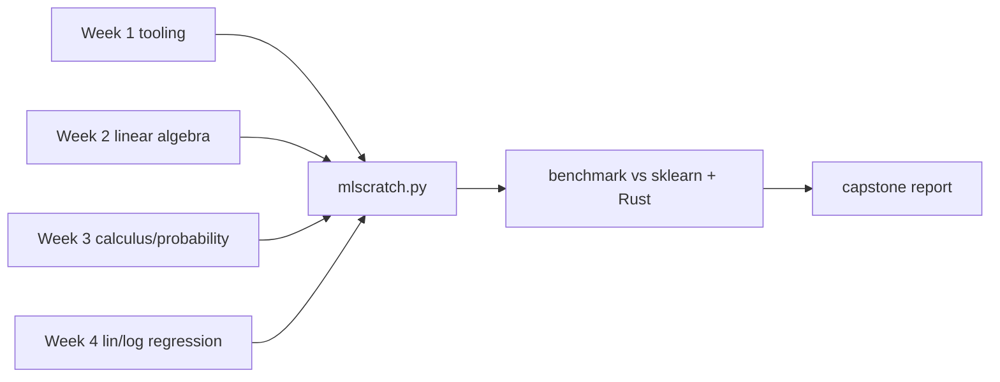

# Week 5 (Days 29-35): Month-1 capstone and checkpoint, then classic supervised learning II

**Status:** written in full. Titles match `SYLLABUS.md`.

## Week goals
1. Package your Month-1 code into a small reusable library (`code/week-05/mlscratch.py`).
2. Benchmark your from-scratch learners against scikit-learn on accuracy *and* wall time, and optionally against a Rust kernel called from Python through PyO3.
3. Pass the Month-1 checkpoint: self-graded coding exercises, a written exam, and a review of weak spots.
4. (Days 31-35) Control overfitting with ridge, lasso and elastic net, and measure bias and variance directly.
5. Select models honestly with cross-validation, grid/random search and nested CV, and extend classification to many classes with softmax.
6. Ship a CV-selected California housing model with one honest test number and an error analysis.



---

## Day 29: MONTH-1 CAPSTONE: scratch models vs scikit-learn (plus a Rust/PyO3 kernel)
**Review today:** Day 28 (+1), Day 26 (+3), Day 22 (+7), Day 8 (+21).

### Block 1: Concept lesson (1h15)
**Intuition.** Libraries like scikit-learn are not magic. Underneath, they run the same maths you wrote this month, with better numerics and decades of engineering. Today you check that claim in two ways. Your code must give the **same answers**, and you measure **how much slower** it is and why. As a systems engineer, you also see what it takes to move a hot loop into Rust and call it from Python, the same pattern used by tokenizers, Polars and many inference runtimes.

**What `mlscratch.py` contains** (read it before the lab, about 50 lines):
- `StandardScalerNP` with fit/transform (Day 25)
- `LinearRegressionGD` with fit/predict/score (Days 23-24)
- `LogisticRegressionGD` with an L2 penalty and early stopping (Day 26)

**Design choices worth noticing.**
1. The scikit-learn-style API (fit returns self, predict, score) lets your models drop into the same evaluation code.
2. The tolerance-based stop makes the iteration count data-dependent (Day 25's trap).
3. Regularisation scaling differs between libraries (λ/m vs C = 1/λ). That is why coefficients can differ slightly while predictions agree.

**Python ↔ Rust boundary (PyO3 + maturin).** `code/week-05/rust_gd/src/lib.rs` implements batch GD for linear regression. It takes NumPy arrays as read-only views (`PyReadonlyArray2`), with no copy for C-contiguous input, and returns (w, b). Build it once:
```bash
source .venv/bin/activate
cd code/week-05/rust_gd && maturin develop --release && cd -
```
Verified on this box: it builds and imports as `rust_gd`. (The C++/pybind11 alternative couldn't be tested here because no C++ compiler is installed on the box. See PROGRESS.md.)

### Block 2: Worked example: reading the benchmark (45 min)
Verified output of `day29_capstone_benchmark.py` (best of 3 runs; times vary by about ±10% between runs on this shared machine):

**Linear regression** (synthetic housing, 16,000 train rows, 4 standardised features):

| method | test MAE | test R² | time |
|---|---|---|---|
| scratch NumPy GD (500 steps) | 4.7498 | 0.91501 | 42-45 ms |
| sklearn LinearRegression (lstsq) | 4.7498 | 0.91501 | ~1.5 ms |
| sklearn SGDRegressor (50 epochs) | 4.7498 | 0.91507 | 28-30 ms |
| Rust/PyO3 GD (500 steps) | 4.7498 | 0.91501 | 19-20 ms |

**Logistic regression** (breast cancer, standardised, positive = malignant): scratch accuracy **0.9860**, F1 **0.9808** in 110-120 ms (3648 iterations), vs sklearn's identical 0.9860 / 0.9808 in about 2-3 ms. Max |coefficient difference| is 0.0153, explained by the different regularisation scaling.

How to read it:
- **Accuracy is identical.** Every method finds the same convex optimum, which validates all of Month 1.
- **The closed form wins on time** at n = 4 features: one small QR solve vs 500 passes over the data. With n = 100,000 features the ranking would flip (Day 23).
- **Rust is about 2× faster than NumPy GD, not 100×.** NumPy already runs its inner loops in compiled BLAS. Python overhead is only about 2 calls per step. Rust wins by fusing the prediction, error and gradient into one pass over memory (fewer temporary arrays, better cache use). Lesson: **move code to Rust when Python overhead or memory traffic dominates, not when the work is already a big BLAS call.**
- **sklearn's logistic solver (L-BFGS) uses curvature information**, so it needs far fewer iterations than plain GD. You'll meet second-order and quasi-Newton ideas again in Month 3.

### Block 3: Coding lab: capstone (2h): `code/week-05/day29_capstone_benchmark.py`
Deliverables (`notes/month01_capstone.md`, 1-2 pages):
1. Build `rust_gd` and run the benchmark. Paste *your* table, since your timings will differ.
2. Add a multithreaded version of the Rust gradient loop with `rayon`, splitting rows across threads and reducing the partial gradients. Report the speedup on 16k and 1.6M rows. When does threading start to pay off?
3. Add `LinearRegressionNormalEq` to `mlscratch.py` (via `np.linalg.lstsq`) and add it to the table.
4. Scale test: rerun with 200,000 rows. Which method's time grows linearly?
5. Write a "what I learned" section: 5 bullet points linking each Month-1 week to a line of the benchmark.

### Block 4: Practice problems (1h)
1. Why are the MAEs identical to 4 decimals across four very different methods? *Answer:* convex problem, same optimum, all converged.
2. Why doesn't SGDRegressor match exactly (R² 0.91507 vs 0.91501)? *Answer:* stochastic updates and a small default regularisation leave it slightly off the exact optimum.
3. PyO3 with a non-contiguous (e.g. transposed) array: what goes wrong, and how do you fix it? *Answer:* the row-major assumption breaks or a copy is needed. Call `np.ascontiguousarray` first.
4. Estimate the FLOPs per GD step here, and the achieved GFLOP/s for Rust. *Answer:* about 4mn = 4·16000·4 = 256k FLOPs per step × 500 = 1.28e8 FLOPs in about 0.02 s, so about 6 GFLOP/s. That is close to the naive matmul rate from Day 9.
5. When would you *not* bother with Rust? *Answer:* when the time is already inside BLAS or library calls, or the code isn't the bottleneck (profile first).

### Block 5: Review (1h)
- **Day 28 (+1):** what did error analysis find?
- **Day 26 (+3):** log-loss and its gradient.
- **Day 22 (+7):** the cost function.
- **Day 8 (+21):** cosine similarity in one line of NumPy.
- **Self-check:**
  1. Why do all the methods agree?
  2. Why is lstsq fastest here?
  3. Where does the Rust speedup come from?
  4. Why does L-BFGS need fewer iterations?
  5. What would change with 100k features?

### Common mistakes / how to debug
- `ImportError: rust_gd`: you built it outside the venv. Activate `.venv` before `maturin develop`.
- Benchmarking a debug build: always use `--release`.
- Timing a single run: take the best of several, and warm up first (the first call includes import and JIT/cache effects).

### What to do next
Commit everything. Tomorrow is the checkpoint, so skim your Anki "leech" cards tonight.

---

## Day 30: Month-1 checkpoint exam and review
**Review today:** Day 29 (+1), Day 27 (+3), Day 23 (+7), Day 9 (+21).

### Block 1: Written exam, closed book (1h15)
Answer on paper, then mark against the answers at the end of this day.
1. A float32 array of shape (1000, 256). What are its bytes and strides?
2. Why is `X @ w` faster than a Python loop of dot products? Give two reasons.
3. Name two ways information can leak from test to train, and how to prevent each.
4. Cosine similarity of (1, 2, 2) and (2, 1, 2)?
5. Why prefer `lstsq`/QR over the normal equation with an explicit inverse?
6. Explain PCA as an SVD in 3 sentences. What does "explained variance" mean?
7. Derive the gradient of J = (1/2m)‖Xw − y‖².
8. What is the stable learning-rate bound for a quadratic with Hessian eigenvalues 1 and 50, and how many times slower is progress along the flat direction?
9. Prevalence 2%, sensitivity 90%, FPR 10%. What is P(condition | +)?
10. Why is MSE the MLE under Gaussian noise, and log-loss the MLE for Bernoulli labels?
11. Train error 1%, val error 12%. Name the diagnosis and three remedies.
12. At which threshold would you deploy the Day-27 cancer model, and why?

### Block 2: Coding checkpoint (45 min): `code/week-05/day30_checkpoint.py`
The file holds five self-checking exercises (vectorised MSE, its gradient checked numerically, sigmoid, precision/recall, Bayes). Reference solutions run by default. Verified: **5/5 PASS**.
Protocol: copy it to `notes/day30_mine.py`, delete every function body (replace it with `raise NotImplementedError`), re-implement each one from memory, and run. Target 5/5 in 30 minutes without notes.

### Block 3: Mini-project under time pressure (2h)
Without looking at earlier code, using only NumPy and pandas:
1. Load California housing (`python data/download.py california`, cached to `data/cache/`, shape (20640, 9)).
2. Split 80/20 with a fixed seed. Standardise on train.
3. Fit linear regression with *your* `mlscratch.LinearRegressionGD`, and with `sklearn.linear_model.LinearRegression`.
4. Report test MAE and R² for both, plus the predict-the-mean baseline.
5. Do a 10-minute error analysis: residuals by `MedInc` quintile. Write down one hypothesis to test later (Day 35 revisits this dataset with cross-validation).
Record your numbers in `notes/day30_checkpoint.md`. This course doesn't give expected values here, because the point is that you produce and sanity-check them yourself. Do check that scratch and sklearn agree to about 3 decimals.

### Block 4: Gap analysis (1h)
Score yourself on each Month-1 goal (0 = can't, 1 = with notes, 2 = from memory):

| skill | score |
|---|---|
| NumPy broadcasting and vectorisation | |
| matrix shapes and matmul cost | |
| least squares and conditioning | |
| eigen/SVD/PCA | |
| derivatives, gradient checking, backprop by hand | |
| GD learning-rate diagnosis | |
| Bayes and CLT reasoning | |
| MLE derivations | |
| linear/logistic regression from scratch | |
| metrics, thresholds, bias/variance | |

For every 0 or 1, schedule 45 minutes in the first review block of Week 5 and redo that day's practice problems.

### Block 5: Review and plan (1h)
- **Day 29 (+1):** your benchmark conclusions.
- **Day 27 (+3):** the bias/variance recipe.
- **Day 23 (+7):** learning-curve shapes.
- **Day 9 (+21):** matmul FLOPs, and why BLAS is fast.
- Export your Anki stats and note your retention rate on the Month-1 deck in `PROGRESS.md`.
- **Self-check:**
  1. Which week was hardest, and why?
  2. Which concept would you explain to a colleague tomorrow?
  3. Which bug cost you the most time this month?
  4. Is your `run_all.sh` green?
  5. What is your goal for Month 2?

### Exam answers
1. 1000·256·4 = 1,024,000 bytes. Strides (1024, 4).
2. Compiled, SIMD, cache-friendly BLAS kernels, and no per-element interpreter overhead (plus multithreading).
3. Fitting the scaler/encoder on all the data (fit on train only), and target-derived features such as price_per_sqft (drop them). Also duplicate or grouped entities across splits (use a group split).
4. (2 + 2 + 4)/(3·3) = 8/9 ≈ 0.889.
5. The normal equation squares the condition number, and inverting is slower and less accurate (Hilbert example: error 0.28 vs 5.7).
6. Centre X, then X = UΣVᵀ. The rows of Vᵀ are directions of maximal variance, and the scores are XV. Explained variance of component i = σᵢ²/Σσⱼ².
7. ∇J = Xᵀ(Xw − y)/m, by the chain rule on the squared norm.
8. α < 2/50 = 0.04. The flat direction contracts by (1 − α·1) per step vs the steep one's (1 − α·50), so it is about κ = 50 times slower.
9. 0.018/(0.018 + 0.098) = 0.155.
10. The Gaussian log-likelihood is −Σ(y − ŷ)²/(2σ²) + const. The Bernoulli log-likelihood is Σ[y log p + (1 − y) log(1 − p)].
11. Overfitting (variance). More data, regularisation, a simpler model or fewer features (early stopping too).
12. Probably t ≈ 0.1 (recall 1.0, with 11 false positives out of 143) in screening, where missing cancer is costlier. Choose it on validation data, and confirm on test only once.

### Common mistakes / how to debug
- Peeking at answers before finishing the exam turns it into reading practice, not testing.
- Skipping the gap analysis: it is the whole point of a checkpoint.

### What to do next
Month 2 starts with Day 31: regularisation (ridge and lasso) builds directly on Day 27's Ridge experiment and Day 10's conditioning.

---

## Day 31: Regularisation deep dive: ridge, lasso, elastic net
**Review today:** Day 30 (+1), Day 28 (+3), Day 24 (+7), Day 10 (+21; quick 15-min skim of its self-check).

### Block 1: Concept lesson (1h15)
**Intuition.** A linear model with many features can bend itself to the noise in a small training set. Regularisation adds a "tax" on large weights to the cost, so the optimiser only pays for a big weight when it buys a real drop in error. The tax works like a spring that pulls every weight back towards zero. How it pulls decides what you get:
- **Ridge (L2):** cost = MSE + λ‖w‖². It shrinks every weight smoothly and rarely makes one exactly zero. When two features are near-duplicates, ridge splits the weight between them.
- **Lasso (L1):** cost = MSE + λ‖w‖₁. The absolute value has a corner at zero, so the optimum often sits *exactly* on zero for weak features. Lasso therefore does feature selection.
- **Elastic net:** a blend of both, controlled by `l1_ratio`. You get some sparsity without lasso's habit of picking one feature arbitrarily from a correlated group.

**Small example.** Picture a single weight w with data pulling it towards 3. Ridge adds λw², whose slope is 2λw. Near zero that slope is tiny, so ridge never quite reaches zero. Lasso adds λ|w|, whose slope is ±λ no matter how small w is. Once the data's pull drops below λ, w snaps to zero.

**Math in plain words.** Ridge has a closed form: w = (XᵀX + λI)⁻¹ Xᵀy, using centred X and y so the intercept is not taxed. The +λI also fixes the ill-conditioning from Day 10: it lifts the smallest eigenvalue of XᵀX by λ. Lasso has no closed form, and scikit-learn solves it by coordinate descent. Always standardise first. The tax is per unit of weight, so a feature measured in rupees would be punished differently from the same feature measured in lakhs.

**Naming trap.** scikit-learn calls λ `alpha`. Its Lasso objective is (1/2m)‖y − Xw‖² + α‖w‖₁, while its Ridge objective is ‖y − Xw‖² + α‖w‖² with no 1/m. So "alpha = 1" means different strengths in the two classes. Tune each on its own grid.

### Block 2: Worked example (45 min)
Run `code/week-05/day31_regularisation.py` on scikit-learn's bundled **diabetes** data (442 patients, 10 standardised features, target = disease progression after one year). Verified output (75/25 split, random_state=0):

| model | test R² | non-zero weights | ‖w‖₂ |
|---|---|---|---|
| OLS | 0.3594 | 10/10 | 56.8 |
| Ridge α=10 | 0.3580 | 10/10 | 44.0 |
| Lasso α=1 | 0.3557 | 8/10 | 44.3 |
| Lasso α=5 | 0.3448 | 5/10 | 37.5 |
| ElasticNet α=1, l1_ratio=0.5 | **0.3787** | 9/10 | 31.4 |

How to read it:
1. Our closed-form ridge matches `Ridge(alpha=10)` to 3.9e-14, so you have verified the formula, not just trusted it.
2. Lasso at α=5 keeps only half the features and loses about 0.015 R². That is often a good trade when features cost money to collect.
3. On this split elastic net wins. With 111 test patients, a 0.02 R² gap is within split-to-split noise (Day 33 will measure that spread).
4. The lasso path drops features in the order s2, s4, age, s6, s1, sex, s3, bp, bmi, s5. **bmi** and **s5** survive longest.
5. **Twin features demo.** Two copies of the same signal plus tiny noise: ridge gives [1.72, 1.308] (shared), lasso gives [2.931, 0] (one picked, one dropped).

### Block 3: Coding lab (2h)
1. Read and run the script. Open `out/day31_paths.png` and describe both panels in one sentence each.
2. Implement **lasso by coordinate descent** yourself. Loop over features. For feature j, compute ρⱼ = xⱼᵀ(y − ŷ + wⱼxⱼ)/m, then set wⱼ = S(ρⱼ, α)/(xⱼᵀxⱼ/m), where S(z, α) = sign(z)·max(|z| − α, 0) is soft-thresholding. Compare with `Lasso(alpha=1)` on the standardised diabetes data. You should match to about 1e-4 after a few hundred sweeps.
3. Plot test R² against α for ridge on a log grid (1e-3 … 1e3) and mark the best α. Note that you picked it using the test set. Tomorrow and Day 33 show why that is cheating.
4. Stretch (systems angle): time `Ridge(solver=...)` for "cholesky", "svd" and "lsqr" on a 20000×200 random matrix. Explain the ranking using the FLOP counts from Day 9.

### Block 4: Practice problems (1h)
1. With X = I (2×2), y = (2, 4) and λ = 1, compute the ridge solution by hand. *(w = y/(1+λ) = (1, 2).)*
2. With orthonormal features, lasso's solution is soft-thresholding of the OLS weights. Apply S(·, 1) to OLS weights (3, −0.5, 1.2). *(2, 0, 0.2.)*
3. Why must the intercept not be penalised? *(Shifting y by a constant should shift predictions, not change the fit.)*
4. Which model would you pick for 2000 genes and 100 patients, and why? *(Lasso or elastic net: you need sparsity, and elastic net handles correlated genes.)*
5. Ridge always makes XᵀX + λI invertible for λ > 0. Why? *(Its eigenvalues are ≥ λ > 0.)*

### Block 5: Review (1h)
- Do the spaced reviews listed at the top.
- **Self-check:**
  1. Write the ridge and lasso costs.
  2. Why does lasso produce exact zeros and ridge does not?
  3. What happens to correlated twin features under each?
  4. Why standardise before regularising?
  5. What does `alpha` mean in scikit-learn's Lasso vs Ridge?

### Going deeper (optional)
**Bayesian view.** Ridge is the MAP estimate under a Gaussian prior on w. Lasso is MAP under a Laplace prior (Day 21's MLE plus a prior). The sharp peak of the Laplace density at zero is the geometric reason for sparsity. **Constraint view.** Minimising MSE subject to ‖w‖₁ ≤ t means the elliptical error contours first touch a diamond, usually at a corner where some coordinates are zero. With ‖w‖₂ ≤ t they touch a circle, which has no corners.

### Common mistakes / how to debug
- Forgetting to scale, so the penalty hits features unequally. Put the scaler *inside* a pipeline.
- `ConvergenceWarning` from Lasso: raise `max_iter`, or check for unscaled features.
- Reading lasso's dropped features as "not causal". With correlated features, which one survives can change from split to split.

### What to do next
Tomorrow you create *more* features (polynomials), deliberately overfit, and watch regularisation pull the model back. You will also measure bias and variance directly instead of just talking about them.

---

## Day 32: Polynomial features and the bias-variance trade-off in practice
**Review today:** Day 31 (+1), Day 29 (+3), Day 25 (+7), Day 11 (+21; quick 15-min skim of its self-check).

### Block 1: Concept lesson (1h15)
**Intuition.** A straight line cannot follow a sine wave, however much data you give it. That is **bias**: the model family is too simple. A degree-15 polynomial can thread through every noisy point, but refit it on a fresh sample and it wiggles somewhere else. That is **variance**: the model reacts to the particular noise it saw. The test error you care about is the sum of three parts:

> expected test MSE = bias² + variance + irreducible noise σ²

You can't beat σ², since it is randomness in the labels themselves. You trade the other two by choosing model flexibility (degree, depth, k, λ).

**Polynomial features.** `PolynomialFeatures(d)` turns x into [1, x, x², …, x^d]. With n inputs and degree d, the number of columns grows like C(n+d, d). For California's 8 features at degree 2 that is already 45 columns, so pair polynomials with scaling and ridge.

**Ng-style diagnosis.** Plot train and validation error against flexibility:
- Both high and close together → high bias. Add features or flexibility.
- Train low, validation much higher → high variance. Get more data, regularise or simplify.

### Block 2: Worked example (45 min)
`code/week-05/day32_poly_bias_variance.py` uses y = sin(2πx) + noise (σ = 0.3, so σ² = 0.09) with 30 training points and a 1000-point validation set. Verified degree sweep (selected rows):

| degree | train MSE | val MSE |
|---|---|---|
| 1 | 0.3753 | 0.3215 |
| 3 | 0.1152 | **0.1050** |
| 6 | 0.0984 | 0.1141 |
| 11 | 0.0932 | 0.1496 |
| 15 | 0.0912 | 0.1328 |

Train error keeps falling. Validation error bottoms out at degree 3 and then rises. The curve is not perfectly smooth (degree 15 is lower than degree 13) because a single 30-point sample is noisy. That is exactly why we average over many samples next.

**Measured decomposition** (200 independent training sets of 30 points each, error averaged over a grid):

| model | bias² | variance | bias²+var+σ² | measured test MSE |
|---|---|---|---|---|
| degree 1 | 0.1543 | 0.0205 | 0.2648 | 0.2604 |
| degree 3 | 0.0029 | 0.0124 | 0.1053 | 0.1074 |
| degree 9 | 0.0010 | 0.1544 | 0.2454 | 0.2528 |
| degree 9, ridge α=1e-3 | 0.0009 | 0.0195 | 0.1104 | 0.1130 |

Two lessons are in the numbers. (1) The formula holds: the predicted sum lies within about 0.008 of the measured MSE. (2) Even a tiny ridge penalty cut degree 9's variance from 0.154 to 0.020 (about 8×) without raising its bias. Regularisation lets you keep a flexible model and tame it.

### Block 3: Coding lab (2h)
1. Run the script and open `out/day32_degree_sweep.png`. Mark the noise floor and the best degree.
2. Change the training size from 30 to 300. Predict first, then measure: which degree is best now, and how does degree 9's variance change? (Write the prediction down before you run it.)
3. Add a ridge λ sweep at degree 12 and plot val MSE against λ. You should get a U-shape again, this time in λ rather than degree.
4. Apply the idea to real data: on California, compare `PolynomialFeatures(1/2/3)` + `StandardScaler` + `Ridge(alpha=1)` with a 5-fold CV score. Note how long degree 3 takes, and its column count.
5. Stretch: build the decomposition for k-NN regression with k = 1, 5 and 25. Which k has the most variance?

### Block 4: Practice problems (1h)
1. Train MSE 0.02, val MSE 0.40, noise σ² ≈ 0.05. Diagnosis and two fixes? *(High variance: more data, more regularisation, lower degree.)*
2. Train 0.38, val 0.40, σ² ≈ 0.05. Diagnosis? *(High bias: add features or flexibility.)*
3. How many degree-2 polynomial features (with bias) come from 3 inputs? *(C(5,2) = 10.)*
4. Why can't test MSE drop below σ²? *(The labels' noise is independent of any function of x.)*
5. Does more data reduce bias? *(No, mostly variance. Bias is a property of the model family.)*

### Block 5: Review (1h)
- Do the spaced reviews listed at the top.
- **Self-check:**
  1. State the decomposition of expected test MSE.
  2. What do the train and validation curves look like under high bias, and under high variance?
  3. In our run, which degree was best, and what was its measured test MSE?
  4. How did ridge change degree 9's variance?
  5. Why is one train/val split noisy for choosing degree?

### Going deeper (optional)
**Where the decomposition comes from.** Write ŷ = f̂(x) with E over training sets. Then E[(y − ŷ)²] = σ² + (f(x) − E ŷ)² + E[(ŷ − E ŷ)²]. The cross terms vanish because the noise has mean zero and is independent of the training set. The decomposition is exact for squared error. For 0-1 loss there is no clean additive version, which is why practitioners use the train/val *gap* as a practical proxy for variance.

### Common mistakes / how to debug
- Fitting `PolynomialFeatures` with huge raw values (x³ with x ≈ 1000 gives 1e9), which wrecks the numerics. Scale after expanding, and tame heavy-tailed inputs first (you will see a dramatic failure tomorrow).
- Choosing the degree on the test set. Use validation or CV.

### What to do next
Tomorrow: cross-validation, which replaces one noisy split with k averaged splits, plus systematic hyperparameter search.

---

## Day 33: Cross-validation and hyperparameter search
**Review today:** Day 32 (+1), Day 30 (+3), Day 26 (+7), Day 12 (+21; quick 15-min skim of its self-check).

### Block 1: Concept lesson (1h15)
**Intuition.** One validation split is one roll of the dice. **k-fold cross-validation** cuts the training data into k folds, trains on k−1 and scores on the held-out fold, then rotates. Every row gets exactly one turn as validation. You end up with k scores: their **mean** estimates performance and their **standard deviation** tells you how much to trust a difference.

**Variants.**
- `StratifiedKFold`: keeps class ratios in each fold (the default for classifiers).
- `GroupKFold`: keeps all rows of one entity (user, patient) in one fold (Day 6).
- `TimeSeriesSplit`: train on the past and validate on the future (Day 53).

**Searching hyperparameters.** `GridSearchCV` tries every combination. `RandomizedSearchCV` samples a fixed budget, and on log-uniform ranges it often finds good regions with far fewer fits. After the search, `best_score_` is **optimistically biased**, because you picked the maximum of noisy estimates. **Nested CV** puts the whole search inside an outer CV loop to get an honest number for "this procedure, including tuning".

**Golden rule.** Every data-dependent step (scaling, feature selection, imputation, polynomial expansion) must happen *inside* the CV loop. Wrapping it in a `Pipeline` makes that automatic.

### Block 2: Worked example (45 min)
`code/week-05/day33_cv_search.py` runs California housing (16,512 training rows) through polynomial degree 2 + scaling + ridge.

**A real failure first.** On the *raw* features the five fold R² scores were −0.0675, 0.6385, 0.6589, 0.5421, 0.6808. One fold is worse than predicting the mean! The cause is heavy tails: max AveOccup is 599.7 against a median of 2.82, and squaring it creates extreme columns. Unseen extreme rows then get wild predictions.

**Fix:** log1p the four heavy-tailed columns before expanding. Verified results:
- Manual 5-fold R²: [0.6941, 0.7116, 0.6998, 0.6833, 0.7146], mean **0.7007**, std 0.0115. `cross_val_score` gives identical numbers (your loop is correct).
- Grid search over 13 α values: best α = 0.00316, CV R² 0.7099, 1.1 s.
- Random search with 6 draws: best α = 0.348, CV R² 0.7035, 0.5 s.
- The CV R² curve is flat from 0.001 to 0.03 (0.7091–0.7099), so the exact α hardly matters.
- Nested CV: **0.7046 ± 0.0186**, slightly below the optimistic `best_score_` of 0.7099.
- Test R² of the refit winner, touched once: 0.7172, consistent with nested CV.

**Lesson.** Variance across folds is information. A fold that collapses is a data problem to investigate, not noise to average away.

### Block 3: Coding lab (2h)
1. Run the script. Then write `kfold_indices(m, k, seed)` yourself and check it against `KFold(k, shuffle=True, random_state=seed)`.
2. Reproduce the raw-feature collapse, then find *which rows* the bad fold mispredicts most. Print their AveOccup and Population.
3. Add `PolynomialFeatures` degree (1, 2, 3) to the grid alongside α. How many fits does a 5-fold grid of 3×13 need? *(195.)*
4. Use `RandomizedSearchCV` with `n_iter=10` over the same space and compare time and score.
5. Stretch: write the nested loop by hand (outer `KFold`, inner `GridSearchCV`) and confirm the 0.7046 figure.

### Block 4: Practice problems (1h)
1. Model A scores 0.712 ± 0.010 over 5 folds and model B 0.708 ± 0.012. Is A clearly better? *(No. The difference is well inside one std. Use a paired comparison on the same folds, or prefer the simpler model.)*
2. Why is `best_score_` optimistic? *(It's the max over many noisy estimates, a selection effect.)*
3. Leave-one-out CV on 1M rows: is it a good idea? *(No, a million fits. Use k = 5–10.)*
4. Your scaler was fitted on all training rows before CV. What leaks? *(Validation-fold statistics. The effect is mild for scaling but serious for feature selection, as Day 46 shows.)*
5. When is random search better than grid search? *(Many hyperparameters with only a few that matter, and continuous ranges.)*

### Block 5: Review (1h)
- Do the spaced reviews listed at the top.
- **Self-check:**
  1. Describe k-fold CV in two sentences.
  2. Name three CV splitters and when each is used.
  3. What is nested CV for?
  4. What caused the raw-poly fold collapse, and what fixed it?
  5. Why must preprocessing live inside the pipeline?

### Going deeper (optional)
**How many folds?** Larger k means each model trains on more data (less pessimistic bias), but costs more and gives correlated fold scores. k = 5 or 10 is the usual compromise. **Repeated CV** (`RepeatedKFold`) reshuffles and repeats to shrink the estimate's variance when the data is small. **Successive halving** (`HalvingGridSearchCV`, experimental in scikit-learn) gives many candidates a small budget and the survivors more. That is the same idea behind Hyperband-style tuners you will meet in Month 3.

### Common mistakes / how to debug
- Shuffling time-ordered data in CV, which lets you predict the past from the future.
- Reporting `best_score_` as the final performance.
- Using the test set inside the search "just to check".

### What to do next
Tomorrow: more than two classes. Softmax generalises the sigmoid, and you will implement it from scratch.

---

## Day 34: Softmax and multiclass classification
**Review today:** Day 33 (+1), Day 31 (+3), Day 27 (+7), Day 13 (+21; quick 15-min skim of its self-check).

### Block 1: Concept lesson (1h15)
**Intuition.** Logistic regression answers yes or no. For 10 digits we need 10 probabilities that sum to 1. **Softmax regression** gives each class k its own weight vector wₖ and score zₖ = wₖ·x + bₖ, then turns the scores into probabilities:

> softmax(z)ₖ = exp(zₖ) / Σⱼ exp(zⱼ)

The largest score gets the largest probability. Adding the same constant to every score changes nothing, which is the key to computing it safely.

**Cost: cross-entropy.** J = −(1/m) Σᵢ log P(true class of i). With one-hot targets Y and probabilities P, the gradient is beautifully simple:

> ∂J/∂W = Xᵀ(P − Y)/m, ∂J/∂b = mean(P − Y)

It is the same "prediction minus target" shape as linear and logistic regression. With K = 2, softmax reduces to the sigmoid.

**Two ways to go multiclass.**
1. **Multinomial (softmax):** one joint model.
2. **One-vs-rest (OvR):** K separate binary classifiers. Predict the class with the highest score.

Both are common. Softmax gives coherent probabilities, while OvR's scores are not calibrated against each other.

**Numerical stability.** exp(1000) overflows to inf, and inf/inf = NaN. Subtract max(z) first: softmax(z − max z) is identical and never overflows.

### Block 2: Worked example (45 min)
`code/week-05/day34_softmax.py` on the 8×8 **digits** data (1797 images, 64 pixel features, 25% test split, 450 images). Verified:
- Naive softmax of [1000, 1001, 1002] gives [nan, nan, nan]. The stable version gives [0.09, 0.2447, 0.6652].
- Cross-entropy during scratch training (learning rate 0.5, L2 1e-2): 2.3026 at iteration 1 (= ln 10, a uniform guess, a great sanity check), 0.4574 at 10, 0.1632 at 100, 0.1383 at 500.
- Test accuracy: scratch **0.9689** (about 100 ms). scikit-learn `LogisticRegression` with the matched C gives **0.9689** (about 12 ms).
- OvR with 10 binary logistic regressions also gives 0.9689 on this split.
- 14 errors out of 450. The most common confusion is a true 8 predicted as 1 (4 times).

**Matching regularisation.** Our cost adds (λ/2)‖W‖² to a *mean* loss. scikit-learn minimises C·Σ loss + ½‖W‖². Dividing by C·m shows they match when C = 1/(λm), which is exactly what the script passes.

### Block 3: Coding lab (2h)
1. Implement `softmax` and `cross_entropy` yourself and gradient-check ∂J/∂W numerically on 20 rows (as on Day 30).
2. Train your model and plot the loss curve. Then try learning rate 5. What happens?
3. Build the 10×10 confusion matrix and show the 3 worst-classified test images with `plt.imshow(x.reshape(8, 8))`. Are the errors understandable to a human?
4. Calibration peek: for test images where your max probability is above 0.99, what is the accuracy? And below 0.6?
5. Stretch: add **label smoothing** (target 0.9 for the true class, 0.1/9 for the others). Compare test accuracy and the average max-probability.

### Block 4: Practice problems (1h)
1. Compute softmax([0, ln 2, ln 3]) by hand. *(Weights 1, 2, 3 divided by 6: 1/6, 1/3, 1/2.)*
2. Why is the initial loss ln K at W = 0? *(All probabilities are 1/K.)*
3. Show that softmax with K = 2 equals sigmoid(z₁ − z₀).
4. Prediction P = (0.7, 0.2, 0.1), true class 2 (0-based). Gradient row P − Y? *(0.7, 0.2, −0.9.)*
5. OvR or multinomial when you need calibrated class probabilities? *(Multinomial.)*

### Block 5: Review (1h)
- Do the spaced reviews listed at the top.
- **Self-check:**
  1. Write softmax and the cross-entropy loss.
  2. Write the gradient with respect to W.
  3. What is the stability trick, and why is it exact?
  4. What should the first-iteration loss be for 10 classes?
  5. What was our test accuracy, and the most common confusion?

### Going deeper (optional)
**Log-sum-exp.** log Σ exp(zⱼ) = c + log Σ exp(zⱼ − c) with c = max z. `scipy.special.logsumexp` implements it. Computing log-softmax directly (z − logsumexp(z)) is more accurate than log(softmax(z)) for tiny probabilities. Deep-learning libraries fuse softmax and cross-entropy into one operation for this reason, and you will meet that fused loss in Month 3.

### Interview-style question (15 min, written)
A product manager asks: "Why not train ten separate yes/no classifiers instead of one softmax model?" Write a short answer. One-vs-rest gives ten scores that need not sum to 1 and are each calibrated against a different negative class. Softmax trains all classes jointly, so its outputs form one probability distribution, and a confident score for one class automatically lowers the others. Say when one-vs-rest is still fine: when you only need the argmax, or when classes are not mutually exclusive (multi-label tagging, where independent sigmoids are actually correct). Finish with how you would check the choice empirically: compare log loss, not just accuracy, under the same cross-validation folds.

### Common mistakes / how to debug
- Applying softmax across the wrong axis. Rows must sum to 1, so assert it.
- Feeding integer labels where one-hot is expected (or the reverse).
- A loss that starts at 2.30 and never moves: the learning rate is too small, or the gradient sign is flipped.

### What to do next
Tomorrow's project ties the week together: a California housing model chosen by cross-validation, with a single honest test-set number.

---

## Day 35: PROJECT W5: California housing model with CV; Quiz 5
**Review today:** Day 34 (+1), Day 32 (+3), Day 28 (+7), Day 14 (+21; quick 15-min skim of its self-check).

### Block 1: Concept lesson: a disciplined model-selection workflow (1h15)
**Intuition.** A project is not "try models until the test score looks good". It is a protocol:
1. Split off a test set and lock it away.
2. Set baselines.
3. Compare candidates by CV on the training split only.
4. Tune the best one or two.
5. Evaluate the frozen choice once on test.
6. Look at *where* it fails.

Following the protocol is what makes the final number believable to someone else.

**The data.** California housing (20,640 districts from the 1990 census): 8 numeric features such as median income, house age, average rooms and latitude/longitude. The target is median house value in units of $100k. It has a quirk: the target is **capped at 5.0** (4.81% of rows sit at the cap), so the true values above it are unknown.

**Feature engineering ideas from this week.**
- log1p of heavy-tailed counts (population, occupancy, rooms).
- The ratio bedrooms/rooms.
- Polynomial interactions with ridge.

Tree ensembles (HistGradientBoosting, a preview of Day 41) need none of this, because they are invariant to monotone transforms.

### Block 2: Worked example: reference results (45 min)
`code/week-05/day35_week_project.py` (80/20 split, random_state=42; 5-fold CV on the training split). Verified:

| model | CV MAE ($100k) | MAE std | CV R² | time |
|---|---|---|---|---|
| mean baseline | 0.9140 | 0.0188 | −0.0005 | 0.02 s |
| linear (raw) | 0.5289 | 0.0104 | 0.6118 | 0.03 s |
| linear + engineered | 0.4842 | 0.0113 | 0.6630 | 0.04 s |
| poly2 ridge (α=10) | 0.4561 | 0.0105 | 0.7017 | 0.13 s |
| HistGradientBoosting | **0.3155** | 0.0049 | 0.8338 | 1.2 s |

A small grid (learning rate × max_leaf_nodes) picked lr = 0.1 and 63 leaves, with CV MAE 0.3056. **Final test MAE 0.2971, test R² 0.8432**, touched once.

Error analysis: on the 184 test districts at the cap, MAE is **0.6202**, against 0.2820 elsewhere. The model under-predicts capped districts because their real value is unknown and above 5.0. That is a data limitation, not a modelling bug.

### Block 3: Coding lab: the project (2h)
Deliverable: `notes/week05_report.md` plus your own script. Follow this checklist and tick each item.
1. **Setup (15 min):** load with `common.load_california()` and make one 80/20 split with a fixed seed. Write the seed in your report.
2. **Baselines (15 min):** mean and median predictors, giving CV MAE for each.
3. **Linear family (30 min):** raw linear, then your engineered features. Every transform goes inside a `Pipeline` (use `FunctionTransformer` for custom ones).
4. **Flexible models (30 min):** polynomial ridge, plus HistGradientBoosting. Use CV MAE ± std for all models in one table.
5. **Tuning (15 min):** one small grid or random search on the best family. Report the search space and the number of fits.
6. **Test once (5 min):** final MAE and R².
7. **Error analysis (10 min):** errors by target decile and for capped rows, plus a map (longitude vs latitude coloured by absolute error). Where are the big errors?

**Rubric (self-grade out of 20):**

| criterion | points |
|---|---|
| Test set used exactly once, and the code shows it | 4 |
| Baselines present and beaten | 2 |
| Every preprocessing step inside pipelines (no leakage) | 4 |
| CV table with mean ± std for ≥ 4 models | 3 |
| Tuning documented (space, fits, best params) | 2 |
| Error analysis with at least one plot and one concrete hypothesis | 3 |
| Report states limitations (the cap, 1990 data, district-level only) | 2 |

A score of 16 or more means you are ready for Week 6. If you lose points on leakage, redo Day 33's lab 1-2.

**Stretch:** treat capped rows separately. Either drop them from training and report test MAE on non-capped rows only, or model log(target). Explain which you would choose for a real pricing tool, and why.

### Block 4: Practice: Quiz 5 (1h), closed book, answers at the end of this file

### Block 5: Review (1h)
- Do the spaced reviews listed at the top.
- **Self-check:**
  1. List the six protocol steps in order.
  2. Why don't trees need log transforms?
  3. What was the gap between the CV MAE (0.3056) and the test MAE (0.2971), and is it worrying? *(No. The test score is within normal split noise and slightly better.)*
  4. What does the capped-row MAE tell you?
  5. Which single feature would you expect to matter most? (Check it on Day 43.)

### Going deeper (optional)
**Spatial leakage.** Neighbouring districts have similar prices, so a random split lets a model "memorise" location from nearby training rows. Try `GroupKFold` with groups = rounded (latitude, longitude) cells, and see how much the CV MAE rises. That number is closer to the error you'd get on a brand-new region.

### Common mistakes / how to debug
- Engineering features with statistics from the full dataset (e.g. dividing by a global mean) outside the pipeline.
- Comparing models on different splits. Pass the same `KFold` object to every comparison.

### What to do next
Week 6 opens the classical-ML toolbox: k-NN, naive Bayes, SVMs, trees, forests and boosting, each built from scratch first.

---

## Weekly quiz: Week 5 (answers below)
1. Write the ridge closed-form solution.
2. Which penalty gives exact zeros, and why?
3. In the twin-feature demo, what did ridge and lasso do?
4. State the bias-variance decomposition.
5. In the Day 32 run, what was degree 9's variance without and with ridge α=1e-3?
6. What does a large train/val gap mean, and what do you try first?
7. Why is `best_score_` from a grid search optimistic, and what fixes it?
8. What caused one CV fold to score R² −0.07 on California with raw polynomial features?
9. Write the softmax function and its stable form.
10. Gradient of softmax cross-entropy with respect to the logits?
11. Expected loss at initialisation for 10 classes?
12. What test MAE did the tuned HistGB reach on Day 35, and why are capped rows harder?

### Answers
1. w = (XᵀX + λI)⁻¹Xᵀy (centred data, unpenalised intercept).
2. L1 (lasso). Its constant-magnitude slope at zero (the corner of the diamond) pins weak weights at exactly 0.
3. Ridge split the weight (1.72, 1.308). Lasso kept one (2.931, 0).
4. E[test MSE] = bias² + variance + σ².
5. 0.1544 → 0.0195.
6. High variance. Try more data, more regularisation or a simpler model.
7. It's the max of noisy estimates (a selection effect). Nested CV, or a held-out test set, fixes it.
8. Heavy-tailed features (AveOccup up to about 600) squared by the polynomial expansion. log1p fixed it.
9. softmax(z)ₖ = e^{zₖ}/Σⱼ e^{zⱼ}. Stable form: subtract max(z) first.
10. P − Y (divided by m for the mean loss).
11. ln 10 ≈ 2.3026.
12. 0.2971 ($100k). Their true values are above the 5.0 cap and unknown, so the model under-predicts them (MAE 0.62).
