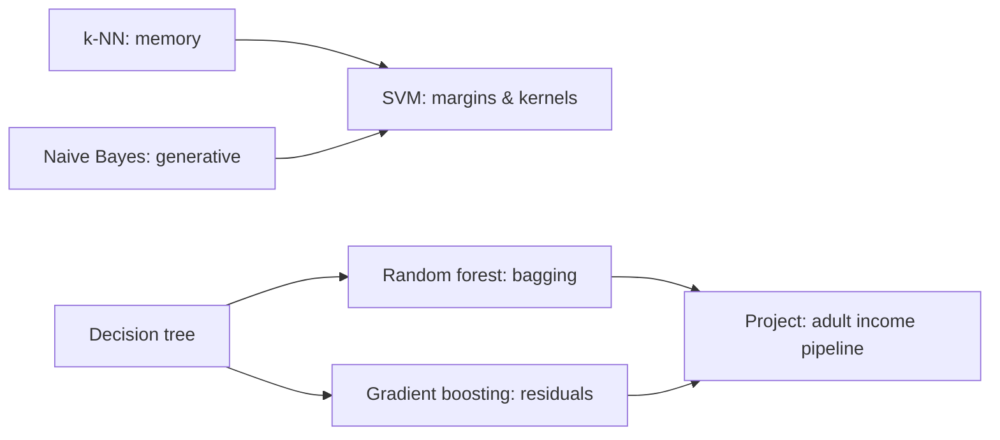

# Week 6 (Days 36-42): The classical ML toolbox: k-NN, naive Bayes, SVMs, trees, forests, boosting

**Status:** written in full. Titles match `SYLLABUS.md`.

## Week goals
1. Build k-NN, Gaussian naive Bayes, a hinge-loss linear SVM, a CART decision tree and gradient boosting **from scratch**, and match each against scikit-learn.
2. Understand each model's inductive bias, meaning what kind of pattern it finds easily, so you can pick one for a problem before trying it.
3. Know the ensemble ideas behind most winning tabular models: bagging decorrelates, and boosting corrects residuals.
4. Ship a leakage-proof tabular pipeline on the adult income data.

**Datasets this week** (all fetched by code, nothing is committed): scikit-learn's bundled digits, wine and breast-cancer data, synthetic moons, California housing, and **adult** (US 1994 census income, 48,842 rows, 14 features, fetched from OpenML via `common.load_adult()`).

---

## Day 36: k-nearest neighbours; distance metrics; curse of dimensionality
**Review today:** Day 35 (+1), Day 33 (+3), Day 29 (+7), Day 15 (+21; quick 15-min skim of its self-check).

### Block 1: Concept lesson (1h15)
**Intuition.** "Tell me who your neighbours are and I'll tell you who you are." k-NN has no training step. It stores the data, and to predict a new point it finds the k closest training points and takes a majority vote (classification) or an average (regression). The model *is* the data.

**The knobs.**
- **k:** k = 1 follows every noisy point (low bias, high variance). Large k smooths everything towards the overall majority (high bias).
- **Distance:** Euclidean ‖a − b‖₂ is the default. Manhattan Σ|aᵢ − bᵢ| is more robust to one huge coordinate difference. Cosine distance compares directions (useful for text counts).
- **Weights:** `weights="distance"` lets closer neighbours count more.

**Scaling is not optional.** Distance adds up squared differences across features. If one feature ranges over 1,400 units and another over 2, the first one decides everything.

**The curse of dimensionality.** In high dimensions, random points become almost equally far from each other. "Nearest" stops meaning "similar", because the nearest and farthest neighbours have nearly the same distance. k-NN (and anything distance-based) degrades unless the data really lives on a low-dimensional surface.

**Cost.** Training is O(1). Prediction is O(m·n) per query with brute force. KD-trees and ball trees help in low dimensions, and approximate nearest-neighbour indexes (Month 4's vector databases) help at scale.

### Block 2: Worked example (45 min)
`code/week-06/day36_knn.py`. Verified:
- **Digits** (75/25 stratified split), k = 3: scratch test accuracy **0.9867** (about 10–20 ms, a vectorised NumPy distance matrix via ‖a‖² + ‖b‖² − 2a·b), scikit-learn 0.9867 (about 110 ms). Predictions agree on 100% of rows.
- **k sweep** (5-fold CV on the training split): k=1 0.9881, 3 0.9837, 5 0.9829, 11 0.9792, 25 0.9659, 51 0.9347. On clean digit images, small k is best, because neighbours are reliable.
- **Wine** (13 chemistry features), k = 5: unscaled CV accuracy **0.6913** against **0.9494** with `StandardScaler`. The proline feature spans 1402 units while most others span under 20, so without scaling, k-NN is effectively "nearest proline value".
- **Curse of dimensionality**, as the ratio of nearest to farthest distance for one query among 1000 uniform points: d=2 0.014, d=10 0.279, d=100 0.702, d=1000 0.874. At d=1000 the nearest neighbour is 87% as far as the farthest.

### Block 3: Coding lab (2h)
1. Implement `knn_predict(Xtr, ytr, Xq, k)` with a fully vectorised distance matrix and `np.argpartition` (O(m) per row rather than a full sort). Match `KNeighborsClassifier`.
2. Add `weights="distance"` voting and compare on digits for k = 5 and 25.
3. Re-run the wine experiment with `MinMaxScaler` and with only the proline feature removed. Which matters more: scaling, or dropping the dominant feature?
4. Run k-NN *regression* on California (scaled), sweeping k over 1–50 with CV MAE. Compare with Day 35's linear baseline (0.5289).
5. Stretch: time brute force against `algorithm="kd_tree"` at n = 2, 8 and 64 features with 20,000 points. When does the tree stop helping?

### Block 4: Practice problems (1h)
1. Points A(0, 0) label 0, B(1, 0) label 1, C(0, 3) label 0. Query (0.6, 0). Predictions for k = 1 and k = 3? *(k=1: B → 1. k=3: votes 0, 1, 0 → 0.)*
2. A feature in metres is rescaled to millimetres. What happens to unscaled k-NN? *(That feature's influence grows 1000×.)*
3. Why does k = 1 always give 100% training accuracy (with no duplicate points)? *(Each point is its own nearest neighbour.)*
4. Name two ways to fight the curse of dimensionality. *(Dimensionality reduction such as PCA on Day 50; feature selection; learned embeddings.)*
5. Prediction cost for 1M stored points, 100 features and 1000 queries, by brute force? *(About 10¹¹ multiply-adds.)*

### Block 5: Review (1h)
- Do the spaced reviews listed at the top.
- **Self-check:**
  1. How does k control bias and variance?
  2. Why must features be scaled, and what did wine show?
  3. State the curse of dimensionality in one sentence, with our d=1000 number.
  4. What are the training and prediction costs of brute-force k-NN?
  5. When would you use cosine distance?

### Going deeper (optional)
**1-NN's error is at most twice the Bayes error, asymptotically.** The classic Cover–Hart result says that with infinite data, 1-NN's error is at most twice the best possible error. It explains why such a "dumb" method is a respectable baseline. **Metric learning** learns a distance (for example a linear map before Euclidean distance) so that same-class points come closer together. Siamese networks and contrastive learning in Month 3 are its deep descendants.

### Common mistakes / how to debug
- Fitting the scaler on all data before splitting. Use a pipeline.
- An even k in binary problems allows ties. Pick odd k, or use distance weights.
- Memory blow-up from an m×m distance matrix. Process queries in chunks.

### What to do next
Tomorrow's model is the opposite of k-NN: naive Bayes compresses each class into a few numbers, and it is *generative*.

---

## Day 37: Naive Bayes; generative vs discriminative models
**Review today:** Day 36 (+1), Day 34 (+3), Day 30 (+7), Day 16 (+21; quick 15-min skim of its self-check).

### Block 1: Concept lesson (1h15)
**Two philosophies.**
- A **discriminative** model learns P(y | x) directly. Logistic regression asks "where is the boundary?"
- A **generative** model learns how each class *produces* data, P(x | y), plus the class frequencies P(y). It then flips them with Bayes' rule (Day 18): P(y | x) ∝ P(x | y)·P(y).

**The naive assumption.** Within a class, features are independent: P(x | y) = Πⱼ P(xⱼ | y). That is almost never true, but it turns an impossible density estimate into n one-dimensional ones. **Gaussian NB** gives each feature a per-class mean and variance. **Multinomial NB** models word counts, with Laplace smoothing α (pretend every word appeared α extra times) so an unseen word does not zero out the product.

**Work in logs.** Multiplying 1000 small probabilities underflows to 0. Sum log-probabilities instead and compare classes by their **log joint**, log P(y) + Σ log P(xⱼ | y).

**When does it shine?** It needs very little data, trains in one pass, handles thousands of text features, and is a strong text baseline. A classic theoretical result (Ng & Jordan, 2001) says generative models can approach their (higher) asymptotic error *faster*, so they may beat logistic regression at small m. Today you test that claim yourself rather than taking it on faith.

### Block 2: Worked example (45 min)
`code/week-06/day37_naive_bayes.py`. Verified:
- **Wine** Gaussian NB, scratch vs scikit-learn: both **0.9630** test accuracy, with identical predictions. The first test row's log joint per class was [−13.25, −43.15, −100.06]. Class 0 wins by about 30 nats, so the posterior rounds to [1, 0, 0]. NB posteriors are often overconfident like this, because the double-counted correlated evidence multiplies up (Day 54 measures calibration).
- **Tiny spam filter** (6 toy messages, MultinomialNB, α = 1): P(spam | "buy now") = 0.928, P(spam | "meeting tomorrow") = 0.107, P(spam | "cheap meeting") = 0.519. One spammy word and one hammy word cancel out.
- **NB vs logistic regression by training size** (breast cancer, mean test accuracy over 30 random draws):

| m | GaussianNB | LogReg |
|---|---|---|
| 10 | 0.8493 | 0.8946 |
| 20 | 0.9237 | 0.9265 |
| 40 | 0.9281 | 0.9446 |
| 80 | 0.9288 | 0.9542 |
| 160 | 0.9282 | 0.9630 |
| 340 | 0.9338 | 0.9655 |

**Honest finding:** here NB did *not* win at small m. Logistic regression (on scaled features) led at every size. NB did plateau early (0.928 from m = 40 onwards), which matches the "reaches its asymptote faster" half of the theory. The "beats LR at small m" half did not show up on this dataset. Theory describes tendencies, not guarantees, and you should always measure.

### Block 3: Coding lab (2h)
1. Implement `GaussianNB` from scratch (class priors, per-class means and variances plus a small variance floor, log joint), and reproduce 0.9630 on wine.
2. Implement multinomial NB with Laplace smoothing on the 6-message toy corpus. Verify P(spam | "buy now") = 0.928.
3. Try to *make* NB win: repeat the m-sweep on wine, or on digits with `GaussianNB` vs unregularised logistic regression. Report what you find either way.
4. Print the per-class posteriors for 10 test rows and count how many have max posterior > 0.999. What does that tell you about the naive assumption?
5. Stretch: `ComplementNB` vs `MultinomialNB` on `fetch_20newsgroups` with two categories (scikit-learn downloads it). Report accuracy and training time.

### Block 4: Practice problems (1h)
1. P(spam) = 0.4, P("win" | spam) = 0.3, P("win" | ham) = 0.01. Compute P(spam | "win"). *(0.12/(0.12 + 0.006) ≈ 0.952.)*
2. Why does Laplace smoothing matter? *(Without it, one unseen word makes P(x | y) = 0 for that class.)*
3. Is logistic regression generative or discriminative? *(Discriminative.)*
4. Two perfectly duplicated features in NB. What happens? *(Their evidence counts twice, so the model is overconfident.)*
5. Gaussian NB with shared variances across classes has what kind of boundary? *(Linear.)*

### Block 5: Review (1h)
- Do the spaced reviews listed at the top.
- **Self-check:**
  1. State the naive independence assumption.
  2. Why compute in log space?
  3. What is the difference between generative and discriminative models?
  4. What did our m-sweep show, honestly?
  5. What is Laplace smoothing?

### Going deeper (optional)
With shared covariance, Gaussian class-conditionals give exactly logistic regression's functional form for P(y | x) (linear discriminant analysis). The two then differ only in *how the parameters are fitted*: by maximising the joint P(x, y) or the conditional P(y | x). That is the cleanest way to see "generative vs discriminative" as a statement about the objective, not the model shape.

### Common mistakes / how to debug
- Zero variance for a constant feature gives division by zero. Add a variance floor (scikit-learn's `var_smoothing`).
- Feeding TF-IDF floats or negative values to MultinomialNB. It expects non-negative counts.

### What to do next
Tomorrow: support vector machines, which focus on the points near the boundary and use kernels to bend it.

---

## Day 38: Support vector machines and kernels
**Review today:** Day 37 (+1), Day 35 (+3), Day 31 (+7), Day 17 (+21; quick 15-min skim of its self-check).

### Block 1: Concept lesson (1h15)
**Intuition.** Many lines can separate two classes. The SVM picks the one with the **widest margin**, the widest "street" with no points inside it. A wide street is a confident boundary, and it tends to generalise. Only the points on or inside the street edges, the **support vectors**, define it. Move any other point a little and nothing changes.

**Soft margin and hinge loss.** Real data overlaps, so we allow violations at a price:

> minimise ½‖w‖² + C·Σᵢ max(0, 1 − yᵢ(w·xᵢ + b)), with yᵢ ∈ {−1, +1}

The **hinge** max(0, 1 − y·f) is zero for points safely outside the street and grows linearly inside it.
- Large C means violations are expensive: a narrow street that fits training data closely (more variance).
- Small C means a wide, tolerant street (more bias).

Compare logistic loss, log(1 + e^{−yf}): a smooth hinge that never reaches exactly zero.

**Kernels.** Some data is not linearly separable, like two interleaved moons. Map x to features φ(x) where it is separable. The SVM's dual form only uses dot products φ(a)·φ(b), so we can substitute a **kernel** K(a, b) that computes that dot product without ever building φ. The RBF kernel K(a, b) = exp(−γ‖a − b‖²) is a similarity: large γ means each point influences only a tiny neighbourhood (wiggly boundary), and small γ means smooth.

**Cost.** Kernel SVMs scale roughly between m² and m³, so they are great up to around 10⁴–10⁵ rows. Beyond that, linear SVMs or trees win.

### Block 2: Worked example (45 min)
`code/week-06/day38_svm.py`. Verified:
- **Breast cancer, linear**: scratch subgradient descent on the hinge objective reaches test accuracy **0.9650** with objective 15.80. `LinearSVC(loss="hinge")` reaches 0.9650 with objective 15.74. The scratch optimiser lands within 0.4% of the exact optimum.
- 20 of 426 training points are on or inside the margin (y·f ≤ 1), so the boundary is defined by fewer than 5% of the rows.
- **Moons with an RBF kernel** (train/test accuracy and number of support vectors):

| C | γ | train | test | #SV |
|---|---|---|---|---|
| 0.1 | 0.1 | 0.820 | 0.860 | 158 |
| 0.1 | 1 | 0.885 | 0.915 | 120 |
| 0.1 | 50 | 0.530 | 0.470 | 195 |
| 10 | 0.1 | 0.880 | 0.910 | 73 |
| 10 | 1 | 0.930 | 0.915 | 40 |
| 10 | 50 | 0.980 | 0.900 | 154 |

- Linear SVC on moons: 0.880.

How to read it: **C=10, γ=50** fits training nearly perfectly (0.98) and drops on test, which is variance. **C=0.1, γ=50** collapses (0.47 test), because tiny-radius kernels with a weak penalty leave almost every point a support vector and the boundary is meaningless. **C=10, γ=1** gives the best test accuracy with the fewest SVs (40). A small support-vector count is often a sign of a clean fit. Look at `out/day38_rbf_grid.png`.

### Block 3: Coding lab (2h)
1. Implement subgradient descent on the hinge objective with labels in {−1, +1}. The subgradient for a margin violator is −C·yᵢxᵢ, plus w from the regulariser. Reproduce an objective within 1% of LinearSVC.
2. Plot the hinge, logistic and 0-1 losses against the margin y·f on one chart.
3. Run a 5-fold CV grid over C ∈ {0.1, 1, 10, 100} and γ ∈ {0.1, 0.3, 1, 3, 10} on moons and pick the winner. Compare with the table above.
4. Check your understanding of kernels: compute the RBF kernel matrix for 5 points by hand in NumPy and compare with `sklearn.metrics.pairwise.rbf_kernel`.
5. Stretch: time `SVC(kernel="rbf")` at m = 2k, 8k and 32k rows of `make_moons`, and fit the scaling exponent (time ∝ m^p).

### Block 4: Practice problems (1h)
1. A point with y = +1 and f(x) = 0.3. Hinge loss? *(0.7.)* With f = 1.5? *(0.)*
2. Why are SVM scores not probabilities? *(Hinge isn't a log-likelihood. You need Platt scaling; see Day 54.)*
3. Feature map for the kernel (a·b)², with 2-D inputs? *(φ(x) = (x₁², √2x₁x₂, x₂²).)*
4. Effect of doubling C on the margin width? *(It typically narrows.)*
5. Why must you scale features before an RBF SVM? *(The kernel uses Euclidean distance, as with k-NN.)*

### Block 5: Review (1h)
- Do the spaced reviews listed at the top.
- **Self-check:**
  1. Write the soft-margin objective.
  2. What is a support vector?
  3. What does γ do in an RBF kernel?
  4. In our grid, which setting overfit and which collapsed?
  5. Roughly how do kernel SVMs scale with m?

### Going deeper (optional)
**The dual and the kernel trick.** Lagrangian duality turns the problem into maximising Σαᵢ − ½ΣΣ αᵢαⱼyᵢyⱼ K(xᵢ, xⱼ) subject to 0 ≤ αᵢ ≤ C and Σαᵢyᵢ = 0. Points with αᵢ > 0 are the support vectors, and the prediction is f(x) = Σ αᵢyᵢ K(xᵢ, x) + b. Kernel ridge regression and Gaussian processes reuse the same Gram-matrix machinery.

### Common mistakes / how to debug
- Labels in {0, 1} for a hand-written hinge loss. Convert to ±1.
- Searching C and γ on a linear grid. Use logarithmic steps.
- Calling `SVC(probability=True)` and trusting the probabilities without checking calibration.

### What to do next
Tomorrow: decision trees, a completely different inductive bias made of axis-aligned questions, with no need for scaling.

---

## Day 39: Decision trees: entropy, Gini, splitting
**Review today:** Day 38 (+1), Day 36 (+3), Day 32 (+7), Day 18 (+21; quick 15-min skim of its self-check).

### Block 1: Concept lesson (1h15)
**Intuition.** A tree is a game of 20 questions. "Is worst perimeter ≤ 106?" If yes, ask another question, and so on until a leaf says "benign". Each question splits the data on one feature at one threshold. The algorithm (CART) chooses, greedily, the split that makes the children **purest**.

**Impurity measures** for a node with class proportions pₖ:
- **Gini** = 1 − Σ pₖ². The chance two random draws disagree.
- **Entropy** = −Σ pₖ log₂ pₖ. Bits needed to name the class.
- A split's quality is the parent impurity minus the size-weighted child impurity. With entropy, that difference is the **information gain**.

**Greedy search.** For every feature, sort its values. Every midpoint between consecutive distinct values is a candidate threshold. Evaluating all of them costs O(n·m log m) per node. Recurse until nodes are pure or a stopping rule fires (`max_depth`, `min_samples_leaf`).

**Properties.**
- No scaling needed, because only the order of values matters.
- Handles mixed feature types and interactions naturally.
- Easy to explain.
- **High variance:** a fully grown tree memorises its training data, and a small change to the data can change the whole tree. Tomorrow's forests fix this.

**Regression trees** use variance (MSE) as impurity and predict the leaf mean.

### Block 2: Worked example (45 min)
**By hand.** A parent node has 6 positives and 4 negatives. Gini = 1 − (0.6² + 0.4²) = 0.48, entropy = 0.971 bits. Split it into L = [5 pos, 1 neg] and R = [1 pos, 3 neg]:
- Weighted Gini = 0.6·(1 − (5/6)² − (1/6)²) + 0.4·(1 − 0.25² − 0.75²) = **0.3167**.
- Information gain = **0.2564** bits.

**Code.** `code/week-06/day39_trees.py` on breast cancer. Verified:
- Scratch CART matches scikit-learn exactly. At depth 1 both reach test accuracy **0.8881**. At depth 3 both reach **0.9161**. Both choose the same root split: feature 22 (*worst perimeter*) ≤ 106.10.
- The printed depth-2 tree asks about *worst concave points* next. Notice that both right-hand leaves say class 0: a split can improve purity without changing the majority label.
- **Depth sweep:**

| depth | train | test | leaves |
|---|---|---|---|
| 1 | 0.9296 | 0.8881 | 2 |
| 2 | 0.9319 | 0.8881 | 4 |
| 3 | 0.9765 | 0.9161 | 8 |
| 5 / 8 / None | 1.0000 | 0.9021 | 18 |

From depth 5 the tree is pure (train accuracy 1.0, 18 leaves), and test accuracy *drops* from 0.9161 to 0.9021. That is the overfitting signature from Day 32 in a new model family.

### Block 3: Coding lab (2h)
1. Write `gini(y)`, `entropy(y)` and `best_split(X, y)` (loop over features, then sorted unique midpoints) and test them on the hand example.
2. Build the recursive `fit(X, y, depth)` that returns nested dicts, and `predict_one(node, x)`. Match scikit-learn at depth 1 and 3.
3. Speed it up: use cumulative class counts over sorted values so each feature's scan is O(m), not O(m²). Time both versions.
4. Prune with `ccp_alpha`: plot the `cost_complexity_pruning_path`, then pick α by 5-fold CV. How many leaves remain?
5. Stretch: implement a regression tree (MSE impurity) and fit y = sin(x) + noise at depths 1, 3 and 8. Plot the staircase predictions.

### Block 4: Practice problems (1h)
1. Gini of [10 pos, 0 neg]? Of [5, 5]? *(0 and 0.5.)*
2. Entropy of a fair 4-class node? *(2 bits.)*
3. Why don't trees need feature scaling? *(Splits depend only on the order of values.)*
4. How many candidate thresholds does a feature with 7 distinct values have? *(6.)*
5. A tree with depth limit d has at most how many leaves? *(2^d.)*

### Block 5: Review (1h)
- Do the spaced reviews listed at the top.
- **Self-check:**
  1. Define Gini and entropy.
  2. Compute the weighted Gini of a split.
  3. Why is a fully grown tree high variance?
  4. What was our root split?
  5. At what depth did test accuracy peak?

### Going deeper (optional)
Finding the globally optimal tree is NP-hard, which is why CART is greedy. Greedy trees can miss an XOR pattern: neither feature alone reduces impurity, so the first split looks useless even though two splits would solve it. Modern libraries handle categorical features by sorting categories by target mean (an optimal trick for binary targets). HistGradientBoosting bins features into at most 255 bins so split search costs O(bins).

### Common mistakes / how to debug
- Reading the top split as "the most important feature". Use Day 43's permutation importance instead.
- One-hot encoding a 500-level category for a single tree, which makes deep sparse splits. Consider native categorical support.

### What to do next
Tomorrow: average hundreds of high-variance trees to get a low-variance forest.

---

## Day 40: Random forests and bagging
**Review today:** Day 39 (+1), Day 37 (+3), Day 33 (+7), Day 19 (+21; quick 15-min skim of its self-check).

### Block 1: Concept lesson (1h15)
**Intuition.** Ask one expert and you get their quirks. Ask 300 independent experts and their quirks cancel. **Bagging** (bootstrap aggregating) trains each tree on a **bootstrap sample**, m rows drawn *with replacement*, and averages their votes. If each tree has variance σ² and the trees have pairwise correlation ρ, the average of B trees has variance

> ρσ² + (1 − ρ)σ²/B

More trees kill the second term. The first term only falls if the trees are *less correlated*.

**Random forests** decorrelate trees further by letting each split consider only a random subset of features (`max_features`, typically √n for classification). A dominant feature then can't be the root of every tree.

**Free validation: out-of-bag (OOB).** Each bootstrap sample leaves out about 1 − (1 − 1/m)^m ≈ 1/e ≈ 36.8% of rows. Score each row using only the trees that didn't see it, and you get a validation estimate without a separate split.

**Properties.** Forests are hard to overfit by adding trees (more trees never hurts accuracy, it only costs time), need little tuning, are embarrassingly parallel (`n_jobs=-1`), and need no scaling. They are weaker than boosting at squeezing out the last percent, and their probabilities are often under-confident.

### Block 2: Worked example (45 min)
`code/week-06/day40_random_forest.py` on **adult** (predict income > $50K; 48,842 rows, positive rate 0.2393; ordinal-encoded categories). Verified:
- A single full-depth tree: train **0.9999**, test **0.8125**. That is memorisation.
- Hand-written bagging of full trees: 1 tree 0.8067, 5 trees 0.8385, 25 trees 0.8511.
- One bootstrap sample contained 0.6312 unique rows (theory: 1 − 1/e = 0.6321).
- The mean pairwise prediction agreement between bagged trees was 0.8182.
- RF with `max_features=None` (pure bagging): OOB 0.8554, test 0.8559, tree agreement 0.8218, 2.8 s.
- RF with `max_features="sqrt"`: OOB 0.8550, test **0.8582**, agreement 0.8163, 1.3 s. The trees are a little less correlated, the result is slightly better, and it is twice as fast because each split looks at fewer features.
- By number of trees: 1 0.8096, 5 0.8414, 20 0.8560, 100 0.8587, 300 0.8595. Gains flatten after about 100 trees.

**Note how closely OOB tracked test** (0.8550 vs 0.8582). OOB is a trustworthy free estimate.

### Block 3: Coding lab (2h)
1. Write `bootstrap_indices(m, rng)` and check the unique fraction over 100 draws (mean about 0.632).
2. Implement bagging by hand with `DecisionTreeClassifier` and majority vote. Reproduce the 1/5/25-tree trend.
3. Compute the OOB score by hand: for each row, average the votes of trees whose bootstrap excluded it. Compare with `oob_score_`.
4. Sweep `max_features` ∈ {1, 2, 4, "sqrt", None} and `min_samples_leaf` ∈ {1, 5, 20}, reporting OOB accuracy and fit time.
5. Stretch: measure tree correlation versus `max_features` and plot it against test accuracy. Does the variance formula's story hold?

### Block 4: Practice problems (1h)
1. Trees with σ² = 1 and ρ = 0.5. What is the variance of the average of B = 100 trees? Of infinitely many? *(0.505; 0.5.)*
2. Why doesn't adding trees overfit? *(Averaging only lowers variance. Bias is unchanged.)*
3. What fraction of rows does one bootstrap sample leave out, for large m? *(About 36.8%.)*
4. Why can OOB replace a validation set? *(Each row is scored only by trees that never saw it.)*
5. Is a random forest a good choice when you need monotone, smooth extrapolation beyond the training range? *(No. Trees predict constants outside the data range.)*

### Block 5: Review (1h)
- Do the spaced reviews listed at the top.
- **Self-check:**
  1. Write the variance of an average of correlated predictors.
  2. What does `max_features` decorrelate?
  3. What is OOB, and how close was it to test?
  4. How large was the single tree's train/test gap?
  5. Where did accuracy plateau in the tree count?

### Going deeper (optional)
**Extremely randomised trees** (`ExtraTreesClassifier`) also pick split thresholds at random. That decorrelates further and trains faster, sometimes at a small accuracy cost. **Bagging works best for low-bias, high-variance learners.** Bagging a linear model helps very little, because its variance is already low.

### Interview-style question (15 min, written)
"Our random forest has 500 trees. Would 5000 make it overfit?" Answer it in writing. Adding trees reduces variance by averaging, so the test error levels off rather than rising. More trees cost time and memory but do not add overfitting in the way deeper trees can. The levers that *do* control overfitting are `max_features` (decorrelation), `min_samples_leaf` and `max_depth`. Explain how you would prove this on your own data: plot the out-of-bag error against the number of trees, which needs no extra validation split. Finally, state when a forest is the wrong tool. When extrapolation beyond the training range matters, trees predict a constant there.

### Common mistakes / how to debug
- `n_jobs=1` on an 8-core box. Use `n_jobs=-1`.
- Treating forest probabilities as calibrated. Check them on Day 54.
- Huge memory use with deep trees on big data. Limit `max_leaf_nodes` or `min_samples_leaf`.

### What to do next
Tomorrow: boosting. Instead of averaging independent trees, each new tree fixes what the previous ones got wrong.

---

## Day 41: Gradient boosting from scratch, then HistGradientBoosting
**Review today:** Day 40 (+1), Day 38 (+3), Day 34 (+7), Day 20 (+21; quick 15-min skim of its self-check).

### Block 1: Concept lesson (1h15)
**Intuition.** Fit a small tree, look at its mistakes (residuals), fit the next small tree *to those mistakes*, add it in with a small weight, and repeat. Each tree is a weak learner (depth 3 or so). Together, hundreds of them form a strong model. It works like a team that edits a draft in turn, each editor fixing what remains wrong.

**Why "gradient".** For squared loss L = ½(y − F)², the negative gradient with respect to the prediction F is exactly the residual y − F. For any differentiable loss (log loss, Huber), we fit each tree to the **negative gradient** ("pseudo-residuals"). Boosting is gradient descent in function space.

**The algorithm (squared loss).**
1. F₀ = mean(y).
2. For t = 1…T: compute rᵢ = yᵢ − F_{t−1}(xᵢ). Fit a depth-d regression tree hₜ to r. Update Fₜ = F_{t−1} + η·hₜ.
3. Predict F_T(x).

**The knobs.**
- **Learning rate η:** smaller is better but needs more trees.
- **Number of trees T:** choose it by early stopping on validation data.
- **Depth:** sets the interaction order.
- **Subsampling:** stochastic boosting.

Unlike forests, boosting **can overfit by adding trees**, because each tree reduces bias and adds variance.

**HistGradientBoosting.** It bins each feature into at most 255 bins, so split finding scans histograms instead of sorted values. That makes it far faster on large m. It also supports native missing values and categorical features. It is scikit-learn's recommended booster for data with more than a few thousand rows, and it follows the same design as LightGBM.

### Block 2: Worked example (45 min)
`code/week-06/day41_gboost.py` on California housing (80/20 split, 200 trees, depth 3, η = 0.1). Verified:
- **Scratch GB** (about 25 lines on top of `DecisionTreeRegressor`): test MSE **0.2553**, 4.9 s.
- **scikit-learn GradientBoostingRegressor**, same settings: test MSE **0.2553**, 4.6 s. The predictions differ by 1.22e-4 on average and are identical on 99.9% of rows. The small maximum difference (0.187) comes from tie-breaking between equally good splits.
- **HistGradientBoostingRegressor** (default settings): test MSE **0.1982**, 0.4–2.3 s across runs (it is multithreaded, so timing depends on machine load). It is better because its defaults use deeper trees (31 leaves) and early stopping, not because of binning.
- **Train/test MSE by stage:** 1: 1.2004/1.1754; 10: 0.6394/0.6521; 50: 0.3089/0.3328; 100: 0.2641/0.2904; 200: 0.2221/0.2553.
- **Learning rate** at 200 trees: η=1.0 0.2738 (overshoots), η=0.1 0.2553, η=0.01 0.5005 (has not converged after 200 small steps). η=0.01 with 2000 trees (HistGB, depth 3): **0.2531**. The small-steps-many-trees rule holds.

### Block 3: Coding lab (2h)
1. Write `ScratchGB.fit/predict` (squared loss) and reproduce 0.2553.
2. Add **early stopping**: keep a validation split, track validation MSE per stage, and stop after 20 stages without improvement. At which stage does it stop with η = 0.3?
3. Generalise to **log loss** for binary classification. The pseudo-residual is y − sigmoid(F). Use leaf values equal to the mean residual (a simplification of the Newton step) and test on breast cancer.
4. Plot train and test MSE against stages for depth 1, 3 and 6.
5. Stretch: compare `HistGradientBoostingRegressor` with `max_bins` = 15, 63 and 255. How much accuracy does coarse binning cost?

### Block 4: Practice problems (1h)
1. y = [3, 5, 10]. Compute F₀ and the first residuals. *(F₀ = 6; residuals −3, −1, 4.)*
2. Negative gradient of ½(y − F)² with respect to F? *(y − F.)*
3. Why can boosting overfit with more trees while RF can't? *(Each boosting tree fits the remaining training error, reducing bias and adding variance. RF averages independent trees.)*
4. With η = 0.01 instead of 0.1, roughly how many more trees do you need? *(About 10×, as our 2000-tree run suggests.)*
5. What does tree depth control in boosting? *(The maximum interaction order between features.)*

### Block 5: Review (1h)
- Do the spaced reviews listed at the top.
- **Self-check:**
  1. Write the boosting update.
  2. What are pseudo-residuals?
  3. What learning-rate/tree-count trade-off did you measure?
  4. Why is HistGB fast?
  5. Bagging vs boosting: which one reduces variance, and which one bias?

### Going deeper (optional)
**Newton boosting** (XGBoost, LightGBM) uses second derivatives. The leaf value is −Σg/(Σh + λ), with gradient g and Hessian h, and the split gain has a closed form with an L2 penalty λ on leaf values. For log loss h = p(1 − p), which makes leaf values better scaled than the mean-residual shortcut from lab step 3.

### Common mistakes / how to debug
- Tuning the number of trees without early stopping, using the test set to choose.
- Very deep trees with a high learning rate, which overfits within a few dozen stages.
- Passing the deprecated `criterion` argument. Recent scikit-learn removed the options, so leave it at its default.

### What to do next
Tomorrow's project: a production-style pipeline on adult income, with logistic regression vs forest vs boosting, chosen by CV.

---

## Day 42: PROJECT W6: tabular pipeline with boosting; Quiz 6
**Review today:** Day 41 (+1), Day 39 (+3), Day 35 (+7), Day 21 (+21; quick 15-min skim of its self-check).

### Block 1: Concept lesson: from notebook to pipeline (1h15)
**Intuition.** Real tables mix numbers, categories and missing values. A good pipeline:
1. Imputes missing values.
2. Encodes categories (one-hot for linear models, ordinal or native for trees).
3. Scales numbers only where needed (linear models).
4. Fits the model, all inside one object that `cross_validate` can refit per fold.

This makes leakage structurally impossible and deployment trivial: one `predict` call on raw rows.

**The dataset: adult income.** 48,842 people from the 1994 US census. There are 14 features: age, workclass, education, marital status, occupation, relationship, race, sex, capital gain/loss, hours per week, native country, and others. The target is income > $50K (positive rate 23.9%). The data contains protected attributes (sex, race). We will look at per-group behaviour on Day 59 and discuss fairness on that day. Today, note that "accuracy" hides who bears the errors.

**Metrics for a 24% positive class.** Accuracy has a 76% floor (always predict ≤ 50K), so also report ROC-AUC (ranking quality) and F1 (the positive class's precision/recall balance).

### Block 2: Worked example: reference results (45 min)
`code/week-06/day42_week_project.py` (75/25 stratified split; 5-fold stratified CV on train). Verified:
- **Missing values:** workclass 2799, occupation 2809, native-country 857. These are encoded as NaN by the OpenML version.

| model | CV acc | CV ROC-AUC | CV F1 | time |
|---|---|---|---|---|
| majority class | 0.7607 | 0.5000 | 0.0000 | 0.05 s |
| logreg + one-hot (imputed, scaled) | 0.8508 | 0.9056 | 0.6568 | 1.3 s |
| random forest (ordinal-encoded) | 0.8637 | 0.9166 | 0.6816 | 4.3 s |
| **HistGB, native categorical** | **0.8720** | **0.9277** | **0.7085** | 1.5 s |

**Test (once), HistGB:** accuracy 0.8714, ROC-AUC 0.9281, F1 0.7065. The test numbers lie within about 0.001 of CV, as you would expect from a sound protocol.

### Block 3: Coding lab: the project (2h)
Deliverable: `notes/week06_report.md` plus your script.
1. **Load and inspect (15 min):** `common.load_adult()`. Print dtypes, missing counts and the class balance. Make one stratified 75/25 split.
2. **Baseline (5 min):** `DummyClassifier`.
3. **Linear pipeline (30 min):** `ColumnTransformer` with numeric (impute median → scale) and categorical (impute "missing" → `OneHotEncoder(handle_unknown="ignore")`) branches → `LogisticRegression`.
4. **Tree pipelines (30 min):** RF with an `OrdinalEncoder` (unknowns → −1), and HistGB with `categorical_features="from_dtype"`.
5. **Compare (15 min):** one `cross_validate` call per model with the *same* `StratifiedKFold`, scoring accuracy, ROC-AUC and F1, and recording times.
6. **Tune (15 min):** a random search over HistGB's `learning_rate`, `max_leaf_nodes` and `l2_regularization` (≤ 20 draws).
7. **Test once, and inspect (10 min):** the confusion matrix, plus accuracy by `sex`. Write down what you see. Don't fix it yet.

**Rubric (self-grade out of 20):**

| criterion | points |
|---|---|
| All preprocessing inside pipelines; raw DataFrame in, predictions out | 5 |
| Same CV splitter for every model; mean ± std reported | 3 |
| Three metrics, with a sentence on why accuracy alone misleads | 3 |
| Tuning documented, and the CV-to-test gap discussed | 3 |
| Confusion matrix and one per-group observation | 3 |
| Reproducible: seed, library versions, run time | 3 |

**Stretch:** add `capital-gain > 0` as a flag feature, and log1p of capital gain. Does the logistic model close the gap to the trees? (Linear models can't make thresholds on their own; trees can.)

### Block 4: Practice: Quiz 6 (1h), closed book, answers below

### Block 5: Review (1h)
- Do the spaced reviews listed at the top.
- **Self-check:**
  1. Why do linear models need one-hot encoding while HistGB doesn't?
  2. What is `handle_unknown="ignore"` for?
  3. Which metric would you report to a stakeholder for this data, and why?
  4. What was HistGB's test AUC?
  5. Name one fairness concern this dataset raises.

### Going deeper (optional)
Compare the predicted positive rate by sex at a 0.5 threshold with the true positive rate by sex. The gap between them is a first look at **demographic parity** vs **equal opportunity**, which Day 59 measures properly.

### Common mistakes / how to debug
- `OneHotEncoder` crashing on test categories. Set `handle_unknown="ignore"`.
- Passing string categories to HistGB without telling it they are categorical. Use the `category` dtype with `categorical_features="from_dtype"`.

### What to do next
Week 7: explain the models (importance, SHAP intuition), engineer features, handle imbalance, harden pipelines, and start unsupervised learning.

---

## Weekly quiz: Week 6
1. How do k and feature scaling affect k-NN?
2. Our d=1000 nearest/farthest ratio was about what, and what does it imply?
3. State the naive Bayes assumption, and why computing in log space matters.
4. Did NB beat logistic regression at small m in our run?
5. Write the soft-margin SVM objective.
6. What does a large RBF γ do?
7. Compute the Gini impurity for [6 pos, 4 neg].
8. What happened to test accuracy when the breast-cancer tree grew past depth 3?
9. Write the variance of an average of B trees with correlation ρ.
10. What fraction of rows is out-of-bag, and how close was OOB to test on adult?
11. In gradient boosting with squared loss, what does each tree fit?
12. Which model won the Week 6 project, with what test AUC?

### Answers
1. Small k means high variance and large k high bias. Without scaling, the widest-range feature dominates (wine: 0.69 unscaled vs 0.95 scaled).
2. 0.874. Distances concentrate, so "nearest" carries little information.
3. Features are independent given the class. Logs avoid underflow when multiplying many small probabilities.
4. No. Logistic regression led at every size; NB only plateaued earlier.
5. ½‖w‖² + C Σ max(0, 1 − yᵢ(w·xᵢ + b)).
6. It shrinks each point's influence radius, so boundaries get wiggly (overfitting, or collapse with small C).
7. 0.48.
8. It fell from 0.9161 to 0.9021 as the tree became pure (overfitting).
9. ρσ² + (1 − ρ)σ²/B.
10. About 36.8% (1/e). OOB 0.8550 vs test 0.8582.
11. The residuals y − F, i.e. the negative gradient of the loss.
12. HistGB with native categoricals: test ROC-AUC 0.9281.
