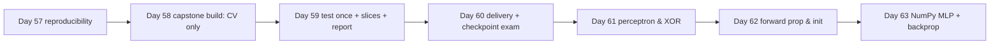

# Week 9 (Days 57-63): Reproducibility, Month-2 capstone, and the first neural networks

**Status:** written in full. Titles match `SYLLABUS.md`.

## Week goals
1. Make an experiment reproducible: seeds, a data fingerprint, a config, model persistence and a run log.
2. Build, evaluate and report the **Month-2 capstone**: a complete tabular ML project with an honest single test evaluation, calibration, slice analysis and a model card.
3. Pass the Month-2 checkpoint exam (six self-graded code exercises).
4. Start Month 3: perceptrons, forward propagation, and a NumPy MLP trained with hand-derived backprop.

**Datasets:** adult (OpenML), as in Weeks 6-8, and scikit-learn's bundled digits. No new downloads.

---

## Day 57: Reproducible experiments: seeds, configs, model persistence
**Review today:** Day 56 (+1), Day 54 (+3), Day 50 (+7), Day 36 (+21; quick 15-min skim of its self-check).

### Block 1: Concept lesson (1h15)
**Intuition.** Six weeks from now someone asks, "how did you get 0.93?" If you can't regenerate that number from a commit, a config and a data version, it isn't a result. It's an anecdote. Reproducibility is also how you catch your own bugs: a number that changes when nothing should have changed is a warning.

**Sources of non-determinism, and fixes.**
1. **Random seeds** in splits, model initialisation, bootstrap sampling and CV shuffles. Pass `random_state` everywhere, and use `np.random.default_rng(seed)` rather than global state.
2. **Data drift under you:** a re-downloaded file, a changed SQL query. Fingerprint the data (a hash of its contents) and store the hash with the result.
3. **Library versions:** default parameters change between releases. Record the Python, NumPy, pandas and scikit-learn versions.
4. **Hardware and threading:** floating-point sums in different orders differ in the last bits. Usually that is harmless. Know that it exists.

**Seed variance is not noise to hide.** Run several seeds and report mean ± std. If two models differ by less than the seed spread, you haven't shown that one is better.

**Persistence.** `joblib.dump(pipeline, path)` saves the *whole fitted pipeline* (preprocessing included). Reload it in the same library versions, and **verify a round trip** (predictions identical after reload). Pickle-based formats can execute code when loaded, so only load files you trust. ONNX and skops are alternatives for safer exchange.

**Minimum run record (`runs.csv` / model card):** timestamp, git commit, data hash, config (all hyperparameters), metric(s), versions, and the artefact path.

### Block 2: Worked example (45 min)
`code/week-09/day57_persistence.py` (adult, HistGB). Verified:
- Data fingerprint `cd37a2b18a7dd171` (first 16 hex digits of a SHA-256 over the pandas row hashes).
- Two runs with the same config give test AUC 0.928072 both times. **Identical.**
- Five seeds (changing both the split and the model seed): [0.9281, 0.9281, 0.9296, 0.9296, 0.9277], **mean 0.9286, std 0.0008**. Any model comparison closer than about 0.002 AUC on this setup is within seed noise.
- `joblib` dump plus load took roughly 60-110 ms across our runs. The file is 451 KiB, and predictions are **bit-identical** after reload.
- It writes `out/model_card.json` (data hash, config, test_auc, versions) and appends a row to `out/runs.csv`.

### Block 3: Coding lab (2h)
1. Write `fingerprint(df)` and show that it changes if you alter one cell.
2. Put the config in a dict or YAML file. The script must read *all* hyperparameters from it, with no literals in model code.
3. Add the current git commit (`git rev-parse --short HEAD`, if available) to the model card.
4. Seed study: 10 seeds for HistGB and for random forest. Is the difference in mean AUC larger than about 2 standard deviations?
5. Round trip: save, reload in a *fresh* Python process, and `assert np.array_equal(p_before, p_after)`.
6. Stretch: export the logistic-regression pipeline to ONNX (`skl2onnx`, if you choose to install it) and compare its predictions to 1e-6.

### Block 4: Practice problems (1h)
1. Model A has 0.9290 and model B 0.9281, one seed each, with seed std 0.0008. Conclusion? *(Not distinguishable. Run more seeds.)*
2. Why save the whole pipeline, not just the classifier? *(The preprocessing is part of the model; without it, predictions on raw data are wrong.)*
3. What does a data fingerprint protect against? *(Silent data changes.)*
4. Why is unpickling an untrusted file dangerous? *(It can execute arbitrary code.)*
5. Name four fields of a run record. *(Commit, data hash, config, metric, versions, time.)*

### Block 5: Review (1h)
- Do the spaced reviews listed at the top.
- **Self-check:**
  1. Name four sources of non-determinism.
  2. What did the 5-seed spread show?
  3. How do you verify persistence?
  4. What goes in a model card?
  5. Why record library versions?

### Going deeper (optional)
Experiment trackers (MLflow, Weights & Biases) automate the run log, artefacts and comparison plots. DVC versions large data alongside git. Try MLflow's local mode for a day and decide whether its overhead pays off for a project your size.

### Interview-style question (15 min, written)
"I can't reproduce your 0.93 from last month." Write the reply you wish you could send. It would contain the git commit, the data fingerprint, the config file, the library versions and the command, all read from the model card, plus the seed spread, so the colleague knows that a result within ±0.002 counts as a reproduction. Then list what you would change in your workflow if you could *not* send that reply: a run log appended automatically by every training script, configs in files rather than code, and a CI job that re-runs the smallest experiment weekly and fails if its metric moves beyond the seed spread.

### Common mistakes / how to debug
- Seeding only NumPy and forgetting the CV shuffle.
- Reporting the best of 10 seeds as "the" result.
- Loading a joblib file under a different scikit-learn version and ignoring the warning.

### What to do next
Tomorrow: the Month-2 capstone build. Everything from Weeks 5-9 in one project, and no peeking at the test set.

---

## Day 58: MONTH-2 CAPSTONE (part 1): build and compare, CV only
**Review today:** Day 57 (+1), Day 55 (+3), Day 51 (+7), Day 37 (+21; quick 15-min skim of its self-check).

### Block 1: Concept lesson: the capstone brief (45 min)
**Brief.** Build a classifier that predicts whether a person's income exceeds $50K from 1994 US census features (adult). Treat it as a mock "outreach targeting" task. The stakeholder needs **precision ≥ 0.70** (most people contacted should qualify) while catching as many qualifying people as possible. Deliver:
1. A frozen model artefact.
2. A one-page report with test metrics, calibration and slices.
3. A model card.
4. Reproducible code.

**The rules (from Days 39-45).**
1. Split off the test set (25%, stratified, seed 0) on day one, and **don't touch it until Day 59**.
2. All choices (model, hyperparameters, threshold) come from CV on the training split.
3. Preprocessing lives inside pipelines.
4. Compare against simple baselines.
5. Report the spread, not just means.

**Ethics note.** Adult contains sex and race. We use them in *evaluation slices* to look for unequal error rates. Whether to use them as *features* in a real decision system is a legal and ethical question, not just a technical one. For many real decisions it is restricted. In the lab you will train a variant without them and compare.

### Block 2: Worked example: the reference build (1h15)
`code/week-09/capstone.py` (a reusable library) plus `day58_capstone_build.py`. Verified on the 36,631-row training split:
- **Data checks:** 34 duplicate rows, 4,816 missing cells (in workclass, occupation and native-country), positive rate 0.2393. No blocking problems.
- **CV comparison** (5-fold, stratified):

| model | ROC-AUC (± std) | PR-AUC | log loss | accuracy | fit s |
|---|---|---|---|---|---|
| **hist_gb_tuned** (lr 0.05, ≤500 iters, early stopping, L2 1.0) | **0.9280 ± 0.0030** | 0.8278 | 0.2778 | 0.8723 | 0.52 |
| hist_gb (defaults) | 0.9277 ± 0.0030 | 0.8272 | 0.2782 | 0.8720 | 0.26 |
| random_forest | 0.9166 ± 0.0022 | 0.8044 | 0.3003 | 0.8637 | 0.74 |
| logreg (one-hot + scaling) | 0.9068 ± 0.0032 | 0.7661 | 0.3180 | 0.8512 | 0.21 |

**Reading it honestly.** The tuned and default HistGB differ by 0.0003 AUC, far inside the fold std (0.003) and the seed std (Day 57, 0.0008). We pick `hist_gb_tuned` by the pre-registered rule "highest mean CV AUC", but **the tuning did not meaningfully help**. Say so in the report. Both boosted models clearly beat the forest and logistic regression.

**Threshold.** On out-of-fold CV predictions, the lowest threshold reaching precision ≥ 0.70 is **0.3778** (CV precision 0.7000, recall 0.7601). This is chosen *before* seeing the test data. The model, threshold and CV table are saved to `out/`.

### Block 3: Coding lab: your build (2h30)
Work in your own `capstone_mine/` folder. You may reuse `capstone.py`, but you must be able to explain every line of it.
1. Data checks. Print the dtypes, missingness per column, duplicates and class balance. Decide what to do about the duplicates and write down why.
2. At least four candidate pipelines, including one of your own design (e.g. Day 44's target encoding plus logreg, or a feature-engineered HistGB: capital-gain > 0, hours bins).
3. Build a CV table with mean ± std and fit time.
4. Train a **variant without sex and race** and compare its CV AUC with the full model.
5. Choose the threshold for precision ≥ 0.70 on CV predictions.
6. Save `capstone_model.joblib`, `cv_table.csv`, and `choice.json` (model name, threshold, config, data hash).

### Block 4: Practice problems (30 min)
1. Why choose the threshold on CV predictions rather than on the training-fit predictions? *(Training predictions are overconfident.)*
2. Two models differ by 0.0003 AUC with fold std 0.003. Which do you pick, and how do you report it? *(Either; pre-register a rule; report "no meaningful difference".)*
3. Why is fit time in the table? *(It is a satisficing constraint and affects retraining cost.)*
4. Where should imputation happen? *(Inside the CV pipeline.)*

### Block 5: Review (1h)
- Do the spaced reviews listed at the top.
- **Self-check:**
  1. List the five capstone rules.
  2. What was the CV winner, and was the win meaningful?
  3. What threshold met precision 0.70?
  4. Why keep sex and race in the slices?
  5. What files make up the frozen artefact?

### Going deeper (optional)
Look up "pre-registration" in science. Writing down the selection rule, the metric and the threshold criterion *before* the comparison is the strongest defence against fooling yourself with many comparisons. Write a three-line `PLAN.md` before you run step 3.

### Common mistakes / how to debug
- Peeking at test "just to check".
- Choosing among 20 models by CV and then reporting the winner's CV score as unbiased. It is optimistically biased, which is why the test set exists.

### What to do next
Tomorrow: evaluate once on test, then dig into calibration and fairness slices.

---

## Day 59: Month-2 capstone (part 2): test evaluation, slices, report
**Review today:** Day 58 (+1), Day 56 (+3), Day 52 (+7), Day 38 (+21; quick 15-min skim of its self-check).

### Block 1: Concept lesson: evaluating like a reviewer (45 min)
**One shot.** Load the frozen model and threshold, then predict on the test set **once**. Report:
1. Ranking metrics: ROC-AUC and PR-AUC, with a **bootstrap 95% CI** (resample test rows with replacement, recompute, and take the 2.5th and 97.5th percentiles).
2. Operating-point metrics at the chosen threshold: precision and recall. Did precision ≥ 0.70 hold on new data?
3. Calibration: a reliability table and the Brier score.
4. **Slice metrics:** for each group, n, base rate, predicted-positive rate, recall and precision. Small groups give noisy estimates, so always show n.

**Fairness vocabulary (brief).**
- **Demographic parity:** equal predicted-positive rates.
- **Equal opportunity:** equal recall (true positive rate).
- **Predictive parity:** equal precision.

When base rates differ these generally *can't all hold at once*. Choosing which to prioritise is a values decision, and you should document it, not hide it.

### Block 2: Worked example: the reference results (1h15)
`code/week-09/day59_capstone_report.py` (it re-runs Day 58 if the model is missing) writes `out/report.md`. Verified on the 12,211-row test split:

- **Test ROC-AUC 0.9291**, bootstrap 95% CI [0.9237, 0.9331]. PR-AUC 0.83. The CV estimate (0.9280) falls well inside the interval, so there is no sign of overfitting to CV.
- **At threshold 0.3778:** precision **0.7026** (the ≥ 0.70 requirement held, narrowly) and recall 0.7567. Accuracy at 0.5 is 0.8727, and Brier is 0.0877.
- **Calibration:** close to the diagonal. For example, the top decile has mean predicted 0.926 against observed 0.942.

**Slices by sex:**

| group | n | base rate | pred. positive rate | recall | precision |
|---|---|---|---|---|---|
| Female | 4,064 | 0.110 | 0.103 | 0.661 | 0.708 |
| Male | 8,147 | 0.304 | 0.335 | 0.774 | 0.702 |

Precision is equal (predictive parity roughly holds). **Recall is 11 points lower for women**: qualifying women are missed more often.

**Slices by race:**

| group | n | recall | precision |
|---|---|---|---|
| Amer-Indian-Eskimo | 113 | 0.538 | 0.467 |
| Asian-Pac-Islander | 371 | 0.697 | 0.663 |
| Black | 1,175 | 0.672 | 0.647 |
| Other | 103 | 0.667 | 0.833 |
| White | 10,449 | 0.765 | 0.707 |

Recall and precision are lower for most minority groups. With n = 113 and n = 103, however, those groups hold only about 13-15 positives each, so their estimates are very noisy. Bootstrap them before drawing conclusions (lab step 3).

### Block 3: Coding lab: your report (2h30)
1. Run your frozen model on test once. Save the predictions to `test_preds.csv` so you never need to re-predict.
2. Bootstrap CIs for AUC, and for precision and recall at your threshold (1,000 resamples).
3. Build the slice table for sex and race with **bootstrap CIs for recall**. Which gaps survive the uncertainty?
4. Compare the no-sex/race variant's slices with the full model's. Did removing the features close the recall gap? (Often it does not, because other features act as proxies. Check your own numbers.)
5. Write `report.md`:
   - the problem,
   - the data and its caveats (1994, US-only, sampling),
   - the CV table,
   - the test results with CIs,
   - calibration,
   - slices with discussion,
   - limitations,
   - recommended use and misuse.

### Block 4: Practice problems (30 min)
1. Test precision 0.7026 when the requirement was ≥ 0.70. What would you tell the stakeholder? *(It is met on this sample, but the CI likely includes values below 0.70, so monitor it in production or raise the threshold slightly.)*
2. Group with n = 103, recall 0.667 from about 15 positives. How wide could the CI be? *(Very wide: roughly ±0.25.)*
3. Equal precision and unequal recall: which fairness criterion holds? *(Predictive parity, not equal opportunity.)*
4. Why is the CV estimate falling inside the test CI reassuring? *(It is consistent with no selection overfitting.)*

### Block 5: Review (1h)
- Do the spaced reviews listed at the top.
- **Self-check:**
  1. What should a one-shot test evaluation report?
  2. Describe the bootstrap CI recipe.
  3. Name three fairness criteria.
  4. Which group had the largest recall gap?
  5. Why show n in slice tables?

### Going deeper (optional)
Read the original "Model Cards for Model Reporting" idea (Mitchell et al., 2019): intended use, factors, metrics, evaluation data, ethical considerations and caveats. Map each section to something in your report, and note which ones you can't fill in honestly.

### Common mistakes / how to debug
- Re-running the test evaluation after changing something. Once you've looked, the test set is spent, so collect a new one or state clearly that you re-used it.
- Hiding unflattering slices.

### What to do next
Tomorrow: deliver the capstone, sit the checkpoint exam, and run a review session for Month 2.

---

## Day 60: MONTH-2 CAPSTONE delivery + checkpoint exam and review
**Review today:** Day 59 (+1), Day 57 (+3), Day 53 (+7), Day 39 (+21; quick 15-min skim of its self-check).

### Block 1: Capstone delivery checklist (1h)
Your capstone is done when a stranger could clone the repository and get your numbers. Check each item:
1. `README.md` gives the problem, how to run it (one command), and the expected outputs.
2. Running from scratch regenerates `cv_table.csv`, the model and `report.md` with **the same numbers**. Run it twice and `diff` the outputs.
3. The model card covers the data hash, config, versions, metrics with CIs, intended use, out-of-scope uses, slice results and limitations.
4. The test set was used once, and the report says so.
5. Every number in the report comes from a file the code wrote. Nothing is copied by hand.

**Capstone rubric (self-grade out of 30):**

| criterion | points |
|---|---|
| Clean, leak-free pipeline; test touched once | 6 |
| Baselines and ≥ 4 candidates compared with CV mean ± std | 5 |
| Threshold chosen on CV for the stated business constraint | 3 |
| Test metrics with bootstrap CIs; constraint checked | 4 |
| Calibration assessed (table or plot plus Brier) | 3 |
| Slice analysis with n, CIs and an honest discussion | 5 |
| Reproducible: one command, same numbers twice, model card | 4 |

24+ is excellent, 18-23 is solid (fix the gaps this week), and below 18 means you should redo the weakest sections before Month 3.

### Block 2: Checkpoint exam: code (1h15)
`code/week-09/day60_checkpoint.py` holds six exercises with automatic checks. Write each function yourself in a fresh file, **without notes**, and then run the checks against your versions. (The reference solutions inside the script are for after you're done.)
1. Ridge regression closed form, matching `sklearn.linear_model.Ridge`.
2. K-fold index generator, matching `KFold`.
3. Gini impurity (gini([0, 0, 1, 1]) = 0.5, and a pure node = 0).
4. One k-means step that does not increase inertia.
5. Rank-based ROC-AUC, matching `roc_auc_score`.
6. PCA via SVD: uncorrelated components with descending variance.

The reference run passes 6/6. Target: 5/6 within 75 minutes.

### Block 3: Checkpoint exam: concepts (1h)
Answer in writing, in at most five sentences each:
1. A colleague reports 0.97 accuracy on a fraud dataset with 1% fraud. What three questions do you ask?
2. Explain why shuffled CV failed on the bike data (Day 53), with the numbers.
3. Bias or variance? Train error 0.0, val 0.19, and the curve is still decreasing (Day 55). What next?
4. Why did Platt scaling leave AUC unchanged but fix the Brier score?
5. Random forest vs gradient boosting: what does each reduce, and how?
6. Your clustering silhouette says k = 3 but the domain expert says 4. How do you proceed?
7. When is anomaly detection preferable to supervised classification?
8. In the capstone, the tuned model "won" by 0.0003 AUC. Write the sentence you'd put in the report.

**Grading:** compare your answers with the relevant lesson's Block 1 and the quizzes. Give 2 points for each answer that includes the key idea *and* a number from our runs where one applies.

### Block 4: Review session (1h)
Do a heavier review today:
- Shuffle all of `flashcards/month-02.csv` and go through it once. Mark the cards you miss.
- Re-take the questions you missed in Quizzes 5-8.
- Write a one-page "Month 2 in my own words" summary. Supervised learning beyond linear models, evaluation, unsupervised learning, strategy, systems.

### Block 5: Review (30 min)
- Do the spaced reviews listed at the top.
- **Self-check:**
  1. What would make your capstone irreproducible?
  2. Which checkpoint exercise was hardest, and why?
  3. Which three Month-2 ideas will you use most?

### Going deeper (optional)
Publish (privately, or publicly if you like) your capstone as a short write-up: the problem, the approach, the honest results and the slice findings. Explaining it to someone else is the best test of understanding. This is optional and entirely your call.

### Interview-style question (15 min, written)
Before you close Month 2, write a half-page answer to: "Walk me through your capstone in three minutes." Use this structure:
- problem and constraint (precision ≥ 0.70),
- data and its caveats,
- how you avoided leakage,
- what CV said and how much the differences meant,
- the one-shot test result with its interval,
- the slice finding you would raise with a stakeholder,
- what you would do next with two more weeks (informed by the Day 55 diagnosis).

Read it aloud and time yourself. If it runs over, cut detail, not caveats. Keep this script. It becomes your portfolio summary.

### Common mistakes / how to debug
- Grading the exam generously.
- Skipping the reproducibility re-run because "it worked last time".

### What to do next
Month 3 starts tomorrow: neural networks, from a single neuron upwards.

---

## Day 61: The perceptron and the logistic neuron
**Review today:** Day 60 (+1), Day 58 (+3), Day 54 (+7), Day 40 (+21; quick 15-min skim of its self-check).

### Block 1: Concept lesson (1h15)
**Intuition.** A neuron is a weighted vote: z = w·x + b, followed by a decision. The **perceptron** (Rosenblatt, 1958) outputs 1 if z > 0, and learns by correcting its mistakes. When it gets an example wrong, it nudges w towards the positive examples (w += y·x with labels ±1). If the data are **linearly separable**, this provably stops after a finite number of mistakes (the perceptron convergence theorem). If they are not, it never stops.

**The logistic neuron** replaces the hard step with the sigmoid σ(z) = 1/(1 + e⁻ᶻ), giving a probability and a smooth loss to minimise (log loss). That is exactly logistic regression from Month 1. A neural network is many of these stacked. Its derivative is σ′(z) = σ(z)(1 − σ(z)), which is **at most 0.25** (at z = 0). Remember that number for Day 62's vanishing gradients.

**The XOR limit.** XOR (output 1 when exactly one input is 1) can't be separated by any single line. Minsky and Papert's 1969 analysis of single-layer limits like this one is often credited with slowing neural-network research. There are two fixes:
1. **Engineer a feature** (x₁·x₂), and the problem becomes linear.
2. **Add a hidden layer** that *learns* such features, which is the whole idea of deep learning.

### Block 2: Worked example (45 min)
`code/week-09/day61_perceptron.py`. Verified:
- **Separable data** (200 points, true boundary 2x₁ − x₂ + 0.5 = 0): mistakes per epoch were [13, 13, 12, 8, 6, 8, 4, 0], so it converged in 8 epochs. The learned direction w/|w| = [0.893, −0.450] against the true [0.894, −0.447]. scikit-learn's `Perceptron` reaches training accuracy 1.000.
- **XOR:** the mistakes in epochs 1-5 were [2, 3, 4, 4, 4], and in epochs 96-100 [4, 4, 4, 4, 4]. It **never converges**. Logistic regression on XOR: accuracy **0.5** (chance). Add the product feature x₁x₂ and logistic regression reaches **1.0**.
- Sigmoid derivative at z = −4…4: [0.018, 0.045, 0.105, 0.197, **0.25**, 0.197, 0.105, 0.045, 0.018].

### Block 3: Coding lab (2h)
1. Implement the perceptron from scratch (labels ±1, update on mistakes only) and reproduce the mistake trace.
2. Plot the decision boundary after epochs 1, 3 and 8.
3. Add margin: make the data *barely* separable (shrink the gap). How do the mistakes and epochs change? (The theorem bounds the mistakes by (R/γ)².)
4. Implement a single logistic neuron trained with gradient descent on log loss. Compare it with `LogisticRegression` on the separable data.
5. XOR: show that *no* (w, b) separates it by plotting the four points and trying a few lines. Then add x₁x₂ and show that a line in 3-D works.
6. Stretch: implement the **pocket** perceptron (keep the best weights so far) for non-separable data.

### Block 4: Practice problems (1h)
1. w = [1, −1], b = 0, x = [2, 3], y = +1. Prediction? Update? *(z = −1, so it predicts −1, which is wrong. w becomes [3, 2].)*
2. Why does the perceptron never converge on XOR? *(The data are not linearly separable.)*
3. Maximum of σ′? *(0.25 at z = 0.)*
4. How does a logistic neuron differ from a perceptron? *(Smooth probability output and log-loss gradient descent, vs a hard step and mistake-driven updates.)*
5. Give two ways to solve XOR. *(A product feature, or a hidden layer.)*

### Block 5: Review (1h)
- Do the spaced reviews listed at the top.
- **Self-check:**
  1. Write the perceptron update rule.
  2. State the convergence theorem's condition.
  3. Why is XOR not separable?
  4. Write σ′.
  5. What did logistic regression score on XOR, with and without x₁x₂?

### Going deeper (optional)
The perceptron convergence proof is half a page. Show that w·w* grows linearly with the number of mistakes while |w| grows only like √mistakes. Together these bound the mistakes by (R/γ)². Work through it on paper. It is a good first proof in learning theory.

### Interview-style question (15 min, written)
"Is a neural network just many logistic regressions?" Write a careful answer. Each unit is a logistic (or other) neuron, but the hidden units are trained *jointly* for the final loss, not each against the labels, so they learn intermediate features nobody specified. Use today's XOR result: a single logistic unit scores 0.5, the same unit with the hand-made x₁x₂ feature scores 1.0, and a hidden layer can learn such a feature itself. Finish by noting what changes in training. The loss is no longer convex in the weights, so initialisation and optimisation, the topics of the coming days, start to matter.

### Common mistakes / how to debug
- Using {0, 1} labels in the ±1 update rule.
- Forgetting the bias.

### What to do next
Tomorrow: stack neurons into layers and run them forward.

---

## Day 62: Multilayer networks: forward propagation, activations, initialisation
**Review today:** Day 61 (+1), Day 59 (+3), Day 55 (+7), Day 41 (+21; quick 15-min skim of its self-check).

### Block 1: Concept lesson (1h15)
**A layer** maps a batch X (m × n) to Z = XW + b (W is n × h), then applies an activation element-wise, A = g(Z). Stack layers and the output layer produces scores. For K classes, apply **softmax**: pₖ = e^{zₖ}/Σⱼe^{zⱼ}, with each row summing to 1. Always subtract the row maximum first, for numerical stability.

**Why non-linearity?** Without g, two layers collapse into one: X W₁ W₂ = X W. Hidden layers give a network its power only if g is non-linear.

**Activations.**
- **sigmoid:** saturates, σ′ ≤ 0.25.
- **tanh:** zero-centred, also saturates.
- **ReLU** max(0, z): cheap, gradient 1 when active, the modern default. Units can "die" (stay at 0).
- Variants: Leaky ReLU, GELU.

**Shapes are your best debugger.** Write the shape of every array in a comment. Count the parameters: n·h + h + h·K + K.

**Initialisation.** If all the weights are equal, every hidden unit computes the same thing forever (symmetry), so initialise randomly. Scale matters. Each layer multiplies the signal's variance by about n·Var(w)·(gain of g). For ReLU the gain is ½, so **He initialisation** Var(w) = 2/n keeps the variance roughly constant through the layers. Too large and activations explode; too small and they vanish, and so do the gradients.

### Block 2: Worked example (45 min)
`code/week-09/day62_forward_prop.py`. Verified:
- **XOR by hand:** two hidden step units with hand-set weights compute OR and AND. The hidden activations for the inputs (0,0), (0,1), (1,0), (1,1) are [0,0], [1,0], [1,0], [1,1]. The output unit computes OR AND NOT AND, giving **[0, 1, 1, 0]**. A hidden layer solves what Day 61's single unit could not.
- **Shapes** for a 64→32→10 network on 5 digits: X (5, 64), W1 (64, 32), Z1 (5, 32), W2 (32, 10), Z2 (5, 10). Softmax rows sum to 1. **Parameters: 2,410** = 64·32 + 32 + 32·10 + 10. 52.5% of the ReLU units are active, and the per-row loop equals the batched matmul.
- **Initialisation experiment** (activation std after 10 ReLU layers): std 1 → **1.518e7** (explodes). He √(2/n) → **0.794** (stable). std 0.01 → **2.8e−13** (vanishes).

### Block 3: Coding lab (2h)
1. Write `dense(X, W, b)`, `relu`, `softmax` (stable) and `forward(params, X)` with shape asserts.
2. Reproduce the hand-set XOR network, then find a *different* set of weights that also works.
3. Initialisation study: plot the activation std per layer (1-10) for the three inits, plus Xavier (Var = 1/n). Which suits tanh?
4. Count the parameters for 784→256→128→10 by hand, then check the count in code.
5. Show that removing the activation collapses two layers into one. Compute W = W₁W₂ and compare the outputs.
6. Stretch: plot the share of dead ReLU units as the bias init varies from −1 to +1.

### Block 4: Practice problems (1h)
1. Input 100 features, hidden 50, output 3. Parameter count? *(100·50 + 50 + 50·3 + 3 = 5,203.)*
2. Softmax of [2, 1, 0]? *(About [0.665, 0.245, 0.090].)*
3. Why subtract the maximum before exp? *(To avoid overflow; the result is unchanged.)*
4. What is the He initialisation variance for n = 64 inputs? *(2/64 = 0.03125.)*
5. What goes wrong if all weights start at 0? *(Symmetry: hidden units stay identical. With ReLU, everything stays at 0.)*

### Block 5: Review (1h)
- Do the spaced reviews listed at the top.
- **Self-check:**
  1. Write a layer's forward equation with shapes.
  2. Why do we need non-linearity?
  3. Compare ReLU and sigmoid in two ways.
  4. What is He initialisation, and why does it work?
  5. Give the activation std after 10 layers for the three inits.

### Going deeper (optional)
Work out why the ReLU gain is ½: if z is symmetric around 0, then E[ReLU(z)²] = ½E[z²]. Then derive Var(w) = 2/n by requiring Var(zₗ₊₁) = Var(zₗ). This is the argument of He et al. (2015), and it takes about ten lines.

### Interview-style question (15 min, written)
"Why not initialise all weights to small random numbers like 0.01?" Answer it with today's experiment. Through 10 ReLU layers the activation standard deviation fell to about 2.8e-13, so the output carries almost no information about the input, and the gradients flowing back shrink the same way. With std 1 it exploded to about 1.5e7. He initialisation (variance 2/n) kept it near 0.8. Explain the general rule: choose the weight variance so that each layer preserves the signal variance, accounting for the activation's gain. Note that normalisation layers (coming in Week 10) make networks less sensitive to this choice, but do not remove the need for a sensible start.

### Common mistakes / how to debug
- Broadcasting b with the wrong shape (h,) vs (1, h). Both work in NumPy, but know which one you have.
- Applying softmax to the hidden layers.

### What to do next
Tomorrow's project: train a network yourself with backprop derived by hand, and prove your gradients right.

---

## Day 63: PROJECT W9: NumPy MLP with hand-derived backprop on digits; Quiz 9
**Review today:** Day 62 (+1), Day 60 (+3), Day 56 (+7), Day 42 (+21; quick 15-min skim of its self-check).

### Block 1: Concept lesson: backpropagation (1h15)
**Intuition.** Training needs ∂L/∂(every weight). Backprop is the chain rule applied layer by layer from the loss backwards, reusing intermediate results so that the cost is about two forward passes.

**Our network:** Z1 = XW1 + b1, A1 = ReLU(Z1), Z2 = A1W2 + b2, P = softmax(Z2), L = mean cross-entropy (+ λ/2·‖W‖²). The gradients, for a batch of m rows with one-hot Y:
- dZ2 = (P − Y)/m. This is the famous clean softmax plus cross-entropy gradient, the same as logistic regression's.
- dW2 = A1ᵀdZ2 + λW2, and db2 = Σ_rows dZ2.
- dA1 = dZ2 W2ᵀ, and dZ1 = dA1 ⊙ [Z1 > 0] (ReLU passes gradient only where active).
- dW1 = XᵀdZ1 + λW1, and db1 = Σ_rows dZ1.

Every gradient has the **same shape as its parameter**, which makes a quick check.

**Gradient checking.** Compare the analytic gradients with central differences, (L(θ+ε) − L(θ−ε))/2ε with ε = 1e−5, using relative error ‖num − ana‖/(‖num‖ + ‖ana‖). Below about 1e−7 is correct, and around 1e−2 is a bug. Check on a small network and a small batch, because it is slow.

**Mini-batch SGD:** shuffle every epoch, then take steps on batches of 32: θ −= η·g.

### Block 2: Worked example: reference results (45 min)
`code/week-09/day63_week_project.py` (digits scaled to [0, 1], 75/25 stratified split). Verified:
- **Gradient check** (64→16→10, 20 rows, λ = 1e−3): relative errors W1 3.86e−10, b1 1.87e−10, W2 3.14e−10, b2 1.58e−10. **PASSED.**
- **Training** (64→64→10, He init, η = 0.2, batch 32, λ = 1e−4):

| epoch | train loss | train acc | test acc |
|---|---|---|---|
| 1 | 1.0840 | 0.5798 | 0.5756 |
| 5 | 0.1808 | 0.9644 | 0.9556 |
| 20 | 0.0715 | 0.9933 | 0.9644 |
| 60 | 0.0324 | 0.9993 | **0.9822** |

- **Baselines:** logistic regression 0.9689 and scikit-learn `MLPClassifier(64)` 0.9733. Our network's 0.9822 is higher on this one split. With 450 test images, 0.9822 vs 0.9733 is a difference of 4 images, so don't over-read it. The learning curve is in `out/day63_mlp_curve.png`.

### Block 3: Coding lab: the project (2h)
Deliverable: `notes/week09_mlp.md` plus your own `mlp.py`.
1. **Derive (25 min)** every gradient above on paper, with shapes. Explain why dZ2 = (P − Y)/m.
2. **Implement (30 min)** `forward` and `loss_grad`. Write them yourself first, then compare with the reference.
3. **Gradient-check (15 min)** every parameter. Deliberately introduce a bug (drop the ReLU mask) and confirm that the check catches it. Record the relative error it gives.
4. **Train (20 min)** and reproduce the table's shape. Your numbers may differ slightly if you change seeds.
5. **Experiments (20 min):** pick two, and record the test accuracy and curves.
   - η ∈ {0.02, 0.2, 2}
   - hidden ∈ {16, 64, 256}
   - λ ∈ {0, 1e−3, 1e−2}
   - batch ∈ {8, 32, full}
6. **Write-up (10 min):** derivation photos or LaTeX, the check results, the curves, experiment tables, and an honest comparison with the baselines.

**Rubric (self-grade out of 20):**

| criterion | points |
|---|---|
| Correct derivation with shapes | 5 |
| Gradient check passes (< 1e−7), and the injected bug is detected | 5 |
| Training reaches ≥ 0.95 test accuracy | 3 |
| Two experiments with interpretation | 4 |
| Honest baseline comparison (noise on 450 test images acknowledged) | 3 |

### Block 4: Practice: Quiz 9 (1h), closed book, answers below

### Block 5: Review (1h)
- Do the spaced reviews listed at the top.
- **Self-check:**
  1. Write dZ2 for softmax plus cross-entropy.
  2. Where does the ReLU mask enter?
  3. How do you compute the relative error for a gradient check?
  4. What test accuracy did the reference reach after 60 epochs?
  5. Why compute the gradient check on a small network?

### Going deeper (optional)
Backprop is reverse-mode automatic differentiation. Next week you will meet frameworks (PyTorch) that do this for you. Keep your NumPy version: re-deriving one layer by hand remains the fastest way to debug a strange gradient later.

### Common mistakes / how to debug
- Forgetting the 1/m in dZ2. The gradients are then m times too big, and training diverges.
- Checking gradients with ReLU inputs exactly at 0 (a kink), which gives spurious errors.
- ε too small (1e−10), so round-off dominates.

### What to do next
Week 10: training deep networks well (optimisers, normalisation, regularisation), and moving to a framework.

---

## Weekly quiz: Week 9
1. Name four things a run record must contain.
2. What was the 5-seed AUC spread on Day 57, and what does it imply for model comparisons?
3. Why verify predictions after a joblib round trip?
4. Which capstone model won CV, and was the margin meaningful?
5. What threshold met precision ≥ 0.70, and did it hold on test?
6. Give the test AUC and its bootstrap CI.
7. Which fairness criterion roughly held across sexes, and which did not?
8. Why does the perceptron fail on XOR?
9. Maximum of the sigmoid derivative?
10. Parameter count of 64→32→10?
11. What happened to the activation std after 10 ReLU layers with std-1 init?
12. Write dZ2 for softmax plus cross-entropy, and state the gradient-check pass criterion.

### Answers
1. Any four of: data hash, config, metric, library versions, commit, timestamp, artefact path.
2. Std 0.0008 (mean 0.9286). Differences under about 0.002 are not distinguishable.
3. To confirm the saved pipeline reproduces the original predictions exactly.
4. hist_gb_tuned (0.9280 vs 0.9277), well within the std of 0.003. Not meaningful.
5. 0.3778. Test precision was 0.7026, so yes, narrowly.
6. 0.9291, [0.9237, 0.9331].
7. Predictive parity (precision 0.708 vs 0.702) roughly held. Equal opportunity did not (recall 0.661 vs 0.774).
8. XOR is not linearly separable.
9. 0.25, at z = 0.
10. 2,410.
11. It exploded to about 1.5e7.
12. dZ2 = (P − Y)/m. The check passes when the relative error is below about 1e−7 (ours was about 1e−10).
