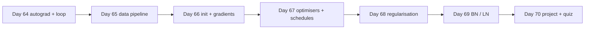

# Week 10 (Days 64-70): Training deep networks in PyTorch

**Status:** written in full (Phase 3). Titles match `SYLLABUS.md`.

## Week goals
- Move from the NumPy MLP of Week 9 to PyTorch: tensors, autograd, `nn.Module` and a training loop you could write from memory.
- Feed data efficiently (Dataset, DataLoader, batching) and understand what a "device" is, even though this box has **no GPU**.
- Explain, and show in a run, why initialisation decides whether a deep net trains at all.
- Compare SGD, momentum, RMSProp, Adam and AdamW, and use learning-rate schedules and an LR range test.
- Use regularisation (weight decay, dropout, augmentation, early stopping) and normalisation (batch norm, layer norm) on purpose, not by habit.
- Ship a small, logged MNIST experiment as the weekly project.



**Compute note (honest).** Every run in this week was done on an 8-thread CPU with PyTorch 2.15 (CPU build). There is no CUDA device here. The code is written device-agnostic (`device = "cuda" if torch.cuda.is_available() else "cpu"` where it matters), but the timings you read below are CPU timings and will differ on your machine.

**Datasets:** MNIST and Fashion-MNIST, downloaded by `torchvision` (source mirror `https://ossci-datasets.s3.amazonaws.com/mnist/`, and the Fashion-MNIST mirror listed in `data/README.md`). Loaded through `load_mnist()` in `code/common.py` and cached in `data/cache/`. Shared helpers for this week live in `code/week-10/_mnist.py` (`tensors`, `evaluate`, `train`).

---

## Day 64: PyTorch tensors, autograd, nn.Module, training loop
**Review today:** Day 63 (+1), Day 61 (+3), Day 57 (+7), Day 43 (+21; quick 15-min skim of its self-check).

### Block 1: Concept lesson (1h15)
**Intuition.** In Week 9 you wrote every derivative by hand. That was the point: you now know what a framework is doing. PyTorch gives you three things on top of NumPy: (1) tensors that can live on different devices, (2) *autograd*, which records the operations you run and replays them backwards to produce gradients, and (3) building blocks (`nn.Module`, `nn.Linear`, losses, optimisers) so a training loop is ten lines instead of a hundred.

**Tensors.** A `torch.Tensor` is an n-dimensional array with a `dtype` (float32 by default), a `shape`, and a `device`. Most NumPy habits carry over: slicing, broadcasting, `@` for matmul, reductions with `dim=` instead of `axis=`. `torch.from_numpy(a)` shares memory with the NumPy array; `t.numpy()` does the same in reverse (CPU only). Changing one changes the other, which is fast but can surprise you.

**Autograd in one paragraph.** If a tensor has `requires_grad=True`, every operation that uses it adds a node to a graph. Calling `loss.backward()` walks that graph in reverse, applying the chain rule, and *adds* the result into each leaf's `.grad`. Three consequences:
1. Gradients **accumulate**. If you call `backward()` twice without zeroing, `.grad` holds the sum. That is why every loop has `opt.zero_grad()`.
2. The graph is freed after `backward()` unless you pass `retain_graph=True`.
3. Anything you do inside `with torch.no_grad():` is not recorded. Use it for evaluation and for manual parameter updates.

**nn.Module.** A module owns parameters (registered automatically when you assign an `nn.Parameter` or a submodule as an attribute) and defines `forward`. `model.parameters()` yields every parameter so an optimiser can update them. `model.train()` and `model.eval()` flip a flag that changes the behaviour of dropout and batch norm (Days 68-69).

**The canonical loop.**
```
for epoch in range(E):
    model.train()
    for xb, yb in loader:
        loss = loss_fn(model(xb), yb)
        opt.zero_grad(); loss.backward(); opt.step()
    model.eval(); evaluate on validation with torch.no_grad()
```
Learn the order: forward, loss, zero, backward, step. `nn.CrossEntropyLoss` expects **raw logits** and integer class labels. It applies log-softmax itself.

### Block 2: Worked example (45 min)
Run `code/week-10/day64_autograd.py`. It does four things.

1. A scalar check: f(x, y) = x³ + 2xy at (x, y) = (2, −1), so df/dx = 3x² + 2y = 10 and df/dy = 2x = 4. **Verified:** autograd prints df/dx = 10.0 and df/dy = 4.0, and calling `backward()` a second time without zeroing doubles df/dx to **20.0**. That is gradient accumulation, seen directly.
2. It rebuilds the Week-9 two-layer network in PyTorch and compares autograd's gradients with the hand-derived NumPy ones on the same weights. **Verified:** max absolute difference **2.08e-17** for W1 and **2.78e-17** for W2. Autograd and your Week-9 backprop agree to floating-point round-off.
3. It defines an `nn.Module` MLP 64-64-10 (**4,810 parameters**) and trains it with SGD (lr 0.2, batch 32) on scikit-learn's 8×8 digits (the Week-9 data), so you can compare directly with your NumPy network.
4. It reports test accuracy at several epoch counts.

**Verified (test accuracy / final train loss):**

| epochs | test acc | train loss |
|---|---|---|
| 1 | 0.5778 | 1.4863 |
| 5 | 0.9400 | 0.2110 |
| 20 | 0.9689 | 0.0631 |
| 60 | 0.9578 | 0.0416 |

Training for 60 epochs took about 0.5 s on this CPU. Notice that train loss kept falling from 20 to 60 epochs while test accuracy *dropped*. That is overfitting on a small dataset (digits has under 1,800 images), and it sets up Day 68. From Day 65 on we switch to MNIST.

### Block 3: Coding lab (2h)
1. (30 min) Without looking, write the training loop for a 784-64-10 MLP on MNIST on the `_mnist.tensors(n_train=5000)` data. Use `torch.optim.SGD(lr=0.1)`.
2. (30 min) Replace `nn.Linear` with your own `MyLinear(nn.Module)` that stores `self.W = nn.Parameter(...)` and `self.b`. Confirm `len(list(model.parameters()))` is unchanged.
3. (30 min) Do one manual SGD step: compute the loss, call `backward()`, then update with `with torch.no_grad(): p -= lr * p.grad` and zero the grads. Check you get the same loss after the step as with `opt.step()`.
4. (30 min) Break it on purpose: remove `zero_grad()` and record what happens to the loss over 3 epochs. Then pass softmax outputs into `CrossEntropyLoss`. Write two sentences on each symptom. (Day 75 measures these bugs systematically.)

### Block 4: Practice problems (1h)
1. `a = torch.ones(3, requires_grad=True); b = (a * 2).sum(); b.backward(); b = (a * 2).sum(); b.backward()`. What is `a.grad`? *Answer: [4., 4., 4.]: each backward adds 2.*
2. Why do we call `model.eval()` before validation even for a model without dropout? *Answer: habit and safety; as soon as dropout or BN is added, forgetting it silently changes the metric. It costs nothing.*
3. Count the parameters of the script's 64-64-10 MLP. *Answer: 64·64+64+64·10+10 = 4,810.*
4. What does `torch.no_grad()` save? *Answer: memory and time, because no graph is built and no intermediate activations are kept for backward.*
5. A tensor from `torch.from_numpy(a)` is modified in place. What happens to `a`? *Answer: it changes too; they share memory.*

### Block 5: Review (1h)
Rewrite the five-step loop from memory on paper. Then explain to an imaginary colleague why `loss.backward()` doesn't update weights. Self-check:
- [ ] I can say what `requires_grad`, `.grad`, `backward()`, `zero_grad()` and `step()` each do.
- [ ] I can explain the 20.0 vs 10.0 result above.
- [ ] I know why CrossEntropyLoss takes logits.
- [ ] I can say what changed between 20 and 60 epochs and why.

### Going deeper (optional)
Read the PyTorch "Autograd mechanics" note (linked in `docs/resources.md`). Then try `torch.autograd.grad(loss, params, create_graph=True)` to get a gradient you can differentiate again: the basis of second-order methods and gradient penalties.

### Interview-style question (15 min, written)
"Explain what happens, step by step, between `loss = criterion(model(x), y)` and the weights changing." A strong answer mentions the recorded graph, the chain rule applied in reverse, accumulation into `.grad`, the optimiser reading `.grad`, and why `zero_grad` is required.

### Common mistakes / how to debug
- Forgetting `zero_grad()`: loss behaves erratically or barely moves. Print a parameter's grad norm on two consecutive steps.
- `loss.item()` vs `loss`: storing `loss` (the tensor) in a list keeps the graph alive and leaks memory. Store `loss.item()`.
- Shape mistakes: `CrossEntropyLoss` wants logits `(N, C)` and labels `(N,)` of dtype long. A float label tensor gives a confusing error.
- In-place operations on tensors needed for backward raise "one of the variables needed for gradient computation has been modified by an inplace operation". Replace `x += 1` with `x = x + 1`.

### What to do next
Day 65 replaces manual slicing with Dataset and DataLoader, and measures what each option costs.

---

## Day 65: Datasets, DataLoaders, batching, devices
**Review today:** Day 64 (+1), Day 62 (+3), Day 58 (+7), Day 44 (+21; quick 15-min skim of its self-check).

### Block 1: Concept lesson (1h15)
**Intuition.** A model only learns as fast as you can feed it. On a GPU the data pipeline is often the bottleneck. On this CPU box everything shares the same cores, so the lesson is about *overhead*: how much time goes to Python per item versus real arithmetic.

**Dataset.** Any object with `__len__` and `__getitem__(i)` returning one example. `TensorDataset(X, y)` wraps tensors you already have in memory. A custom Dataset is how you load from disk, decode images, or apply per-item augmentation.

**DataLoader.** Wraps a Dataset and handles batching (`batch_size`), shuffling (`shuffle=True`, re-shuffled every epoch), collation (stacking items into a batch tensor) and parallel loading (`num_workers`). Each worker is a separate process, which costs start-up time and pays off only when per-item work (decoding JPEGs, heavy augmentation) is expensive.

**Normalisation statistics.** Compute the mean and std on the **training split only**, then apply them to validation and test. Using test statistics is a small leak, the same mistake as fitting a scaler on all data (Week 6).

**Splits.** Carve a validation set out of training data. The test set is touched once at the end (the Month-2 discipline).

**Batch size.** Larger batches give less noisy gradient estimates and better hardware utilisation, but fewer updates per epoch. On many problems, moderate batches with a tuned learning rate generalise as well as small ones; very large batches usually need a larger LR and warm-up.

**Devices.** `x.to(device)` copies a tensor to another device. Model and data must be on the same device. On a GPU you would add `pin_memory=True` and `non_blocking=True` to overlap copying with compute. Here `torch.cuda.is_available()` is `False`, so everything stays on `cpu`. Write the code device-agnostic anyway.

### Block 2: Worked example (45 min)
Run `code/week-10/day65_dataloader.py`. **Verified:**
- Train mean **0.1307** and std **0.3081** (pixels scaled to [0, 1]). Split: **55,000** train / **5,000** validation; with batch 128 that is **430** batches per epoch.
- One epoch of iteration only (no model), by loading method:

| method | seconds per epoch |
|---|---|
| per-item custom Dataset, `num_workers=0` | 0.63 |
| per-item custom Dataset, `num_workers=2` | 0.60 |
| `TensorDataset` + DataLoader | 0.21 (0.18 on a rerun) |
| manual slicing of a tensor | 0.01 |

Workers barely helped because the per-item work is trivial and the process start-up eats the gain. When data already sits in memory as a tensor, slicing is the cheapest of all, which is why the remaining scripts in this course use the `_mnist.train` helper that slices.
- Batch size (same epochs and LR): batch 16 / 128 / 1024 took **1.48 / 0.51 / 0.34 s** per epoch and reached test accuracy **0.9315 / 0.9312 / 0.9338**. At this scale the three are within noise of each other on accuracy, but very different in time.

### Block 3: Coding lab (2h)
1. (40 min) Write `class NoisyMNIST(Dataset)` that adds Gaussian noise with std σ in `__getitem__`. Train the Day-64 MLP on σ = 0, 0.5, 1.0 and record test accuracy on clean images.
2. (30 min) Time one epoch with `num_workers` in {0, 2, 4}. Write down why the result might flip on a machine with slow disk reads.
3. (30 min) Make your loop device-agnostic: one `device` variable, `.to(device)` for model and each batch. Run it here (CPU) and confirm nothing else changes.
4. (20 min) Verify that `shuffle=True` changes the order across epochs and that `generator=torch.Generator().manual_seed(0)` makes it reproducible.

### Block 4: Practice problems (1h)
1. 55,000 examples, batch 128, `drop_last=False`. How many batches? *Answer: ceil(55000/128) = 430.*
2. Why compute normalisation statistics on train only? *Answer: so no information from validation/test leaks into preprocessing.*
3. When do workers help? *Answer: when per-item loading/augmentation is expensive relative to process start-up and inter-process transfer.*
4. You double the batch size. What is a reasonable first guess for the new learning rate with SGD? *Answer: roughly double it (linear scaling rule), then verify with a short run.*
5. A model is on the GPU and a batch is on the CPU. What happens? *Answer: a runtime error about tensors on different devices.*

### Block 5: Review (1h)
Draw the path of one example: file → Dataset `__getitem__` → collate → batch tensor → `.to(device)` → model. Self-check:
- [ ] I can write a custom Dataset from memory.
- [ ] I can explain why workers did not help in our run.
- [ ] I know which split the normalisation statistics come from.

### Going deeper (optional)
Look at `torch.utils.data.IterableDataset` for streaming data that does not fit in memory, and at `persistent_workers=True`. Day 82 writes the collate step in Rust.

### Interview-style question (15 min, written)
"Your GPU utilisation sits at 30% during training. What do you check?" Mention data loading time per batch, worker count, CPU-side augmentation, pinned memory, host-to-device copies, small batch sizes, and profiling (Day 82).

### Common mistakes / how to debug
- Shuffling the validation set: harmless for metrics but confusing when you compare predictions across runs.
- Returning NumPy arrays of the wrong dtype from `__getitem__` (float64), so the model gets doubles and errors.
- Forgetting `model.to(device)` while moving data, or vice versa.
- Measuring "speed" on the first epoch only: workers and caches warm up.

### What to do next
Day 66 asks why a deep network sometimes refuses to learn, and shows that the answer is often the first line of code: initialisation.

---

## Day 66: Initialisation; vanishing and exploding gradients
**Review today:** Day 65 (+1), Day 63 (+3), Day 59 (+7), Day 45 (+21; quick 15-min skim of its self-check).

### Block 1: Concept lesson (1h15)
**Intuition.** Backprop multiplies one Jacobian per layer. If each factor shrinks the signal a little, the product over 10 layers is tiny (vanishing); if each grows it, the product explodes. Initialisation chooses the scale of those factors at step 0.

**Variance argument.** For a linear layer with fan-in n and independent zero-mean inputs and weights, Var(output) = n · Var(w) · Var(input). To keep variance constant through layers:
- **Xavier/Glorot** (for tanh/sigmoid-ish, symmetric activations): Var(w) = 2/(fan_in + fan_out), or 1/fan_in in its simple form.
- **He/Kaiming** (for ReLU, which zeroes half its inputs): Var(w) = 2/fan_in.

**Activation matters too.** The sigmoid derivative is at most 0.25 (Day 62), so even with good weights its gradient shrinks by at least 4× per layer. Tanh's derivative is up to 1. ReLU's is 0 or 1.

**Recurrence is the extreme case.** Multiplying by the same matrix W again and again grows or shrinks like ρ(W)^t, where ρ is the spectral radius. Day 78 returns to this for RNNs.

**Gradient clipping.** If the gradient norm exceeds a threshold c, rescale it to have norm c. It does not fix bad initialisation, but it stops a single huge step from destroying training.

### Block 2: Worked example (45 min)
Run `code/week-10/day66_init_vanishing.py`. It builds 12-layer MLPs (MNIST, 5,000 training images) and prints gradient norms at the first and last layers, the initial loss, and test accuracy after a short training run. **Verified:**

| activation + init | grad norm layer 1 | grad norm layer 11 | test acc |
|---|---|---|---|
| sigmoid + Xavier | 2.80e-06 | 1.57 | 0.0974 |
| tanh + Xavier | 0.952 | 0.343 | 0.8678 |
| ReLU, std 0.01 | 1.84e-11 | — | 0.1135 |
| ReLU, std 1 | 6.99e9 | — | 0.0980 (initial loss 5.9e10) |
| ReLU + He, lr 0.05 | 4.48 | 8.14 | 0.2916 (initial loss 3.285) |

Read it carefully. Sigmoid's first layer receives gradients six orders of magnitude smaller than the last: the network trains only its top layers and stays at chance. std 0.01 vanishes; std 1 explodes. He initialisation gives healthy gradients at both ends, yet at lr 0.05 it still trained poorly (0.2916). With **lr 0.01 it reached 0.7679** and with lr 0.02, 0.7526. Good initialisation is necessary, not sufficient: the learning rate still has to fit.

The script also multiplies a vector by one fixed matrix with spectral radius **1.51**: |h| = **3.55e2, 3.13e5, 9.86e8** after 10, 30 and 50 steps. And it clips the gradient [30, 40] (norm 50) to norm 5, giving **[3, 4]**: same direction, smaller step.

### Block 3: Coding lab (2h)
1. (40 min) Write `init_(model, kind)` applying `nn.init.xavier_normal_` or `kaiming_normal_(nonlinearity="relu")`, biases zero. Reproduce the table for depth 6 and depth 12.
2. (30 min) Plot per-layer activation std after one forward pass for each setting. Which ones are flat across depth?
3. (30 min) Add `torch.nn.utils.clip_grad_norm_(model.parameters(), 1.0)` to the "ReLU std 1" run. Does it train now? Explain why or why not in two sentences.
4. (20 min) Try He init with lr in {0.005, 0.01, 0.02, 0.05}. Mark the best on a small plot.

### Block 4: Practice problems (1h)
1. fan_in = 256, ReLU. He std? *Answer: sqrt(2/256) ≈ 0.088.*
2. Sigmoid, 10 layers, best-case derivative each layer. Upper bound on the product of derivatives? *Answer: 0.25^10 ≈ 9.5e-7.*
3. Spectral radius 0.9, 50 steps. Rough shrink factor? *Answer: 0.9^50 ≈ 5.2e-3.*
4. Clip g = [6, 8] to max norm 5. *Answer: [3, 4].*
5. Why initialise biases to zero but not weights? *Answer: zero weights make all units in a layer identical (symmetry is never broken); zero biases are fine because random weights already break symmetry.*

### Block 5: Review (1h)
Explain in your own words why the initial loss was 5.9e10 with std 1 and 3.285 with He (close to ln 10 = 2.303). Self-check:
- [ ] I can derive the He variance in three lines.
- [ ] I can recognise vanishing gradients from per-layer norms.
- [ ] I can state what clipping does and does not fix.

### Going deeper (optional)
Look up orthogonal initialisation (`nn.init.orthogonal_`) and "fixup"-style initialisation for residual nets without normalisation. Compare one of them with He at depth 20.

### Interview-style question (15 min, written)
"A 20-layer MLP's loss doesn't move from ln(10). Walk me through your diagnosis." Mention: check the initial loss, per-layer gradient norms, activation statistics, the init scheme, the activation, the learning rate, and adding normalisation (Day 69) or residual connections (Day 72).

### Common mistakes / how to debug
- Applying He init to sigmoid layers or Xavier to deep ReLU stacks without thinking.
- Re-initialising after the optimiser was created with different tensors (if you replace parameters rather than filling them in place).
- Concluding "init doesn't matter" from a shallow net. It shows up with depth.
- Forgetting PyTorch's default `nn.Linear` init (a Kaiming-uniform variant with a=√5) is *not* plain He: check what you are actually using.

### What to do next
Day 67 keeps the network fixed and changes how we step: optimisers and learning-rate schedules.

---

## Day 67: Optimisers: SGD, momentum, RMSProp, Adam; LR schedules
**Review today:** Day 66 (+1), Day 64 (+3), Day 60 (+7), Day 46 (+21; quick 15-min skim of its self-check).

### Block 1: Concept lesson (1h15)
**Intuition.** Gradient descent in a long narrow valley zig-zags across it and creeps along it. Momentum averages recent gradients so the zig-zags cancel and the along-valley component builds up. Adaptive methods (RMSProp, Adam) rescale each coordinate by its recent gradient magnitude, so steep and flat directions get comparable steps.

**Update rules (per parameter, g = gradient).**
- SGD: θ ← θ − η g.
- Momentum: v ← βv + g; θ ← θ − η v (β ≈ 0.9).
- RMSProp: s ← ρs + (1−ρ) g²; θ ← θ − η g / (√s + ε).
- Adam: m ← β1 m + (1−β1) g; s ← β2 s + (1−β2) g²; bias-correct both (m̂ = m/(1−β1^t), ŝ = s/(1−β2^t)); θ ← θ − η m̂ / (√ŝ + ε). Defaults β1 0.9, β2 0.999.
- AdamW: Adam with *decoupled* weight decay (θ ← θ − η λ θ applied separately), which behaves better than adding λθ to the gradient inside Adam.

**Stability.** On a quadratic with curvature h, plain GD diverges once η > 2/h. That is why a too-large LR blows up rather than "just learning faster".

**Schedules.** Start larger to make progress, end smaller to settle. Step decay (divide by 10 at fixed epochs), cosine annealing, and one-cycle (warm-up then anneal) are the common shapes. **LR range test:** increase the LR exponentially over a few hundred steps, plot loss vs LR, and pick a value somewhat below where the loss is lowest, well below where it blows up.

### Block 2: Worked example (45 min)
Run `code/week-10/day67_optimisers.py`. **Verified on a 2-D ill-conditioned quadratic (f after 50 steps):** SGD lr 0.03 → **0.380**; SGD lr 0.085 → **1.63e6** (past the stability limit); momentum → **4.97e-2**; RMSProp → **0.457**; Adam lr 0.1 → **2.67e-2**.

**MNIST, 10k training images, 5 epochs, test accuracy:**

| optimiser | test acc |
|---|---|
| SGD | 0.9193 |
| SGD + momentum | 0.9559 |
| RMSProp | 0.9529 |
| Adam (1e-3) | 0.9474 |
| Adam (1e-1) | 0.5647 |
| AdamW | 0.9472 |

Adam is not magic: at lr 0.1 it is far worse than plain SGD. Momentum SGD was best here, which is not a general law; it is one run, one seed.

**Schedules over 10 epochs:** constant **0.9650**, step **0.9634**, cosine **0.9639**, one-cycle **0.9672**. These differences are small; on Day 85 you will measure seed noise and see whether they mean anything. **LR range test:** lowest loss near lr **0.0498**; loss blew up at **1.23**.

### Block 3: Coding lab (2h)
1. (40 min) Implement momentum and Adam yourself as `torch.optim.Optimizer` subclasses (only `step`). Check they match the built-ins on 20 steps to 1e-6.
2. (30 min) Reproduce the optimiser table with 3 seeds and report mean ± std.
3. (30 min) Run your own LR range test for Adam. Where does it say to start?
4. (20 min) Plot the LR over steps for step, cosine and one-cycle schedulers to be sure you know what you configured.

### Block 4: Practice problems (1h)
1. Curvature h = 20. Largest stable GD learning rate? *Answer: 2/20 = 0.1.*
2. Why does Adam need bias correction? *Answer: m and s start at zero, so early averages are biased towards 0; dividing by (1−β^t) removes it.*
3. Difference between Adam with L2 and AdamW? *Answer: in Adam+L2 the decay gradient is rescaled by the adaptive denominator; AdamW applies decay directly to weights, independent of gradient scale.*
4. Momentum β = 0.9. Effective averaging window? *Answer: about 1/(1−β) = 10 steps.*
5. When should a scheduler step per batch instead of per epoch? *Answer: when it is defined in steps, like OneCycleLR or warm-up schedules.*

### Block 5: Review (1h)
Write the four update rules from memory. Self-check:
- [ ] I can explain why lr 0.085 diverged on the quadratic.
- [ ] I know when to pick AdamW over SGD+momentum and why I would still test both.
- [ ] I can run and read an LR range test.

### Going deeper (optional)
Read the AdamW paper ("Decoupled Weight Decay Regularization", Loshchilov & Hutter) and the one-cycle report by Leslie Smith; both are linked in `docs/resources.md`.

### Interview-style question (15 min, written)
"Your loss is NaN after 200 steps with Adam. What do you try?" Lower LR, check data for NaNs/infs, gradient clipping, check for log(0) or division by zero in custom losses, check mixed-precision overflow (Day 82), and warm-up.

### Common mistakes / how to debug
- Calling `scheduler.step()` before `optimizer.step()` (PyTorch warns; the first LR value is skipped).
- Comparing optimisers at one learning rate each: every optimiser needs its own LR search.
- Forgetting that AdamW's default weight decay is 0.01 while Adam's is 0.
- Reading tiny accuracy differences between schedules as real without seeds.

### What to do next
Day 68 fights overfitting: the gap you saw between 20 and 60 epochs on Day 64.

---

## Day 68: Regularisation: L2, dropout, early stopping, augmentation
**Review today:** Day 67 (+1), Day 65 (+3), Day 61 (+7), Day 47 (+21; quick 15-min skim of its self-check).

### Block 1: Concept lesson (1h15)
**Intuition.** A network with hundreds of thousands of parameters can memorise 2,000 images. Regularisation makes memorising harder or less attractive so that what the network learns generalises.

**The tools.**
- **Weight decay (L2).** Adds λ‖θ‖² to the loss (or decays weights directly, AdamW). Prefers small weights, smoother functions.
- **Dropout.** In training, zero each unit with probability p and scale the survivors by 1/(1−p) ("inverted dropout"), so at evaluation you simply use all units. It stops units from relying on specific partners.
- **Early stopping.** Track validation loss; stop when it has not improved for `patience` epochs and restore the best weights. It is cheap and almost always worth having.
- **Data augmentation.** Generate label-preserving variants (shifts, flips, crops, noise). It adds information about invariances you believe in. Be careful: a horizontal flip is fine for clothes, but wrong for digits like 2 and 5 if orientation matters.

**What to watch.** Train accuracy vs validation accuracy, and above all **validation loss**. Accuracy can stay flat while the loss rises because the model becomes over-confident on its mistakes.

### Block 2: Worked example (45 min)
Run `code/week-10/day68_regularisation.py`: Fashion-MNIST, only **2,000** training and **5,000** validation images, an MLP trained 60 epochs, one setting at a time. **Verified:**

| setting | train acc | final val acc | final val loss | best val loss (epoch) |
|---|---|---|---|---|
| baseline | 1.0 | 0.8330 | 1.063 | 0.501 (ep 6) |
| weight decay | 1.0 | 0.8328 | 0.894 | 0.505 (ep 6) |
| dropout | 0.9515 | 0.8290 | 0.675 | 0.522 (ep 15) |
| shift augmentation | 0.8790 | 0.8228 | 0.574 | 0.535 (ep 46) |
| all combined | 0.7985 | 0.7738 | 0.625 | 0.560 (ep 59) |

How to read this honestly:
- The baseline memorises the training set (train acc 1.0) and its validation loss more than doubles after epoch 6, while validation accuracy looks fine. That is over-confidence.
- Each regulariser reduced the final validation loss and delayed the best epoch. None improved final validation **accuracy** in this short budget.
- "All combined" over-regularised: still improving at epoch 59, lowest accuracy. More regularisation is not automatically better; it needs more epochs or less strength.
- Early stopping (patience 5) halted after epoch 15 and restored epoch 10 weights: val loss **0.546**, acc **0.8196**.

The script also prints a dropout layer's output in train vs eval mode so you can see the zeros and the 1/(1−p) scaling.

### Block 3: Coding lab (2h)
1. (40 min) Write an `EarlyStopping` class (patience, min_delta, keeps a deep copy of the best `state_dict`). Use it on the baseline.
2. (40 min) Sweep dropout p in {0.1, 0.3, 0.5} and weight decay in {1e-4, 1e-3, 1e-2}. Plot final val loss.
3. (40 min) Add augmentation with `torch.roll` shifts of ±2 pixels. Then try horizontal flips on Fashion-MNIST and on MNIST digits. Which one hurts?

### Block 4: Practice problems (1h)
1. Dropout p = 0.2, a unit outputs 1.0 and survives. What is its value in training? *Answer: 1/(1−0.2) = 1.25.*
2. Why monitor validation loss instead of accuracy for early stopping? *Answer: it reacts to over-confidence before accuracy changes.*
3. Name one augmentation that would be wrong for MNIST. *Answer: 180° rotation (6 vs 9) or horizontal flip.*
4. Your model has train acc 0.80, val acc 0.79. Should you add dropout? *Answer: no, that is underfitting; increase capacity or train longer.*
5. Why did "all combined" score lowest? *Answer: too much regularisation for the budget; it was still improving.*

### Block 5: Review (1h)
For each tool, write one sentence on *what problem it addresses* and one on *a sign it is too strong*. Self-check:
- [ ] I can explain inverted dropout.
- [ ] I can read the table above and say which settings over-regularised.
- [ ] I can implement early stopping with weight restoring.

### Going deeper (optional)
Look up label smoothing (used on Day 87) and mixup. Both regularise the targets instead of the weights.

### Interview-style question (15 min, written)
"Your validation accuracy is stable but validation loss climbs. Is the model getting worse?" Explain calibration, over-confidence, and why the decision depends on whether you use probabilities downstream.

### Common mistakes / how to debug
- Forgetting `model.eval()`, so dropout is active during evaluation and validation accuracy is noisy and low.
- Augmenting the validation set.
- Applying weight decay to batch-norm and bias parameters without thinking (often excluded in practice).
- Restoring "best" weights by reference instead of copying, so the restored model equals the last.

### What to do next
Day 69 adds normalisation layers, which make deep networks much easier to train.

---

## Day 69: Batch norm and layer norm
**Review today:** Day 68 (+1), Day 66 (+3), Day 62 (+7), Day 48 (+21; quick 15-min skim of its self-check).

### Block 1: Concept lesson (1h15)
**Intuition.** Day 66 showed that the scale of activations drifts layer by layer. Normalisation layers reset it: standardise the activations, then let the network learn a scale γ and shift β.

**Batch norm (BN).** For each feature (channel), compute the mean and variance **over the batch** during training, normalise, then apply γ, β. It also keeps *running* averages of mean and variance (buffers, not parameters) that are used in `eval()` mode. Consequences:
- Training behaviour depends on batch size. With a batch of 1 there is no variance to compute: PyTorch raises an error in train mode.
- Train and eval modes differ. Forgetting `model.eval()` changes predictions.
- It allows larger learning rates and makes training much less sensitive to initialisation.

**Layer norm (LN).** Normalises **over the features of each example**, independently of the batch. Same behaviour in train and eval, works with batch size 1 and with variable-length sequences. That is why Transformers use it (Month 4).

**Where to put them.** Common: Linear/Conv → BN → ReLU. In Transformers, LN is applied before each sub-layer ("pre-norm").

### Block 2: Worked example (45 min)
Run `code/week-10/day69_batchnorm.py`: a 10-layer MLP on MNIST-10k, 5 epochs, three learning rates. **Verified test accuracy:**

| model | lr 0.01 | lr 0.1 | lr 0.5 |
|---|---|---|---|
| no normalisation | ~0.10-0.11 | ~0.10-0.11 | ~0.10-0.11 |
| batch norm | 0.9469 | 0.9500 | 0.9417 |
| layer norm | 0.9456 | 0.5529 | 0.1028 |

With PyTorch's default initialisation and SGD, the 10-layer net without normalisation did not learn at any LR in 5 epochs. BN trained at all three. LN matched BN at lr 0.01 but degraded at large LRs in this setup. The script also triggers the batch-of-1 error in train mode and counts: BatchNorm1d(128) has **256 parameters** (γ, β) plus **257 buffers** (running mean, running var, batch counter); LayerNorm(128) has **256 parameters** and no buffers.

### Block 3: Coding lab (2h)
1. (40 min) Implement BN for a 2-D input yourself (training mode, plus running stats with momentum 0.1). Compare with `nn.BatchNorm1d` in train and eval mode.
2. (30 min) Train the BN model with batch sizes 8, 64 and 512. What happens to accuracy and speed?
3. (30 min) Evaluate the BN model while forgetting `model.eval()`, with a test batch of 10 images. Compare with proper eval.
4. (20 min) Replace BN with LN and repeat the batch-size experiment.

### Block 4: Practice problems (1h)
1. What statistics does BN use at test time? *Answer: running mean and variance accumulated during training.*
2. Why can LN work with batch size 1? *Answer: it normalises within each example.*
3. BN after a Linear layer: why can the Linear layer drop its bias? *Answer: BN subtracts the mean, cancelling any constant bias; β replaces it.*
4. Count parameters of BatchNorm2d(64). *Answer: 128 (γ and β).*
5. Your BN model's val accuracy is much lower than train accuracy right from epoch 1 and fluctuates. One likely cause? *Answer: evaluating in train mode, or very small/unrepresentative validation batches.*

### Block 5: Review (1h)
Make a two-column table BN vs LN: axis of normalisation, train/eval difference, batch-size dependence, typical use. Self-check:
- [ ] I can explain buffers vs parameters.
- [ ] I can explain why the no-norm 10-layer net failed and the BN one did not.
- [ ] I know why Transformers use LN.

### Extra notes: BN at inference, step by step
During training, BN normalises each channel with the mean and variance of the current batch, then applies the learned scale γ and shift β. It also updates running estimates: running_mean ← (1 − momentum)·running_mean + momentum·batch_mean, with PyTorch's default momentum 0.1. In `eval()` mode, it uses the running estimates instead, so a single example gets the same output whatever batch it arrives in. Two consequences follow. A model evaluated in train mode gives batch-dependent, usually worse, predictions. And with very small batches (1-4 examples) the batch statistics are noisy, which is why LayerNorm or GroupNorm, which normalise within one example, are preferred there and in sequence models.

### Going deeper (optional)
Read the original BN paper and the LN paper (linked in `docs/resources.md`). Note that the "internal covariate shift" explanation in the BN paper has been disputed; later work points to a smoother loss landscape. Look at GroupNorm for small-batch vision.

### Interview-style question (15 min, written)
"You fine-tune a CNN with batch size 2 and accuracy collapses. Why, and what would you do?" Mention noisy BN statistics, freezing BN (eval mode for BN layers), GroupNorm/LN, or gradient accumulation (which does *not* fix BN statistics).

### Common mistakes / how to debug
- Forgetting `model.eval()` at test time.
- Putting BN after the final classification layer.
- Freezing BN weights but leaving it in train mode, so the running statistics still change.
- Comparing BN and no-BN at one learning rate chosen for one of them.

### What to do next
Day 70 is the weekly project: three MLPs, an experiment log, one test evaluation, and Quiz 10.

---

## Day 70: PROJECT W10: MNIST MLP in PyTorch with experiment log; Quiz 10
**Review today:** Day 69 (+1), Day 67 (+3), Day 63 (+7), Day 49 (+21; quick 15-min skim of its self-check).

### Block 1: Concept lesson: the project brief (1h15)
**Brief.** Train an MLP on full MNIST (55,000 train / 5,000 validation / 10,000 test). Compare at least three configurations, choose one **on validation only**, and evaluate it on test **once**. Keep a machine-readable experiment log. Deliver:
1. `out/day70_runs.csv` with one row per run: config, parameter count, epochs, val accuracy, seconds.
2. A test accuracy and an error count for the chosen model.
3. The top confused digit pairs and a few sentences on what they say.
4. A half-page write-up: what you tried, what you chose, why, and what you would try next.

**Why a log?** Week 9 taught reproducible runs with scikit-learn. The same applies here, with more knobs. A CSV you append to after each run is enough at this scale; Day 85 adds structure.

**Rules.** No test-set peeking. Fixed seed. Every number in your write-up must come from the log or the final evaluation.

### Block 2: Worked example: the reference project (45 min)
Run `code/week-10/day70_week_project.py`. It trains three configurations for 8 epochs each. **Verified:**

| config | params | val acc | seconds |
|---|---|---|---|
| A: 784-256-10, SGD momentum lr 0.05 | 203,530 | 0.9764 | 4.1 |
| B: 784-512-512-10, dropout 0.2, Adam 1e-3 | 669,706 | 0.9756 | 15.1 |
| C: 512-512 + BN + dropout 0.2, SGD momentum lr 0.1, wd 5e-4, one-cycle | 671,754 | **0.9834** | 9.9 |

C is selected on validation. **Test accuracy 0.9859**, **141 errors** out of 10,000. Top confusions (true → predicted): 9→4 (9), 7→2 (7), 5→3 (7), 4→9 (6). The 4/9 pair appears in both directions: those digits differ by whether the top loop is closed. Note B (3.3× the parameters of A, with Adam and dropout) did not beat A: capacity alone was not the bottleneck. C changed several things at once (BN, optimiser, schedule, weight decay), so this project cannot say *which* of them helped. Day 87 fixes that with one-change-at-a-time ablations.

### Block 3: Coding lab: your project (2h)
1. (20 min) Copy the script's structure but write your own loop. Create the CSV writer first.
2. (60 min) Run at least three configs. Suggested axes: width, depth, dropout, BN, optimiser, schedule. Change one thing at a time where possible.
3. (20 min) Choose on validation. Evaluate on test once.
4. (20 min) Print the confusion matrix; save 16 misclassified test images in a grid. Write the half-page report.

**Rubric (self-grade out of 20)**

| criterion | points |
|---|---|
| Three or more configs, logged to CSV with params and time | 4 |
| Selection on validation; test used once | 4 |
| Correct, readable training loop (train/eval modes, zero_grad) | 4 |
| Error analysis: confusion pairs + images + interpretation | 4 |
| Write-up honest about what did and did not help | 4 |

### Block 4: Practice problems (1h)
1. B and C have almost the same size and both ran 8 epochs, yet B took 15.1 s and C 9.9 s. What would you check before explaining it? *Answer: B uses Adam (more per-parameter work per step) and C SGD; also rerun both, since wall-clock times on a shared CPU vary between runs. Do not explain a timing difference from one measurement.*
2. If two configs differ by 0.001 val accuracy on 5,000 images, is that meaningful? *Answer: 0.001 is 5 images; without seeds, no.*
3. What is the test error rate? *Answer: 141/10,000 = 1.41%.*
4. Why log parameter counts? *Answer: to compare capacity and spot accidental size changes.*

### Block 5: Review (1h)
Take the weekly quiz below, closed book, then mark it. Re-read the Day you scored worst on.

### Going deeper (optional)
Add a CNN (preview of Week 11) and see how many errors remain. Keep the same log format.

### Interview-style question (15 min, written)
"Describe an ML experiment you ran, what you logged, and how you made sure the test number was honest."

### Common mistakes / how to debug
- Selecting the best of several runs on test accuracy.
- Overwriting the CSV each run instead of appending.
- Forgetting to put the model into eval mode before the confusion matrix (BN!).

### What to do next
Week 11: convolutions, CNN architectures, CIFAR-10-small and transfer learning.

---

## Weekly quiz: Week 10
1. What did the second `backward()` do to df/dx in the Day-64 script, and why?
2. What was the largest difference between autograd and hand-derived gradients?
3. Give the MNIST train mean and std used for normalisation, and which split they came from.
4. Rank the four loading methods on Day 65 by time per epoch.
5. Sigmoid + Xavier at depth 12: give the first- and last-layer gradient norms.
6. He init: what accuracy at lr 0.05 vs lr 0.01, and what does it teach?
7. Why did SGD at lr 0.085 diverge on the quadratic?
8. Which optimiser had the best and which the worst MNIST accuracy on Day 67?
9. In the Day-68 baseline, what happened to validation loss after epoch 6?
10. What did early stopping restore, and with what val loss and accuracy?
11. BatchNorm1d(128): parameters and buffers?
12. Which Day-70 config won, with what test accuracy and how many errors?

### Answers
1. It doubled to 20.0: gradients accumulate into `.grad`.
2. About 2.8e-17 (W2), i.e. round-off.
3. 0.1307 and 0.3081, from the training split.
4. Manual slicing 0.01 s < TensorDataset 0.21 s < per-item with 2 workers 0.60 s < per-item 0.63 s.
5. 2.80e-06 and 1.57.
6. 0.2916 vs 0.7679: good init still needs a suitable learning rate.
7. The LR exceeded 2/h for the steep direction.
8. Best: SGD + momentum 0.9559. Worst: Adam at lr 0.1, 0.5647.
9. It rose from 0.501 to 1.063 while train accuracy hit 1.0.
10. Epoch 10 weights: val loss 0.546, acc 0.8196.
11. 256 parameters, 257 buffers.
12. C (BN + one-cycle): test acc 0.9859, 141 errors.
