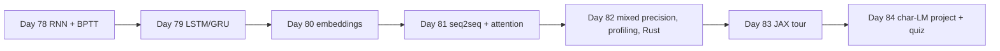

# Week 12 (Days 78-84): Sequences, attention's motivation, and performance engineering

**Status:** written in full (Phase 3). Titles match `SYLLABUS.md`.

## Week goals
- Derive backpropagation through time and *measure* why plain RNN gradients vanish or explode.
- Use LSTMs and GRUs, count their parameters, and know their limits on long-range memory.
- Train word embeddings (skip-gram with negative sampling) and read them critically.
- Build an encoder-decoder and see attention fix its bottleneck.
- Understand number formats and mixed precision; profile a training run; write a small Rust/PyO3 data kernel.
- Get a quick tour of JAX (grad, jit, vmap).
- Train a character-level language model and compare it with count baselines (weekly project).

**Compute note.** CPU-only box. Models are small and training is short. The point is to see mechanisms, not to set records.

**Datasets:** Tiny Shakespeare (`https://raw.githubusercontent.com/karpathy/char-rnn/master/data/tinyshakespeare/input.txt`, 1,115,394 characters, public-domain text), cached in `data/` by `code/common.py`. Synthetic sequence tasks generated by the scripts. MNIST and CIFAR-10-small as in earlier weeks.

---

## Day 78: RNNs and backprop through time
**Review today:** Day 77 (+1), Day 75 (+3), Day 71 (+7), Day 57 (+21; quick 15-min skim of its self-check).

### Block 1: Concept lesson (1h15)
**Intuition.** A recurrent network reads a sequence one step at a time and keeps a hidden state h, a summary of what it has seen. The same weights are used at every step, as a convolution shares weights across positions.

**Equations (vanilla / Elman RNN).**
h_t = tanh(W_x x_t + W_h h_{t−1} + b), output y_t = W_y h_t + b_y.

**Backprop through time (BPTT).** Unroll the loop into a T-layer network with tied weights, then apply ordinary backprop. The gradient for a shared weight is the *sum* of its gradients at every step. The key quantity is how the gradient on the hidden state flows backwards:

∂L/∂h_{t−1} = W_hᵀ · (diag(1 − h_t²) · ∂L/∂h_t) + (direct loss terms at t−1).

Each step back multiplies by W_hᵀ and by tanh's derivative (≤ 1). Over k steps that is a product of k matrices. If its size (roughly, the spectral radius of W_h times the average tanh derivative) is below 1, the gradient shrinks exponentially (**vanishing**); above 1, it can grow (**exploding**).

**Consequences.**
- Vanishing: the network cannot learn dependencies more than a few dozen steps long.
- Exploding: training blows up. Fix with **gradient clipping** (rescale the gradient when its norm exceeds a threshold).
- **Truncated BPTT:** backpropagate only k steps for long streams; carry the hidden state forward but detach it.

### Block 2: Worked example (45 min)
Run `code/week-12/day78_rnn_bptt.py` (pure NumPy, about 4 s). **Verified:**
- Gradient check of hand-written BPTT vs finite differences, relative error: W_x **6.01e-11**, W_h **1.45e-11**, b **1.94e-11**, W_y **3.89e-12**, b_y **3.24e-12**. PASSED.
- Gradient norm on the hidden state, with the loss at the last step (T = 50):

| W_h scale | spectral radius | t = 49 | t = 25 | t = 0 |
|---|---|---|---|---|
| 0.5 | 0.51 | 7.29e-1 | 1.38e-10 | 1.01e-19 |
| 1.0 | 1.10 | 9.75e-1 | 2.95e-5 | 1.03e-9 |
| 2.0 | 2.04 | 6.86e-1 | 1.62e-1 | 7.97e-4 |

Even with spectral radius 1.10, the gradient falls by 9 orders of magnitude over 50 steps, because tanh's derivative also shrinks it. With radius 2.04 the larger weights partly offset tanh's shrinking derivative, so 7.97e-4 survives at t = 0: the spectral radius alone does not predict the result.
- Task "output x_0 after T steps": T = 3 gives test MSE **0.051** (predicting 0 gives 1.071). T = 20 gives **2.303**, *worse* than predicting 0 (0.931): training failed and was unstable. That honest failure is the lesson: plain RNNs struggle beyond a few steps.

### Block 3: Coding lab (2h)
1. (60 min) Write the forward and BPTT backward for a vanilla RNN in NumPy. Gradient-check it on T = 5.
2. (30 min) Add gradient clipping by global norm and train the T = 20 task again. Does MSE drop below the predict-0 baseline?
3. (30 min) Reproduce the table for scales 0.8 and 1.2.

### Block 4: Practice problems (1h)
1. Why is the gradient of W_h a sum over time steps? *Answer: W_h is used at every step; the total derivative adds all paths.*
2. tanh′ is at most 1. What does that imply for gradients flowing back? *Answer: it can only shrink them, adding to vanishing.*
3. What does truncated BPTT with k = 32 lose? *Answer: gradients for dependencies longer than 32 steps (the forward state still carries information).*
4. Clipping by norm 1: gradient g has norm 5. New gradient? *Answer: g/5.*

### Block 5: Review (1h)
Self-check:
- [ ] I can write the BPTT recursion for ∂L/∂h_{t−1}.
- [ ] I can explain the table in my own words, including the surprising row.
- [ ] I know when to clip and how.

### Extra notes: a two-step BPTT by hand
Take a scalar RNN with h_t = tanh(w·h_{t−1} + u·x_t), h_0 = 0, and a loss only at the end, L = ½(h_2 − y)². Forward: h_1 = tanh(u x_1), h_2 = tanh(w h_1 + u x_2). Backward: δ_2 = ∂L/∂h_2 = h_2 − y. Through the tanh at step 2: a_2 = δ_2 (1 − h_2²). Now ∂L/∂w gets a contribution a_2 · h_1 from step 2, ∂L/∂u gets a_2 · x_2, and the gradient flowing to h_1 is δ_1 = a_2 · w. Through the tanh at step 1: a_1 = δ_1 (1 − h_1²), adding a_1 · x_1 to ∂L/∂u (and a_1 · h_0 = 0 to ∂L/∂w). So ∂L/∂u = a_2 x_2 + a_1 x_1: a sum over time, exactly as the matrix version. Notice the factor w (1 − h_1²) between δ_2 and a_1: with T steps you get a product of T such factors, which is the vanishing/exploding story in one line. Pick numbers (w = 0.5, u = 1, x = [1, 1], y = 0), compute the gradient by hand and confirm it with a finite difference in Python; this takes 15 minutes and makes the table above concrete.

### Going deeper (optional)
Read Pascanu, Mikolov and Bengio, "On the difficulty of training recurrent neural networks" (2013), especially the geometric picture of exploding gradients.

### Interview-style question (15 min, written)
"Why do vanilla RNNs have trouble with long sequences, and what are two fixes?" Vanishing/exploding products of Jacobians; gating (LSTM/GRU), clipping, attention, residual connections.

### Common mistakes / how to debug
- Not detaching the hidden state between truncated windows, so the graph grows forever (memory leak).
- Forgetting that the loss at every step contributes to the gradient.
- Gradient-checking with float32: use float64.

### What to do next
Day 79 adds gates that let the network decide what to keep.

---

## Day 79: LSTMs and GRUs
**Review today:** Day 78 (+1), Day 76 (+3), Day 72 (+7), Day 58 (+21; quick 15-min skim of its self-check).

### Block 1: Concept lesson (1h15)
**Intuition.** Instead of overwriting the memory each step, keep a *cell state* c that is changed by addition, and let learned gates decide what to forget, what to write and what to show.

**LSTM.** With σ the sigmoid and [h, x] concatenated:
- forget f = σ(W_f [h_{t−1}, x_t] + b_f), input i = σ(…), output o = σ(…), candidate g = tanh(…)
- c_t = f ⊙ c_{t−1} + i ⊙ g, h_t = o ⊙ tanh(c_t).

When f ≈ 1 and i ≈ 0, c passes through unchanged and so does its gradient: the "constant error carousel". A common trick is to **initialise the forget-gate bias to 1**, so the network starts by remembering.

**GRU.** Two gates (update z, reset r), no separate cell: h_t = (1 − z) ⊙ h_{t−1} + z ⊙ h̃_t. Fewer parameters, often similar results.

**Parameter counts.** PyTorch stacks the gates: weight_ih has shape (G·H, input) with G = 1 (RNN), 3 (GRU), 4 (LSTM). Each layer has two bias vectors (b_ih and b_hh). Params = G·(H·I + H·H + 2H).

### Block 2: Worked example (45 min)
Run `code/week-12/day79_lstm_gru.py` (about 50 s). Task: a sequence of T random tokens from 4 symbols; at the end, output the first token (chance 0.25). Hidden 32, Adam 3e-3, gradient clipping 1, 1,500 steps. **Verified:**
- Params: RNN **1,408**, GRU **4,224**, LSTM **5,632**; weight_ih shapes (32, 10), (96, 10), (128, 10).
- Accuracy recalling the first token:

| T | RNN | GRU | LSTM | LSTM, forget bias 1 |
|---|---|---|---|---|
| 5 | 1.0 | 1.0 | 1.0 | 1.0 |
| 20 | 1.0 | 1.0 | 0.7520 | 1.0 |
| 50 | 0.2520 | 0.2380 | 0.2600 | 0.2525 |

- A hand-written LSTM step matches `nn.LSTMCell` exactly (max diff **0.0**).

**Read this honestly.** At T = 20, the plain LSTM was slower to learn than the GRU and RNN in this budget; forget-bias 1 fixed it. At T = 50, *every* model stayed at chance after 1,500 steps. Gates make long memory *possible*, not automatic: the learning signal from a single target at the end is weak, and more steps, curricula or attention are needed. (In an earlier version of this script with fewer steps, the LSTM at T = 20 reached only 0.49.)

### Block 3: Coding lab (2h)
1. (45 min) Write an LSTM cell from the equations; check it against `nn.LSTMCell`.
2. (45 min) Re-run T = 50 with 5,000 steps for the GRU. Does it leave chance? Record time.
3. (30 min) Verify the parameter formula for an LSTM with I = 64, H = 256.

### Block 4: Practice problems (1h)
1. LSTM params for I = 10, H = 32? *Answer: 4·(320 + 1024 + 64) = 5,632.*
2. GRU for the same sizes? *Answer: 3·1408 = 4,224.*
3. Why does forget bias 1 help early training? *Answer: f starts near σ(1) ≈ 0.73 rather than 0.5, so information and gradient decay more slowly.*
4. What does the T = 50 row tell you about claims that LSTMs "solve" long dependencies? *Answer: they help, but optimisation can still fail; measure.*

### Block 5: Review (1h)
Self-check:
- [ ] I can write the LSTM equations from memory.
- [ ] I can count GRU/LSTM parameters.

### Extra notes: why the gradient survives in an LSTM
Differentiate the cell update along the cell path only: ∂c_t/∂c_{t−1} = f_t (element-wise). Over k steps this becomes the product of the forget gates, f_t ⊙ f_{t−1} ⊙ …, with no weight matrix and no tanh derivative in between. If the network learns f ≈ 1 for a unit, that unit's memory and gradient pass through many steps almost unchanged. Compare the RNN, where every step multiplies by W_hᵀ diag(1 − h²). This is why forget-bias initialisation matters: with bias 0, f starts near 0.5 and 0.5²⁰ ≈ 1e-6, so the early gradient from step 20 is tiny; with bias 1, f ≈ 0.73 and 0.73²⁰ ≈ 2e-3, about 2,000 times larger. Our T = 20 result (0.7520 → 1.0) matches this reasoning.

The T = 50 failure has a different cause. The target depends on the first token only, and the network receives one supervised signal per sequence. Early in training, before the gates have learned to hold that token, the gradient that would teach them to hold it is weak, and the 49 distractor tokens add noise. Remedies that are known to help: curriculum learning (start with T = 5, then increase), more steps, larger hidden size, or architectures with direct access to the past, which is attention (Day 81, Day 91).

### Going deeper (optional)
Chris Olah's blog post "Understanding LSTM Networks" (linked in `docs/resources.md`) is the clearest diagram-based explanation.

### Interview-style question (15 min, written)
"LSTM or GRU?" Similar quality on many tasks; GRU is smaller and faster; try both on validation; today transformers often replace both for long text.

### Common mistakes / how to debug
- Confusing `batch_first=True` and the default (T, B, I) layout.
- Using the last time step's output when sequences are padded: use `pack_padded_sequence` or index the true last step.
- Forgetting that `nn.LSTM` returns (output, (h, c)).

### What to do next
Day 80 turns words into vectors.

---

## Day 80: Embeddings and word2vec intuition
**Review today:** Day 79 (+1), Day 77 (+3), Day 73 (+7), Day 59 (+21; quick 15-min skim of its self-check).

### Block 1: Concept lesson (1h15)
**Intuition.** One-hot vectors make every word equally far from every other. An **embedding** is a learned dense vector per item (word, user, product) so that similar items end up close. In PyTorch, `nn.Embedding(V, d)` is a lookup table, mathematically a one-hot times a matrix.

**Distributional hypothesis.** "You shall know a word by the company it keeps." Words used in similar contexts get similar vectors.

**Skip-gram with negative sampling (SGNS).** For each (centre, context) pair within a window, push σ(u_ctx · v_centre) towards 1; for k random "negative" words drawn from the unigram distribution raised to 0.75, push it towards 0. Loss per pair: −log σ(u·v) − Σ log σ(−u_neg·v).

**Practical tricks.** Drop rare words (min count); **subsample frequent words** ("the", "and") with probability based on frequency; use cosine similarity. Raw embedding spaces are often **anisotropic** (all vectors point in a similar direction), so cosines are all high; subtracting the mean vector helps.

**Limits.** One vector per word type ignores senses ("bank"); embeddings reflect biases in the text; small corpora give noisy neighbours.

### Block 2: Worked example (45 min)
Run `code/week-12/day80_embeddings.py` on Tiny Shakespeare (about 13 s). **Verified:**
- 204,062 tokens; vocabulary (count ≥ 5) **3,330**; kept 188,851; after subsampling **78,202**; **625,552** pairs.
- SGNS loss **3.0099 → 2.2908** over 10 epochs.
- Anisotropy (mean cosine between random pairs) **0.453** before centring; vectors are mean-centred before computing similarities.
- Nearest neighbours:
  - king: vi, insulting, richard, henry, warwick
  - lord: william, ely, berkeley, derby, entreaties
  - love: unkindness, brotherhood, heart's, dearly, shown
  - death: lightning, fearing, nails, suffering, cousin's
  - thou: wouldst, dost, livest, art, hast
  - good: glad, fare, well, business, provided
- cos(king, queen) **0.372** vs cos(king, the) **−0.164**.

"thou" → wouldst, dost, art, hast is a clean syntactic cluster; "king" → richard, henry, warwick reflects the history plays. "love" and "death" are noisy: 200k tokens is tiny for word2vec. An earlier 3-epoch version without centring gave cos(king, queen) 0.967 and cos(king, the) 0.874, showing how anisotropy makes raw cosines misleading.

### Block 3: Coding lab (2h)
1. (60 min) Implement SGNS in PyTorch from the loss above (two embedding tables, `logsigmoid`).
2. (30 min) Compute neighbours with and without mean-centring. Compare.
3. (30 min) Try the analogy king − man + woman. Report the result honestly, whatever it is.

### Block 4: Practice problems (1h)
1. What is `nn.Embedding(3330, 64)`'s parameter count? *Answer: 213,120.*
2. Why raise unigram counts to 0.75 for negatives? *Answer: samples rare words more often than their frequency, frequent words less.*
3. Why subsample frequent words? *Answer: they add many low-information pairs and dominate training.*
4. Mean cosine 0.453 between random pairs: what's wrong? *Answer: anisotropy; similarities are inflated; centre the vectors.*

### Block 5: Review (1h)
Self-check:
- [ ] I can write the SGNS loss.
- [ ] I can explain why a small corpus gives noisy neighbours.

### Extra notes: what the embedding actually learns
In SGNS, each word has two vectors: v (as centre) and u (as context). The model scores a pair by the dot product u·v, and the loss rewards high scores for pairs seen together and low scores for random pairs. Levy and Goldberg showed that, at the optimum, u·v approximates the pointwise mutual information of the pair minus log k: log P(w, c) / (P(w) P(c)) − log k. In plain words, the vectors factorise a matrix of "how much more often do these two words co-occur than chance". Two words get similar v vectors when they co-occur with the same contexts, which is the distributional hypothesis turned into an objective.

This explains our neighbours. "thou" appears before "dost", "art", "hast", "wouldst", so archaic second-person verbs cluster with it. "king" appears near "richard", "henry", "edward" and roman numerals, because of play titles and speaker names, which is why "vi" is its top neighbour: a correct statistic of this corpus, not a semantic insight. When you evaluate embeddings, always ask which co-occurrence produced a neighbour.

It also explains anisotropy. Frequent words are pushed in a shared direction by many updates, so all vectors share a common component. Subtracting the mean (and sometimes the top principal components) removes it, which is why cos(king, the) went from strongly positive to −0.164 after centring.

### Going deeper (optional)
Mikolov et al. (2013), "Distributed Representations of Words and Phrases and their Compositionality". Then read about contextual embeddings (ELMo, BERT) as the fix for one-vector-per-word.

### Interview-style question (15 min, written)
"How would you use embeddings in a recommender?" Item and user embeddings trained on co-occurrence or interactions, nearest-neighbour retrieval, cold start issues.

### Common mistakes / how to debug
- Evaluating with dot products when vectors have different norms (use cosine).
- Too-large windows on small corpora (topic, not syntax).
- Trusting analogy demos as evaluation.

### What to do next
Day 81 builds a model that maps one sequence to another, and finds its bottleneck.

---

## Day 81: Seq2seq and the motivation for attention
**Review today:** Day 80 (+1), Day 78 (+3), Day 74 (+7), Day 60 (+21; quick 15-min skim of its self-check).

### Block 1: Concept lesson (1h15)
**Encoder-decoder.** An encoder RNN reads the input sequence; its final hidden state initialises a decoder RNN that generates the output one token at a time. Training uses **teacher forcing**: feed the true previous token. Inference feeds the model's own prediction (greedy or beam search).

**The bottleneck.** Everything about the input must fit into one fixed-size vector. Longer inputs suffer.

**Attention (Bahdanau-style idea).** At each decoder step, compute a score between the decoder state and *every* encoder state, softmax the scores into weights, and take the weighted sum of encoder states as a context vector. The decoder can "look back" at the relevant input position. The weights are interpretable: for translation, they often align words.

This is the step that leads to transformers (Day 91): if attention is so useful, what if we use *only* attention?

### Block 2: Worked example (45 min)
Run `code/week-12/day81_seq2seq_attention.py` (about 21 s). Task: reverse a sequence of digits; training lengths vary, evaluation at lengths 8, 16, 24. GRU encoder/decoder. **Verified:**

| model | params | len 8 token / exact | len 16 token / exact | len 24 token / exact |
|---|---|---|---|---|
| no attention | 51,468 | 0.879 / 0.634 | 0.474 / 0.000 | 0.338 / 0.000 |
| with attention | 64,524 | **0.938 / 0.848** | **0.672 / 0.292** | **0.405 / 0.030** |

- Attention argmax per output step for a length-8 input: **[7, 7, 6, 5, 4, 3, 2, 1]**. Reversal should give 7, 6, …, 0: the pattern is correct except for an off-by-one shift at the start: a nice example of reading attention maps.
- Both models degrade with length. Attention degrades much less.

### Block 3: Coding lab (2h)
1. (60 min) Implement dot-product attention inside a GRU decoder.
2. (30 min) Plot the attention matrix as an image for one example.
3. (30 min) Train longer on length 16 and report exact-match accuracy.

### Block 4: Practice problems (1h)
1. Why does exact-match fall faster than token accuracy? *Answer: one wrong token ruins the whole sequence; exact ≈ token^L if independent.*
2. Check: 0.879⁸ ≈ ? *Answer: about 0.36; the measured 0.634 is higher, so errors are correlated, not independent.*
3. What does teacher forcing cause at inference? *Answer: exposure bias: the model never saw its own mistakes during training.*

### Block 5: Review (1h)
Self-check:
- [ ] I can draw encoder, decoder and attention with shapes.
- [ ] I can explain the bottleneck with numbers from the table.

### Extra notes: attention scores and shapes
Let the encoder produce states H of shape (B, S, d) and the decoder state at step t be s_t of shape (B, d). Dot-product scores: e = H @ s_t[:, :, None] → (B, S, 1); weights α = softmax(e, dim=1); context c_t = Σ_j α_j H_j → (B, d). The decoder combines c_t with s_t (concatenate and a linear layer) to predict the next token. Bahdanau's original "additive" score used a small MLP, e_j = vᵀ tanh(W_1 H_j + W_2 s_t); Luong's variants use dot or bilinear scores. All give a probability distribution over source positions at each output step.

For the reversal task, output step t should attend to source position S − 1 − t. The measured argmax [7, 7, 6, 5, 4, 3, 2, 1] for S = 8 means the model attends one position "late" after the first step, yet still outputs mostly correct tokens: the decoder state also carries information, so attention does not need to be perfectly sharp. Use the attention matrix as a diagnostic, not as proof of how the model reasons.

The cost: attention adds O(S) work per output step, O(S·T) overall, and here 13,056 extra parameters (64,524 − 51,468) for the combination layer. Practise the shapes with a toy: B = 2, S = 8, d = 64. Write the three lines (scores, softmax, weighted sum) in PyTorch with random tensors, assert the shapes after each line, and confirm that the weights for each example sum to 1 over the 8 source positions. Then add a padding mask: set the scores of the last 3 positions of the second example to −inf before softmax and confirm their weights become exactly 0. These two checks catch most attention bugs before any training.

That quadratic cost becomes the central engineering problem for transformers on long inputs.

### Going deeper (optional)
Bahdanau, Cho and Bengio (2014), "Neural Machine Translation by Jointly Learning to Align and Translate".

### Interview-style question (15 min, written)
"What problem did attention originally solve?" The fixed-length bottleneck of seq2seq; long-input degradation; alignment.

### Common mistakes / how to debug
- Softmax over the wrong dimension (batch instead of source positions).
- Attending to padding positions: mask them with −inf before softmax.
- Evaluating with teacher forcing and reporting it as inference accuracy.

### What to do next
Day 82 switches to performance: number formats, mixed precision, profiling, and Rust.

---

## Day 82: Mixed precision; profiling a PyTorch training run
**Review today:** Day 81 (+1), Day 79 (+3), Day 75 (+7), Day 61 (+21; quick 15-min skim of its self-check).

### Block 1: Concept lesson (1h15)
**Number formats.**
- **fp32:** 8 exponent bits, 23 mantissa bits.
- **fp16:** 5 exponent, 10 mantissa: precise but tiny range (max about 65,504).
- **bf16:** 8 exponent (same range as fp32), 7 mantissa: coarse but hard to overflow.

**Mixed precision.** Run matmuls and convolutions in 16-bit (faster, half the memory traffic, tensor cores on GPUs), keep master weights and reductions in fp32. In PyTorch: `torch.autocast(device_type, dtype)`. With fp16, small gradients underflow to 0, so use **loss scaling** (`torch.amp.GradScaler`): multiply the loss by S before backward, divide gradients by S before the step, skip steps with inf/NaN. bf16 usually doesn't need scaling.

**Profiling.** Measure before optimising. `torch.profiler` records time per operator, shapes and memory, and exports a Chrome trace. Typical findings: data loading stalls, too-small batches, CPU-GPU syncs (`.item()` in the loop), unexpected copies.

**Why Rust here?** As a multimedia developer you may own data pipelines. Python loops over samples are slow; a small compiled kernel (Rust with PyO3, built by maturin) can gather and normalise a batch, and use several threads, without the GIL.

**Honesty note.** This box is CPU-only. bf16 speedups on CPU depend on the processor's instructions and are not representative of GPUs.

### Block 2: Worked example (45 min)
Run `code/week-12/day82_mixed_precision_profiling.py`. Build the Rust module first: `cd code/week-12/rust_loader && maturin develop --release`. **Verified:**
- finfo: fp32 max **3.403e38**, eps **1.192e-7**; fp16 max **6.550e4**, smallest normal **6.104e-5**, eps **9.766e-4**; bf16 max **3.390e38**, eps **7.812e-3**.
- 70000 → **inf** in fp16, **70144** in bf16; 1 + 1e-3 in bf16 = **1.0**.
- A gradient of 1e-8 is **0** in fp16. Scaled by 65,536 first: **6.5517e-4**, unscaled back **9.997e-9**. That is loss scaling in one line.
- 1024×1024 matmul: fp32 **1.77–1.85 ms**, bf16 **0.58–0.69 ms** (including casts). Relative error vs float64: fp32 **3.4e-7**, bf16 **2.9e-3**.
- CNN on MNIST (10k training images), 2 epochs: fp32 **2.2 s**, test **0.9573**; bf16 autocast **1.4 s**, test **0.9574** (a rerun gave 1.0 s / 0.9573 and 1.3 s / 0.9578: on CPU bf16 is not reliably faster). Under autocast, weights stay fp32 and the logits come out as bf16.
- Profiler top operators: `mkldnn_convolution` **22.46%**, `convolution_backward` **16.51%**, `max_pool2d` **16.00%**, `threshold_backward` **11.92%**; total **63.2 ms** for the profiled steps. Trace: `out/day82_trace.json` (open in `chrome://tracing` or Perfetto).
- Rust collate of 512 CIFAR images to a (512, 3072) float array: max diff vs NumPy **4.8e-7**; NumPy **1.52 ms**, torch **0.25 ms**, Rust serial **0.46 ms**, Rust rayon **0.77 ms**. Parallelism *lost* at this size: thread start-up costs more than the work. A bad index raises a Python `IndexError`.

### Block 3: Coding lab (2h)
1. (30 min) Add `torch.autocast("cpu", torch.bfloat16)` to your Day-73 CNN; compare time and accuracy.
2. (30 min) Profile one epoch; find the top 5 operators; open the trace.
3. (60 min) Read `rust_loader/src/lib.rs`. Add a function that also applies a random horizontal flip per sample. Rebuild with maturin and test against NumPy.

### Block 4: Practice problems (1h)
1. Why does bf16 rarely need loss scaling? *Answer: same exponent range as fp32, so small gradients don't underflow.*
2. Why keep master weights in fp32? *Answer: small updates (lr × grad) would round to zero against large weights in 16-bit.*
3. `.item()` in a GPU training loop: what's the cost? *Answer: forces a device sync every step.*
4. bf16 matmul error 2.9e-3: acceptable for what? *Answer: training forward/backward usually; not for numerics that need high precision.*

### Block 5: Review (1h)
Self-check:
- [ ] I can state the bit layouts of the three formats.
- [ ] I can explain loss scaling with the 1e-8 example.
- [ ] I can read a profiler table.

### Extra notes: how a profiler table guides you
Read a `torch.profiler` table in three passes. First, sort by total self time and look at the top five operators: in our CNN, convolution forward and backward together take about 39%, max-pooling 16% and the ReLU backward (`threshold_backward`) 12%. That says the model is compute-bound in its convolutions, which is expected; the fix would be a smaller model, channels-last memory format, or bf16. Second, look for operators that should not be there: `aten::copy_` or `aten::to` in large amounts mean dtype or device conversions inside the loop; `aten::item` means synchronisation. Third, open the Chrome trace to see gaps: idle periods between steps on a GPU usually mean the data loader is the bottleneck, which is where a compiled collate kernel such as the Rust one helps.

About the Rust module: `rust_loader` exposes `collate(images_u8, indices, mean, std)` and `collate_par` (the same with a thread pool). It copies the selected uint8 rows into a new float32 array and normalises them, checking that every index is in range and raising `IndexError` otherwise. PyO3 converts NumPy arrays without copying the input, and releasing the GIL lets the parallel version use several cores. Treat its speedup as specific to this box and batch size: measure on your own pipeline before replacing working Python.

### Going deeper (optional)
PyTorch's "Automatic Mixed Precision" recipe and the `torch.profiler` tutorial (both in `docs/resources.md`); the PyO3 user guide for Rust extensions.

### Interview-style question (15 min, written)
"Training is slower than expected. How do you find out why?" Profile; check GPU/CPU utilisation, data loader time, syncs, batch size; fix the biggest item first; measure again.

### Common mistakes / how to debug
- Calling `scaler.step` without `scaler.update`.
- Optimising code that the profiler shows is 2% of time.
- Benchmarking without warm-up or with a single run.

### What to do next
Day 83: the same ideas (autodiff, compilation, vectorisation) in JAX.

---

## Day 83: JAX quick tour (optional): jit, grad, vmap
**Review today:** Day 82 (+1), Day 80 (+3), Day 76 (+7), Day 62 (+21; quick 15-min skim of its self-check).

### Block 1: Concept lesson (1h15)
**Why look at JAX?** It shows the ideas behind modern frameworks very cleanly, as function transformations:
- `jax.grad(f)` returns a new function computing the gradient of a scalar function.
- `jax.jit(f)` traces f once with abstract values, compiles it with XLA, and reuses the compiled version for the same shapes and dtypes.
- `jax.vmap(f)` vectorises a function written for one example over a batch axis.
They compose: `jit(vmap(grad(loss)))` gives fast per-example gradients.

**Rules that surprise PyTorch users.**
- Arrays are immutable: `x.at[i].set(v)` instead of `x[i] = v`.
- Functions must be pure: Python side effects (print, appending to a list) run only during tracing.
- Randomness uses explicit keys: `key, sub = jax.random.split(key)`.
- Changing shapes triggers recompilation.

This day is optional: skip it if you are behind, and use the time for Day 82's lab.

### Block 2: Worked example (45 min)
Run `code/week-12/day83_jax_tour.py` (jax 0.12.0.1 on CPU, about 3 s). **Verified:**
- f(x, y) = x²y + 3y: its gradient at (2, 1) is **[4.0, 7.0]** (∂f/∂x = 2xy = 4, ∂f/∂y = x² + 3 = 7).
- Linear regression by gradient descent: fitted w ≈ **[1.003, 2.005, 3.001, 4.0, 5.002]** (true 1..5), loss 0.0107; `grad` vs analytic 2Xᵀ(Xw − y)/n: max diff **4.2e-9**.
- MLP gradient: eager **8-10 ms** vs jit **2.85-3.83 ms** per call; the first call of a fresh jit takes **101 ms** (compilation).
- `vmap` per-example gradients have shape **(4, 5)**; their mean equals the batch gradient (**True**).
- A Python side effect ran **once** across 3 jitted calls.

### Block 3: Coding lab (2h)
1. (45 min) Port your Day-64 two-layer network to JAX with `grad` and a manual SGD loop.
2. (45 min) `jit` the training step. Measure compile time and per-step time.
3. (30 min) Compute per-example gradient norms with `vmap` (used in differential privacy).

### Block 4: Practice problems (1h)
1. Read the script's function and confirm [4.0, 7.0] by hand.
2. Why did the print run once? *Answer: jit traced once; later calls run compiled code.*
3. What happens if you call a jitted function with a new input shape? *Answer: it retraces and recompiles.*
4. Why must the first jit call be excluded from timings? *Answer: it includes compilation (101 ms here).*

### Block 5: Review (1h)
Self-check:
- [ ] I can explain grad, jit, vmap in one sentence each.
- [ ] I know the purity and immutability rules.

### Extra notes: the same three ideas in PyTorch
Each JAX transformation has a PyTorch counterpart, which helps you move between codebases. `jax.grad` corresponds to `torch.autograd.grad` or `.backward()`, and more directly to `torch.func.grad`, which is a function transform with the same style. `jax.vmap` corresponds to `torch.func.vmap`; per-example gradients are `torch.func.vmap(torch.func.grad(loss_fn), in_dims=(None, 0, 0))`. `jax.jit` corresponds most closely to `torch.compile`, which traces Python into graphs and compiles them (TorchInductor), with the same trade-off: a slow first call, then faster calls, and recompilation when shapes change.

The difference is the default. PyTorch is eager first and lets you opt into transforms and compilation; JAX is transform first and expects pure functions throughout. That purity is what makes the composition `jit(vmap(grad(f)))` safe and easy to reason about. The cost is the rules from Block 1. In this course we use PyTorch for the main projects; knowing JAX's model makes you a better reader of research code and of PyTorch's own `torch.func` API.

Check your understanding of the measured numbers: per call, jit was about 3 times faster than eager for the MLP gradient, and its 101 ms compilation is repaid after about 15-20 calls. A training run of thousands of steps repays it easily; a one-off computation does not.

A useful exercise is to rewrite the Day-83 linear regression with `torch.func.grad` and `torch.compile` and compare the numbers with JAX on this box. Expect them to be of the same order; small problems are dominated by Python and dispatch overhead in both frameworks, which is exactly what compilation removes. Record your own measurements rather than trusting anyone's benchmark, including this lesson's.

### Going deeper (optional)
The JAX documentation pages "Thinking in JAX" and "🔪 JAX - The Sharp Bits 🔪" (Common Gotchas) (linked in `docs/resources.md`).

### Interview-style question (15 min, written)
"What does a JIT compiler gain you in ML, and what does it cost?" Fusion, fewer Python overheads; compile time, shape specialisation, debugging difficulty.

### Common mistakes / how to debug
- Timing without `block_until_ready()` (JAX is asynchronous).
- Reusing the same random key.
- Using Python control flow on traced values (use `jax.lax.cond` / `scan`).

### What to do next
Day 84: the weekly project, a character-level language model.

---

## Day 84: PROJECT W12: character-level language model; Quiz 12
**Review today:** Day 83 (+1), Day 81 (+3), Day 77 (+7), Day 63 (+21; quick 15-min skim of its self-check).

### Block 1: Concept lesson: the project brief (1h15)
**Brief.** Train a character-level language model on Tiny Shakespeare. Report validation **bits per character** (cross-entropy in base 2, averaged per character) against count-based baselines, plot the learning curve, and generate samples at two temperatures.

**Why bits per character?** It is comparable across models and has meaning: a uniform model over V characters needs log₂ V bits; better models need fewer. Lower is better. Loss in nats ÷ ln 2 = bits.

**Baselines first.** Unigram, bigram and trigram count models with add-one (Laplace) smoothing. If your network doesn't beat the trigram, something is wrong.

**Sampling.** Divide logits by temperature τ before softmax: τ < 1 makes text more conservative and repetitive, τ > 1 more random.

### Block 2: Worked example: the reference project (45 min)
Run `code/week-12/day84_char_lm.py` (about 4 minutes). 90/10 split by position. Model: embedding 64, 2-layer GRU with 256 units, dropout 0.1; sequence length 128, batch 64; AdamW 3e-3 with OneCycle; 1,500 steps. **Verified:**
- 1,115,394 characters, vocabulary **65**, train 1,003,854, val 111,540.
- Validation bits/char: uniform **6.022**, unigram **4.829**, bigram **3.581**, trigram **2.984**.
- GRU LM: **662,913** parameters.

| step | 1 | 250 | 500 | 750 | 1000 | 1250 | 1500 |
|---|---|---|---|---|---|---|---|
| val bits/char | 6.031 | 2.841 | 2.363 | 2.241 | 2.192 | 2.167 | 2.159 |

Final train **1.840** bits/char vs val **2.159**: some overfitting is starting. The GRU beat the trigram (2.984) by about 0.8 bits/char after 1,500 steps.
- Samples (printed by the script) produce speaker names in the right format ("KING RICHARD II:", "FRIAR LAURENCE:") and line structure; at τ = 1.0 they include invented words. The curve is saved to `out/day84_curve.csv`.

### Block 3: Coding lab: your project (2h)
1. (20 min) Count baselines.
2. (60 min) Train an LSTM or GRU LM; log val bits/char every 250 steps.
3. (20 min) Samples at τ = 0.5 and 1.0.
4. (20 min) Write-up: table, curve, samples, one paragraph on overfitting.

**Rubric (self-grade out of 20)**

| criterion | points |
|---|---|
| Correct bits/char computation and baselines | 5 |
| Model beats trigram; learning curve logged | 5 |
| Samples at two temperatures, interpreted | 4 |
| Train vs val gap discussed | 3 |
| Reproducible (seed, config in write-up) | 3 |

### Block 4: Practice problems (1h)
1. log₂ 65? *Answer: 6.022.*
2. A loss of 1.5 nats per char is how many bits? *Answer: 2.164.*
3. Why add-one smoothing? *Answer: unseen n-grams would get probability 0 and infinite loss.*

### Block 5: Review (1h)
Take the weekly quiz below.

### Going deeper (optional)
Andrej Karpathy, "The Unreasonable Effectiveness of Recurrent Neural Networks" (blog, linked in `docs/resources.md`).

### Interview-style question (15 min, written)
"How do you evaluate a language model?" Perplexity/bits on held-out data, baselines, downstream tasks, human evaluation of samples; beware of leakage.

### Common mistakes / how to debug
- Splitting randomly by character windows (leaks overlapping text); split by position.
- Mixing nats and bits.
- Judging a model by its best sample.

### What to do next
Week 13: the Month-3 capstone, then a cumulative review and the first look at transformers.

---

## Weekly quiz: Week 12
1. Write the BPTT recursion for ∂L/∂h_{t−1} in a tanh RNN.
2. With W_h spectral radius 0.51, what was |∂L/∂h| at t = 0 (T = 50)?
3. What happened on the Day-78 memory task at T = 20?
4. Give the LSTM cell update equation.
5. Parameter counts of RNN, GRU, LSTM with I = 10, H = 32.
6. What did forget-bias 1 change on Day 79, and what happened at T = 50?
7. What is the SGNS loss for one positive pair and k negatives?
8. Why were raw cosines misleading in the first Day-80 version?
9. Exact-match at length 16 without vs with attention?
10. Why does fp16 need loss scaling? Use the Day-82 example.
11. Name the three JAX transformations and what the 101 ms measured.
12. Validation bits/char of the trigram and of the GRU LM after 1,500 steps.

### Answers
1. ∂L/∂h_{t−1} = W_hᵀ (diag(1 − h_t²) ∂L/∂h_t) + direct loss terms at t−1.
2. 1.01e-19.
3. MSE 2.303, worse than predicting 0 (0.931): training failed.
4. c_t = f ⊙ c_{t−1} + i ⊙ g; h_t = o ⊙ tanh(c_t).
5. 1,408; 4,224; 5,632.
6. At T = 20 the LSTM went from 0.7520 to 1.0; at T = 50 all models stayed near chance (about 0.25).
7. −log σ(u_ctx·v) − Σ_k log σ(−u_k·v).
8. Anisotropy: all vectors shared a direction, so cos(king, the) was 0.874; centring fixed it.
9. 0.000 vs 0.292.
10. 1e-8 underflows to 0 in fp16; scaling by 65,536 keeps it (6.55e-4) and it unscales to 9.997e-9.
11. grad, jit, vmap; 101 ms was the first-call compile time of a fresh jit.
12. 2.984 and 2.159.
