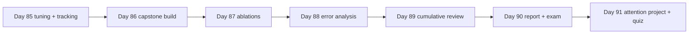

# Week 13 (Days 85-91): Tuning, the Month-3 capstone, and the first step into attention

**Status:** written in full (Phase 3). Titles match `SYLLABUS.md`. Every number below was printed by a script in `code/week-13/` on this box (Python 3.13.5, torch 2.15.0+cpu, 8 CPU threads, no GPU). Wall-clock times were measured while other jobs shared the CPU, so treat them as rough. Accuracies are deterministic for a fixed seed.

## Week goals
- Run a hyperparameter search you can defend: a fixed budget, a log file, a validation set, and a measured seed-noise floor.
- Build a Month-3 capstone image classifier (a small ResNet on CIFAR-10-small) and beat two baselines by a clear margin.
- Run ablations that change one thing at a time, and report the surprising rows honestly.
- Do a full error analysis: per-class accuracy, confusion pairs, input slices, calibration, abstention, and a hand-tagged error sheet.
- Review Months 1-3 with runnable drills, then deliver a written capstone report and sit the checkpoint exam.
- Start Month 4 by writing scaled dot-product attention from scratch (weekly project).

**Compute note.** CPU-only. The capstone trains in about 3 minutes for 15 epochs on 15,000 images. The ablations take about 30 minutes in total; run them while you read.

**Datasets:** MNIST (Day 85, via `code/week-10/_mnist.py`) and CIFAR-10-small from OpenML dataset 40926 (Days 86-90, see `data/README.md` for why OpenML is used). The split is fixed with seed 0: 15,000 train, 2,500 validation, 2,500 test. The test set is used **once**, on Day 88, after every choice is frozen.

---

## Day 85: Hyperparameter tuning and experiment tracking for deep learning
**Review today:** Day 84 (+1), Day 82 (+3), Day 78 (+7), Day 64 (+21; quick 15-min skim of its self-check).

### Block 1: Concept lesson (1h15)
**Intuition.** A deep-learning result is a sample from a noisy process. Weight initialisation, the order of minibatches, dropout masks and augmentation all depend on a random seed. If you try twenty settings and keep the best, part of what you "found" is luck. Tuning is a small experiment, and it needs the same discipline as any other experiment: a fixed budget, a held-out set that tuning never touches, a record of every trial, and an estimate of the noise.

**What to tune first.** In rough order of impact for the models in this course: learning rate (by far the most important), then the schedule, batch size, weight decay, dropout and width. Search the learning rate on a log scale, because 1e-4 and 1e-3 differ as much as 1e-3 and 1e-2. Weight decay is also a log-scale quantity.

**Grid vs random search.** A grid of 3 × 3 tries only 3 distinct values of each hyperparameter. If only one hyperparameter matters (usually the learning rate), 6 of your 9 trials repeat values you already tried. Random search with the same 9 trials tries 9 distinct learning rates. Bergstra and Bengio (2012, "Random Search for Hyper-Parameter Optimization") made this argument formally. Use random search, sampled log-uniformly, over ranges you have sanity-checked with an LR range test (Day 67).

**The noise floor.** Train one configuration with several seeds and compute the standard deviation of the validation metric. A difference between two configurations smaller than about two of those standard deviations is not evidence. This one measurement prevents most false "improvements".

**Experiment tracking.** At minimum, write one CSV row per trial: method, trial id, every hyperparameter, the metric, and the seed. Keep the code version (a git commit hash) next to it. Tools such as MLflow or Weights & Biases add dashboards, but a CSV you can open in pandas is enough for this course and has no account to lose.

**Leakage through tuning.** If you tune against the test set you no longer have a test set. Tune on validation, then touch test once at the end. With small data, use cross-validation for tuning, as in Month 2.

### Block 2: Worked example (45 min)
Run `code/week-13/day85_hparam_search.py` (about 10 s). It trains an MLP 784-256-10 with dropout 0.2, AdamW, 3 epochs, batch 128, on 10,000 MNIST training images, validating on 5,000 held-out training images (the test set is untouched). **Verified:**
- Grid search, lr ∈ {1e-4, 1e-3, 1e-2} × wd ∈ {1e-4, 1e-2, 1}: best val acc **0.9382** at lr 1e-3, wd 1e-4; **3** distinct learning rates tried.
- Random search, 9 trials, lr log-uniform in [10^-4.5, 10^-1.5], wd log-uniform in [1e-5, 1]: best val acc **0.9434** at lr 2.58e-3, wd 2.23e-4; **9** distinct learning rates tried.
- One configuration (lr 1e-3, wd 1e-2) with 5 seeds: mean **0.9386**, std **0.0007**, min **0.9378**, max **0.9396**.
- All 18 trials are in `out/day85_trials.csv`.

Read the result carefully. The random-search winner beats the grid winner by 0.0052, about 7 seed-standard-deviations, so this gap is probably real for this model and budget. It came from a learning rate (2.58e-3) that the grid could not try. On the other hand, the grid best at wd 1e-4 (0.9382) and the 5-seed mean at wd 1e-2 (0.9386) are within one standard deviation: weight decay barely matters here over 3 epochs.

### Block 3: Coding lab (2h)
1. (45 min) Open `out/day85_trials.csv` in pandas. Plot val acc against log10(lr), coloured by method. Where is the good region, and how wide is it?
2. (45 min) Add a third method: random search over lr only, with wd fixed at 1e-4. Does it match the two-dimensional search with the same 9 trials?
3. (30 min) Re-run the 5-seed measurement at the random-search winner. Is the gap to the grid winner still larger than two standard deviations when you compare 5-seed means?

### Block 4: Practice problems (1h)
1. A 4 × 4 grid over (lr, wd) where only lr matters. How many distinct useful trials do you get out of 16? *Answer: 4.*
2. Seed std is 0.004. Config A scores 0.912 and B 0.915 on one seed each. Conclusion? *Answer: none; the gap is under one std.*
3. Why sample lr log-uniformly? *Answer: its effect is multiplicative; uniform sampling over [1e-5, 1e-1] would put almost every trial above 1e-2.*
4. Name three things a trial log must contain. *Answer: hyperparameters, metric, seed (plus code version and data split).*
5. You picked the best of 50 trials on validation. Is its validation score an unbiased estimate of future performance? *Answer: no, it is optimistically biased by the selection; that is what the untouched test set is for.*

### Block 5: Review (1h)
Self-check:
- [ ] I can explain why random search beats grid search when few hyperparameters matter.
- [ ] I measured the seed-noise floor before comparing configurations.
- [ ] My trials are logged in a file I can reload.
- [ ] I can say which Day-85 differences are real and which are noise, with numbers.

### Extra notes: successive halving in one paragraph
Most bad configurations reveal themselves early. Successive halving starts many trials on a small budget (say 1 epoch), keeps the best half, doubles their budget, and repeats. With 16 trials and budgets 1, 2, 4, 8 epochs, the total cost is 16·1 + 8·2 + 4·4 + 2·8 = 64 epochs, against 128 for running all 16 to 8 epochs. Hyperband runs several such brackets with different starting sizes, to hedge against configurations that start slowly but finish well (a low learning rate is the classic case). The risk is exactly that: early ranking is not final ranking, especially when a schedule such as one-cycle makes early epochs unrepresentative. Day 86 shows this. The capstone's validation accuracy dropped to 0.3728 at epoch 8 and recovered to 0.7656 by epoch 15, so a halving rule applied at epoch 8 could easily have killed the eventual winner. If you implement halving, compare at matched points of the schedule, not just matched epochs.

### Going deeper (optional)
Read Bergstra and Bengio (2012) for the low-effective-dimension argument, and Li et al., "Hyperband" (2017) for the bandit view of early stopping.

### Interview-style question (15 min, written)
"Your colleague reports a 0.3% accuracy improvement from a new augmentation. What do you ask before believing it?" How many seeds, what is the seed std, was the test set used for selection, was the training budget matched, and is the code for both runs the same apart from the change?

### Common mistakes / how to debug
- Comparing single runs with different seeds and calling the winner.
- Tuning on test, or on a validation set that overlaps training (check indices).
- Changing two things at once, so you cannot attribute the effect.
- Forgetting to log a failed trial. Failures are data: they map the edge of the stable region.

### What to do next
Day 86 builds the capstone model and its baselines, using the habits from today.

---

## Day 86: Month-3 capstone build: small ResNet on CIFAR-10-small with baselines
**Review today:** Day 85 (+1), Day 83 (+3), Day 79 (+7), Day 65 (+21; quick 15-min skim of its self-check).

### Block 1: Concept lesson (1h15)
**The capstone brief.** Build an image classifier for CIFAR-10-small (10 classes, 32 × 32 colour images) that you can defend in a written report. "Defend" means: it beats simple baselines by a margin larger than noise, every design choice is justified by an experiment (Day 87), its failures are understood (Day 88), and the test number was produced once.

**Baselines first.** Before training anything deep, compute:
1. The **majority-class** baseline: predict the most common training class. It tells you what accuracy means on this split. With balanced classes it should be about 0.10.
2. A **simple model**: logistic regression on downsampled pixels. It shows how much a linear model gets from colour and layout alone.
If your network does not clearly beat both, something is wrong with the data pipeline, the labels or the training loop.

**The model.** A small ResNet in the style of He et al. (2016): a 3×3 stem convolution with 32 channels, then three residual blocks with 32, 64 and 128 channels. The second and third blocks halve the resolution with stride 2. Each block has two 3×3 convolutions with batch norm. When the shape changes, the skip path is a 1×1 convolution with batch norm. Then global average pooling and a linear layer to 10 classes. The code is in `code/week-13/_capstone.py`, so Days 86-90 share one definition.

**The recipe.** SGD with Nesterov momentum 0.9, weight decay 5e-4, a one-cycle schedule peaking at lr 0.05, batch 128, random horizontal flips and 4-pixel random crops, 15 epochs. Every choice is a Month-3 lesson: Day 67 (optimisers and schedules), Day 68 (regularisation), Day 69 (batch norm), Day 72 (residual connections) and Day 73 (augmentation on CIFAR).

**Checkpoints.** Save the `state_dict`, not the whole pickled model, together with enough metadata (architecture arguments, data split seed, class names) to rebuild it. Day 88 loads it without retraining.

### Block 2: Worked example (45 min)
Run `code/week-13/day86_capstone_build.py` (about 4 minutes on this box). **Verified:**
- Split: train **15,000**, val **2,500**; train class counts **1,469-1,533** per class.
- Majority-class baseline, val acc **0.1016**.
- Logistic regression on 16 × 16 downsampled pixels, val acc **0.3688** (47 s; scikit-learn warns that it hit its 300-iteration limit, which is fine for a baseline as long as you report it).
- Small ResNet, width 32: **308,650** parameters.
- Training curve (val acc): epoch 1 **0.3408**, 4 **0.4800**, 7 **0.6152**, 8 **0.3728**, 9 **0.6436**, 13 **0.7300**, 15 **0.7656**. Train loss fell steadily from **1.9333** to **0.5579**.
- Final val acc **0.7656** after 15 epochs in **190 s**. Checkpoint: `out/capstone.pt`; the history is in `out/day86_history.csv`.

Two things to notice. First, the margin: 0.7656 against 0.3688 and 0.1016 is far beyond any noise. Second, the dip at epoch 8. The one-cycle learning rate is near its peak there, and with batch norm a large step can briefly change the activation statistics so that the running averages used in eval mode no longer match. Train loss kept falling (0.9546 → 0.8939), so this was an evaluation-time wobble, not divergence. It is a good reason not to early-stop on a single noisy epoch. For comparison, the Day-73 CNN with batch norm and augmentation reached val acc 0.7268 with 308,394 parameters in 10 epochs. The capstone has almost the same parameter count, adds residual connections, one-cycle and 5 more epochs, and gains 0.0388.

### Block 3: Coding lab (2h)
1. (30 min) Read `_capstone.py` and draw the network, writing the tensor shape after every block for a batch of 128.
2. (45 min) Count the parameters by hand for one residual block with a 1×1 projection (32 → 64 channels, stride 2). Check your answer against `sum(p.numel() for p in block.parameters())`.
3. (45 min) Plot `out/day86_history.csv`: train loss and val acc on twin axes, and mark where the one-cycle learning rate peaks.

### Block 4: Practice problems (1h)
1. Why report a majority-class baseline when the classes are balanced? *Answer: it confirms the split really is balanced and gives the chance level for this exact split (0.1016 here).*
2. Output shape after the stem and three blocks for a 32 × 32 input? *Answer: 128 × 8 × 8, then 128 after global pooling.*
3. Why are the convolutions bias-free when followed by batch norm? *Answer: batch norm subtracts the mean, so a bias is cancelled; BN's own β plays that role.*
4. Val acc drops from 0.6152 to 0.3728 for one epoch while train loss falls. Name two possible causes. *Answer: a learning-rate peak disturbing BN running statistics; a noisy, small validation set (2,500 images) would give only small wobbles, so the first cause is the likely one.*
5. Why save a `state_dict` rather than `torch.save(model)`? *Answer: pickling the whole model ties the file to your class definitions and file layout; a state dict plus a builder function is portable.*

### Block 5: Review (1h)
Self-check:
- [ ] My model beats both baselines by a margin I can quote.
- [ ] I can rebuild the model from the checkpoint and its metadata.
- [ ] I can explain the epoch-8 dip without hand-waving.
- [ ] I have not looked at the test set.

### Extra notes: why global average pooling
VGG-style networks flatten the last feature map into a large fully connected layer. In the Day-72 VGG, most parameters sat in that head. Global average pooling replaces it with a per-channel mean, so the classifier is a 128 × 10 linear layer (1,290 parameters including bias). Three consequences follow. Parameters drop sharply, which matters with 15,000 training images. The network becomes approximately translation-invariant at the output, because averaging discards where a feature fired. And the 128 channels become interpretable: each class score is a weighted sum of "how much of feature k is present anywhere". The cost is that spatial layout is thrown away at the end, so the network must encode any layout it needs into the channels before pooling. On 32 × 32 images with three downsamplings, the last map is 8 × 8, small enough that little is lost. In the lab, replace the pooling with flatten + linear and count how many parameters the head now has (128·8·8·10 + 10 = 81,930).

### Going deeper (optional)
Read He et al., "Deep Residual Learning for Image Recognition" (2016), section 4.2 (the CIFAR-10 experiments), and compare their depth and width with ours.

### Interview-style question (15 min, written)
"Your CNN gets 76% on CIFAR-10-small. Is that good?" It depends on the baselines and the budget: here chance is 10%, a linear model 37%, and we trained on 15,000 images for 3 minutes on a CPU. It is not comparable with published full-CIFAR-10 numbers trained on 50,000 images with GPUs for hours.

### Common mistakes / how to debug
- Normalising with statistics computed on validation or test images.
- Applying augmentation at evaluation time by accident (flip/crop inside the shared loader).
- Forgetting `model.eval()` before validating, so BN uses batch statistics and dropout stays on.
- One-cycle with the wrong total step count, so the schedule ends early or never anneals.

### What to do next
Day 87 asks which of today's choices actually mattered.

---

## Day 87: Month-3 capstone: ablations
**Review today:** Day 86 (+1), Day 84 (+3), Day 80 (+7), Day 66 (+21; quick 15-min skim of its self-check).

### Block 1: Concept lesson (1h15)
**What an ablation is.** Remove or change one component, retrain with everything else identical (same seed, split, budget and code), and measure the change. An ablation answers "does this part earn its place in *this* setting?" It does not answer whether the part is useful in general.

**Design rules.**
- Change one thing per run. If removing batch norm also needs a lower learning rate to train at all, say so in the row name, as the script does ("no batch norm (lr 0.01)").
- Match the budget. All rows use the same number of epochs. A shorter budget than the main run is fine (it makes the study affordable) but must be stated, because some components only pay off late.
- Include a "full model" row trained under the ablation budget, and compare against that row, not against the main run.
- Add a data row (train on 50% of the data). It tells you whether more data or more modelling would help most.
- State the noise floor. One seed per row means differences under about a point of accuracy are not interpretable.

**Reading surprises.** When a component you expected to help shows no gain or a small gain from removal, the honest options are: the effect is within noise; the budget is too short for it to matter (augmentation is the classic case, since it slows fitting and pays off over longer training); or the component really does not help at this depth and data size. Do not delete the row, and do not quietly change the budget until the expected ordering appears.

### Block 2: Worked example (45 min)
Run `code/week-13/day87_capstone_ablations.py` (it took 1,975 s on a busy box; expect 10-30 minutes). Every row is 8 epochs, seed 0, same split. **Verified:**

| config | final train loss | val acc | delta vs full | time (s) |
|---|---|---|---|---|
| full model | 0.8035 | 0.7044 | 0 | 86 |
| no augmentation | 0.5366 | 0.7112 | +0.0068 | 74 |
| no residual connections | 0.7802 | 0.7108 | +0.0064 | 356 |
| no batch norm (lr 0.01) | 1.7112 | 0.3536 | −0.3508 | 951 |
| half width (16) | 0.9278 | 0.6612 | −0.0432 | 305 |
| no weight decay | 0.8029 | 0.7032 | −0.0012 | 69 |
| label smoothing 0.1 | 1.1706 | 0.7024 | −0.0020 | 54 |
| 50% of training data | 0.9929 | 0.6180 | −0.0864 | 37 |

Logged to `out/day87_ablations.csv`. The times are **not** comparable between rows: other jobs were competing for the CPU during the no-residual, no-BN and half-width runs. Do not read "removing residuals makes training 4× slower" into this table.

**What the table says.**
- Batch norm is the one component that matters enormously here: without it, even at a safer learning rate, the network reaches 0.3536.
- Width matters: halving it costs 0.0432.
- Data matters most of the rest: half the data costs 0.0864, twice the width penalty. More images would help more than more architecture.
- Weight decay and label smoothing are within noise at this budget (−0.0012, −0.0020).
- **Surprises:** removing augmentation (+0.0068) and removing residual connections (+0.0064) both scored slightly *higher*. Both are under a point with one seed, so they are not evidence that these parts hurt. The no-augmentation train loss (0.5366 against 0.8035) shows that without augmentation the model fits the training set faster. Over 8 epochs it has not yet overfitted enough for augmentation to pay off. Residual connections exist to make *deep* networks trainable (Day 72: the 22-layer residual net beat the plain one by 0.1025). This network has only about 8 weight layers, where plain and residual nets train comparably.

### Block 3: Coding lab (2h)
1. (60 min) Re-run "full model" and "no augmentation" with seeds 1 and 2 (`fit(seed=...)`). Is the +0.0068 still there as a mean over three seeds?
2. (30 min) Re-run the same pair for 15 epochs. Does augmentation start to pay off with the longer budget?
3. (30 min) Add a row with a 25% data fraction and plot val acc against data fraction (25%, 50%, 100%). Extrapolate, with caution, what doubling the data might give.

### Block 4: Practice problems (1h)
1. Why does the ablation compare against a full model trained for 8 epochs and not against the 15-epoch main run (0.7656)? *Answer: the budgets must match; 15 epochs vs 8 would confound the comparison.*
2. Why does the no-BN row change the learning rate too? *Answer: at lr 0.05 the unnormalised network is likely to diverge, so the row would measure instability, not BN's contribution; the change is named in the row.*
3. A component gives +0.003 with one seed. What do you write in the report? *Answer: "no measurable effect at this budget (single seed)".*
4. Half data costs 0.0864; half width costs 0.0432. Which would you invest in first? *Answer: more data (or stronger augmentation as a proxy), then width.*
5. Why is the no-augmentation train loss so much lower? *Answer: the model sees the exact same images each epoch and memorises faster; augmented images are harder to fit.*

### Block 5: Review (1h)
Self-check:
- [ ] Every row changes exactly one thing, or names the second change.
- [ ] I can state the noise floor and which rows fall inside it.
- [ ] I reported the two surprising rows without deleting or "fixing" them.
- [ ] I know why the timing column cannot be compared here.

### Extra notes: ablation vs addition
An ablation removes a component from the full model; an addition study adds it to a minimal model. They can disagree. Components often overlap in what they provide: weight decay, augmentation, label smoothing and dropout all regularise. Removing any one of them from a model that has the others may show no effect, because the rest cover for it, even though adding it alone to a bare model would help a lot. Today's weight-decay and label-smoothing rows are consistent with that. Interactions also run the other way: batch norm makes larger learning rates usable, so "no BN" partly measures "lower usable learning rate". For a full picture you would run a small factorial design (for example augmentation × weight decay, 4 runs, several seeds each) and look at the interaction term. That costs more, so for a capstone the honest compromise is the one-at-a-time table plus a sentence on which conclusions might be interaction effects.

### Going deeper (optional)
Read the ablation sections of the ResNet paper (He et al., 2016) and the batch norm paper (Ioffe and Szegedy, 2015), and note how many seeds each reports.

### Interview-style question (15 min, written)
"Your ablation shows that removing a component improves accuracy by 0.5%. Do you remove it?" Not on one seed: measure the seed std, repeat with several seeds and the full budget, check whether the effect depends on budget (augmentation) or depth (residuals), and only then decide. Also consider robustness and calibration, not only accuracy.

### Common mistakes / how to debug
- Comparing rows trained with different seeds, budgets or data orders.
- Silently tuning the learning rate per row; if you do, say so.
- Reading wall-clock timings from a shared machine as properties of the model.
- Treating a single-seed table as a ranking.

### What to do next
Day 88 asks *where* the frozen model fails, and touches the test set once.

---

## Day 88: Month-3 capstone: error analysis
**Review today:** Day 87 (+1), Day 85 (+3), Day 81 (+7), Day 67 (+21; quick 15-min skim of its self-check).

### Block 1: Concept lesson (1h15)
**Why error analysis.** A single accuracy number hides where the model fails, how confidently it fails, and whether some inputs are systematically harder. Error analysis turns "76%" into a list of concrete, fixable problems ranked by how many errors each explains.

**The checklist.**
1. **Bias/variance view.** Compare training and validation error. A large training error means underfitting (bigger model, longer training). A large gap means overfitting (more data, more regularisation).
2. **Per-class accuracy** and the **confusion pairs** that account for most errors.
3. **Semantic structure.** Are errors between similar classes (cat vs dog) or across obviously different groups (animal vs vehicle)? Errors within a group are often ambiguous images; errors across groups suggest a bug or a shortcut.
4. **Slices.** Accuracy by an input property, here brightness and contrast quartiles. A slice with much lower accuracy is a target for augmentation or data collection.
5. **Calibration.** Mean confidence on correct and wrong predictions, and the **expected calibration error** (ECE): bin predictions by confidence, then average |accuracy − confidence| over bins, weighted by bin size.
6. **Selective prediction.** If the model may abstain below a confidence threshold, what coverage and accuracy do you get?
7. **Look at the errors.** Tag a sample by hand (ambiguous, mislabelled, small object, unusual pose, background shortcut). Counts of tags tell you what to fix.

**The test set.** Everything was frozen on Day 86 (model and recipe) and Day 87 (no changes adopted). Today the test set is used once. Any further tuning after looking at test numbers would make them optimistic.

### Block 2: Worked example (45 min)
Run `code/week-13/day88_capstone_error_analysis.py` (about 10 s; it loads `out/capstone.pt`). **Verified:**
- Train (first 2,500 images, eval mode) acc **0.8272**; val **0.7656**; **TEST 0.7736**; test with flip test-time augmentation (average of the image and its mirror) **0.7816**.
- Bias/variance: train error **0.1728**, val-train gap **0.0616**. Training error is large, so the model is still underfitting: longer training or more width should help, which agrees with Day 87's width row.
- Per-class test accuracy: truck **0.927**, automobile **0.870**, ship **0.861**, airplane **0.826**, horse **0.824**, frog **0.815**, deer **0.770**, dog **0.647**, bird **0.628**, cat **0.578**.
- Errors **566 / 2,500**. Top confused pairs (count, true, predicted): cat→dog **74**, bird→deer **42**, deer→horse **36**, airplane→ship **34**, airplane→bird **34**. These five explain **39%** of errors.
- Errors crossing the animal/vehicle boundary: **96 of 566**.
- Slices: darkest brightness quartile **0.7184** vs brightest **0.8096**; lowest contrast quartile **0.7344** vs highest **0.8208**.
- Calibration: mean confidence **0.830** when correct and **0.574** when wrong; ECE (10 bins) **0.0203**; **28** wrong predictions with confidence above 0.9.
- Abstention: threshold 0.5 keeps **85.6%** at accuracy **0.8303**; 0.7 keeps **64.1%** at **0.9132**; 0.9 keeps **41.5%** at **0.9730**.
- Files: `out/day88_review_sheet.csv` (60 errors to tag by hand) and `out/day88_confident_errors.png`.

**Reading it.** The weakest classes are the four mammals and birds, and their errors mostly stay inside the animal group. Airplane is confused with ship and bird, which share plain sky or sea backgrounds: a plausible background shortcut to check in the review sheet. Dark and low-contrast images are about 9 points harder; brightness and contrast jitter is a cheap augmentation to try next. Calibration is good (ECE 0.0203), so the confidence scores are usable for abstention, and the 28 confident errors are the first images to inspect: some may be mislabelled.

### Block 3: Coding lab (2h)
1. (60 min) Open the review sheet and the figure. Tag all 60 errors with one of: ambiguous, likely mislabelled, small/occluded object, unusual viewpoint, background shortcut, other. Count the tags and add them to the report.
2. (30 min) Draw a reliability diagram (accuracy vs mean confidence per bin) from the script's predictions.
3. (30 min) Compute the confusion matrix restricted to {cat, dog, deer, horse, bird} and decide whether you would merge any classes for a product that only needs "animal type".

### Block 4: Practice problems (1h)
1. Train error 0.1728, val-train gap 0.0616. Underfitting or overfitting? *Answer: mainly underfitting; the training error dominates.*
2. Why may flip-TTA be reported but not used to pick the model? *Answer: it was evaluated on test; if you want to adopt it, decide on validation first, then report test once.*
3. ECE with bins (n=100, acc 0.9, conf 0.8) and (n=300, acc 0.6, conf 0.6)? *Answer: (100·0.1 + 300·0)/400 = 0.025.*
4. At threshold 0.7 the model keeps 64.1% of images. How many of the 2,500 test images go to a human? *Answer: about 897.*
5. Five pairs explain 39% of 566 errors. About how many errors is that? *Answer: about 221 (the counts sum to 220).*

### Block 5: Review (1h)
Self-check:
- [ ] I used the test set once and wrote the number down before doing anything else.
- [ ] I can name the three weakest classes and the top confusion.
- [ ] I can define ECE and compute it for two bins by hand.
- [ ] I tagged the error sheet and have counts per tag.

### Extra notes: why the confident errors matter most
A wrong answer at confidence 0.4 is cheap: any abstention rule catches it. A wrong answer at confidence 0.95 is dangerous because nothing downstream notices. Of 566 test errors, 28 had confidence above 0.9. Look at those first. In practice they usually fall into three groups: label noise (the image really is what the model says), genuine ambiguity (a small animal in a large scene), and shortcuts (the model learned that blue background means ship). The first group means your test accuracy slightly understates the model; report it but do not "fix" the test labels you have peeked at without also auditing the training labels. The third group is the one to act on, with targeted augmentation or data. Also note the asymmetry in the abstention table: going from threshold 0.5 to 0.9 halves coverage (85.6% to 41.5%) for a 14-point accuracy gain. Whether that trade is worth it depends on the cost of a human review against the cost of an error, which is a product decision, not a modelling one.

### Going deeper (optional)
Read Guo et al., "On Calibration of Modern Neural Networks" (2017), especially temperature scaling, and try it on the validation logits.

### Interview-style question (15 min, written)
"Your classifier is 77% accurate. The product team wants 95%. What can you offer without retraining?" Selective prediction: at a threshold of 0.9 the model was 97.3% accurate on the 41.5% of images it kept; send the rest to people. Then use the error analysis to plan retraining (more data, brightness augmentation, width).

### Common mistakes / how to debug
- Looking at test errors, changing the model, and reporting the same test set again.
- Computing training accuracy in train mode (dropout/BN active), which understates it.
- Reporting only a top-confusions list without its share of total errors.
- Reading ECE without the reliability diagram: a small ECE can hide over- and under-confidence that cancel.

### What to do next
Day 89 steps back and reviews Months 1-3 before the report is written.

---

## Day 89: Cumulative review Months 1-3 (10 runnable drills)
**Review today:** Day 88 (+1), Day 86 (+3), Day 82 (+7), Day 68 (+21; quick 15-min skim of its self-check).

### Block 1: Concept lesson (1h15)
**Why a cumulative review now.** Spaced review (the +1/+3/+7/+21 schedule in `review-schedule.csv`) keeps recent material alive, but each review touches one day. Before the capstone report and the checkpoint exam you need the opposite view: one pass over the whole course, looking for the threads that connect it. The three months form one story.
- **Month 1 (mathematics and NumPy).** Vectors, matrices and least squares; derivatives, the chain rule and gradient descent; probability, likelihood and cross-entropy. Every later loss and every later gradient comes from here.
- **Month 2 (classical machine learning).** Train/validation/test discipline, cross-validation, bias and variance, regularisation, metrics such as precision and recall, and pipelines that prevent leakage. Every later experiment uses these habits.
- **Month 3 (deep learning).** Autograd, data loading, initialisation, optimisers and schedules, regularisation, normalisation, convolutions, residual connections, sequence models, mixed precision, tuning, and now the capstone.

**How to review.** Do not reread. Retrieve: close the notes, write what you remember, then check. Then **recompute**: a fact you can reproduce in three lines of code is a fact you own. Today's script does exactly that with ten drills, each of which recomputes a result from an earlier lesson and checks it automatically.

**Connections to draw today** (write each one out in two or three sentences):
1. Least squares (Month 1) is linear regression (Month 2), and also a one-layer network trained with squared loss (Month 3).
2. Cross-entropy (Month 1) is logistic regression's loss (Month 2) and the classifier loss in every Month-3 network. At initialisation it should be near ln(C).
3. Regularisation appears as ridge/lasso (Month 2) and as weight decay, dropout and augmentation (Month 3). All trade training fit for generalisation.
4. Validation discipline (Month 2) became tuning discipline (Day 85) and the single test-set use (Day 88).

### Block 2: Worked example (45 min)
Run `code/week-13/day89_cumulative_review.py` (about 6 s). It exits with an error code if any drill fails, so it can run in `run_all.sh`. **Verified:** **10/10 drills passed.**
- M1 least squares recovers w = [1, −2, 0.5] from noisy data: [**0.999**, **−2.001**, **0.501**].
- M1 cross-entropy when the true class has probability 0.7: **0.3567**.
- M2 5-fold cross-validated logistic regression on the 8 × 8 digits: mean **0.9277**, std **0.0262**.
- M2 precision and recall for TP 70, FP 30, FN 10: P **0.700**, R **0.875**.
- M3 parameters of an MLP 784-128-10: **101,770**.
- M3 parameters of Conv2d(3, 16, 3): **448**.
- M3 output size of a 3×3 conv with padding 1 on 32 × 32: **32**.
- M3 gradients accumulate without `zero_grad`: two backward passes of x² at x = 3 give **12.0**.
- M3 initial loss with near-zero logits: **2.3024** against ln 10 = **2.3026**.
- M3 dropout p = 0.5 in train mode: mean of the output **0.984** (kept units scaled by 2); identity in eval mode.

### Block 3: Coding lab (2h)
1. (60 min) Add five drills of your own, at least one per month. Suggestions: the gradient of the logistic loss equals (p − y)x; ridge regression shrinks coefficients as λ grows; the BN running mean after one batch with momentum 0.1; the receptive field of two stacked 3×3 convolutions is 5; an LSTM with I = 10, H = 32 has 5,632 parameters (Day 79).
2. (30 min) Make one drill fail on purpose and check that the script exits non-zero.
3. (30 min) From `flashcards/month-01.csv` to `month-03.csv`, pick the 15 cards you get wrong most often and write a drill for any that can be computed.

### Block 4: Practice problems (1h)
1. Why is the digits CV accuracy reported with a standard deviation? *Answer: the fold-to-fold spread (0.0262) shows how much a single split could mislead.*
2. Gradients accumulate. Name a case where that is useful. *Answer: gradient accumulation, which simulates a larger batch over several small ones.*
3. The initial loss is 4.1 with 10 classes. What do you suspect? *Answer: logits too large at initialisation (bad init or a missing normalisation), or wrong labels.*
4. Write the parameter count of a dense layer from n to m units. *Answer: n·m + m.*
5. Explain in one sentence why dropout rescales by 1/(1 − p). *Answer: so the expected activation in training equals the activation in eval mode.*

### Block 5: Review (1h)
Self-check:
- [ ] All 10 drills pass on my machine, and I wrote 5 more.
- [ ] I can draw the Month 1 → 2 → 3 connections without notes.
- [ ] I know my weakest 15 flashcards.

### Extra notes: building a personal error log
Keep a file, one line per mistake you made in Months 1-3, in the form *date, what I did, what was wrong, how I found out, the rule*. Examples from this course's own debugging: forgetting `model.eval()` (Day 69's BN demos show the symptom), normalising with test statistics (Day 65 computes the mean on train only for this reason), not zeroing gradients (today's drill), a learning rate too high for an unnormalised network (Day 87's no-BN row needed lr 0.01). Patterns emerge quickly: most bugs are about **mode** (train vs eval), **data** (leakage, wrong split, wrong normalisation) or **state** (gradients, hidden states, running statistics). Before the exam, read the log once and turn each rule into a flashcard. This is more valuable than any summary someone else wrote, because it targets the mistakes you actually make. It also makes a strong section in an interview portfolio: "here is how I debug".

### Going deeper (optional)
Redo one past weekly project from scratch, without looking at its code, and diff your version against the original.

### Interview-style question (15 min, written)
"Explain how logistic regression, a softmax classifier and a neural network classifier are related." All minimise cross-entropy; logistic regression is a one-layer network with a sigmoid; softmax regression extends it to C classes; a neural network adds learned nonlinear features before the same final layer and loss.

### Common mistakes / how to debug
- Reviewing by rereading. Use retrieval and recomputation.
- Skipping Month 1 because it feels easy. Most deep-learning debugging comes back to shapes, gradients and probabilities.
- Writing drills that cannot fail (no assertion).

### What to do next
Day 90 turns Days 86-88 into a report, then the checkpoint exam.

---

## Day 90: MONTH-3 CAPSTONE delivery (report) + checkpoint exam
**Review today:** Day 89 (+1), Day 87 (+3), Day 83 (+7), Day 69 (+21; quick 15-min skim of its self-check).

### Block 1: Concept lesson (1h15)
**The report.** Someone who has not seen your code should be able to judge your claim from the report alone. Use this structure (one to two pages):
1. **Task and data.** Source (OpenML 40926), image size, classes, split sizes and seed, and the rule that the test set is used once.
2. **Baselines.** Majority class and logistic regression, with numbers.
3. **Model and recipe.** Architecture, parameter count, optimiser, schedule, augmentation, epochs, hardware and time.
4. **Result.** Validation and test accuracy, with the date the test number was produced.
5. **Ablations.** The Day-87 table, its budget, the noise caveat and the surprising rows.
6. **Error analysis.** Per-class accuracy, top confusions, slices, calibration, abstention, and your hand-tag counts.
7. **Limitations and next steps.** Single seeds, small images, CPU budget, and the two or three experiments the evidence points to.

**Writing rules.** Every number in the report must come from a log or a CSV you can point to. Do not compare with published full-CIFAR-10 results: different data size, budget and resolution. Say "no measurable effect" rather than "slightly better" when a difference is within noise.

**The checkpoint exam.** Two hours, closed notes, then mark it with the answers in the week files. It covers Weeks 9-13: 40% concepts (explain), 40% computation (by hand), 20% code reading (find the bug). A score below 70% in any section means a revisit week before Month 4 goes further; the syllabus has slack for that.

### Block 2: Worked example (45 min)
Run `code/week-13/day90_capstone_delivery.py` (about 5 s). It collects the logs and writes `out/capstone_report.md` (**44 lines**). **Verified:** the report contains:
- Data: OpenML 40926, 15,000 / 2,500 / 2,500, seed 0. Model: small ResNet, **308,650** parameters. Environment: Python 3.13.5, torch 2.15.0+cpu.
- Result: validation **0.7656**, test **0.7736** (test used once).
- The 15-epoch training curve from `out/day86_history.csv`, and the 8-row ablation table from `out/day87_ablations.csv`.
- A placeholder in the error-analysis section for your Day-88 tag counts, and a limitations section (single seed per ablation, 32 × 32 images and CPU budget).

The generated report is a skeleton, not a finished report. Your job today is to add the baselines (0.1016 and 0.3688), the error-analysis figures from Day 88, your tag counts, and a "next steps" section justified by the evidence: more data (Day 87, −0.0864 at half data), more width or epochs (Day 88, underfitting with train error 0.1728), and brightness/contrast augmentation (Day 88, the darkest quartile 9 points below the brightest).

### Block 3: Coding lab (2h)
This block is the exam, timed.
1. (40 min) **Concepts.** (a) Why do residual connections help deep networks? (b) What does batch norm do differently in train and eval mode? (c) Why does random search beat grid search? (d) What is ECE? (e) Why can an LSTM remember longer than a vanilla RNN?
2. (40 min) **Computation.** (a) Output size of a 5×5 conv, stride 2, padding 2, on 64 × 64. (b) Parameters of Conv2d(64, 128, 3) with bias. (c) Adam's first update size for any gradient with bias correction and lr 1e-3. (d) The ECE of two bins: (n = 50, acc 0.8, conf 0.9) and (n = 150, acc 0.7, conf 0.7). (e) Cross-entropy of probabilities [0.25, 0.25, 0.5] when the true class is the third.
3. (40 min) **Code reading.** Find the bug in each: (a) a validation loop without `model.eval()`; (b) `loss.backward()` in a loop without `zero_grad`; (c) normalisation statistics computed on `torch.cat([train, test])`; (d) a truncated-BPTT loop without `h = h.detach()`.

*Answers to the computation section:* (a) (64 + 4 − 5)/2 + 1 = 32 (floor of 31.5 is 31, plus 1). (b) 64·128·9 + 128 = 73,856. (c) about lr = 1e-3 per parameter, whatever the gradient's scale. (d) (50·0.1 + 150·0)/200 = 0.025. (e) −ln 0.5 = 0.693.

### Block 4: Practice problems (1h)
Mark the exam. For every wrong answer, write one flashcard and find the day that covers it. Then:
1. Rewrite one report sentence that overclaims. Example: "removing residual connections improves accuracy" becomes "removing residual connections had no measurable effect at 8 epochs with one seed (+0.0064)".
2. Write the abstract of your report in at most 80 words, containing the test number, both baselines and the one most important limitation.

### Block 5: Review (1h)
Self-check:
- [ ] My report has all seven sections and every number points to a file.
- [ ] I scored at least 70% in each exam section, or I have scheduled a revisit.
- [ ] My limitations section names the single-seed ablations and the CPU budget.

### Extra notes: what a reviewer looks for
Imagine someone reviewing the capstone for a hiring decision. They spend three minutes and look for four things. **One:** is the evaluation trustworthy? A fixed split, a seed, a test set used once, and baselines answer that. **Two:** does the author know which parts matter? The ablation table, with its caveats, answers that, and admitting the two surprising rows is a positive signal, not a weakness. **Three:** does the author understand the failures? Per-class numbers, the cat→dog confusion (74 errors), the dark-image slice and the 28 confident errors show you looked at the data, not just the metric. **Four:** can the work be reproduced? `bash run_all.sh 3` re-runs every Month-3 script, and the report lists the environment. A short, honest report with these four properties beats a long one with a higher number and no evidence. Keep the report in the repository next to the code and the CSVs it cites.

### Going deeper (optional)
Read Mitchell et al., "Model Cards for Model Reporting" (2019), and add a model-card section (intended use, out-of-scope use, metrics by slice) to your report.

### Interview-style question (15 min, written)
"Walk me through a project where a result surprised you." Use Day 87: augmentation and residual connections did not help at 8 epochs; explain the budget and depth reasons, the noise floor, and the experiment you would run to settle it.

### Common mistakes / how to debug
- Reporting the best validation epoch as the result instead of the frozen model's test number.
- Missing environment details (library versions, hardware), so nobody can reproduce the timings.
- Numbers typed by hand into the report that drift from the logs. Generate tables from CSVs, as the script does.

### What to do next
Day 91 begins Month 4: attention, the building block of transformers.

---

## Day 91: PROJECT W13: attention from scratch (Q, K, V); Quiz 13
**Review today:** Day 90 (+1), Day 88 (+3), Day 84 (+7), Day 70 (+21; quick 15-min skim of its self-check).

This is the first day of Month 4. The flashcards tag it `m4`.

### Block 1: Concept lesson (1h15)
**From Day 81 to here.** On Day 81 the decoder of a seq2seq model learned to look back at all encoder states with a weighted average, and exact match at length 16 rose from 0.000 to 0.292. Attention generalises that idea: every position in a sequence can build its output as a weighted average of every other position, with the weights computed from the content itself.

**Queries, keys and values.** Each input row x_t (one token's vector) is projected three ways: a query q_t = x_t W_Q ("what am I looking for?"), a key k_t = x_t W_K ("what do I contain?") and a value v_t = x_t W_V ("what do I pass on?"). The score of position s for position t is the dot product q_t · k_s. A softmax over s turns scores into weights that sum to 1, and the output is the weighted sum of values.

**Scaled dot-product attention** (Vaswani et al., 2017):

Attention(Q, K, V) = softmax(Q Kᵀ / √d_k) V.

**Why divide by √d_k.** If the entries of q and k are independent with mean 0 and variance 1, then q · k is a sum of d_k such products, with variance d_k. Large scores push the softmax into saturation (nearly one-hot), where gradients vanish. Dividing by √d_k restores variance 1.

**Causal mask.** For a language model, position t must not see positions after t. Set those scores to −∞ before the softmax, so their weights are exactly 0. The weight matrix becomes lower-triangular.

**Permutation equivariance.** Attention has no notion of order: permuting the input rows permutes the output rows in the same way. That is why transformers add positional information (Day 92 onward).

**Multi-head attention.** Split the model dimension D into h heads of size D/h, run attention in each head independently, concatenate the results and apply an output projection W_O. Different heads can attend to different things. With four D × D matrices (W_Q, W_K, W_V, W_O) and no biases, the parameter count is 4D².

### Block 2: Worked example (45 min)
Run `code/week-13/day91_attention_scratch.py` (about 1 s). It implements attention in NumPy and checks it against PyTorch. **Verified:**
- 5 tokens, d = 8: weight rows sum to 1 (**True**), weight shape **(5, 5)**.
- Causal mask: upper triangle all zero (**True**). The weights, rounded:

| query \ key | 0 | 1 | 2 | 3 | 4 |
|---|---|---|---|---|---|
| 0 | 1.000 | 0 | 0 | 0 | 0 |
| 1 | 0.879 | 0.121 | 0 | 0 | 0 |
| 2 | 0.417 | 0.289 | 0.295 | 0 | 0 |
| 3 | 0.282 | 0.237 | 0.290 | 0.191 | 0 |
| 4 | 0.336 | 0.056 | 0.238 | 0.106 | 0.264 |

  The first token can only attend to itself, so its weight is exactly 1.
- Max difference from `torch.nn.functional.scaled_dot_product_attention` with the causal flag: **1.1e-16**.
- Standard deviation of q · k for random unit-variance vectors: d_k = 4: **2.00** → **1.00** after scaling; d_k = 64: **8.39** → **1.05**; d_k = 1024: **31.25** → **0.98**. Unscaled, the spread grows like √d_k (2, 8, 32), as predicted.
- Permuting the input rows permutes the outputs: **True**.
- My multi-head attention (D = 16, h = 4) vs `nn.MultiheadAttention` with the same weights: max diff **8.5e-08**; parameters **1,024** = 4·D² = **1,024**.

### Block 3: Coding lab (2h) (the weekly project)
1. (45 min) Write `attention(Q, K, V, mask=None)` in NumPy without looking at the script. Test it: rows of the weights sum to 1; the causal weights have a zero upper triangle; the output matches PyTorch to 1e-6.
2. (45 min) Write multi-head attention with reshape and transpose only (no loops over heads). Load the weights of an `nn.MultiheadAttention(16, 4, bias=False)` into it and match its output.
3. (30 min) Show the saturation problem: for d_k = 512, compute the softmax of unscaled scores for one query against 10 keys and report the largest weight. Repeat with scaling. Then compute the gradient of the softmax output with respect to the scores in both cases and compare their norms.

**Deliverable.** `code/week-13/my_attention.py` with the three tests passing, and a paragraph explaining the √d_k table in your own words.

### Block 4: Practice problems (1h)
1. Q is 5 × 8, K is 5 × 8, V is 5 × 3. Shapes of the scores, the weights and the output? *Answer: 5 × 5, 5 × 5, 5 × 3.*
2. Why −∞ and not a large negative number like −1e9? *Answer: either works in float32; −∞ gives exactly 0 weight, but a row of all −∞ gives NaN, so real code must handle fully masked rows.*
3. Parameters of multi-head attention with D = 512 and no biases? *Answer: 4·512² = 1,048,576.*
4. Cost of computing Q Kᵀ for sequence length T and dimension d? *Answer: O(T² d); quadratic in sequence length.*
5. Why does the first row of the causal weights always equal [1, 0, 0, 0, 0]? *Answer: only one key is visible, and softmax over a single element is 1.*

### Block 5: Review (1h)
Self-check:
- [ ] I can write scaled dot-product attention from memory and explain each factor.
- [ ] I can derive why the variance of q · k is d_k.
- [ ] My multi-head implementation matches PyTorch.
- [ ] I took Quiz 13 below and marked it.

### Extra notes: attention as a soft dictionary lookup
A Python dictionary maps a query key to exactly one value: if the query equals a stored key, return its value. Attention is the differentiable version. Every stored item has a key and a value; the query is compared with every key by a dot product; the softmax turns the similarities into a probability distribution; and the result is the expected value under that distribution. If one similarity is much larger than the others, the softmax is nearly one-hot and attention behaves like an exact lookup. If they are similar, it returns a blend. The temperature of this lookup is set by the score scale, which is exactly what √d_k controls. Because every step is differentiable, the network can learn *what* to use as keys and queries (through W_Q and W_K) by gradient descent. Day 81's attention was this lookup with the decoder state as query and encoder states as keys and values. Self-attention, today's version, uses the same sequence for all three. In Month 4 the transformer block stacks self-attention with a small MLP, residual connections (Day 72) and layer norm (Day 69), all of which you already know.

### Going deeper (optional)
Read Vaswani et al., "Attention Is All You Need" (2017), section 3.2 only, and compare their equation with your code.

### Interview-style question (15 min, written)
"Why is attention scaled by √d_k?" The dot product of two random d_k-dimensional vectors with unit-variance entries has variance d_k; large scores saturate the softmax and kill gradients; scaling keeps the scores at unit variance. Quote the measured table: 31.25 → 0.98 at d_k = 1024.

### Common mistakes / how to debug
- Softmax over the wrong axis (over queries instead of keys). Check that each **row** sums to 1.
- Forgetting to subtract the row maximum before `exp`, which overflows for large scores.
- Mixing up the head split: reshape to (T, h, D/h) and then transpose to (h, T, D/h), not reshape directly to (h, T, D/h).
- Applying the mask after the softmax, which leaves the rows not summing to 1.

### What to do next
Month 4 continues with positional encodings and a full transformer block. Take Quiz 13 now.

---

## Weekly quiz: Week 13
1. Why does random search beat grid search on the same budget? Use the Day-85 numbers.
2. What was the Day-85 seed-noise standard deviation, and which comparison did it make meaningful?
3. Give the two baselines and the capstone's validation accuracy on Day 86.
4. What happened at epoch 8 of the capstone run, and why was it not a reason to stop?
5. Which single ablation cost the most, and by how much?
6. Which two ablations scored slightly *higher* than the full model, and how should the report describe them?
7. What did the half-data ablation suggest about where to invest next?
8. Give the test accuracy, with and without flip-TTA.
9. Name the top confusion pair and the share of errors explained by the top five pairs.
10. Define ECE and give its Day-88 value.
11. At an abstention threshold of 0.9, what coverage and accuracy did the model get?
12. Why is attention divided by √d_k? Give one measured value.

### Answers
1. With only 3 × 3 values, a grid tries just 3 learning rates; random search tried 9. Grid best 0.9382, random best 0.9434 (at lr 2.58e-3, a value the grid could not try).
2. 0.0007 over 5 seeds; it showed that the 0.0052 gap between random and grid winners (about 7 std) is probably real.
3. Majority class 0.1016, logistic regression 0.3688, small ResNet 0.7656.
4. Val acc fell from 0.6152 to 0.3728 while train loss kept falling; it was a one-epoch wobble near the one-cycle peak, and it recovered to 0.7656.
5. Removing batch norm: −0.3508 (val acc 0.3536).
6. No augmentation (+0.0068) and no residual connections (+0.0064): "no measurable effect at an 8-epoch budget with one seed".
7. Half data cost 0.0864, twice the half-width cost (0.0432): more data, or augmentation as its proxy, should help most.
8. 0.7736 without and 0.7816 with flip-TTA.
9. cat → dog (74 errors); the top five explain 39% of the 566 errors.
10. Bin predictions by confidence and take the size-weighted mean of |accuracy − confidence|; 0.0203 with 10 bins.
11. Coverage 41.5%, accuracy 0.9730.
12. The variance of q · k grows with d_k, which saturates the softmax; e.g. the std was 31.25 at d_k = 1024 and 0.98 after scaling.
