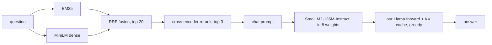

# Week 18 (Days 120-126)

**Status:** Day 120 (the Month-4 capstone and checkpoint exam) is written in full and closes Month 4. Days 121-126 (Month 5 opens: RL fundamentals) are written in full; their numbers come from `code/week-18/day121_*.py` to `day126_*.py` (CPU only, gymnasium 1.4.0, each under about 2 minutes), with logs in `code/week-18/out/`. Day 120's numbers come from `code/week-18/day120_capstone.py`, run once on this box (CPU only, 8 threads, torch 2.15.0+cpu, transformers 5.21.1, about 50 seconds), with its log in `code/week-18/out/day120_capstone.log`.

**Compute note.** The capstone runs on CPU because every model is small: the MiniLM embedder and cross-encoder, and SmolLM2-135M-Instruct. The int8 quantisation is simulated: weights are rounded and then stored in fp32 again, so it shows quality loss but no speed-up. On a GPU, or with a real int8/int4 kernel (for example llama.cpp, which this box cannot build because it has no `g++` or `cmake`), you would also measure memory and speed gains, and you could use a larger generator. That matters most here, because the generator is where this system fails.

**Models and data.** These are the same verified, locally cached models as Week 17: `sentence-transformers/all-MiniLM-L6-v2`, `cross-encoder/ms-marco-MiniLM-L6-v2` and `HuggingFaceTB/SmolLM2-135M-Instruct`. The corpus is `weeks/week-01.md` to `week-16.md`. Nothing new was downloaded.

---

## Day 120: MONTH-4 CAPSTONE: an end-to-end LLM question-answering system, plus the Month-4 checkpoint exam
**Review today:** Day 119 (+1), Day 117 (+3), Day 113 (+7), Day 99 (+21; quick 15-min skim of its self-check).

### Block 1: Concept lesson (1h15)
**What the capstone is.** Month 4 built the parts of a modern LLM stack from the inside:
- attention, the transformer block and a tiny GPT (Weeks 13-14);
- BPE, Hugging Face models, fine-tuning and LoRA (Weeks 14-15);
- preference tuning with DPO and evaluation pitfalls (Week 16);
- retrieval, quantisation and serving (Week 17).

Today you put the parts into one system and, more importantly, **evaluate it like an engineer**. The system answers questions about these course notes:

Every component is code you wrote: `_rag.py` (chunking, embeddings, BM25), `_quant.py` (RTN quantisation) and `_tinyllama.py` (the forward pass and KV cache), all from Week 17. The capstone script only wires them together.

**How to evaluate a system, not a model.** Measure each stage separately, then end to end:
1. **Retrieval quality**: recall@k on questions with known answers. Here that is the 58 held-out interview questions from the notes; their own sections are removed from the index, so the system cannot simply find the question text.
2. **Context recall**: for the 12 factual questions, is the answer string in the 3 chunks given to the model?
3. **Answer accuracy**: does the answer contain the gold string?
4. **Behaviour change from compression**: do the int8 answers match the fp32 answers?
5. **Correctness of your own components**: does your decoder give the same text as a reference (Hugging Face `generate`)?
6. **Latency breakdown**: retrieval, prefill and decode, since each is optimised differently.
7. **Failure analysis**: sort every wrong answer into "retrieval miss" (the answer was not in the context) or "generation error" (it was there and the model got it wrong). Then read every one.

**Honest reporting.** State the sample sizes, show the failures next to the successes, say what was simulated, and do not claim more than the numbers support. With 12 questions, one question is 0.08 of accuracy.

### Block 2: Worked example (45 min)
Run `code/week-18/day120_capstone.py`. It takes about 50 seconds on this box.

**Verified (out/day120_capstone.log):**
- Index: 1,037 chunks from 112 days, built in 9.8 s.
- Retrieval (hybrid + rerank) on 58 held-out questions: **recall@1 0.48, recall@5 0.79**, 214 ms per query.
- Our KV-cache decoder produced exactly the same answer as HF `generate` on the int8 model for Q1 (`True`).

| Generator | Accuracy (12 Q) | Mean prompt | Prefill | Decode speed | Mean answer length |
|---|---|---|---|---|---|
| fp32 | 0.25 | 816 tokens | 330 ms | 60.4 tok/s | 26.6 tokens |
| int8 per-channel | 0.25 | 816 tokens | 313 ms | 61.1 tok/s | 28.3 tokens |

- int8 answers identical to the fp32 answers: 9 of 12.
- **Failure categories (int8 system):** 3 correct, 1 retrieval miss, **8 generation errors** (the answer was in the context).

**Examples from the log:**

| Question | Category | Gold answer | What the model said |
|---|---|---|---|
| Q03 | correct | 0.70 | "SFT on chosen answers reached 0.70…" |
| Q04 | generation error | 32.05 | "…got 192 perplexity…" |
| Q06 | generation error | 2,442,817 | "…had 2 trainable parameters…" |
| Q07 | retrieval miss | [0.07, 0.30] | a different interval |
| Q12 | generation error | −10.3 | "…120.8 nats…" |

**Reading the results:**
- **Retrieval is good enough:** 0.79 recall@5 on held-out questions, and 11 of 12 factual questions had their answer in the top 3.
- **The generator is the bottleneck.** In 8 of 12 cases it had the answer in front of it and still produced a wrong number, often a number copied from elsewhere in the context, or an invented one.
- **int8 did not change accuracy or speed.** Speed did not change because the weights were dequantised to fp32. It did change 3 of 12 answers.
- **Latency:** per question, about 0.2 s goes to retrieval and 0.3 s to prefill, then about 0.45 s to decode the roughly 27 answer tokens at about 60 tok/s.
- **Next step:** improving the system means a stronger generator, not better retrieval.

### Block 3: Lab (2h)
Build, then write the report.
1. **Reproduce:** run the script and check every number against the log.
2. **Extend:** add int4 group-64 with the AWQ-style scaling from Day 117 as a third generator, and report accuracy and agreement with fp32.
3. **Grounding check:** for each answer, list the numbers it contains and test whether each appears in the context. How many answers contain a number found nowhere in the context (a hallucination)?
4. **Prompt ablation:** try k = 1 against k = 3 chunks, and an instruction such as "Reply with only the number". Keep the 12 questions fixed. Note that this is now tuning on the test set, so label the results as exploratory.
5. **Write the report** (`code/week-18/out/report.md`, one to two pages):
   - the diagram;
   - a table per stage;
   - the failure table with every question;
   - three findings, each backed by a number;
   - limits;
   - what you would do with a GPU.

### Block 4: Practice (1h)
1. Context recall was 11 of 12, but accuracy was 3 of 12. Which component would you change first, and why?
2. Why check your decoder against HF `generate`?
3. int8 kept accuracy at 0.25 but changed 3 of 12 answers. How can both be true?
4. Why is the 12-question accuracy weak evidence, and how would you strengthen it?
5. Which latency stage would batching help most, and which would a smaller reranker help?

**Answers.**
1. The generator. Retrieval already delivers the answer in 11 of 12 prompts, so better retrieval could add at most one correct answer.
2. It is a correctness test for your own code. A silent bug in RoPE positions or the cache would otherwise look like "the model is bad".
3. The changed answers were wrong before and after, or switched between wrong variants. Accuracy only counts the contains-gold result.
4. One question equals 0.08, so a confidence interval would be very wide (Day 110). Use more questions, written independently of the notes' author, and normalise answer strings.
5. Batching helps decode throughput across users (Day 118), and a smaller reranker would cut the roughly 0.2 s retrieval stage.

### Block 5: Review (1h)
Self-check:
- [ ] My capstone reproduces the log: recall@5 0.79, accuracy 0.25, 8 generation errors.
- [ ] I can draw the system and name the week where each part was built.
- [ ] I can explain the failure categories and why generation dominates.
- [ ] I wrote the report with honest limits.
- [ ] I completed the Month-4 checkpoint exam below without notes, then marked it.

### Extra notes
**Limits:**
- The QA set is small (12) and was written by the same author as the notes.
- Accuracy is measured by string containment, so "2442817" written without commas would count as wrong.
- The generator is tiny.
- Quantisation is simulated.
- No GPU was used, and no production server (vLLM, llama.cpp) was run; llama.cpp cannot be built here without `g++`/`cmake`.

These limits are not embarrassing. Stating them is part of the deliverable.

### Going deeper
- Re-read the RAG paper (Lewis et al., 2020) and the PagedAttention paper (Kwon et al., 2023) with your system in mind.
- Compare your metrics with a RAG evaluation framework's (for example RAGAS: context recall, faithfulness, answer relevance).

### Interview-style question (15 min)
"Describe an LLM system you built end to end and what limited its quality." Use this capstone:
- the components and the week each came from;
- recall@5 0.79 and context recall 11/12, against accuracy 3/12;
- the diagnosis that the generator caused 8 of the 9 errors;
- the int8 result (same accuracy, 9/12 identical answers, no speed change because it is simulated);
- what you would change with more compute.

### Common mistakes
- Reporting only one end-to-end number.
- Not testing your own decoder against a reference.
- Hiding the failure cases, or tuning prompts on the 12 test questions and reporting the result as final.

### What to do next
Month 5 starts on Day 121 with reinforcement learning. Before then, review the Month-4 flashcards (`flashcards/month-04.csv`).

---

## Month 4 checkpoint exam (15 questions; 90 minutes; closed notes, then mark yourself)
1. Write scaled dot-product attention and explain the √d_k factor.
2. What does RoPE do to queries and keys, and why does it give relative-position behaviour?
3. Draw a pre-norm transformer block (attention and MLP sub-layers with residuals).
4. How does BPE build its vocabulary?
5. What is perplexity, and how does it relate to cross-entropy?
6. What does LoRA train, and how many parameters does a rank-r adapter on a d×k matrix add?
7. Why are only assistant tokens included in the SFT loss with a chat template?
8. Write the Bradley-Terry preference probability, and say what a reward model learns from it.
9. Write the DPO loss. What role does β play?
10. Name three pitfalls in LLM evaluation from Week 16.
11. Why does hybrid retrieval (BM25 + dense) often beat either one alone?
12. Why does int4 per-tensor quantisation fail while group-wise int4 works?
13. What problem do GPTQ and AWQ solve that plain RTN does not, and how does each approach it?
14. Why does a KV cache speed up decoding, and what is its memory cost per token?
15. In the capstone, retrieval delivered the answer in 11 of 12 prompts, but accuracy was 3 of 12. What do you conclude, and what are the main limits of that conclusion?

### Answers
1. softmax(QKᵀ/√d_k)V. Without the scaling, the dot products of unit-variance vectors have standard deviation √d_k, which saturates the softmax.
2. It rotates each pair of query and key dimensions by an angle proportional to the token's position. The dot product of rotated q and k then depends only on the position difference.
3. x → x + Attn(Norm(x)) → x + MLP(Norm(x)); a final norm comes before the output head.
4. Start from characters or bytes, then repeatedly merge the most frequent adjacent pair into a new token until the vocabulary reaches its target size.
5. Perplexity = exp(mean cross-entropy per token in nats). It is the "effective number of choices" per token.
6. It trains low-rank matrices B (d×r) and A (r×k) with W' = W + (α/r)·BA, while W stays frozen. That adds r(d + k) parameters.
7. The model should learn to produce answers, not to predict the user's prompt. Masking the user and system tokens focuses the gradient on the responses.
8. P(a ≻ b) = σ(r(a) − r(b)). The reward model learns a scalar score whose differences predict human (or labelled) preferences.
9. −log σ(β[(log π(y_w) − log π_ref(y_w)) − (log π(y_l) − log π_ref(y_l))]). β sets how strongly the policy may move away from the reference (it acts like a KL strength).
10. Any three of:
    - test-set contamination;
    - tiny eval sets with wide confidence intervals;
    - LLM-judge biases (position, length, self-preference);
    - prompt-format sensitivity;
    - string-match brittleness.
11. They make different errors: BM25 matches rare exact terms, while dense retrieval matches paraphrases. Rank fusion combines both without calibrating scores (Week 17: recall@5 0.67 for BM25 and 0.64 for dense alone, 0.76 fused).
12. Outlier weights set a single huge scale, so most weights round to zero (Day 116: perplexity 1,561,367.93). Group-wise scales follow the local range (group-64: 36.89, against 26.29 for fp32).
13. RTN ignores the inputs, but output error depends on the activations. GPTQ compensates the rounding error in the remaining weights using the Hessian XᵀX. AWQ scales up the weight channels that meet large activations. On Day 117, int4 per-channel perplexity fell from 64.84 (RTN) to about 44 with both methods.
14. Past keys and values do not change, so each decode step processes only the new token (Day 118: 27.3 → 67.8 tok/s). Memory per token is 2 × layers × KV heads × head dim × bytes; for SmolLM2 that is 23.6 MB per sequence at 512 tokens in fp32.
15. The generator, not retrieval, limits quality (8 of 9 errors were generation errors). Limits:
    - only 12 questions, written by the notes' author;
    - string-match scoring;
    - one tiny model;
    - simulated quantisation;
    - CPU only.

---

## Day 121: MDPs, returns and Bellman equations
**Review today:** Day 120 (+1), Day 118 (+3), Day 114 (+7), Day 100 (+21; quick 15-min skim of its self-check).

### Block 1: Concept lesson (1h15)
Month 5 opens with reinforcement learning (RL). Until now every model learned from a fixed dataset of inputs and targets. In RL there is no dataset: an **agent** acts in an **environment**, gets a **reward** after each action, and must find behaviour that collects as much reward as possible over time. The data the agent sees depends on what it does, so exploring and learning are tied together.

The standard formal model is the **Markov decision process (MDP)**. It has a set of states S, a set of actions A, a transition function p(s', r | s, a) that gives the probability of landing in state s' with reward r after taking action a in state s, and a discount factor γ between 0 and 1. "Markov" means that the next state depends only on the current state and action, not on the earlier history. If the history matters, you must put the parts that matter into the state.

An **episode** runs from a start state until a terminal state is reached. The **return** from time t is the discounted sum of future rewards: G_t = r_{t+1} + γ r_{t+2} + γ² r_{t+3} + … With γ < 1, rewards far in the future count less, and the sum stays finite even if an episode never ends. When every reward is −1, the return can never be below −1/(1−γ). With γ = 1 you need episodes that are guaranteed to end.

A **policy** π(a | s) gives the probability of each action in each state. The **state-value function** V^π(s) is the expected return when you start in s and follow π. The **action-value function** Q^π(s, a) is the expected return when you take a in s first and follow π after that. These are the two objects that nearly every RL method estimates.

The **Bellman expectation equation** is a consistency condition. The value of a state equals the expected immediate reward plus the discounted value of the next state:
V^π(s) = Σ_a π(a|s) Σ_{s',r} p(s',r|s,a) [r + γ V^π(s')].
For a finite MDP this is a linear system: V = r_π + γ P_π V, so V = (I − γ P_π)^{-1} r_π. You can solve it exactly with a linear solve, or iteratively by sweeping the update until the values stop changing. That iterative version is **policy evaluation**, the first dynamic-programming method (Day 122).

The **Bellman optimality equation** replaces the average over actions with a maximum: V*(s) = max_a Σ p(s',r|s,a)[r + γ V*(s')]. This equation is not linear, and solving it is the subject of Day 122.

Three design choices matter in practice. First, the **reward** says *what* you want, not *how* to do it. A −1 per step reward means "finish fast". Second, **γ** is part of the problem definition: it changes which policy is best, not only how fast learning goes. Third, **stochastic transitions** (slipping) make good plans worth less, and they hurt some plans more than others.

### Block 2: Worked example (45 min)
Everything runs on small tabular environments written from scratch in `code/week-18/_rl.py`. Transitions are stored as `P[s][a] = [(prob, s', reward, done)]`, the same layout gymnasium uses for its toy-text environments. The action order is left, down, right, up, which matches gymnasium's FrozenLake. The gridworld is 4x4, with terminal corners at states 0 and 15 and a reward of −1 per step. `day121_mdp_bellman.py` evaluates the uniform random policy three ways.

**Verified (out/day121_mdp_bellman.log):**
- Exact linear solve (γ = 1): 11.19 ms. Iterative policy evaluation: 342 sweeps, 2.2 ms. Maximum difference between the two: 1.7e-07.
- V_random by row: [0 −14 −20 −22], [−14 −18 −20 −20], [−20 −20 −18 −14], [−22 −20 −14 0]. A random walker next to a goal still needs 14 steps on average.
- Monte Carlo check from state 1 (2,000 sampled episodes): −13.97 ± 0.73, against −14.00 exact. Episode lengths ranged from 1 to 145 steps.
- Discounting, with the bound −1/(1−γ):

| γ | V(1) | V(7) | Bound |
|---|---|---|---|
| 0.5 | −1.69 | −1.95 | −2 |
| 0.9 | −5.28 | −7.13 | −10 |
| 0.99 | −11.95 | −16.96 | −100 |

- A fixed "go down, then right" policy under slip:

| slip | V(1) | V(4) |
|---|---|---|
| 0 | −5.00 | −5.00 |
| 0.2 | −5.73 | −6.40 |
| 0.5 | −7.87 | −10.81 |

Slip costs state 4 more than state 1, because the same plan is a worse fit from there.

### Block 3: Lab (2h)
1. Read `_rl.py` and draw the 4x4 grid with its state numbers. Check by hand that `P[5][2]` (right, from state 5) leads to state 6 with reward −1.
2. Run `python day121_mdp_bellman.py` from `code/week-18` with the venv active. Compare your output with the log.
3. Write a function that builds P_π and r_π for any policy array and solves V = (I − γP_π)^{-1} r_π. Check it against the iterative version.
4. Change the step reward to −2 and predict what happens to V before you run it. Every value should double.
5. Add a "wall" state: moving into it leaves you where you are. Check that V changes only near the wall.

### Block 4: Practice (1h)
1. γ = 0.9 and every reward is +1 forever. What is V? **Answer:** 1/(1−0.9) = 10.
2. Why does iterative evaluation need 342 sweeps here when the exact solve needs none? **Answer:** with γ = 1 the error shrinks only as fast as the random walk reaches a terminal state, which is slow. The linear solve does all of that work at once.
3. Is V_random symmetric? **Answer:** yes. The grid and the terminal corners are symmetric, so V(1) = V(4) = −14 and so on.
4. Why does the γ = 0.99 value of state 7 (−16.96) sit far above its bound of −100? **Answer:** episodes end, usually long before discounting makes a difference.

### Block 5: Review (1h)
Self-check: (a) define return, V, and Q in one line each; (b) write the Bellman expectation equation from memory; (c) explain why the Monte Carlo estimate has a ± term and the linear solve does not; (d) give one example where the Markov property fails and say how to fix the state.

### Extra notes
- Infinite horizon with γ < 1 and episodic with γ = 1 are both standard settings. Mixing them up gives values that never converge.
- Rewards can be scaled without changing the best policy, but a constant added to every reward does change behaviour in episodic tasks: it changes how much ending early is worth.

### Going deeper
Write out Q^π in terms of V^π, and V^π in terms of Q^π. Note that the second only needs π and not the model. That is why model-free control (Day 123) learns Q and not V.

### Interview-style question (15 min)
"Your agent learns to loop forever instead of finishing the task. What do you check?" Good answer: the reward (are there positive rewards that can be collected again and again?), γ (with γ close to 1, small repeated rewards add up), the terminal conditions, and whether the state includes what the agent needs to know.

### Common mistakes
- Bootstrapping from a terminal state's value. A terminal state's value must be zero.
- Action orders that do not match between your code and a library. This course hit exactly that bug on Day 122.
- Reporting V(start) as a "success rate". It is a discounted expected return.

### What to do next
Day 122 turns the Bellman equations into algorithms that find the best policy when the model is known.

---

## Day 122: Dynamic programming: policy evaluation, value iteration and policy iteration
**Review today:** Day 121 (+1), Day 119 (+3), Day 115 (+7), Day 101 (+21; quick 15-min skim of its self-check).

### Block 1: Concept lesson (1h15)
**Dynamic programming (DP)** solves an MDP when you know the full model p(s', r | s, a). It is not learning from experience. It is planning, and it is the reference that every learning method is measured against this week.

**Policy evaluation** (Day 121) computes V^π for a fixed π. **Policy improvement** then makes π greedy with respect to V^π: in each state, pick the action with the highest one-step lookahead value, Σ p(s',r|s,a)[r + γV^π(s')]. The *policy improvement theorem* says the new policy is at least as good everywhere. **Policy iteration (PI)** alternates the two steps until the policy stops changing. A finite MDP has finitely many deterministic policies and each step improves, so PI stops, usually after only a handful of iterations.

**Value iteration (VI)** skips full evaluation. It applies the Bellman optimality update V(s) ← max_a Σ p[r + γV(s')] once per sweep, until the largest change is below a tolerance. Each sweep is cheap, but with γ close to 1 it needs many sweeps, because the update shrinks the error only by about a factor of γ per sweep.

In matrix form the model is T[s, a, s'] and R[s, a] (built by `_rl.model`, with transitions out of terminal states set to zero). One VI sweep is then `Q = R + γ T @ V; V = Q.max(1)`. That is a single tensor contraction, which is why tabular DP is so fast on a CPU.

DP has two hard limits. It needs the model, and it touches every state on every sweep. A table with 10^12 states does not fit in memory. Days 123-125 remove each limit in turn: sampling removes the need for a model, and function approximation removes the need for a table.

**FrozenLake** is the test bed. An agent crosses a frozen lake from S to G. H marks holes, which end the episode with reward 0. Reaching G gives reward 1. On the slippery lake, the agent moves in the intended direction or either perpendicular direction with probability 1/3 each. The optimal policy is often strange: it sometimes points *away* from the goal so that the only possible slips are safe ones.

### Block 2: Worked example (45 min)
`day122_dynamic_programming.py` builds our own FrozenLake table, compares it with gymnasium's, and runs VI and PI, using gymnasium 1.4.0 (installed and checked on this box).

**Verified (out/day122_dynamic_programming.log):**
- 4x4 gridworld, optimal V after 4 sweeps: [0 −1 −2 −3], [−1 −2 −3 −2], [−2 −3 −2 −1], [−3 −2 −1 0]. That is minus the number of steps to the nearest corner.
- Our FrozenLake table equals gymnasium's: True, for both maps.
- Slippery FrozenLake (success is the greedy policy's success rate when run in gymnasium for 2,000 episodes):

| Map | γ | VI sweeps | VI time | PI iterations | PI time | V(start) | Success |
|---|---|---|---|---|---|---|---|
| 4x4 | 0.9 | 145 | 0.8 ms | 6 | 0.9 ms | 0.069 | 0.733 |
| 4x4 | 0.99 | 571 | 2.8 ms | 7 | 0.2 ms | 0.542 | 0.741 |
| 8x8 | 0.9 | 158 | 2.0 ms | 10 | 0.5 ms | 0.006 | 0.596 |
| 8x8 | 0.99 | 662 | 7.8 ms | 9 | 0.5 ms | 0.415 | 0.632 |

- max|V_VI − V_PI| was 1e-9 or less in every case.
- Optimal 4x4 actions (γ 0.99; L = left, D = down, R = right, U = up): LUUU / LHLH / UDLH / HRDG. Note the "U" in the top row: pushing into the wall means you can only slip sideways, never into a hole.
- Non-slippery 4x4: V(start) 0.951 = 0.99^5, found in 7 sweeps.

Why success is not V(start): gymnasium cuts episodes off at 100 steps (logged), and V is discounted. With γ = 0.9, a slow, safe path is worth almost nothing (0.006), but it still succeeds about 60% of the time.

### Block 3: Lab (2h)
1. Run the script and reproduce the table.
2. **Debugging story.** The first run printed "table == gymnasium: False" and a success rate of 0.000. The cause was an action order in `_rl.A` that did not match gymnasium's (left, down, right, up). Break `_rl.A` again on purpose, watch the check fail, and then restore it. Always write a check like this when your code talks to a library.
3. Implement *modified* policy iteration: k evaluation sweeps per improvement step. Try k = 1 (which is VI) and k = 20, and count total sweeps.
4. Print the 8x8 optimal policy and mark which arrows point away from G.

### Block 4: Practice (1h)
1. Why does VI need about 4x more sweeps at γ 0.99 than at 0.9 (571 vs 145)? **Answer:** the error shrinks by about γ per sweep, so reaching the tolerance takes roughly log(tol)/log(γ) sweeps. That number grows quickly as γ approaches 1.
2. PI ran in fewer iterations, but each one solves a linear system. When does VI win? **Answer:** for large state spaces, where the O(S³) solve is too expensive and a cheap approximate sweep is enough.
3. Why does a larger γ raise the success rate on 8x8 (0.596 to 0.632)? **Answer:** with a small γ, the agent cares less about a far-off goal and accepts riskier or more aimless moves. With γ 0.99, it pays to be patient and safe.

### Block 5: Review (1h)
Self-check: (a) state the policy improvement step; (b) explain why PI terminates; (c) give one VI sweep as a single line of numpy; (d) explain why V(start) ≠ success rate.

### Extra notes
- A greedy policy has ties. `argmax` picks the first one. Ties do not change V, but they can change the arrows you print.
- An "in-place" (Gauss-Seidel) sweep uses new values straight away and usually converges in fewer sweeps.

### Going deeper
Asynchronous DP updates only the states an agent actually visits. Taken to the limit, with sampled rather than full backups, this is exactly where Day 123's methods come from.

### Interview-style question (15 min)
"You have the full model of a 1,000-state MDP. Would you use RL?" Good answer: no. Solve it with VI or PI in milliseconds, and use RL only when the model is unknown or the state space is too large.

### Common mistakes
- Letting terminal states keep receiving value.
- Using a convergence threshold on the policy in VI. Use one on V.
- Checking only V and never running the policy in the real environment.

### What to do next
Day 123 drops the model and learns from sampled episodes.

---

## Day 123: Monte Carlo and TD learning; Q-learning vs SARSA
**Review today:** Day 122 (+1), Day 120 (+3), Day 116 (+7), Day 102 (+21; quick 15-min skim of its self-check).

### Block 1: Concept lesson (1h15)
Without a model you learn from samples. **Monte Carlo (MC)** prediction waits until the episode ends and moves V(s) towards the actual return G: V(s) ← V(s) + α (G − V(s)). The target is unbiased but noisy, because G is a sum of many random rewards.

**Temporal-difference learning, TD(0)**, updates after every step, using its own estimate of the next state: V(s) ← V(s) + α (r + γV(s') − V(s)). The quantity in brackets is the **TD error** δ. TD is biased (it bootstraps from estimates that may be wrong) but has much lower variance. It also works on episodes that never end. In practice, TD often learns faster.

For **control**, learn Q(s, a) instead, so that you can act greedily without a model. The agent must also explore, usually **ε-greedy**: a random action with probability ε, and otherwise the best one.

- **SARSA** (on-policy) uses the action it will actually take next: target r + γQ(s', a'). It learns the value of the ε-greedy policy it is following, *including* its own random mistakes.
- **Q-learning** (off-policy) uses the best next action: target r + γ max_a Q(s', a). It learns the value of the greedy policy, even though it behaves ε-greedily.

**Cliff walking** shows the difference. A 4x12 grid has a cliff along the bottom edge: stepping off costs −100 and sends you back to the start, and every other step costs −1. The shortest path runs along the cliff edge. Q-learning learns that path, but while exploring with ε = 0.1 it sometimes falls off. SARSA takes those exploration slips into account and learns a safer path further from the edge.

### Block 2: Worked example (45 min)
`day123_mc_td_qlearning.py` runs two experiments. The first is a 5-state random walk: start in the middle, reward +1 only for leaving on the right. Its true values are 1/6 … 5/6. The second is cliff walking, built from scratch in `_rl.cliff`.

**Verified (out/day123_mc_td_qlearning.log):** RMS error on the random walk, mean of 10 seeds:

| Method | α | After 10 episodes | After 50 | After 100 |
|---|---|---|---|---|
| MC | 0.01 | 0.209 | 0.143 | 0.098 |
| MC | 0.03 | 0.178 | 0.099 | 0.099 |
| TD | 0.05 | 0.175 | 0.065 | 0.036 |
| TD | 0.1 | 0.128 | 0.062 | 0.058 |
| TD | 0.15 | 0.094 | 0.076 | 0.072 |

Every TD setting beats every MC setting by episode 50. A larger α learns faster at first and then levels off at a higher error. That is the noise floor of a constant step size, and MC α 0.03 shows it too, staying at 0.099.

Cliff walking (ε 0.1, α 0.5, 500 episodes, 10 seeds):

| Algorithm | Online return, episodes 1-50 | Episodes 401-500 | Time |
|---|---|---|---|
| Q-learning | −118.3 | −53.0 | 0.8 s |
| SARSA | −116.6 | −28.8 | 0.9 s |

- Greedy path returns per seed: Q-learning scored −13 in all 10 seeds (the optimal cliff-edge path).
- SARSA scored −17 in 8 seeds and −19 in 1, both safer and longer routes. The remaining seed scored −100: its greedy policy looped until the 100-step cap.

So Q-learning has the better *final greedy* policy but the worse *online* return. SARSA is better while exploring, but its greedy policy is not always valid. Both facts come from the same run.

### Block 3: Lab (2h)
1. Run the script. Plot RMS error against episode count for one MC and one TD setting.
2. Implement **Expected SARSA**, whose target is r + γ Σ_a π(a|s')Q(s', a), and add it to the cliff experiment.
3. Decay ε to 0 over the 500 episodes. Predict whether SARSA's greedy path moves towards the edge, then check.
4. Find the looping SARSA seed and print its greedy arrows near the start. Explain the loop: Q-values that are tied or barely updated in states visited rarely.

### Block 4: Practice (1h)
1. Why is the MC target unbiased and TD's biased? **Answer:** G is a sample of the true return, while r + γV(s') uses a current estimate V(s') that may be wrong.
2. Why is SARSA's online return better on the cliff? **Answer:** it learns values that include ε-exploration, so it keeps away from the edge where a random step is fatal.
3. If ε → 0, what does SARSA converge to? **Answer:** the optimal policy, the same as Q-learning (given enough exploration along the way).

### Block 5: Review (1h)
Self-check: (a) write the MC, TD(0), SARSA and Q-learning updates; (b) say which ones are on-policy; (c) explain the constant-α plateau; (d) explain why online return and greedy-policy return can disagree.

### Extra notes
- n-step TD and TD(λ) interpolate between TD (n = 1) and MC (n = ∞).
- Q-learning's max causes **maximisation bias** when estimates are noisy. Double Q-learning fixes this, and Day 125's target network is a related idea.

### Going deeper
Prove to yourself that TD(0) with a fixed batch of episodes converges to the value of the maximum-likelihood Markov model, while batch MC converges to the average observed returns. This is why TD uses the Markov structure better.

### Interview-style question (15 min)
"On-policy vs off-policy: which for a robot learning on real hardware?" Good answer: on-policy methods such as SARSA account for the robot's own exploration, which matters when mistakes are expensive. Off-policy methods can reuse old or logged data, which matters when data is expensive. Many real systems learn off-policy in simulation and then fine-tune carefully.

### Common mistakes
- Updating Q(s', ·) instead of Q(s, a).
- Using Q(s', a') after a terminal step. The target there is just r.
- Judging an algorithm on one seed.

### What to do next
Day 124 replaces the table with a function, so that values generalise between states.

---

## Day 124: Function approximation: from tables to features
**Review today:** Day 123 (+1), Day 121 (+3), Day 117 (+7), Day 103 (+21; quick 15-min skim of its self-check).

### Block 1: Concept lesson (1h15)
A table has one entry per state and nothing carries over from one state to another. Real problems have continuous states (CartPole's four numbers) or far too many states to list. **Function approximation** represents V(s) ≈ v̂(s, w) or Q(s, a) ≈ q̂(s, a, w), with a weight vector w that is much smaller than the state space. Each update changes the value of many similar states at once. That is generalisation, the same idea as supervised learning in Months 2-3.

The prediction objective is the mean squared value error, weighted by how often each state is visited. **Gradient MC** treats the return G as a supervised target: w ← w + α (G − v̂(s,w)) ∇v̂(s,w). That is ordinary SGD, and it converges to a local optimum of this error.

**Semi-gradient TD** uses the target r + γ v̂(s', w) but treats it as a constant when taking the gradient. That is why it is called "semi". It is not true gradient descent on any objective. With linear features it still converges, but to the *TD fixed point*, which can be worse than the best possible approximation. It does usually converge faster.

With **linear** approximation, v̂ = wᵀφ(s), and the gradient is just the feature vector φ(s). Common features are:
- **State aggregation:** group states and give each group one weight. Tabular learning is the special case with one group per state.
- **Tile coding / coarse coding:** several overlapping grids.
- **Random Fourier features:** φ(s) = cos(Ws + b), with W and b drawn at random. They are smooth and work like an RBF kernel. Their *bandwidth*, the scale of W relative to the state units, controls how far each update spreads.

For control, the same idea gives **semi-gradient Q-learning**: w_a ← w_a + α δ φ(s). Combining *function approximation*, *bootstrapping* and *off-policy* learning is called the **deadly triad**. Together these three can make learning diverge, and Day 125's DQN is largely a set of tricks against it.

### Block 2: Worked example (45 min)
`day124_function_approx.py` runs two experiments.

**(1)** A 1000-state random walk. Each step jumps up to 100 states left or right. Leaving on the left gives −1 and leaving on the right gives +1. The true V comes from a linear solve. Both methods use 10 aggregated groups of 100 states and 5,000 episodes.

**(2)** Linear semi-gradient Q-learning on gymnasium CartPole-v1, with 256 random Fourier features, a step size normalised by ‖φ‖², 300 episodes, and ε decaying from 1 to 0.01 over 150 episodes. The greedy policy is evaluated on 20 episodes, with 500 as the cap.

**Verified (out/day124_function_approx.log):**
- Gradient MC (α 5e-4): RMS error 0.061. Semi-gradient TD (α 2e-3): RMS error 0.131. The best possible with this aggregation is 0.053. MC gets close to the best approximation, and TD settles at its own biased fixed point. TD's weights (−0.71 … 0.70) are flatter than MC's (−0.85 … 0.81).
- A first run used step sizes 100x smaller and left the weights far from converged, with RMS errors of 0.364 and 0.414. It is not kept as a result, but it is a useful warning: check convergence before you compare methods.
- CartPole, feature scale [2.4, 3.0, 0.21, 3.0] (the state bounds), α 0.01: this **failed** in all 3 seeds. The last 50 training episodes averaged 9.4-9.5 steps and greedy evaluation averaged 9.3-9.4, which is what you get by always pushing the same way.
- CartPole, feature scale [0.5, 0.5, 0.05, 0.5] (narrower, so the features are more local), α 0.1: greedy evaluation averaged **500.0 (the cap) in all 3 seeds**. The last 50 training episodes averaged 500.0, 433.0 and 500.0. Each seed took 1.5-2.0 s on CPU.

The only difference between failure and success was the feature bandwidth and the step size. Those two hyperparameters decide whether a linear method works.

### Block 3: Lab (2h)
1. Run the script and reproduce the log.
2. Change the number of groups to 5, 20 and 50. Record the "best possible" error and the MC error. More groups gives a lower floor but slower learning.
3. Replace aggregation with polynomial features of s/1000, and compare.
4. On CartPole, sweep feature scale × {0.5, 1, 2} and α ∈ {0.03, 0.1, 0.3} over 3 seeds. Report the fraction of runs that solve the task, not the best run.

### Block 4: Practice (1h)
1. Why is semi-gradient TD not true SGD? **Answer:** the target depends on w, but its gradient is ignored, so the update is not the gradient of any fixed loss.
2. Why did wide features fail on CartPole? **Answer:** with smooth features covering the whole state space, the values of nearby situations where different actions are needed get blurred together, so the greedy action ends up the same everywhere.
3. Why divide by φᵀφ? **Answer:** it makes α roughly "the fraction of the error corrected per step", whatever the feature scale (normalised LMS).

### Block 5: Review (1h)
Self-check: (a) write the gradient MC and semi-gradient TD updates for linear v̂; (b) name the three parts of the deadly triad; (c) explain the gap between 0.131 and 0.053; (d) explain why a single CartPole run that succeeds proves little.

### Extra notes
- Linear methods with good features are a strong baseline: fast, stable, and easy to inspect.
- Normalising the state (as in Month 2) matters just as much in RL.

### Going deeper
Look at least-squares TD (LSTD), which solves for the TD fixed point directly in one linear solve. It is the function-approximation counterpart of Day 121's exact solve.

### Interview-style question (15 min)
"Your linear Q-learner diverges. What do you try?" Good answer: a smaller or normalised step size, feature scaling, on-policy targets, or experience replay with a target network. Also check for a bug in the terminal-state target.

### Common mistakes
- Bootstrapping across episode truncation (time limit) as if it were termination, or the reverse. gymnasium returns them separately; use `terminated`, not `truncated`, to zero the target.
- Comparing methods before they have converged.

### What to do next
Day 125 replaces the linear features with a small neural network: DQN.

---

## Day 125: Deep Q-networks (DQN) on CartPole
**Review today:** Day 124 (+1), Day 122 (+3), Day 118 (+7), Day 104 (+21; quick 15-min skim of its self-check).

### Block 1: Concept lesson (1h15)
DQN is Q-learning with a neural network q̂(s, ·; θ) that outputs one Q-value per action. Feeding neural-network updates straight into Q-learning hits the deadly triad hard. Consecutive samples are strongly correlated, and the target r + γ max q̂(s', ·; θ) moves every time θ changes. DQN adds two stabilisers:

1. **Experience replay.** Store transitions (s, a, r, s', done) in a buffer, and train on random minibatches. This breaks correlations and reuses each sample many times, which makes learning more data-efficient.
2. **Target network.** Compute targets with a frozen copy θ⁻ and copy θ into θ⁻ every C steps. The regression target then stays fixed for a while, so each phase is close to supervised learning.

The loss is the Huber (smooth L1) loss between q̂(s, a; θ) and y = r + γ(1 − done) max_a' q̂(s', a'; θ⁻). It is optimised with Adam. Exploration is ε-greedy, with ε decaying over the first part of training.

Well-known extensions are **Double DQN** (choose the next action with θ and score it with θ⁻, which reduces maximisation bias), **dueling heads**, **prioritised replay** and n-step returns. They are worth knowing by name. This course does not implement them this week.

**CPU vs GPU.** CartPole's network is tiny (4-64-64-2), so a GPU would not speed it up. The time goes on Python environment steps and small-batch overheads. GPUs matter for DQN on images, such as Atari frames through a convolutional network, where each update is far larger.

### Block 2: Worked example (45 min)
`day125_dqn_cartpole.py` setup:
- Network: MLP 4-64-64-2.
- Replay buffer: 20k transitions; batch 64; Adam 1e-3; Huber loss.
- Target network synced every 500 steps.
- ε from 1 to 0.05 over 10k steps.
- 30k environment steps per seed; learning starts after 1k steps.
- Greedy evaluation: 20 episodes after every 10k steps.
- Ablation: no target network, where targets come from the online net.
- `torch.set_num_threads(1)`, because for a net this small more threads only add overhead.

**Verified (out/day125_dqn_cartpole.log):**

| Run | Training episodes | Mean length, last 20 | Greedy eval at 10k / 20k / 30k steps | Time |
|---|---|---|---|---|
| Target net, seed 0 | 307 | 274.9 | 165.2 / **500.0** / 176.8 | 18 s |
| Target net, seed 1 | 411 | 75.5 | 85.5 / 85.2 / 167.1 | 19 s |
| Target net, seed 2 | 332 | 249.8 | 102.6 / 177.9 / 116.7 | 18 s |
| No target net, seeds 0-2 | about 2,800 | 9.2-9.8 | 9.3-9.4 at every checkpoint | 17-18 s |

What this shows:
1. With a target network, DQN clearly learns, from about 9 steps to between 85 and 500. But it is **unstable**: seed 0 reached the 500 cap at 20k steps and then fell back to 176.8. This rise and collapse is the typical DQN behaviour, and it is why people keep the best checkpoint, judged on a separate evaluation.
2. Without a target network, all 3 seeds **collapsed** to the "always push one way" policy, the same failure as Day 124's badly scaled linear run.
3. Day 124's well-tuned linear learner solved CartPole more reliably within this budget. A deep net is not automatically better on a 4-number state.

### Block 3: Lab (2h)
1. Run the script (about 2 minutes) and reproduce one row.
2. Add **Double DQN** (one line in the target), and compare the 30k-step evaluation over 3 seeds.
3. Keep the best checkpoint by evaluation score, and report both the best and the final score.
4. Try a target sync every 100 and every 2,000 steps. Predict the result first.

### Block 4: Practice (1h)
1. Why does replay help? **Answer:** random minibatches are closer to independent samples, and each transition is used many times.
2. Why multiply by (1 − done)? **Answer:** there is no future value after a true terminal state. For a time-limit truncation you should *not* zero the target, and this script stores only `terminated` as done.
3. Why did training without a target net produce about 2,800 short episodes? **Answer:** the policy collapsed early, so every episode lasted about 9 steps, and 30k steps divided by 9-10 is about 3,000 episodes.

### Block 5: Review (1h)
Self-check: (a) write the DQN loss; (b) name the two stabilisers and what each one fixes; (c) explain why evaluation fell from 500 to 176.8; (d) say what a GPU would and would not change here.

### Extra notes
- Report mean and spread over seeds. RL results vary from seed to seed far more than supervised ones.
- Evaluate greedily with fixed seeds, separate from training episodes.

### Going deeper
Read about how DQN was scaled to Atari: frame stacking, reward clipping, and much larger replay buffers. Then list which of those parts a CartPole run does not need.

### Interview-style question (15 min)
"Your DQN's reward climbs and then crashes. What do you do?" Good answer: lower the learning rate, sync the target less often or use soft (Polyak) updates, use Double DQN, enlarge the buffer, clip gradients, keep the best checkpoint, and check the terminal/truncation handling.

### Common mistakes
- Gradients flowing through the target.
- Evaluating with ε > 0 and calling it the policy's score.
- Reading too much into one lucky seed.

### What to do next
Day 126 brings the week together in a model-free vs model-based mini-project.

---

## Day 126: PROJECT W18: model-free agents on FrozenLake 8x8 vs the DP optimum; Quiz 18
**Review today:** Day 125 (+1), Day 123 (+3), Day 119 (+7), Day 105 (+21; quick 15-min skim of its self-check).

### Block 1: Concept lesson (1h15)
The project question is: **how close do model-free learners get to the planning optimum, and how should we measure it?** On FrozenLake 8x8 (slippery, γ 0.99), DP gives the exact answer (Day 122), so learning can be scored against the truth. That is rarely possible in real problems.

There are three metrics, and each answers a different question:
1. **max Q(start) vs V*(start).** Has the agent learned the *values*? SARSA learns the value of its ε-greedy policy, so it should come out below V*.
2. **Policy agreement.** In what fraction of non-terminal states is the greedy action optimal? Count an action as optimal if its one-step lookahead under V* equals the best one, so that ties are allowed.
3. **Greedy success in gymnasium.** How well does the policy actually do in the real environment, with its 100-step limit? Use 2,000 evaluation episodes with fixed seeds.

There is also one *online* metric: the success rate over the last 1,000 training episodes, with ε at 0.05. It is collected in our own environment, with a 200-step cap per episode. Because the cap is longer than gymnasium's 100 steps, online success can come out *higher* than greedy success in gymnasium. Always state the conditions behind a metric.

### Block 2: Worked example (45 min)
`day126_project.py` runs tabular Q-learning and SARSA from scratch: α 0.1, ε from 1 to 0.05 over 80% of the episodes, random tie-breaking, 5,000 and 20,000 episodes, 3 seeds each. The 8x8 map has 64 states and 4 actions.

**Verified (out/day126_project.log):** DP optimum: V(start) 0.415; greedy success in gymnasium 0.643. This is 2,000 episodes with different seeds from Day 122, which measured 0.632 on the same policy, so the evaluation noise is about ±0.01.

| Agent, episodes | max Q(start), seeds 0/1/2 | Policy optimal in | Greedy success (gymnasium) | Online success, last 1000 | Time per seed |
|---|---|---|---|---|---|
| Q-learning, 5k | 0.391 / 0.382 / 0.409 | 79% / 77% / 81% | 0.611 / 0.552 / 0.513 | 0.645 / 0.600 / 0.649 | 4 s |
| SARSA, 5k | 0.260 / 0.249 / 0.249 | 66% / 60% / 79% | 0.484 / 0.322 / 0.551 | 0.640 / 0.582 / 0.602 | 4 s |
| Q-learning, 20k | 0.407 / 0.398 / 0.397 | 74% / 75% / 85% | 0.376 / 0.593 / 0.623 | 0.661 / 0.639 / 0.601 | 15 s |
| SARSA, 20k | 0.289 / 0.283 / 0.287 | 85% / 74% / 81% | 0.571 / 0.466 / 0.565 | 0.641 / 0.624 / 0.664 | 15 s |

Findings, all from this table:
- Q-learning's start value comes close to V* (0.382-0.409 vs 0.415). SARSA's settles about 0.13 lower, as expected for the value of an ε-greedy policy.
- No learned policy reached the DP policy's 0.643. The best was 0.623.
- More episodes did **not** reliably help: Q-learning seed 0 *dropped* from 0.611 to 0.376. With a constant α = 0.1, Q keeps moving, and a few wrong arrows in states the agent rarely visits can send it towards holes.
- Value accuracy, policy agreement and real success disagree with one another, so report all three.

### Block 3: Lab (2h): the project
1. Run the script (about 2 minutes) and reproduce the table.
2. **Improve it.** Pick one: a decaying α (for example 1/(1 + visits)), Expected SARSA, or more episodes with ε → 0. Make a written prediction first, then report all 3 seeds.
3. **Add DQN as a baseline** (optional): one-hot state into Day 125's network. Compare its success and wall-clock time with the tabular methods. Then explain why a table is the right tool for 64 states.
4. Write a one-page report: setup, the table, the three metrics, one failure case with its greedy arrows printed, and what you would do with a GPU. The honest answer is that it would do little for 64 states; GPUs matter for large networks and image observations.

### Block 4: Practice (1h)
1. Why is SARSA's max Q(start) lower? **Answer:** it estimates returns under ε-greedy behaviour, which includes 5% random moves on a slippery lake full of holes.
2. Why can 79% policy agreement still mean much lower success? **Answer:** the 21% of wrong states can lie on the paths the agent actually travels, and on a slippery lake one wrong arrow near a hole costs a lot.
3. Why does Q-learning seed 0 get worse at 20k episodes? **Answer:** a constant step size means Q never settles. Its greedy policy at the moment training stopped was simply a worse one.

### Block 5: Review (1h): Quiz 18
Take the weekly quiz below closed-book (40 minutes), then mark it.

### Extra notes
- This project is a small version of how RL work should be reported: several seeds, an exact or strong baseline, evaluation separate from training, and stated episode limits.
- Policy gradients and REINFORCE move to Week 19, which updates the planned titles in SYLLABUS.md.

### Going deeper
Use the DP solution to compute the *exact* value of each learned policy (policy evaluation with the learned π), and plot it against the gymnasium success rate.

### Interview-style question (15 min)
"How do you know your RL agent is good?" Good answer: compare it with a known optimum or a strong baseline, use several seeds and a greedy evaluation on held-out seeds, state the episode limits and the discount, and look at the failure cases, not just the mean.

### Common mistakes
- Comparing an online ε-greedy score with a greedy score.
- Mixing up training and evaluation environment limits (200 vs 100 steps here).
- Presenting the best seed as the result.

### What to do next
Week 19 covers policy gradients (REINFORCE, baselines, actor-critic), then agents and tool use.

---

## Weekly quiz: Week 18 (12 questions; 40 minutes; covers Days 120-126)
1. (Day 120) In the capstone, retrieval recall@5 was 0.79 but answer accuracy was 0.25. Where did the failure analysis place most errors?
2. (Day 120) Why did the simulated int8 model show no speed-up?
3. (Day 121) Define the return G_t, and give its lower bound when every reward is −1 and γ < 1.
4. (Day 121) Write V^π as a linear solve.
5. (Day 122) What does policy iteration alternate, and why does it terminate?
6. (Day 122) Why did VI take 571 sweeps at γ 0.99 but 145 at 0.9 on 4x4 FrozenLake?
7. (Day 122) Why can V(start) = 0.006 sit next to a success rate of 0.596?
8. (Day 123) Write the SARSA and Q-learning targets. Which one learned the cliff-edge path?
9. (Day 123) Why did a constant-α MC plateau?
10. (Day 124) What is "semi" about semi-gradient TD, and what did it cost on the 1000-state walk?
11. (Day 125) Name DQN's two stabilisers, and say what happened without the target network.
12. (Day 126) Give the three metrics used in the project, and one case where they disagreed.

### Answers
1. Generation: 8 of 12 were generation errors, 1 was a retrieval miss, and 3 were correct.
2. The weights were rounded but stored in fp32 again, so the arithmetic was the same. It showed quality loss only.
3. G_t = Σ_k γ^k r_{t+k+1}; the lower bound is −1/(1−γ).
4. V = (I − γP_π)^{-1} r_π.
5. It alternates policy evaluation and greedy improvement. Each step improves the policy, and a finite MDP has finitely many deterministic policies.
6. The error shrinks by about γ per sweep, so the number of sweeps needed grows as γ approaches 1.
7. V is discounted (γ 0.9 makes a long, safe path worth almost nothing), while success counts any arrival within gymnasium's 100-step limit.
8. SARSA: r + γQ(s', a'). Q-learning: r + γ max_a Q(s', a). Q-learning learned the edge path (−13 in all 10 seeds).
9. Each update moves V a fixed fraction towards a noisy return, so the error stops falling at a noise floor (MC α 0.03 stayed at 0.099).
10. It ignores the target's dependence on w. It converged to a biased fixed point: RMS error 0.131, against 0.061 for MC and a best possible of 0.053.
11. Experience replay and a target network. Without the target network, all 3 seeds collapsed to about 9-step episodes.
12. max Q(start) vs V*, policy agreement, and greedy success in gymnasium. Example: Q-learning seed 0 at 20k episodes had max Q 0.407 (close to 0.415) but only 0.376 success.
